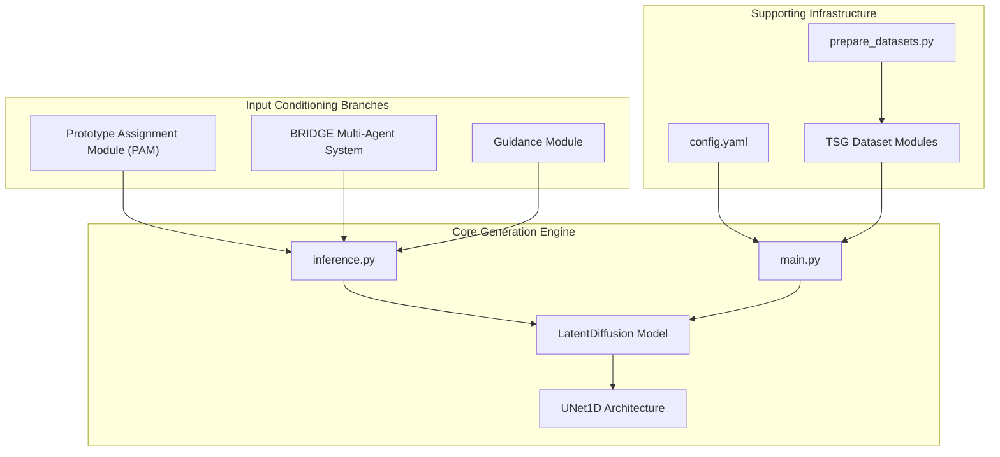
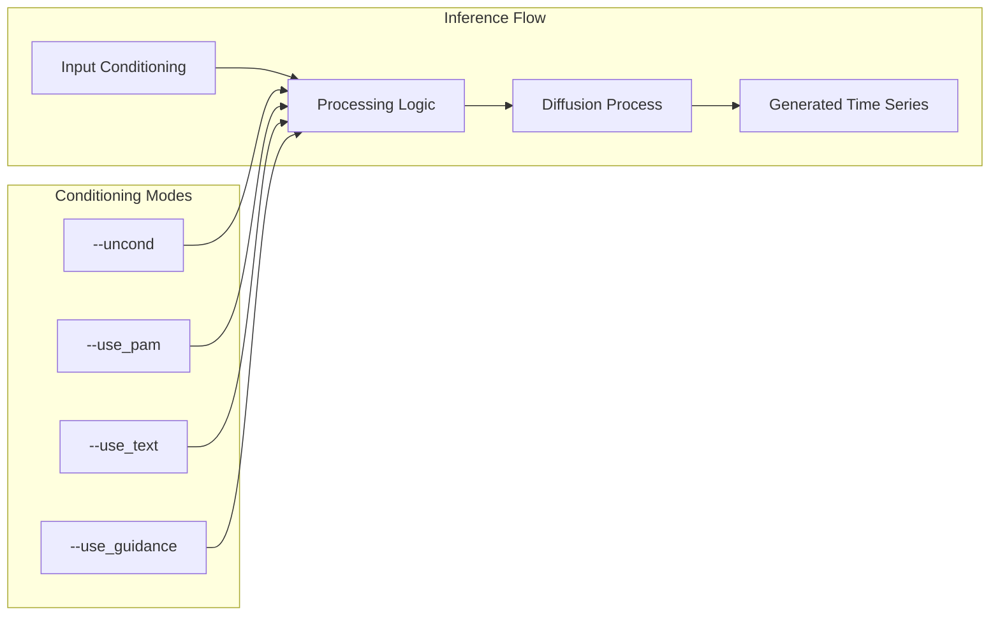
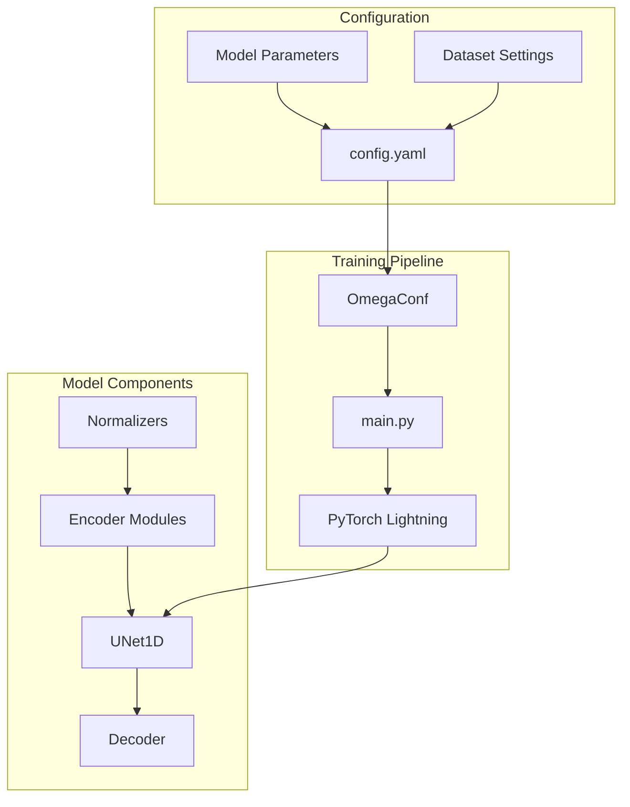
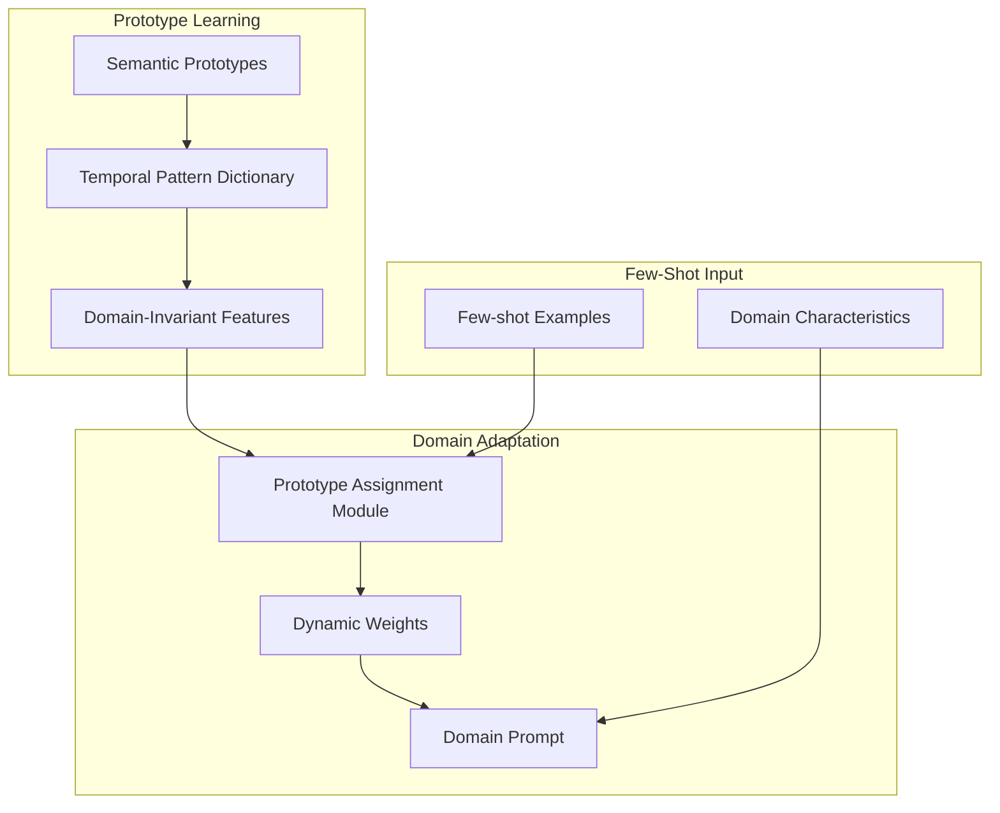
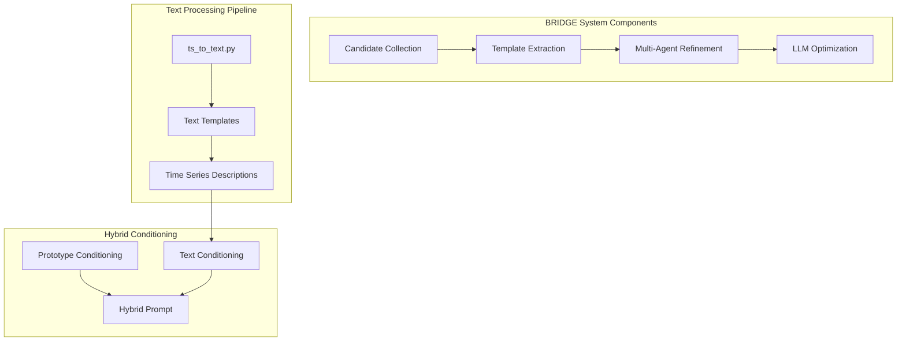
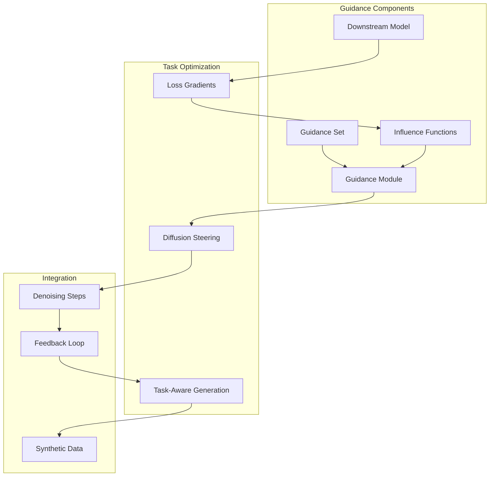
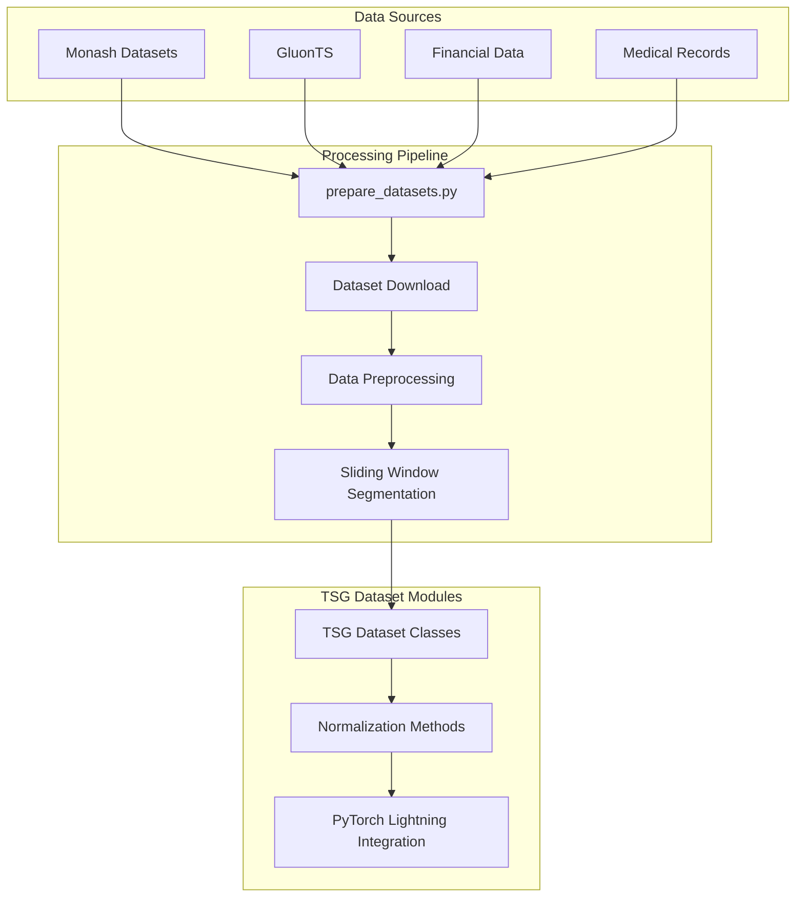
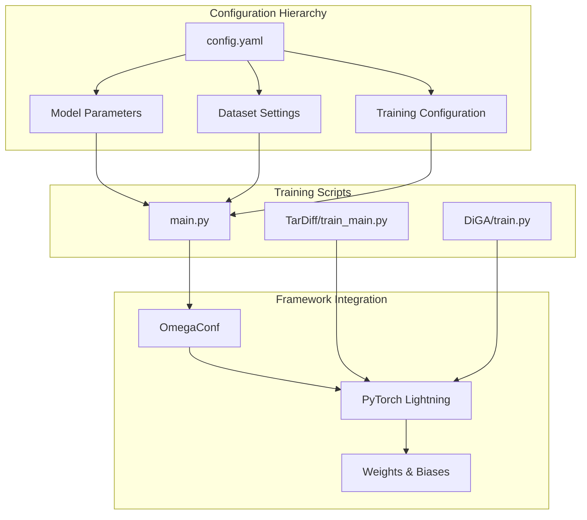

<!-- source: DeepWiki mcp.deepwiki.com · repo microsoft/TimeCraft · page 2 Core Framework Architecture · fetched 2026-10-26 -->

# Core Framework Architecture

Relevant source files

The following files were used as context for generating this wiki page:

- [BRIDGE/README.md](BRIDGE/README.md)
- [README.md](README.md)
- [figures/pt_like_word_newcolors.png](figures/pt_like_word_newcolors.png)
- [supplementary/inference_guidance.md](supplementary/inference_guidance.md)
- [supplementary/inference_prototype.md](supplementary/inference_prototype.md)
- [supplementary/inference_prototype_text.md](supplementary/inference_prototype_text.md)

## Purpose and Scope

This document provides a comprehensive overview of the TimeCraft framework's core architecture, focusing on its three primary capabilities: cross-domain generalization, text-based control, and target-aware adaptation. The architecture is designed as a unified diffusion-based time series generation system with flexible conditioning mechanisms.

For detailed implementation of specific capabilities, see [Cross-Domain Generation with Semantic Prototypes](#2.1), [Text-Based Control and BRIDGE System](#2.2), and [Target-Aware Adaptation](#2.3). For information about specialized domain implementations, see [Specialized Systems](#3).

## Framework Overview

TimeCraft implements a modular architecture centered around a diffusion model backbone with three distinct input conditioning branches. The system provides a unified inference interface while supporting multiple generation modes based on different types of conditioning inputs.

### Core Architecture Components

**Sources:** [README.md:26-38](), [main.py](), [inference.py]()

### Three-Branch Input System

The framework supports three flexible input branches that can be used independently or in combination:

| Branch | Component | Input Type | Purpose |
|--------|-----------|------------|---------|
| **Cross-Domain** | `PAM` | Few-shot examples | Domain adaptation via semantic prototypes |
| **Text-Based** | `BRIDGE` | Natural language | Controllable generation via text descriptions |
| **Target-Aware** | `Guidance Module` | Downstream model | Task-oriented optimization |

**Sources:** [README.md:28-37](), [supplementary/inference_prototype.md:1-28](), [supplementary/inference_prototype_text.md:1-24](), [supplementary/inference_guidance.md:1-28]()

## Core Generation Pipeline

### Unified Inference Interface

The `inference.py` script serves as the central orchestrator for all generation modes, providing a unified interface that dynamically configures the diffusion process based on input conditioning:

**Sources:** [inference.py](), [supplementary/inference_prototype.md:17-26](), [supplementary/inference_prototype_text.md:9-23](), [supplementary/inference_guidance.md:10-25]()

### Diffusion Model Architecture

The core generation engine implements a LatentDiffusion model with UNet1D architecture optimized for time series data:

**Sources:** [README.md:199-201](), [main.py](), [supplementary/training_details.md]()

## Cross-Domain Generation Capability

### Semantic Prototypes System

The cross-domain generation capability centers on learning universal semantic prototypes that encode domain-invariant temporal patterns. These prototypes function as a "dictionary" of reusable temporal components:

**Sources:** [README.md:9-12](), [README.md:226-245]()

## Text-Based Control Capability

### BRIDGE Multi-Agent System

The text-based control capability implements a sophisticated multi-agent framework for generating and refining textual descriptions of time series patterns:

**Sources:** [README.md:14-15](), [README.md:248-268](), [BRIDGE/README.md:1-92]()

## Target-Aware Adaptation Capability

### Influence-Guided Diffusion

The target-aware adaptation capability uses influence functions to guide the diffusion process toward generating data that improves downstream task performance:

**Sources:** [README.md:17-18](), [README.md:271-282](), [supplementary/inference_guidance.md:1-28]()

## Data Processing Infrastructure

### Dataset Preparation Pipeline

The framework includes comprehensive data handling infrastructure for processing various time series datasets:

**Sources:** [README.md:107-137](), [prepare_datasets.py](), [supplementary/dataset_split.md]()

## Configuration and Training

### Configuration Management

The framework uses OmegaConf for hierarchical configuration management, enabling flexible model and dataset configuration:

**Sources:** [main.py](), [supplementary/training_details.md](), [TarDiff/train_main.py](), [DiGA/train.py]()

The TimeCraft framework's modular architecture enables flexible time series generation across multiple domains while maintaining a unified interface for different conditioning modes. The three-branch input system allows users to leverage domain knowledge, natural language descriptions, or task-specific objectives to guide the generation process effectively.

---

