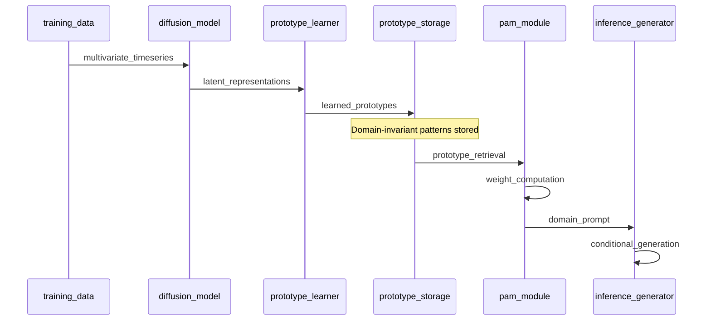
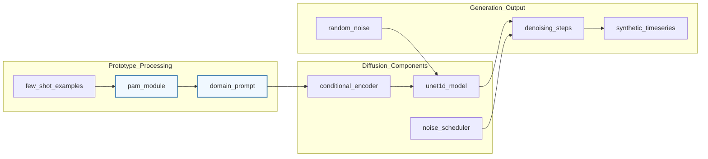

<!-- source: DeepWiki mcp.deepwiki.com · repo microsoft/TimeCraft · page 2.1 Cross-Domain Generation with Semantic Prototypes · fetched 2026-10-26 -->

# Cross-Domain Generation with Semantic Prototypes

<details>
<summary>Relevant source files</summary>

The following files were used as context for generating this wiki page:

- [BRIDGE/README.md](BRIDGE/README.md)
- [README.md](README.md)
- [figures/pt_like_word_newcolors.png](figures/pt_like_word_newcolors.png)
- [supplementary/inference_guidance.md](supplementary/inference_guidance.md)
- [supplementary/inference_prototype.md](supplementary/inference_prototype.md)
- [supplementary/inference_prototype_text.md](supplementary/inference_prototype_text.md)

</details>


## Purpose and Scope

This document describes TimeCraft's cross-domain generation capability using semantic prototypes. This system enables the generation of synthetic time series data that generalizes across different domains (e.g., medical, financial, climate) without requiring domain-specific retraining. The core mechanism uses a shared vocabulary of temporal patterns (semantic prototypes) and a lightweight adaptation module (PAM) that can construct domain-specific prompts from few-shot examples.

For information about text-based control mechanisms, see [Text-Based Control and BRIDGE System](#2.2). For target-aware adaptation using influence functions, see [Target-Aware Adaptation](#2.3).

## Semantic Prototypes Overview

TimeCraft introduces a universal latent space for time series by learning a shared set of semantic prototypes. These prototypes function as a "dictionary" of temporal patterns, encoding domain-invariant features such as trends, seasonality, and periodic fluctuations that are reusable across domains.

### Prototype Conceptual Model

```mermaid
graph TB
    subgraph "Domain-Invariant Patterns"
        P1[Prototype_1<br/>"Trend: Linear Growth"]
        P2[Prototype_2<br/>"Seasonality: Daily Cycle"]
        P3[Prototype_3<br/>"Volatility: High Frequency"]
        P4[Prototype_N<br/>"..."]
    end
    
    subgraph "Domain-Specific Applications"
        D1[Medical_Domain<br/>"Heart Rate Patterns"]
        D2[Financial_Domain<br/>"Stock Price Movements"]
        D3[Climate_Domain<br/>"Temperature Cycles"]
    end
    
    subgraph "Weighted Combinations"
        W1[w1_med * P1 + w2_med * P2 + ...]
        W2[w1_fin * P1 + w2_fin * P2 + ...]
        W3[w1_cli * P1 + w2_cli * P2 + ...]
    end
    
    P1 --> W1
    P2 --> W1
    P3 --> W1
    P1 --> W2
    P2 --> W2
    P3 --> W2
    P1 --> W3
    P2 --> W3
    P3 --> W3
    
    W1 --> D1
    W2 --> D2
    W3 --> D3
```

Sources: [README.md:9-11](), [README.md:228-243]()

## Prototype Assignment Module (PAM)

The Prototype Assignment Module is a lightweight component that dynamically computes domain-specific weights for the learned prototypes using few-shot examples. PAM constructs domain prompts without requiring explicit labels or model retraining.

### PAM Architecture and Processing Flow

```mermaid
graph TB
    subgraph "Input Layer"
        FS[few_shot_examples<br/>"Target Domain Samples"]
        SP[semantic_prototypes<br/>"Learned Pattern Dictionary"]
    end
    
    subgraph "PAM Processing"
        WC[weight_computation<br/>"Domain-Specific Weighting"]
        DP[domain_prompt_construction<br/>"Latent Representation"]
    end
    
    subgraph "Generation Process"
        DM[diffusion_model<br/>"UNet1D + Encoders"]
        TS[synthetic_timeseries<br/>"Generated Output"]
    end
    
    FS --> WC
    SP --> WC
    WC --> DP
    DP --> DM
    DM --> TS
    
    style WC fill:#f9f9f9,stroke:#333,stroke-width:2px
    style DP fill:#f9f9f9,stroke:#333,stroke-width:2px
```

Sources: [README.md:240-243](), [supplementary/inference_prototype.md:1-16]()

## Domain Prompts and Few-Shot Learning

Domain prompts are latent representations that capture target domain characteristics. The system constructs these prompts automatically from a small number of example time series, enabling cross-domain generalization without manual specification.

### Few-Shot Prompting Mechanism

```mermaid
flowchart LR
    subgraph "Input_Stage"
        EX[target_domain_examples<br/>"2-5 sample time series"]
    end
    
    subgraph "PAM_Processing"
        FE[feature_extraction<br/>"Statistical Properties"]
        PC[prototype_correlation<br/>"Similarity Computation"]
        WA[weight_assignment<br/>"Domain-Specific Weights"]
    end
    
    subgraph "Prompt_Construction"
        DP[domain_prompt<br/>"Weighted Prototype Combination"]
        CR[conditional_representation<br/>"Diffusion Model Input"]
    end
    
    EX --> FE
    FE --> PC
    PC --> WA
    WA --> DP
    DP --> CR
    
    style FE fill:#f9f9f9,stroke:#333,stroke-width:2px
    style WA fill:#f9f9f9,stroke:#333,stroke-width:2px
```

Sources: [README.md:234-245](), [README.md:238-239]()

## Implementation Architecture

The cross-domain generation system integrates several key components within the TimeCraft framework. The implementation spans multiple modules that handle prototype learning, domain adaptation, and generation.

### Core Component Integration

```mermaid
graph TB
    subgraph "Configuration_Layer"
        CONFIG[config.yaml<br/>"Model Parameters"]
        CLI[command_line_interface<br/>"--use_pam flag"]
    end
    
    subgraph "PAM_Implementation"
        PAM_MODULE[prototype_assignment_module<br/>"Domain Weight Computation"]
        PROTO_STORAGE[semantic_prototypes<br/>"Learned Pattern Storage"]
    end
    
    subgraph "Generation_Pipeline"
        INFERENCE[inference.py<br/>"Main Inference Script"]
        DIFFUSION[diffusion_model<br/>"UNet1D Architecture"]
        ENCODER[conditional_encoder<br/>"Domain Prompt Processing"]
    end
    
    subgraph "Output_Generation"
        SYNTH[synthetic_timeseries<br/>"Generated Data"]
        EVAL[evaluation_metrics<br/>"Quality Assessment"]
    end
    
    CONFIG --> INFERENCE
    CLI --> INFERENCE
    INFERENCE --> PAM_MODULE
    PAM_MODULE --> PROTO_STORAGE
    PAM_MODULE --> ENCODER
    ENCODER --> DIFFUSION
    DIFFUSION --> SYNTH
    SYNTH --> EVAL
    
    style PAM_MODULE fill:#e8f5e8,stroke:#1b5e20,stroke-width:2px
    style PROTO_STORAGE fill:#e8f5e8,stroke:#1b5e20,stroke-width:2px
```

Sources: [supplementary/inference_prototype.md:7-13](), [supplementary/inference_prototype.md:17-26]()

## Usage and Inference Modes

The cross-domain generation system supports multiple inference modes depending on the available input and desired control level.

### Inference Mode Configuration

| Mode | Command Flag | Input Requirements | Output Characteristics |
|------|-------------|-------------------|----------------------|
| Prototype-Only | `--use_pam` | Few-shot examples | Domain-consistent generation |
| Unconditional | None | None | General time series patterns |
| Hybrid | `--use_pam --use_text` | Examples + text descriptions | Enhanced controllability |

### Command Line Interface

For prototype-based generation with domain prompts:

```bash
python inference.py \
  --base config.yaml \
  --resume true \
  --ckpt_name ./checkpoints/ \
  --use_pam
```

For unconditional generation without domain adaptation:

```bash
python inference.py \
  --base config.yaml \
  --resume true \
  --ckpt_name ./checkpoints/
```

Sources: [supplementary/inference_prototype.md:5-13](), [supplementary/inference_prototype.md:19-26]()

## Technical Implementation Details

The semantic prototype system operates within TimeCraft's diffusion-based architecture, utilizing learned representations that capture fundamental temporal patterns across domains.

### Prototype Learning Process



The system learns prototypes during training across multiple domains, then uses PAM to dynamically weight these prototypes for new domain adaptation during inference.

Sources: [README.md:226-243](), [README.md:9-11]()

## Integration with Diffusion Architecture

The prototype-based generation integrates seamlessly with TimeCraft's underlying diffusion model architecture, providing conditional inputs that guide the generation process.

### Conditional Generation Pipeline



Sources: [README.md:240-243](), [supplementary/inference_prototype.md:1-16]()

---

