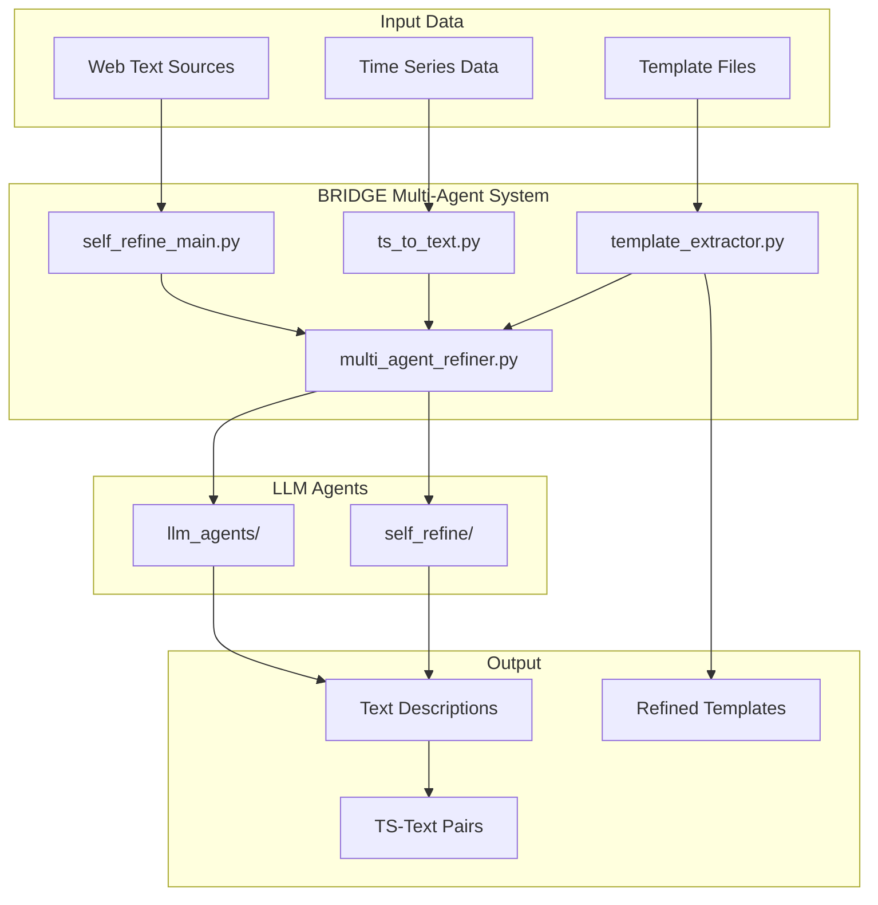
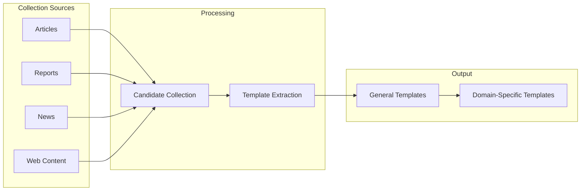
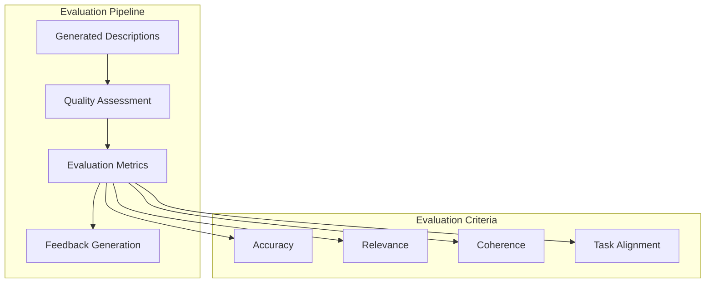
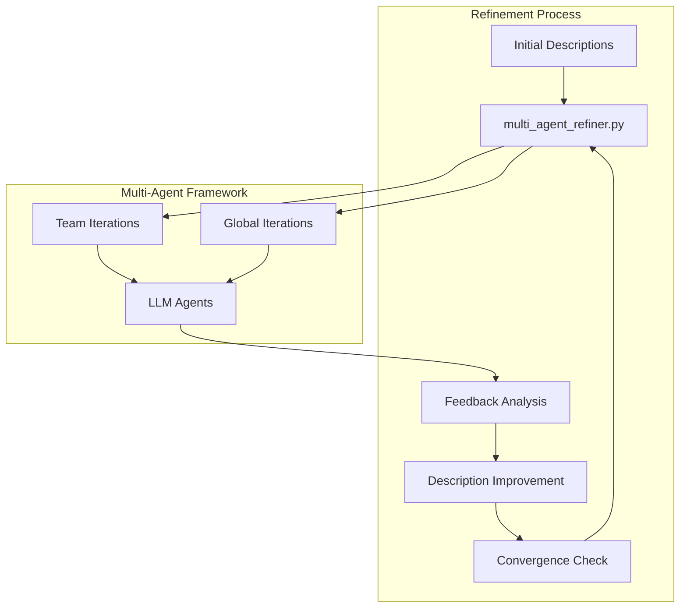
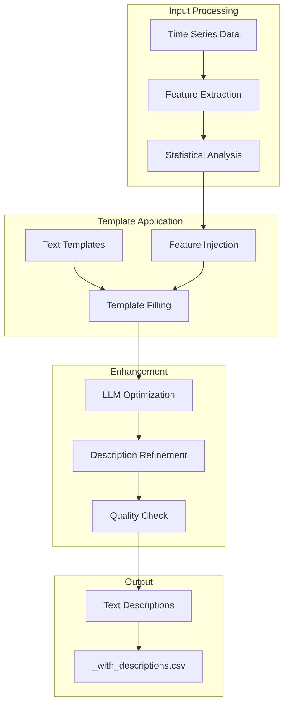
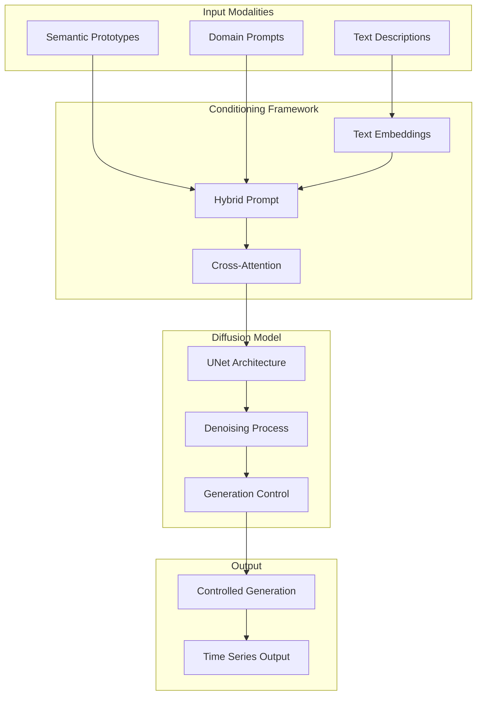
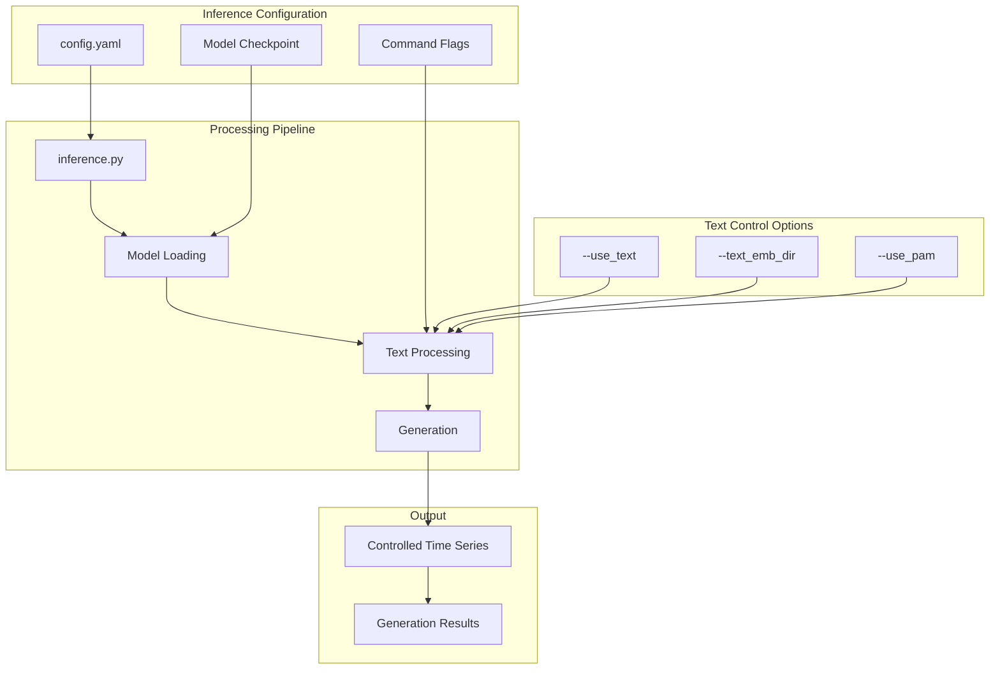

<!-- source: DeepWiki mcp.deepwiki.com · repo microsoft/TimeCraft · page 2.2 Text-Based Control and BRIDGE System · fetched 2026-10-26 -->

# Text-Based Control and BRIDGE System

<details>
<summary>Relevant source files</summary>

The following files were used as context for generating this wiki page:

- [BRIDGE/README.md](BRIDGE/README.md)
- [README.md](README.md)
- [figures/pt_like_word_newcolors.png](figures/pt_like_word_newcolors.png)
- [supplementary/inference_guidance.md](supplementary/inference_guidance.md)
- [supplementary/inference_prototype.md](supplementary/inference_prototype.md)
- [supplementary/inference_prototype_text.md](supplementary/inference_prototype_text.md)

</details>


This document covers TimeCraft's text-based control capability and the BRIDGE multi-agent system that enables natural language conditioning for time series generation. For information about cross-domain generation using semantic prototypes, see [Cross-Domain Generation with Semantic Prototypes](#2.1). For target-aware adaptation mechanisms, see [Target-Aware Adaptation](#2.3).

## Overview

TimeCraft's text-based control system enables users to guide time series generation through natural language descriptions. The system leverages the BRIDGE (Bootstrapping Text to Control Time-Series Generation via Multi-Agent Iterative Optimization and Diffusion Modelling) framework to create high-quality text-to-time-series pairings and implements a hybrid conditioning mechanism that combines textual prompts with semantic prototypes.

## BRIDGE Multi-Agent System Architecture

The BRIDGE system implements a three-stage multi-agent framework for generating domain-specific textual descriptions of time series data:

### Core Components



Sources: [BRIDGE/README.md:1-14](), [README.md:248-262]()

### Three-Stage Processing Pipeline

#### Stage 1: Text Template Collection
The system collects diverse time series-related texts from multiple sources to construct domain-agnostic templates:



Sources: [README.md:254-256](), [BRIDGE/README.md:39-46]()

#### Stage 2: Automated Evaluation
Generated text descriptions are evaluated to assess their quality in supporting downstream tasks:



Sources: [README.md:257](), [BRIDGE/README.md:56-66]()

#### Stage 3: Feedback-Driven Refinement
The system iteratively improves descriptions based on evaluation results:



Sources: [README.md:258-261](), [BRIDGE/README.md:87-91]()

## Text Processing Pipeline

### Time Series to Text Conversion

The `ts_to_text.py` module handles the conversion of time series data into textual descriptions:



Sources: [README.md:147-155](), [process/ts_to_text.py]()

### Statistical Feature Extraction

The system extracts key statistical features from time series windows:

| Feature Type | Description | Purpose |
|-------------|-------------|---------|
| Mean | Average value | Central tendency |
| Standard Deviation | Variability measure | Spread indication |
| Trend | Direction of change | Pattern identification |
| Seasonality | Periodic patterns | Cyclical behavior |
| Extremes | Min/max values | Range characteristics |

Sources: [README.md:149]()

## Hybrid Conditioning Mechanism

TimeCraft implements a hybrid framework that combines textual descriptions with semantic prototypes:



Sources: [README.md:264-268](), [supplementary/inference_prototype_text.md:1-24]()

## Implementation Details

### Command Line Interface

The BRIDGE system provides comprehensive command-line options for different operations:

```bash
# Generate descriptions from time series
python self_refine_main.py \
  --openai_key YOUR_API_KEY \
  --ts_file path/to/timeseries.csv \
  --dataset_name dataset_name \
  --ts_to_text

# Run multi-agent refinement
python self_refine_main.py \
  --openai_key YOUR_API_KEY \
  --ts_file path/to/timeseries.csv \
  --dataset_name dataset_name \
  --refine \
  --team_iterations 3 \
  --global_iterations 2
```

Sources: [BRIDGE/README.md:28-66]()

### Key Configuration Parameters

| Parameter | Description | Default |
|-----------|-------------|---------|
| `--openai_model` | OpenAI model name | `gpt-4o-2024-05-13` |
| `--prediction_length` | Time series window length | 168 |
| `--team_iterations` | Max iterations per team | 3 |
| `--global_iterations` | Max global refinement rounds | 2 |
| `--llm_optimize` | Use LLM for optimization | False |

Sources: [BRIDGE/README.md:68-92]()

### Integration with TimeCraft Inference

Text-based control is integrated with TimeCraft's inference system:



Sources: [supplementary/inference_prototype_text.md:9-24]()

## Usage Examples

### Basic Text-Controlled Generation

```bash
python inference.py \
  --base config.yaml \
  --resume true \
  --ckpt_name ./checkpoints/ \
  --use_text \
  --text_emb_dir ./text_embeddings/
```

### Hybrid Prototype-Text Control

```bash
python inference.py \
  --base config.yaml \
  --resume true \
  --ckpt_name ./checkpoints/ \
  --use_pam \
  --use_text \
  --text_emb_dir ./text_embeddings/
```

Sources: [supplementary/inference_prototype_text.md:9-24]()

### Text Template Processing

```bash
python BRIDGE/process/ts_to_text.py \
  --input_file data/dataset.csv \
  --template_file templates/domain_templates.json \
  --output_file data/dataset_with_descriptions.csv
```

Sources: [README.md:151]()

The text-based control system provides flexible and intuitive control over time series generation through natural language, enabling users to specify desired characteristics like trends, seasonality, and domain-specific patterns without requiring detailed technical knowledge of the underlying model architecture.

---

