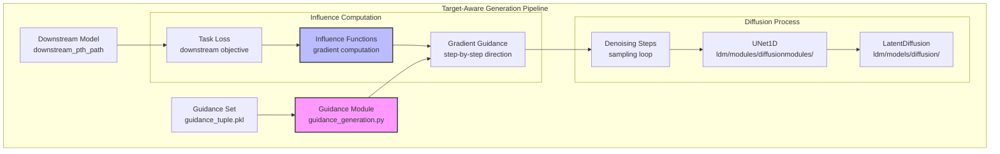
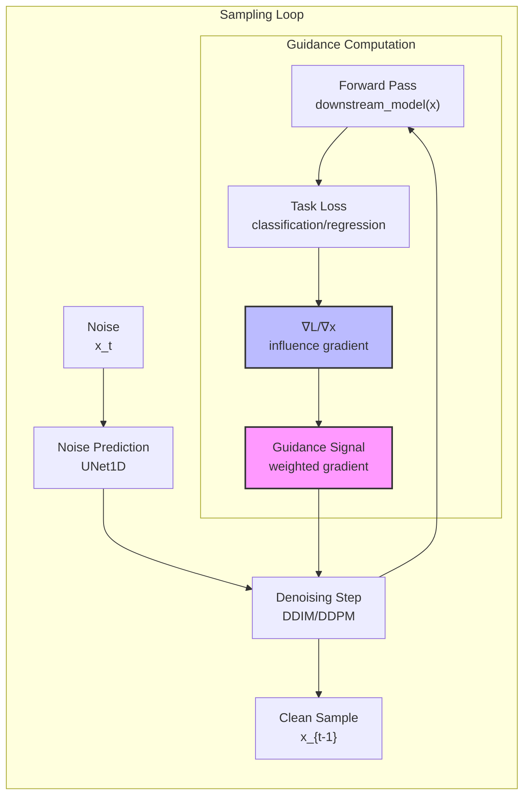
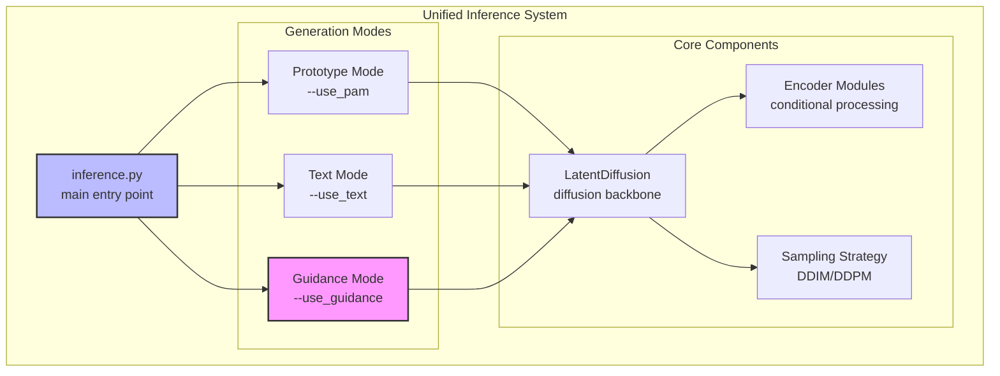

<!-- source: DeepWiki mcp.deepwiki.com · repo microsoft/TimeCraft · page 2.3 Target-Aware Adaptation · fetched 2026-10-26 -->

# Target-Aware Adaptation

<details>
<summary>Relevant source files</summary>

The following files were used as context for generating this wiki page:

- [BRIDGE/README.md](BRIDGE/README.md)
- [README.md](README.md)
- [figures/pt_like_word_newcolors.png](figures/pt_like_word_newcolors.png)
- [supplementary/inference_guidance.md](supplementary/inference_guidance.md)
- [supplementary/inference_prototype.md](supplementary/inference_prototype.md)
- [supplementary/inference_prototype_text.md](supplementary/inference_prototype_text.md)

</details>


This document describes the Target-Aware Adaptation mechanism within TimeCraft's core framework. This system enables synthetic time series generation that is explicitly optimized to improve downstream model performance rather than simply replicating training data distributions.

For cross-domain generation using semantic prototypes, see [Cross-Domain Generation with Semantic Prototypes](#2.1). For text-based control mechanisms, see [Text-Based Control and BRIDGE System](#2.2). For specialized EHR applications using target-aware adaptation, see [TarDiff: EHR Time Series Generation](#3.1).

## Overview

Target-Aware Adaptation represents a paradigm shift from traditional generative modeling approaches. Instead of focusing solely on distributional fidelity, this mechanism generates synthetic samples with the explicit goal of enhancing performance on specific downstream tasks such as forecasting, classification, and anomaly detection.

The system leverages influence functions to quantify the expected reduction in task-specific loss, enabling the diffusion process to generate data that is both realistic and strategically valuable for the target application.

## Core Architecture

The Target-Aware Adaptation system consists of three primary components that work in concert to guide the generation process:

### System Components



**Target-Aware Generation Architecture**

Sources: [README.md:271-283](), [supplementary/inference_guidance.md:1-28]()

### Component Responsibilities

| Component | Role | Implementation |
|-----------|------|----------------|
| **Guidance Set** | Small collection of time-series whose distribution mirrors the target task | Stored as `guidance_tuple.pkl` containing (data, labels) tuples |
| **Downstream Model** | Differentiable network trained on the task of interest | Any architecture (RNN, Transformer, CNN) loaded from `downstream_pth_path` |
| **Guidance Module** | Injects downstream gradients into denoising steps | Implemented in `guidance_generation.py` |

Sources: [README.md:276-282]()

## Implementation Details

### Influence-Guided Diffusion Process

The core innovation lies in the integration of influence functions into the diffusion sampling process. This mechanism computes gradients from the downstream model at each denoising step to steer generation toward task-beneficial samples.



**Influence-Guided Sampling Process**

Sources: [README.md:271-283](), [supplementary/inference_guidance.md:3-8]()

### Data Preparation Requirements

The system requires specific data formats and preprocessing steps:

#### Guidance Set Format

The guidance set must be provided as a pickled tuple containing:
- `data`: shape **(N, F, T)** representing N samples, F features, and T time steps
- `labels`: shape **(N,)** corresponding labels for each sample

#### Downstream Model Requirements

The downstream model must satisfy these criteria:
- Differentiable architecture (supports gradient computation)
- Trained on the same task as the generation target
- Compatible input/output shapes with guidance set format
- Stored as a PyTorch checkpoint file

Sources: [README.md:176-181](), [README.md:188-195]()

## Usage and Configuration

### Command Line Interface

Target-aware generation is activated through the `inference.py` script with specific flags:

```bash
python inference.py \
  --base config.yaml \
  --resume true \
  --ckpt_name ./checkpoints/ \
  --use_guidance \
  --uncond \
  --downstream_pth_path ./classifier/checkpoints/best_model.pt \
  --guidance_path ./classifier/data/guidance_tuple.pkl
```

### Configuration Parameters

| Parameter | Purpose | Requirements |
|-----------|---------|--------------|
| `--use_guidance` | Enables classifier-informed generation | Boolean flag |
| `--downstream_pth_path` | Path to trained downstream model | Must be a valid PyTorch checkpoint |
| `--guidance_path` | Path to guidance set | Must be a `.pkl` file with proper tuple format |
| `--uncond` | Unconditional generation mode | Used with guidance for pure task-aware generation |

Sources: [supplementary/inference_guidance.md:10-21]()

### Integration with Core Framework

The target-aware mechanism integrates seamlessly with TimeCraft's unified inference system:



**Integration with Unified Inference System**

Sources: [README.md:206-217](), [supplementary/inference_guidance.md:1-28]()

## Specialized Applications

### TarDiff Implementation

The TarDiff system represents a specialized implementation of target-aware adaptation for Electronic Health Record (EHR) time series generation. This system extends the core mechanisms with domain-specific optimizations:

- **Healthcare-specific guidance**: Optimized for clinical prediction tasks
- **Medical data preprocessing**: Specialized handling of EHR time series
- **Performance validation**: TSTR/TSRTR protocols for medical applications

### DiGA Market Applications

The DiGA system applies target-aware principles to financial market data generation, focusing on:

- **Trading strategy optimization**: Guidance for reinforcement learning agents
- **Market simulation**: Realistic synthetic trading environments
- **Risk assessment**: Generated data for stress testing financial models

Sources: [README.md:51-54](), [README.md:75-77]()

## Performance Characteristics

Target-aware adaptation demonstrates superior performance compared to traditional generative approaches:

- **Task-specific optimization**: Generated data consistently improves downstream model performance
- **Efficiency**: Lightweight guidance mechanism with minimal computational overhead
- **Generalizability**: Compatible with various downstream architectures and task types
- **Medical validation**: Outperforms real data in some clinical prediction scenarios

The system achieves these results through its novel integration of influence functions with diffusion-based generation, ensuring that synthetic samples are both realistic and strategically valuable for the target application.

Sources: [README.md:51-54](), [README.md:271-283]()

---

