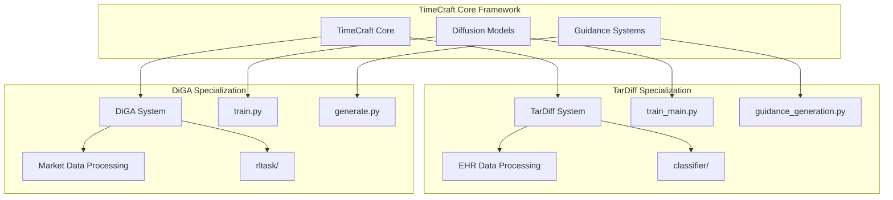
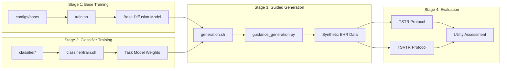
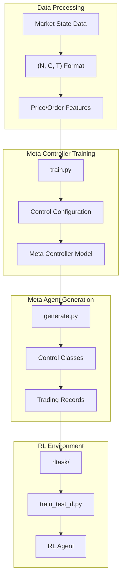
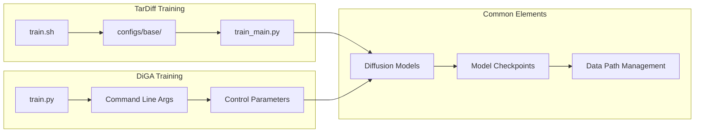

<!-- source: DeepWiki mcp.deepwiki.com · repo microsoft/TimeCraft · page 3 Specialized Systems · fetched 2026-10-26 -->

# Specialized Systems

Relevant source files

The following files were used as context for generating this wiki page:

- [DiGA/README.md](DiGA/README.md)
- [TarDiff/README.md](TarDiff/README.md)

This document covers the specialized implementations built on top of the TimeCraft framework for domain-specific time series generation. These systems extend the core TimeCraft capabilities to address specific use cases in healthcare and financial domains.

For information about the core TimeCraft framework architecture, see [Core Framework Architecture](#2). For details about training and inference procedures, see [Training and Inference](#6).

## System Architecture Overview

The specialized systems leverage TimeCraft's diffusion-based generation capabilities while implementing domain-specific adaptations for targeted applications.

### Specialized System Relationship to TimeCraft Core

**Sources:** [DiGA/README.md:1-88](), [TarDiff/README.md:1-101]()

## TarDiff: EHR Time Series Generation System

TarDiff implements target-oriented diffusion guidance for synthetic Electronic Health Record time series generation. The system addresses data scarcity and class imbalance in healthcare analytics through influence-guided generation.

### TarDiff Training Pipeline

**Sources:** [TarDiff/README.md:35-100]()

### TarDiff Data Processing

The system processes EHR data from MIMIC-III and eICU databases, focusing on multivariate time-series recordings. Data preprocessing utilities are provided for extraction and preparation.

| Component | Location | Purpose |
|-----------|----------|---------|
| Data Preprocessing | `data_preprocess/` | High-level extraction scripts |
| MIMIC-III Support | Raw data access | Clinical database integration |
| eICU Support | Raw data access | Collaborative research database |

**Sources:** [TarDiff/README.md:21-32]()

### TarDiff Evaluation Protocols

The system implements two complementary evaluation protocols for assessing synthetic data utility:

| Protocol | Training Set | Test Set | Purpose |
|----------|-------------|----------|---------|
| TSTR | Synthetic only | Real | Assess pure synthetic training effectiveness |
| TSRTR | Synthetic + Real (α ratios) | Real | Evaluate augmentation benefits |

**Sources:** [TarDiff/README.md:73-96]()

## DiGA: Market Trading Data Generation System

DiGA (Diffusion Guided Meta Agent) specializes in generating synthetic market trading records for training reinforcement learning agents in financial applications.

### DiGA System Components

**Sources:** [DiGA/README.md:1-43]()

### DiGA Training Configuration

The system supports flexible control mechanisms for generating targeted market behaviors:

| Parameter | Options | Purpose |
|-----------|---------|---------|
| `ctrl_type` | continuous, discrete | Control encoder type |
| `ctrl_target` | return, volatility | Target market characteristic |
| `n_bins` | Integer | Discretization granularity |
| `ctrl_class` | 0-n | Specific control condition |

**Sources:** [DiGA/README.md:44-78]()

### DiGA Data Format Requirements

The system requires market data in specific tensor format:
- **Shape**: `(N, C, T)` where N=samples, C=features, T=time steps
- **Features**: C=2 dimensions (mid-price log return rate, order count)
- **Temporal**: T=236 effective trading minutes per day

**Sources:** [DiGA/README.md:16-17]()

## Implementation Comparison

### Training Script Patterns

**Sources:** [TarDiff/README.md:37-43](), [DiGA/README.md:22-28]()

### Generation and Evaluation Workflows

Both systems implement distinct generation and evaluation approaches:

- **TarDiff**: Uses influence-guided generation with `guidance_generation.py` and evaluates through TSTR/TSRTR protocols
- **DiGA**: Employs meta-agent sampling with `generate.py` and evaluates through RL training environments

The specialized systems demonstrate domain-specific adaptations while maintaining compatibility with the core TimeCraft diffusion framework.

**Sources:** [TarDiff/README.md:61-96](), [DiGA/README.md:30-42]()

---

