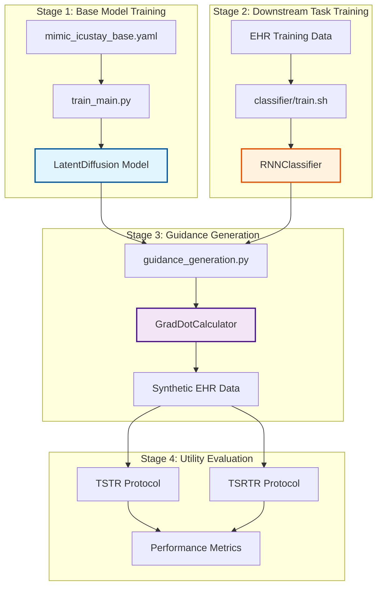
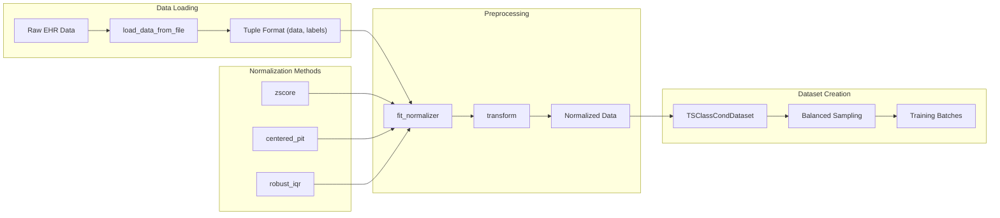
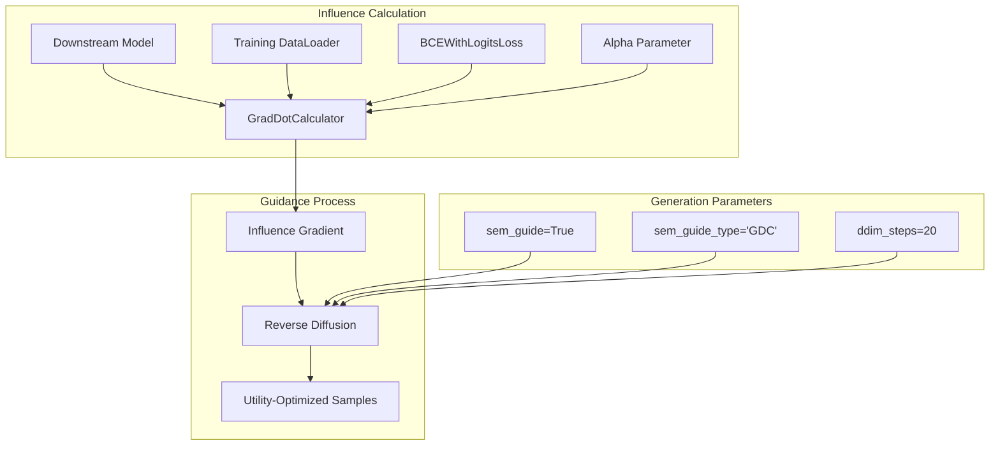

<!-- source: DeepWiki mcp.deepwiki.com · repo microsoft/TimeCraft · page 3.1 TarDiff: EHR Time Series Generation · fetched 2026-10-26 -->

# TarDiff: EHR Time Series Generation

<details>
<summary>Relevant source files</summary>

The following files were used as context for generating this wiki page:

- [TarDiff/README.md](TarDiff/README.md)
- [TarDiff/configs/base/mimic_icustay_base.yaml](TarDiff/configs/base/mimic_icustay_base.yaml)
- [TarDiff/guidance_generation.py](TarDiff/guidance_generation.py)
- [TarDiff/ldm/data/tsg_dataset.py](TarDiff/ldm/data/tsg_dataset.py)
- [TarDiff/train_main.py](TarDiff/train_main.py)

</details>


TarDiff is a specialized target-oriented diffusion framework for generating synthetic Electronic Health Record (EHR) time series data. Unlike conventional approaches that focus on replicating statistical distributions, TarDiff optimizes synthetic samples to improve downstream model performance through influence function-guided diffusion.

This document covers the TarDiff system architecture, training procedures, configuration management, and evaluation protocols. For information about the core TimeCraft framework components, see [Core Framework Architecture](#2). For general time series data infrastructure, see [Data Infrastructure](#4).

## System Overview

TarDiff operates through a four-stage pipeline that transforms raw EHR data into utility-optimized synthetic samples:



**Sources:** [TarDiff/README.md:1-100](), [TarDiff/train_main.py:1-460](), [TarDiff/guidance_generation.py:1-535]()

## Core Components

### Diffusion Model Architecture

TarDiff uses a `LatentDiffusion` model configured specifically for EHR time series data. The model operates on 7-channel multivariate time series with a default sequence length of 24 timesteps.

| Component | Configuration | Purpose |
|-----------|---------------|---------|
| `UNetModel` | 1D convolutions, 64 model channels | Core denoising network |
| `DomainUnifiedEncoder` | 32-dimensional latent space | Conditional encoding |
| `IdentityFirstStage` | No compression | Direct time series processing |

The model configuration is defined in [TarDiff/configs/base/mimic_icustay_base.yaml:1-98]() with key parameters:

```yaml
model:
  target: ldm.models.diffusion.ddpm.LatentDiffusion
  params:
    timesteps: 200
    channels: 7
    image_size: 24
    conditioning_key: crossattn
```

**Sources:** [TarDiff/configs/base/mimic_icustay_base.yaml:1-98](), [TarDiff/train_main.py:374-384]()

### Data Processing Pipeline

The `TSClassCondTrainDataModule` handles EHR data preprocessing with specialized normalization and class-conditional sampling:



The `TSClassCondDataset` implements balanced sampling to ensure equal representation of positive and negative samples:

```python
# From TSClassCondDataset.__getitem__
if idx % 2 == 0:
    sample_idx = np.random.choice(self.pos_indices)
else:
    sample_idx = np.random.choice(self.neg_indices)
```

**Sources:** [TarDiff/ldm/data/tsg_dataset.py:15-46](), [TarDiff/ldm/data/tsg_dataset.py:48-141]()

### Influence Function Guidance

The `GradDotCalculator` implements influence function-based guidance to steer generation toward utility-optimized samples:



The guidance process integrates influence gradients into the sampling procedure through the `sample_log` method with semantic guidance enabled.

**Sources:** [TarDiff/guidance_generation.py:495-512](), [TarDiff/ldm/modules/guidance_scorer.py:26-34]()

## Training Procedures

### Stage 1: Base Model Training

Train the unconditional diffusion model using `train_main.py`:

```bash
python train_main.py -b configs/base/mimic_icustay_base.yaml
```

Key training parameters are configured through command-line arguments:

| Parameter | Default | Purpose |
|-----------|---------|---------|
| `--seq_len` | 24 | Time series sequence length |
| `--batch_size` | 256 | Training batch size |
| `--max_steps` | 20000 | Maximum training steps |
| `--normalize` | centered_pit | Normalization method |

The training script automatically configures the model based on sequence length and other parameters:

```python
config.model['params']['image_size'] = opt.seq_len
config.model['params']['unet_config']['params']['image_size'] = opt.seq_len
config.data['params']['window'] = opt.seq_len
```

**Sources:** [TarDiff/train_main.py:308-332](), [TarDiff/README.md:35-44]()

### Stage 2: Downstream Task Training

Train the RNN classifier for guidance:

```bash
cd classifier
bash train.sh
```

The `RNNClassifier` serves as the downstream task model:

```python
downstream_model = RNNClassifier(
    input_dim=7,
    hidden_dim=256,
    num_layers=2,
    rnn_type='gru',
    num_classes=1,
)
```

**Sources:** [TarDiff/guidance_generation.py:473-479](), [TarDiff/README.md:47-58]()

### Stage 3: Guided Generation

Generate synthetic samples with influence guidance:

```bash
python guidance_generation.py -g <diffusion_checkpoint> -pp <classifier_checkpoint> -sv <save_path>
```

The generation process maintains label distribution balance by generating samples for each class:

```python
for label_sample, total_samples in generation_nums_label.items():
    label = torch.tensor([label_sample] * total_samples, device='cuda')
    samples, z_denoise_row = model.sample_log(
        cond=None,
        batch_size=total_samples,
        ddim=True,
        ddim_steps=20,
        eta=1.,
        sem_guide=True,
        sem_guide_type='GDC',
        label=label,
        GDCalculater=c
    )
```

**Sources:** [TarDiff/guidance_generation.py:500-512](), [TarDiff/README.md:61-70]()

## Configuration Management

### Base Configuration Structure

The YAML configuration defines the complete model architecture:

```yaml
seq_length: &seqlen 24
model:
  target: ldm.models.diffusion.ddpm.LatentDiffusion
  params:
    timesteps: 200
    channels: 7
    unet_config:
      target: ldm.modules.diffusionmodules.unet1d.UNetModel
      params:
        image_size: *seqlen
        in_channels: 7
        out_channels: 7
        model_channels: 64
```

### Data Configuration

The data module configuration specifies normalization and dataset paths:

```yaml
data:
  target: ldm.data.tsg_dataset.TSClassCondTrainDataModule
  params:
    data_path_dict:
      MIMIC_III_Readmission: data/mimic_icustay/train_tuple.pkl
    window: 24
    normalize: centered_pit
    batch_size: 256
```

**Sources:** [TarDiff/configs/base/mimic_icustay_base.yaml:1-98]()

## Evaluation Protocols

### TSTR (Train-Synthetic, Test-Real)

Evaluates how well models trained purely on synthetic data generalize to real patients:

| Training Set | Test Set | Evaluation Question |
|-------------|----------|-------------------|
| Synthetic only | Real | "How well does synthetic-only training generalize?" |

### TSRTR (Train-Synthetic-Real, Test-Real)

Evaluates augmentation benefits by mixing synthetic and real training data:

| Training Set | Test Set | Evaluation Question |
|-------------|----------|-------------------|
| Synthetic + Real (α ratio) | Real | "Does synthetic augmentation improve performance?" |

Both protocols use the same classifier training infrastructure with different data configurations.

**Sources:** [TarDiff/README.md:73-96]()

## Implementation Details

### Normalization Methods

The system supports multiple normalization approaches for different data characteristics:

| Method | Formula | Use Case |
|--------|---------|----------|
| `zscore` | `(x - mean) / std` | Gaussian distributions |
| `centered_pit` | `2 * ECDF(x) - 1` | Non-parametric, robust |
| `robust_iqr` | `(x - median) / IQR` | Outlier-resistant |

### Memory Management

The data module implements efficient memory handling through:

- Lazy loading with `prepare_data()` and `setup()` methods
- Balanced sampling without full dataset replication
- Configurable batch sizes and worker processes

**Sources:** [TarDiff/ldm/data/tsg_dataset.py:211-281](), [TarDiff/ldm/data/tsg_dataset.py:179-198]()

## Integration with TimeCraft

TarDiff serves as a specialized implementation of the TimeCraft framework's target-aware adaptation capability. It demonstrates how influence functions can be integrated into the diffusion process for task-specific optimization.

The system uses standard TimeCraft components:
- `LatentDiffusion` base model
- `UNetModel` diffusion architecture  
- `TSGDataModule` data handling
- PyTorch Lightning training infrastructure

**Sources:** [TarDiff/train_main.py:374-384](), [TarDiff/guidance_generation.py:464-467]()

---

