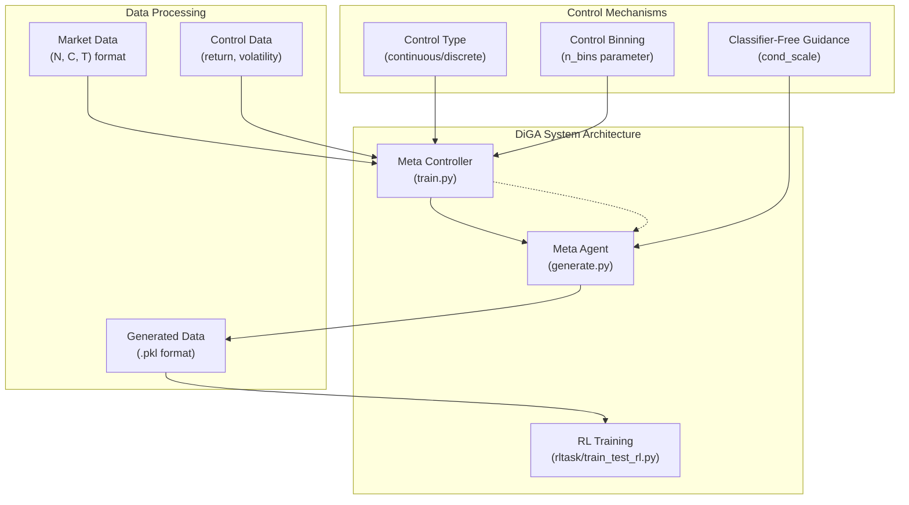
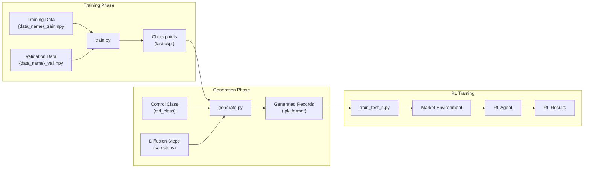
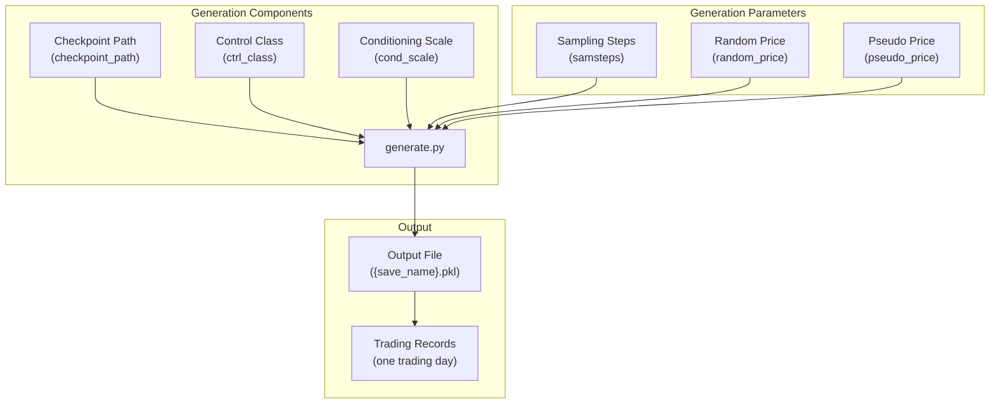
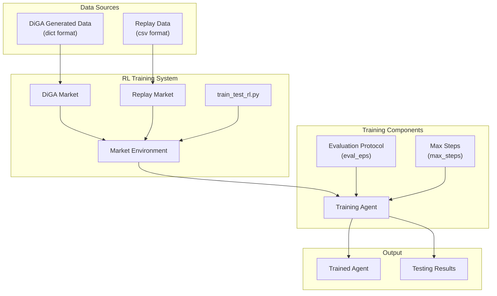
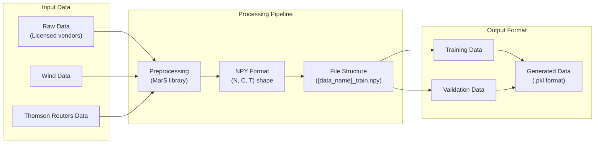

<!-- source: DeepWiki mcp.deepwiki.com · repo microsoft/TimeCraft · page 3.2 DiGA: Market Trading Data Generation · fetched 2026-10-26 -->

# DiGA: Market Trading Data Generation

<details>
<summary>Relevant source files</summary>

The following files were used as context for generating this wiki page:

- [DiGA/README.md](DiGA/README.md)

</details>


## Purpose and Scope

DiGA (Diffusion Guided Meta Agent) is a specialized system within the TimeCraft framework designed for generating synthetic market trading records and training reinforcement learning agents. This system enables the creation of controllable synthetic market environments for financial research and trading strategy development.

This document covers the DiGA system's architecture, training procedures, generation capabilities, and integration with reinforcement learning workflows. For information about the broader TimeCraft framework, see [Core Framework Architecture](#2). For other specialized systems, see [TarDiff: EHR Time Series Generation](#3.1).

## System Architecture

DiGA implements a two-stage architecture consisting of a meta controller and a meta agent that work together to generate synthetic market trading records.

### DiGA Component Overview



Sources: [DiGA/README.md:1-88]()

### Training and Generation Workflow



Sources: [DiGA/README.md:22-42]()

## Training Process

The DiGA training process involves training a meta controller using market data to learn controllable generation patterns.

### Training Configuration

The `train.py` script accepts multiple configuration parameters for training the meta controller:

| Parameter | Description | Example Value |
|-----------|-------------|---------------|
| `data_name` | Dataset identifier | "SZAMain" |
| `ctrl_type` | Control mechanism type | "continuous" or "discrete" |
| `ctrl_target` | Control target variable | "return" or "volatility" |
| `n_bins` | Discretization bins for control target | 5 |
| `diffsteps` | Number of diffusion steps | 200 |
| `epochs` | Maximum training epochs | 10 |
| `checkpoints` | Number of checkpoints to save | 3 |

### Training Command Example

```bash
python train.py --data_name "SZAMain" --ctrl_type "continuous" --ctrl_target "return" --n_bins 5 --diffsteps 200 --epochs 10 --checkpoints 3 --data_path {your_data_path} --output_path {your_output_path} --seed 0
```

The training process expects data files named `{data_name}_train.npy` and `{data_name}_vali.npy` in the specified data path. The trained model is saved in `{output_path}/DiGA_{data_name}_{ctrl_type}_{ctrl_target}_{seed}/` directory.

Sources: [DiGA/README.md:22-28](), [DiGA/README.md:45-61]()

## Generation Process

The generation process uses the trained meta controller to guide a meta agent in producing synthetic market trading records.

### Generation Workflow



### Generation Command Example

```bash
python generate.py --data_name "SZAMain" --ctrl_type "continuous" --ctrl_target "return" --ctrl_class 0 --cond_scale 1 --samsteps 20 --data_path {your_data_path} --output_path {your_output_path} --exp_name {your_exp_name} --checkpoint_path "last.ckpt" --save_name "DiGA_generation" --seed 0
```

The generation process samples from the trained meta controller conditioned on the specified `ctrl_class`. For discrete control, `ctrl_class` refers to the selected bin. For continuous control, it refers to the relative strength of the control target.

Sources: [DiGA/README.md:30-36](), [DiGA/README.md:62-78]()

## RL Integration

DiGA integrates with reinforcement learning workflows to enable training of RL agents in synthetic market environments.

### RL Training Architecture



### RL Training Command Example

```bash
python rltask/train_test_rl.py --market "DiGA" --data_path {your_data_path} --test_replay_path {your_test_replay_path} --output_path {your_output_path} --save_name {your_save_name}
```

The RL training system supports two market environment types:
- **DiGA**: Uses pre-computed meta controller samples stored as dictionaries
- **Replay**: Uses historical order and transaction records in CSV format

Sources: [DiGA/README.md:38-42](), [DiGA/README.md:79-88]()

## Data Format and Requirements

DiGA processes market data in a specific format optimized for financial time series generation.

### Data Structure

The system expects data in shape `(N, C, T)` where:
- **N**: Number of samples
- **C**: Number of market state parameters (2 dimensions)
  - Dimension 1: Mid-price log return rate
  - Dimension 2: Number of orders within each minute
- **T**: Effective number of minutes (236 for one trading day)

### Data Processing Requirements



The system requires installation of the MarS library for proper data preprocessing. Original data can be purchased from licensed data vendors such as Wind or Thomson Reuters.

Sources: [DiGA/README.md:14-18]()

## Configuration Options

DiGA provides extensive configuration options for controlling the generation process and training parameters.

### Control Configuration

| Control Type | Description | ctrl_class Meaning |
|-------------|-------------|-------------------|
| `discrete` | Binned control targets | Selected bin index |
| `continuous` | Continuous control values | Relative strength (0-1) |

### Generation Parameters

| Parameter | Purpose | Default/Range |
|-----------|---------|---------------|
| `cond_scale` | Classifier-free guidance strength | 1.0 |
| `samsteps` | Diffusion sampling steps | 20 |
| `diffsteps` | Training diffusion steps | 200 |
| `n_bins` | Control target discretization | 5 |

### Training Parameters

| Parameter | Purpose | Options |
|-----------|---------|---------|
| `epochs` | Maximum training epochs | Integer |
| `maxsteps` | Maximum training steps | Integer |
| `batch_size` | Training batch size | Integer |
| `learning_rate` | Optimizer learning rate | Float |
| `num_workers` | Data loading workers | Integer |

The training process stops when either `epochs` or `maxsteps` limit is reached, whichever comes first.

Sources: [DiGA/README.md:45-88]()

---

