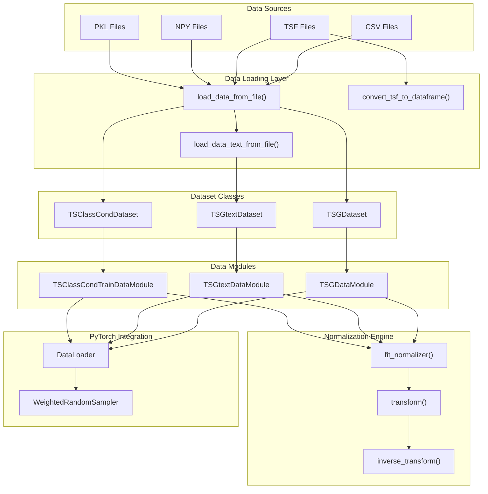
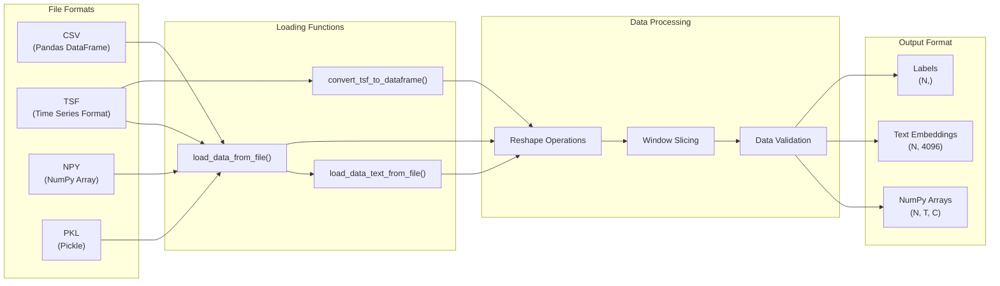
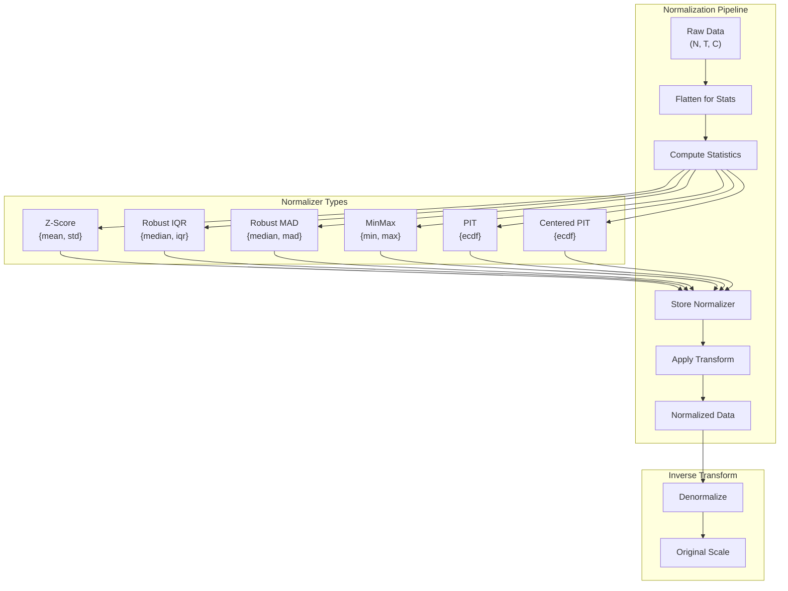
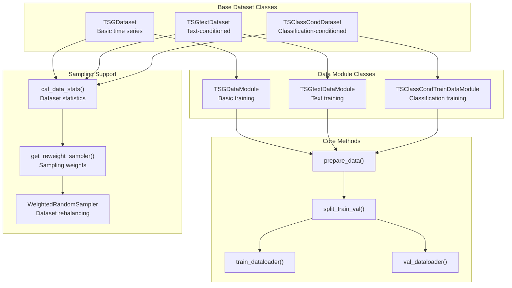
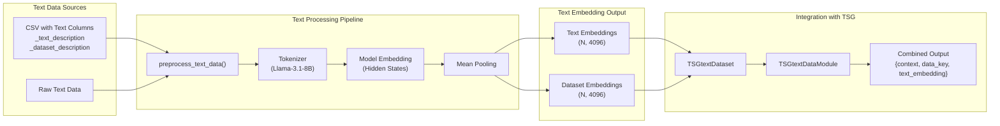
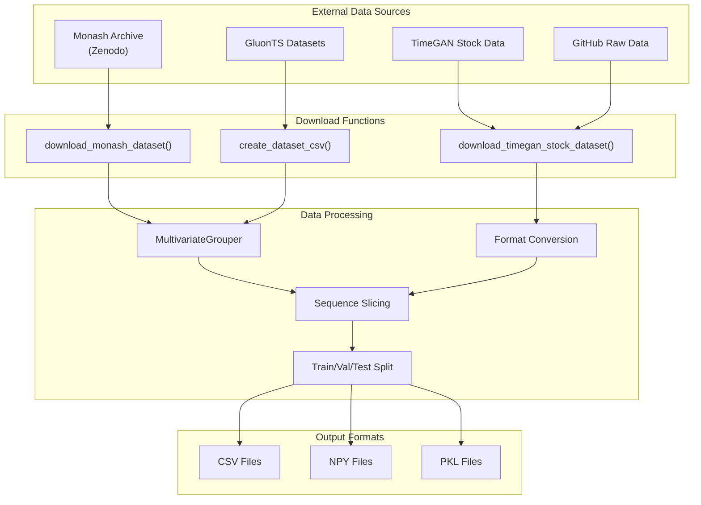
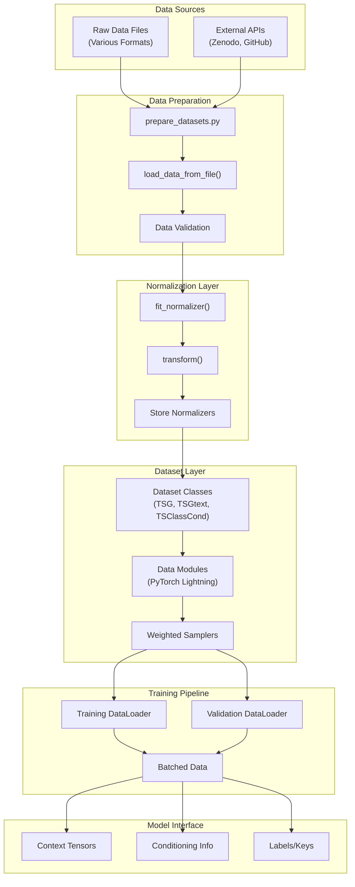

<!-- source: DeepWiki mcp.deepwiki.com · repo microsoft/TimeCraft · page 4 Data Infrastructure · fetched 2026-10-26 -->

# Data Infrastructure

Relevant source files

The following files were used as context for generating this wiki page:

- [.gitignore](.gitignore)
- [TimeDP/ldm/data/tsg_dataset.py](TimeDP/ldm/data/tsg_dataset.py)
- [TimeDP/utils/prepare_datasets.py](TimeDP/utils/prepare_datasets.py)
- [diffusion/ldm/data/tsg_dataset.py](diffusion/ldm/data/tsg_dataset.py)

This document provides a comprehensive overview of the data handling infrastructure in the TimeCraft framework. The data infrastructure is responsible for loading, processing, normalizing, and serving time series data to the model training and inference systems. It supports multiple data formats, normalization methods, and conditioning modes including text-based and classification-based generation.

For information about specific dataset preparation utilities, see [Dataset Preparation and Loading](#4.1). For details on TSG dataset classes and their PyTorch Lightning integration, see [TSG Dataset Modules](#4.2).

## Core Data Infrastructure Architecture

The data infrastructure is built around a modular design that separates data loading, normalization, and serving responsibilities. The system supports multiple input formats and provides standardized interfaces for different conditioning modes.

Sources: [diffusion/ldm/data/tsg_dataset.py:1-992]()

## Data Loading and Format Support

The system provides unified data loading through the `load_data_from_file` function, which automatically detects file formats and applies appropriate loading strategies. The loading layer abstracts away format-specific details and provides consistent numpy array outputs.

Sources: [diffusion/ldm/data/tsg_dataset.py:828-846](), [diffusion/ldm/data/tsg_dataset.py:685-826](), [diffusion/ldm/data/tsg_dataset.py:849-991]()

## Normalization Methods

The data infrastructure supports six different normalization methods, each suited for different data characteristics and use cases. The normalization system provides both forward and inverse transforms, enabling proper denormalization of generated samples.

| Method | Description | Use Case | Transform Function |
|--------|-------------|----------|-------------------|
| `zscore` | Z-score normalization | Gaussian-like distributions | `(x - mean) / std` |
| `robust_iqr` | Robust scaling with IQR | Outlier-resistant | `(x - median) / IQR` |
| `robust_mad` | Robust scaling with MAD | Heavy outliers | `(x - median) / MAD` |
| `minmax` | Min-max scaling | Bounded range [0,1] | `(x - min) / (max - min)` |
| `pit` | Probability integral transform | Non-parametric | `ECDF(x)` |
| `centered_pit` | Centered PIT | Range [-1,1] | `2 * ECDF(x) - 1` |

Sources: [diffusion/ldm/data/tsg_dataset.py:212-282](), [diffusion/ldm/data/tsg_dataset.py:413-474](), [diffusion/ldm/data/tsg_dataset.py:604-663]()

## Dataset Classes and Data Modules

The system provides specialized dataset classes for different conditioning modes, each paired with a PyTorch Lightning data module for seamless integration with the training pipeline.

Sources: [diffusion/ldm/data/tsg_dataset.py:284-331](), [diffusion/ldm/data/tsg_dataset.py:476-533](), [diffusion/ldm/data/tsg_dataset.py:16-46]()

## Text-Based Data Processing

The system supports text-conditioned generation through specialized text processing pipelines that integrate with large language models for embedding generation. This enables natural language control over time series generation.

Sources: [diffusion/ldm/data/tsg_dataset.py:685-805](), [diffusion/ldm/data/tsg_dataset.py:673-684](), [diffusion/ldm/data/tsg_dataset.py:535-663]()

## Data Preparation and External Sources

The framework includes comprehensive utilities for downloading and preparing datasets from various public sources, with automatic format conversion and standardization.

Sources: [TimeDP/utils/prepare_datasets.py:24-52](), [TimeDP/utils/prepare_datasets.py:53-61](), [TimeDP/utils/prepare_datasets.py:63-153]()

## Data Flow and Training Integration

The complete data flow from raw sources through normalization to model training demonstrates the integrated nature of the data infrastructure with the broader TimeCraft framework.

Sources: [diffusion/ldm/data/tsg_dataset.py:98-141](), [diffusion/ldm/data/tsg_dataset.py:180-211](), [diffusion/ldm/data/tsg_dataset.py:397-408]()

---

