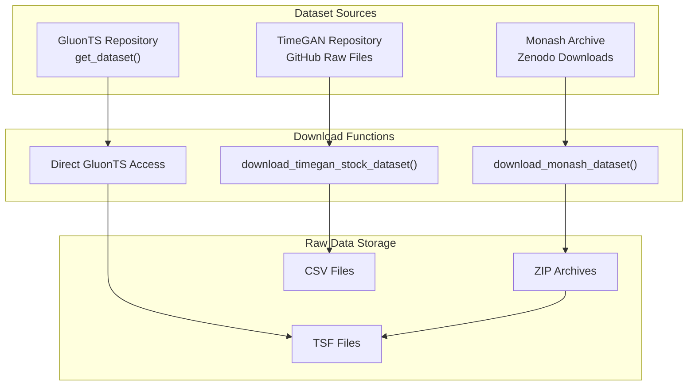
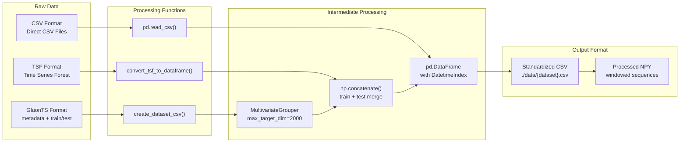
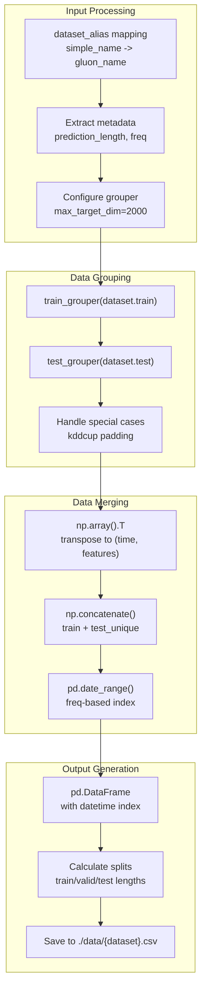
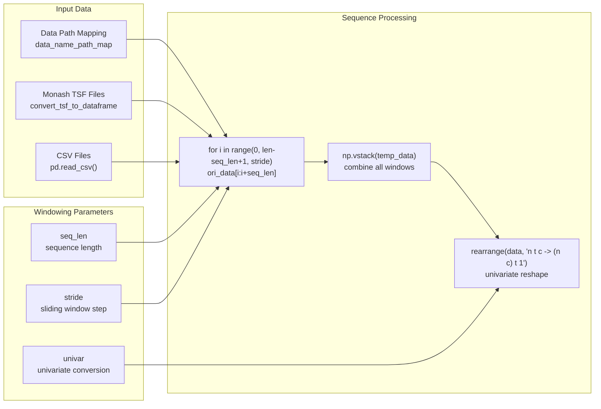
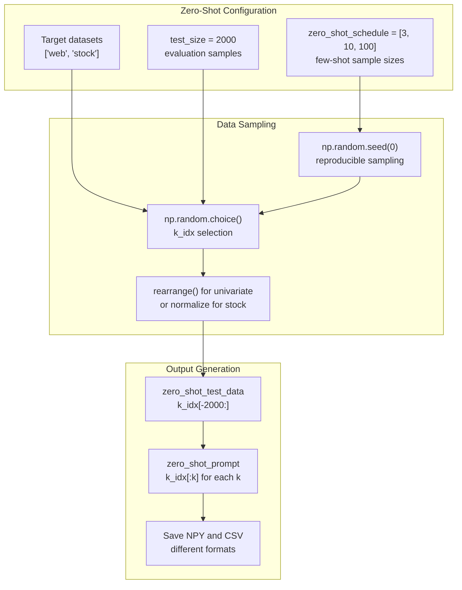
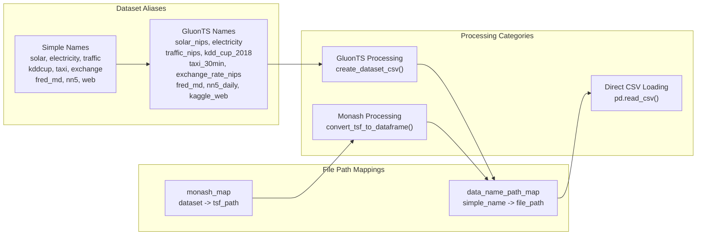

<!-- source: DeepWiki mcp.deepwiki.com · repo microsoft/TimeCraft · page 4.1 Dataset Preparation and Loading · fetched 2026-10-26 -->

# Dataset Preparation and Loading

<details>
<summary>Relevant source files</summary>

The following files were used as context for generating this wiki page:

- [TimeDP/utils/prepare_datasets.py](TimeDP/utils/prepare_datasets.py)

</details>


This document covers the dataset preparation and loading infrastructure in TimeCraft, which provides utilities for downloading, processing, and standardizing various time series datasets. The system handles datasets from multiple sources including GluonTS, Monash repository, and TimeGAN, converting them into formats suitable for time series generation tasks.

For information about the TSG dataset classes used for PyTorch Lightning integration, see [TSG Dataset Modules](#4.2). For model training procedures that use these prepared datasets, see [Training Guide](#6.1).

## Dataset Sources and Download System

The dataset preparation system supports three primary data sources, each with specialized download and processing mechanisms:



**Dataset Source Categories**

The system handles three categories of datasets with different processing requirements:

| Dataset Category | Examples | Source | Format |
|------------------|----------|---------|---------|
| GluonTS Datasets | `solar`, `electricity`, `traffic`, `kddcup`, `taxi`, `exchange`, `fred_md`, `nn5`, `web` | GluonTS repository | Native GluonTS format |
| Monash Datasets | `temprain`, `wind_4_seconds`, `pedestrian` | Zenodo archive | TSF format |
| External Datasets | `stock` | TimeGAN repository | CSV format |

**Sources:** [TimeDP/utils/prepare_datasets.py:24-52](), [TimeDP/utils/prepare_datasets.py:53-61](), [TimeDP/utils/prepare_datasets.py:179-198]()

## Dataset Processing Pipeline

The core processing pipeline transforms raw datasets into standardized formats through a series of preprocessing steps:



**Sources:** [TimeDP/utils/prepare_datasets.py:63-154](), [TimeDP/utils/prepare_datasets.py:155-177]()

## Data Transformation and Standardization

The `create_dataset_csv` function performs comprehensive data transformation for GluonTS datasets:



**Key Processing Features:**
- **Multivariate Grouping**: Limits feature dimensions to 2000 for computational efficiency
- **Temporal Alignment**: Ensures proper train/test split boundaries
- **Frequency Handling**: Preserves original dataset frequency information
- **Special Case Handling**: Addresses dataset-specific issues like padding requirements

**Sources:** [TimeDP/utils/prepare_datasets.py:66-76](), [TimeDP/utils/prepare_datasets.py:82-98](), [TimeDP/utils/prepare_datasets.py:129-153]()

## Sequence Windowing and Preprocessing

The `more_data_loading` function implements sliding window sequence extraction:



**Windowing Configuration:**
- **Sequence Lengths**: `[24, 96, 168, 336]` timesteps
- **Stride Options**: Typically equals sequence length for non-overlapping windows
- **Univariate Mode**: Converts multivariate to multiple univariate series

**Sources:** [TimeDP/utils/prepare_datasets.py:155-177](), [TimeDP/utils/prepare_datasets.py:228-240]()

## Zero-Shot Learning Data Preparation

The system includes specialized preparation for zero-shot learning scenarios:



**Zero-Shot Data Structure:**
- **Test Samples**: 2000 sequences for evaluation
- **Prompt Samples**: 3, 10, or 100 sequences for few-shot conditioning
- **Output Formats**: Both NPY (for training) and CSV (for analysis)

**Sources:** [TimeDP/utils/prepare_datasets.py:266-290]()

## File Organization and Output Structure

The preparation system creates a standardized file structure in the `./data/` directory:

| File Type | Naming Pattern | Purpose |
|-----------|----------------|---------|
| Raw CSV | `{dataset}.csv` | Standardized dataset format |
| Training NPY | `{dataset}_{seq_len}_train.npy` | Training sequences |
| Validation NPY | `{dataset}_{seq_len}_val.npy` | Validation sequences |
| Zero-Shot NPY | `{dataset}_{seq_len}_k_{k}_sample.npy` | Few-shot prompts |
| Zero-Shot CSV | `{dataset}_dim0_{seq_len}_k_{k}_sample.csv` | Analysis format |

**Data Directory Structure:**
```
./data/
├── {dataset}.csv                    # Raw standardized data
├── {dataset}_{seq_len}_train.npy   # Training sequences
├── {dataset}_{seq_len}_val.npy     # Validation sequences
├── ts_data/new_zero_shot_data/     # Zero-shot learning data
│   ├── {dataset}_{seq_len}_test_sample.npy
│   ├── {dataset}_{seq_len}_k_{k}_sample.npy
│   └── {dataset}_dim0_{seq_len}_k_{k}_sample.csv
└── *.tsf                           # Monash TSF files
```

**Sources:** [TimeDP/utils/prepare_datasets.py:23](), [TimeDP/utils/prepare_datasets.py:237-238](), [TimeDP/utils/prepare_datasets.py:277-290]()

## Dataset Catalog and Aliases

The system maintains comprehensive mappings for supported datasets:



**Supported Dataset Categories:**
- **Financial**: `stock`, `exchange`
- **Energy**: `solar`, `electricity` 
- **Transportation**: `traffic`, `taxi`
- **Environmental**: `temprain`, `wind_4_seconds`
- **Web Analytics**: `web`, `nn5`
- **Specialized**: `kddcup`, `fred_md`, `pedestrian`

**Sources:** [TimeDP/utils/prepare_datasets.py:66-76](), [TimeDP/utils/prepare_datasets.py:184-198](), [TimeDP/utils/prepare_datasets.py:179-183]()

---

