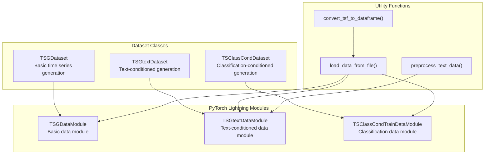
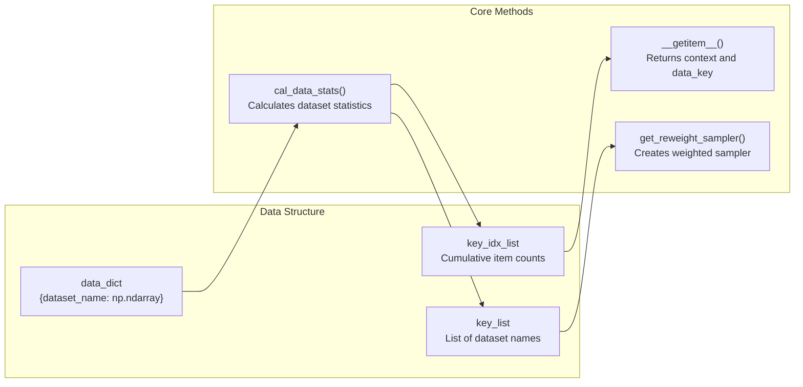
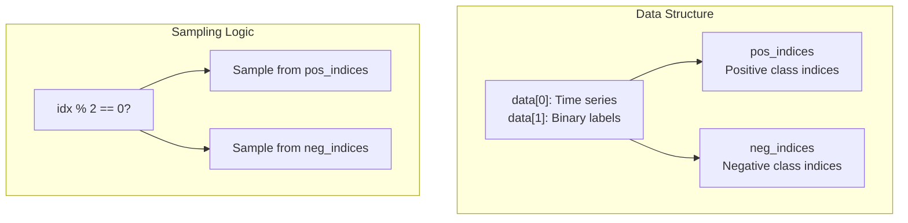
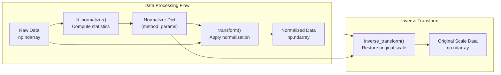
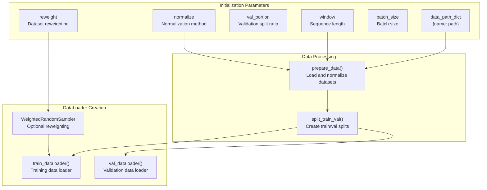
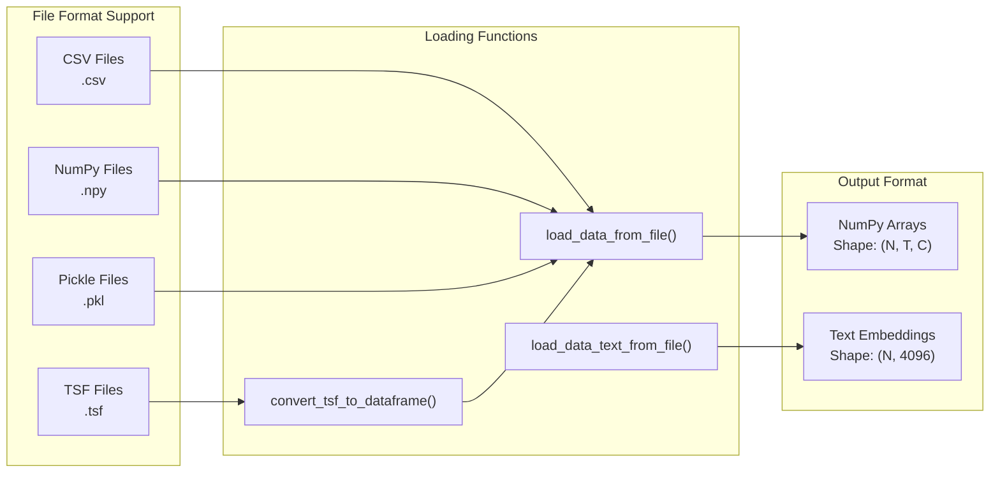

<!-- source: DeepWiki mcp.deepwiki.com · repo microsoft/TimeCraft · page 4.2 TSG Dataset Modules · fetched 2026-10-26 -->

# TSG Dataset Modules

<details>
<summary>Relevant source files</summary>

The following files were used as context for generating this wiki page:

- [.gitignore](.gitignore)
- [TimeDP/ldm/data/tsg_dataset.py](TimeDP/ldm/data/tsg_dataset.py)
- [diffusion/ldm/data/tsg_dataset.py](diffusion/ldm/data/tsg_dataset.py)

</details>


This page documents the TSG (Time Series Generation) dataset modules, which provide the core data handling infrastructure for the TimeCraft framework. These modules handle data loading, normalization, train/validation splitting, and PyTorch Lightning integration for time series generation tasks.

For information about dataset preparation and downloading, see [Dataset Preparation and Loading](#4.1). For details about the diffusion model configuration that uses these datasets, see [Diffusion Model Configuration](#5.1).

## Core Dataset Classes

The TSG dataset modules provide several dataset classes designed for different time series generation scenarios. All classes follow PyTorch's `Dataset` interface and integrate with PyTorch Lightning's `LightningDataModule`.

### Dataset Class Hierarchy



**Sources:** [diffusion/ldm/data/tsg_dataset.py:16-331](), [diffusion/ldm/data/tsg_dataset.py:333-411](), [diffusion/ldm/data/tsg_dataset.py:476-533](), [diffusion/ldm/data/tsg_dataset.py:535-603]()

### TSGDataset - Basic Time Series Generation

The `TSGDataset` class handles multiple datasets simultaneously and provides unified access to time series data for generation tasks.



**Sources:** [diffusion/ldm/data/tsg_dataset.py:284-331](), [TimeDP/ldm/data/tsg_dataset.py:14-61]()

### TSGtextDataset - Text-Conditioned Generation

The `TSGtextDataset` extends basic functionality to include text embeddings for text-conditioned time series generation.

| Field | Type | Description |
|-------|------|-------------|
| `context` | `np.ndarray` | Time series data with shape `(window,)` |
| `data_key` | `int` | Index identifying the source dataset |
| `text_embedding` | `np.ndarray` | Text embeddings with shape `(4096,)` |

**Sources:** [diffusion/ldm/data/tsg_dataset.py:476-533]()

### TSClassCondDataset - Classification-Conditioned Generation

The `TSClassCondDataset` handles binary classification tasks with balanced sampling between positive and negative examples.



**Sources:** [diffusion/ldm/data/tsg_dataset.py:16-47]()

## Data Normalization Methods

The TSG modules support multiple normalization techniques to handle different data distributions and characteristics.

### Normalization Options

| Method | Description | Parameters Stored |
|--------|-------------|-------------------|
| `zscore` | Standard z-score normalization | `mean`, `std` |
| `robust_iqr` | Robust scaling using IQR | `median`, `iqr` |
| `robust_mad` | Robust scaling using MAD | `median`, `mad` |
| `minmax` | Min-max scaling to [0,1] | `min`, `max` |
| `pit` | Probability integral transform | `ecdf` |
| `centered_pit` | Centered PIT to [-1,1] | `ecdf` |

### Normalization Pipeline



**Sources:** [diffusion/ldm/data/tsg_dataset.py:212-233](), [diffusion/ldm/data/tsg_dataset.py:234-256](), [diffusion/ldm/data/tsg_dataset.py:257-282]()

## PyTorch Lightning Integration

The TSG modules integrate seamlessly with PyTorch Lightning's training framework through specialized `LightningDataModule` classes.

### Data Module Configuration



**Sources:** [diffusion/ldm/data/tsg_dataset.py:333-411](), [diffusion/ldm/data/tsg_dataset.py:535-603]()

### Dataset Reweighting

The framework supports automatic dataset reweighting to handle imbalanced multi-dataset scenarios:

```python
def get_reweight_sampler(self):
    dataset_weights = np.array([1 / self.items_dict[key] for key in self.key_list])
    sample_weights = np.repeat(dataset_weights, [self.items_dict[key] for key in self.key_list])
    sampler = WeightedRandomSampler(weights=sample_weights, num_samples=self.total_items)
    return sampler
```

**Sources:** [diffusion/ldm/data/tsg_dataset.py:309-313](), [diffusion/ldm/data/tsg_dataset.py:502-506]()

## Data Loading Utilities

The TSG modules provide comprehensive utilities for loading various time series data formats.

### Supported File Formats



**Sources:** [diffusion/ldm/data/tsg_dataset.py:828-846](), [diffusion/ldm/data/tsg_dataset.py:849-991](), [diffusion/ldm/data/tsg_dataset.py:685-805]()

### Text Processing Integration

For text-conditioned generation, the modules integrate with Hugging Face transformers to process textual descriptions:

| Component | Purpose | Implementation |
|-----------|---------|----------------|
| `preprocess_text_data()` | Clean and validate text data | [diffusion/ldm/data/tsg_dataset.py:673-683]() |
| `load_data_text_from_file()` | Load text with time series | [diffusion/ldm/data/tsg_dataset.py:685-805]() |
| `MLP` | Text embedding projection | [diffusion/ldm/data/tsg_dataset.py:665-671]() |

**Sources:** [diffusion/ldm/data/tsg_dataset.py:673-683](), [diffusion/ldm/data/tsg_dataset.py:685-805](), [diffusion/ldm/data/tsg_dataset.py:665-671]()

---

