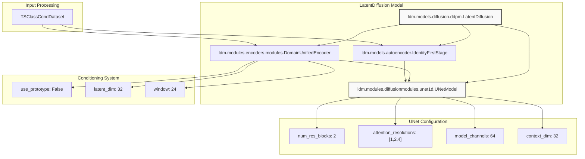
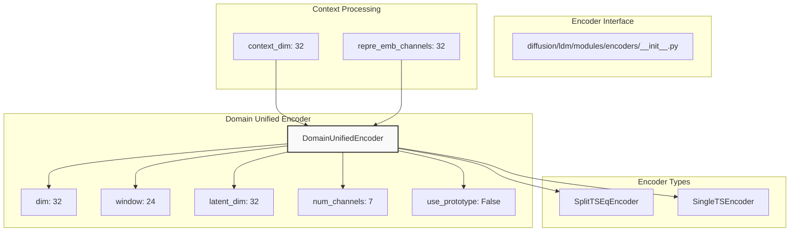
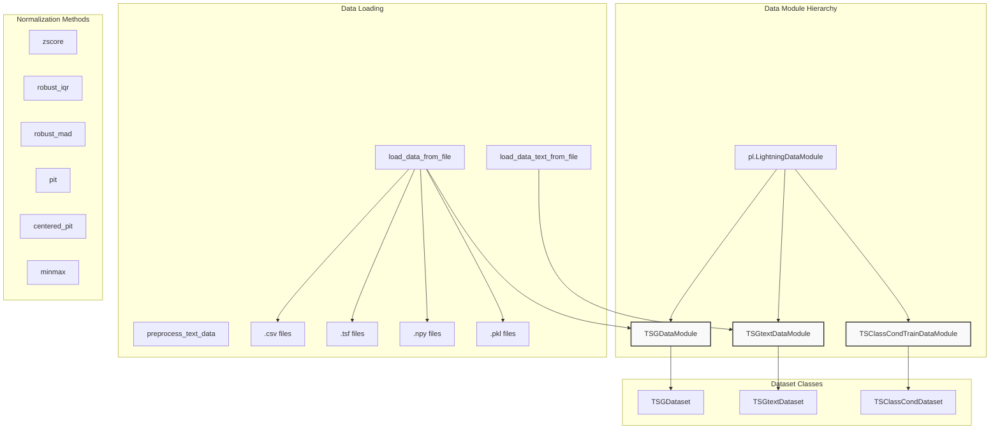
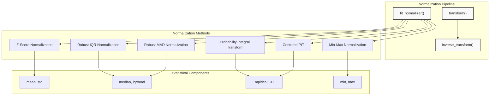
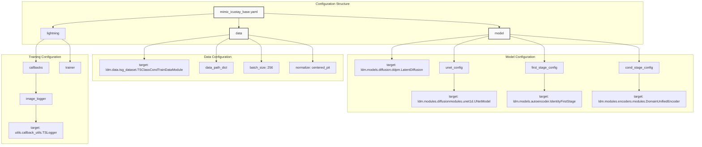
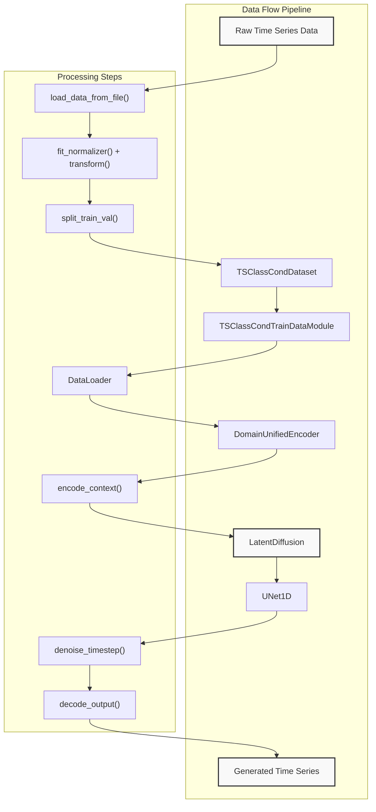

<!-- source: DeepWiki mcp.deepwiki.com · repo microsoft/TimeCraft · page 5 Model Components · fetched 2026-10-26 -->

# Model Components

Relevant source files

The following files were used as context for generating this wiki page:

- [TarDiff/configs/base/mimic_icustay_base.yaml](TarDiff/configs/base/mimic_icustay_base.yaml)
- [TarDiff/ldm/data/tsg_dataset.py](TarDiff/ldm/data/tsg_dataset.py)
- [diffusion/ldm/modules/encoders/__init__.py](diffusion/ldm/modules/encoders/__init__.py)

This document covers the core model components that form the foundation of the TimeCraft diffusion-based time series generation framework. These components include the diffusion model architecture, encoder modules, data processing systems, and their configuration mechanisms.

For information about training and inference workflows, see [Training and Inference](#6). For details about the overall framework architecture, see [Core Framework Architecture](#2).

## Core Diffusion Model Architecture

The TimeCraft framework is built around a latent diffusion model architecture that processes time series data through multiple stages. The core architecture consists of three main components: the diffusion model, the UNet backbone, and the conditioning system.

**Sources:** [TarDiff/configs/base/mimic_icustay_base.yaml:2-68]()

The `LatentDiffusion` model serves as the primary orchestrator, coordinating between the UNet backbone for denoising operations and the conditioning system for context-aware generation. The model supports various conditioning modes including cross-attention (`conditioning_key: crossattn`) and configurable dropout for conditional parts.

## Encoder Module System

The encoder system provides domain-specific and unified encoding capabilities for time series data. The framework supports multiple encoder types for different use cases and conditioning modes.

**Sources:** [TarDiff/configs/base/mimic_icustay_base.yaml:59-68](), [diffusion/ldm/modules/encoders/__init__.py:1-2]()

The encoder system is designed to handle multi-channel time series data with configurable dimensions and prototype-based conditioning. The `DomainUnifiedEncoder` can operate in different modes depending on the `use_prototype` flag and supports various time series encoding strategies.

## Data Processing Components

The data processing system provides comprehensive dataset handling, normalization, and batch preparation capabilities. The system is built around PyTorch Lightning data modules for efficient training and validation workflows.

**Sources:** [TarDiff/ldm/data/tsg_dataset.py:15-991]()

### Dataset Classes and Their Roles

The framework provides specialized dataset classes for different use cases:

| Dataset Class | Purpose | Key Features |
|---------------|---------|--------------|
| `TSGDataset` | Basic time series generation | Cross-domain data handling, reweighting |
| `TSGtextDataset` | Text-conditioned generation | Text embedding integration, multi-modal support |
| `TSClassCondDataset` | Classification-conditioned generation | Label-based conditioning, balanced sampling |

**Sources:** [TarDiff/ldm/data/tsg_dataset.py:283-331](), [TarDiff/ldm/data/tsg_dataset.py:475-532](), [TarDiff/ldm/data/tsg_dataset.py:15-46]()

### Normalization System

The normalization system supports multiple strategies for time series data preprocessing:

**Sources:** [TarDiff/ldm/data/tsg_dataset.py:211-281](), [TarDiff/ldm/data/tsg_dataset.py:412-472](), [TarDiff/ldm/data/tsg_dataset.py:603-662]()

The normalization system uses a three-stage process: fitting normalizers on training data, transforming data during training and inference, and inverse transforming generated samples back to original scale.

## Configuration System Integration

The model components are configured through YAML files that define the complete pipeline from data loading to model architecture. The configuration system uses target-based instantiation for flexible component selection.

**Sources:** [TarDiff/configs/base/mimic_icustay_base.yaml:1-98]()

The configuration system uses target strings to specify exact class paths, enabling flexible component swapping without code changes. Key configuration parameters include sequence length (`seq_length: 24`), model channels (`model_channels: 64`), and attention resolutions (`attention_resolutions: [1, 2, 4]`).

## Component Integration and Data Flow

The model components work together in a coordinated pipeline that processes time series data through multiple stages of encoding, conditioning, and generation.

**Sources:** [TarDiff/ldm/data/tsg_dataset.py:48-210](), [TarDiff/configs/base/mimic_icustay_base.yaml:35-68]()

The integration follows a modular design where each component can be configured independently through the YAML configuration system. The data modules handle preprocessing and batching, encoders provide contextual representations, and the diffusion model coordinates the generation process through the UNet architecture.

---

