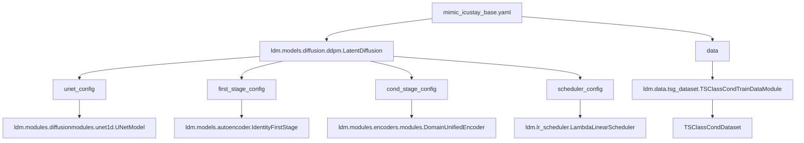
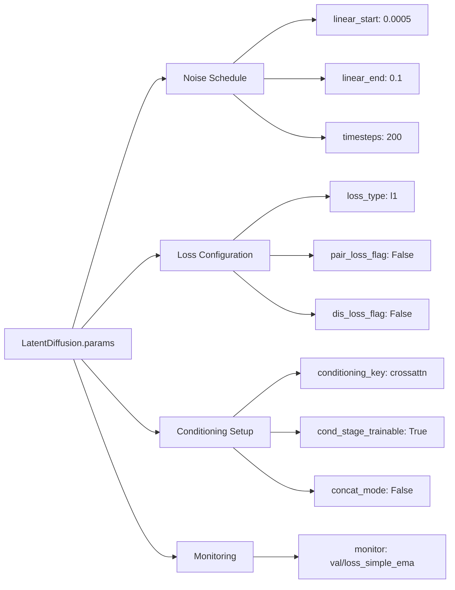
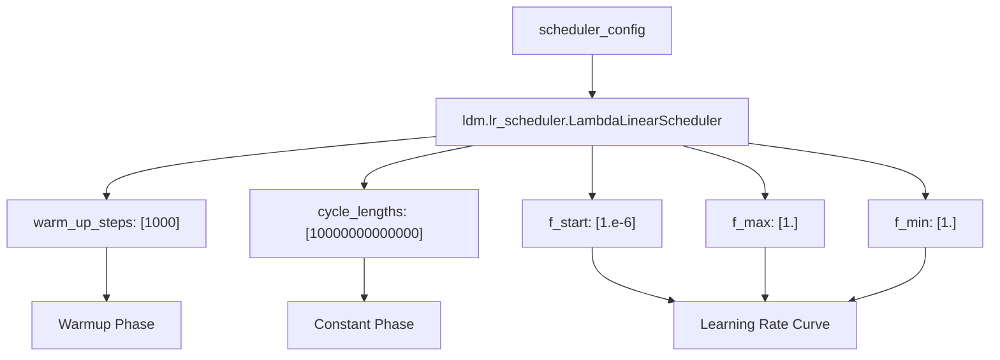
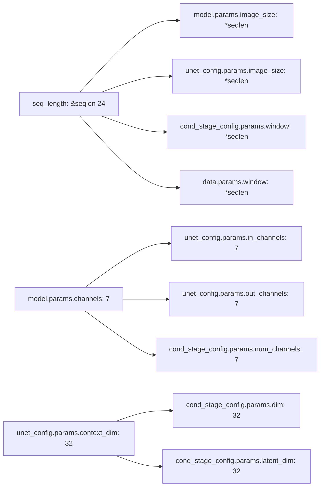

<!-- source: DeepWiki mcp.deepwiki.com · repo microsoft/TimeCraft · page 5.1 Diffusion Model Configuration · fetched 2026-10-26 -->

# Diffusion Model Configuration

<details>
<summary>Relevant source files</summary>

The following files were used as context for generating this wiki page:

- [TarDiff/configs/base/mimic_icustay_base.yaml](TarDiff/configs/base/mimic_icustay_base.yaml)
- [TarDiff/ldm/data/tsg_dataset.py](TarDiff/ldm/data/tsg_dataset.py)

</details>


This document describes the configuration structure and parameters for the LatentDiffusion models used throughout the TimeCraft framework. It covers the YAML configuration files, their relationship to code entities, and the key parameters that control model behavior during training and inference.

For information about the encoder modules that work with these diffusion models, see [Encoder Modules](#5.2). For details about the training process that uses these configurations, see [Training Guide](#6.1).

## Configuration Architecture

The diffusion model configuration follows a hierarchical structure where the main `LatentDiffusion` model coordinates several sub-components including the UNet, first stage model, and conditional stage encoder.



**Configuration-to-Code Entity Mapping**

Sources: [TarDiff/configs/base/mimic_icustay_base.yaml:1-98]()

## Core LatentDiffusion Parameters

The main diffusion model is configured through the `model.params` section, which controls the fundamental behavior of the diffusion process:

| Parameter | Default Value | Description |
|-----------|---------------|-------------|
| `linear_start` | 0.0005 | Starting value for linear noise schedule |
| `linear_end` | 0.1 | Ending value for linear noise schedule |
| `timesteps` | 200 | Number of diffusion timesteps |
| `loss_type` | "l1" | Loss function type (l1, l2, etc.) |
| `conditioning_key` | "crossattn" | Type of conditioning mechanism |
| `image_size` | 24 | Sequence length for time series |
| `channels` | 7 | Number of input channels |

Additional configuration parameters control training behavior:



Sources: [TarDiff/configs/base/mimic_icustay_base.yaml:5-33]()

## UNet1D Configuration

The UNet architecture is configured through the `unet_config` section, specifying the 1D convolutional neural network that performs the actual denoising:

```yaml
unet_config:
  target: ldm.modules.diffusionmodules.unet1d.UNetModel
  params:
    image_size: 24
    dims: 1
    in_channels: 7
    out_channels: 7
    model_channels: 64
    attention_resolutions: [1, 2, 4]
    num_res_blocks: 2
    channel_mult: [1, 2, 4, 4]
    num_heads: 8
    use_scale_shift_norm: True
    resblock_updown: True
    context_dim: 32
    repre_emb_channels: 32
    use_cfg: True
    use_spatial_transformer: True
    num_classes: 2
```

The UNet architecture parameters control the model's capacity and attention mechanisms:

| Parameter | Value | Purpose |
|-----------|-------|---------|
| `model_channels` | 64 | Base number of channels in the UNet |
| `channel_mult` | [1,2,4,4] | Channel multiplication factors for each resolution level |
| `attention_resolutions` | [1,2,4] | Resolutions at which to apply attention |
| `num_res_blocks` | 2 | Number of residual blocks per resolution |
| `context_dim` | 32 | Dimensionality of conditioning context |
| `num_classes` | 2 | Number of classes for classification conditioning |

Sources: [TarDiff/configs/base/mimic_icustay_base.yaml:35-54]()

## Stage Configurations

### First Stage Configuration

The first stage model handles the initial encoding/decoding of the input data. For time series data, an identity transformation is used:

```yaml
first_stage_config:
  target: ldm.models.autoencoder.IdentityFirstStage
```

This configuration indicates that no preprocessing or encoding is applied to the time series data before it enters the diffusion process.

### Conditional Stage Configuration

The conditional stage encoder processes conditioning information that guides the generation process:

```yaml
cond_stage_config:
  target: ldm.modules.encoders.modules.DomainUnifiedEncoder
  params:
    dim: 32
    window: 24
    latent_dim: 32
    num_channels: 7
    use_prototype: False
```

The `DomainUnifiedEncoder` parameters control how conditioning information is processed:

- `dim`: Output dimension of the encoder
- `window`: Input sequence length
- `latent_dim`: Latent representation dimension
- `num_channels`: Number of input channels
- `use_prototype`: Whether to use prototype-based conditioning

Sources: [TarDiff/configs/base/mimic_icustay_base.yaml:56-67]()

## Learning Rate Scheduler Configuration

The training process uses a `LambdaLinearScheduler` for learning rate scheduling:



The scheduler configuration creates a warmup phase followed by a constant learning rate:
- `warm_up_steps`: 1000 steps of gradual learning rate increase
- `cycle_lengths`: Extremely long cycle to maintain constant rate
- `f_start`: Starting factor (very small)
- `f_max` and `f_min`: Maximum and minimum factors (both 1.0)

Sources: [TarDiff/configs/base/mimic_icustay_base.yaml:26-33]()

## Data Configuration Integration

The diffusion model configuration integrates with the data pipeline through the `data` section:

```yaml
data:
  target: ldm.data.tsg_dataset.TSClassCondTrainDataModule
  params:
    data_path_dict:
      MIMIC_III_Readmission: data/mimic_icustay/train_tuple.pkl
    window: 24
    batch_size: 256
    normalize: centered_pit
    val_portion: 0.1
```

The `TSClassCondTrainDataModule` handles:
- Data loading from pickle files
- Normalization using various methods (`centered_pit`, `zscore`, `robust_iqr`, etc.)
- Train/validation splitting
- Batch processing for PyTorch Lightning integration

The data configuration must align with the model configuration, particularly:
- `window` parameter matches `image_size` in the model
- `channels` in the model matches the data dimensionality
- Normalization method affects the data distribution the model sees

Sources: [TarDiff/configs/base/mimic_icustay_base.yaml:69-81](), [TarDiff/ldm/data/tsg_dataset.py:48-96]()

## Configuration Validation and Relationships

The configuration system ensures consistency between different components through parameter sharing and validation:



This YAML anchor system (`&seqlen` and `*seqlen`) ensures that sequence length remains consistent across all components, preventing configuration mismatches that could cause runtime errors.

Sources: [TarDiff/configs/base/mimic_icustay_base.yaml:1-1](), [TarDiff/configs/base/mimic_icustay_base.yaml:14-14](), [TarDiff/configs/base/mimic_icustay_base.yaml:38-38](), [TarDiff/configs/base/mimic_icustay_base.yaml:63-63]()

---

