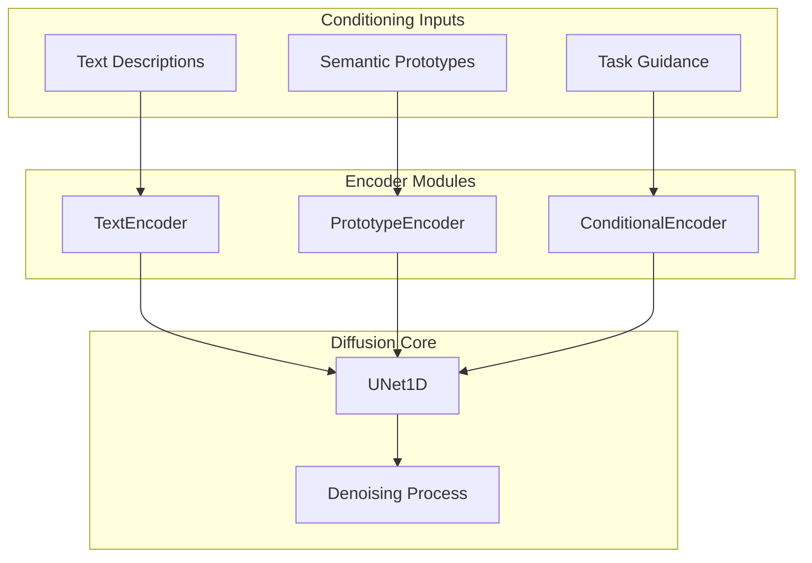
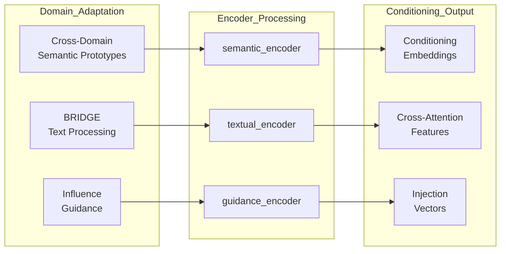
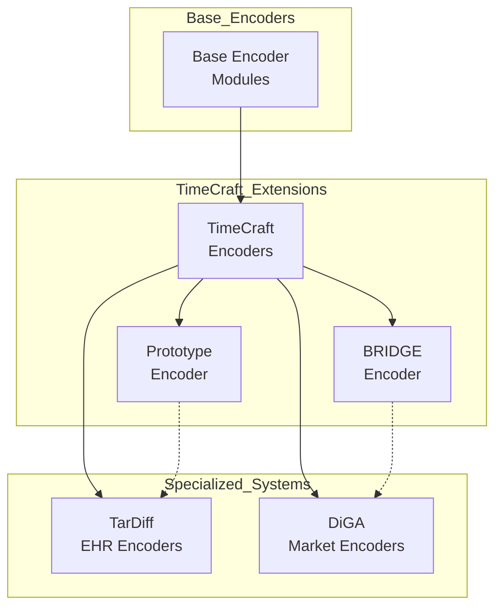
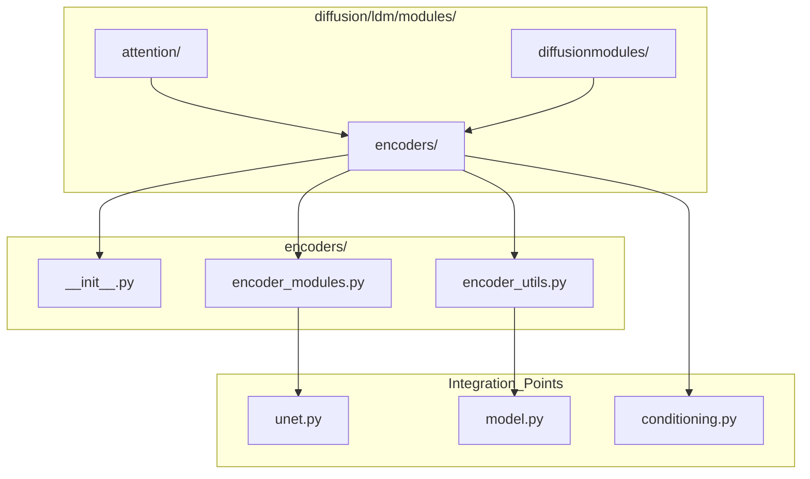
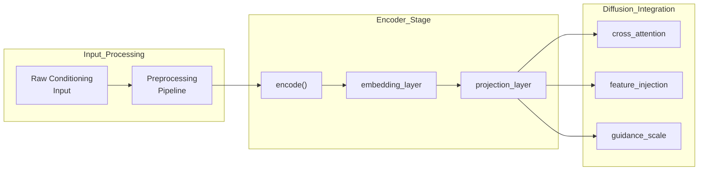

<!-- source: DeepWiki mcp.deepwiki.com · repo microsoft/TimeCraft · page 5.2 Encoder Modules · fetched 2026-10-26 -->

# Encoder Modules

Relevant source files

The following files were used as context for generating this wiki page:

- [diffusion/ldm/modules/encoders/__init__.py](diffusion/ldm/modules/encoders/__init__.py)

## Purpose and Scope

The encoder modules in TimeCraft provide conditional processing and domain-specific encoding capabilities for the diffusion-based time series generation framework. These modules serve as the interface between various conditioning inputs (text descriptions, semantic prototypes, task-specific guidance) and the core diffusion model architecture.

For information about the overall diffusion model configuration and architecture, see [Diffusion Model Configuration](#5.1). For details about the training and inference processes that utilize these encoders, see [Training Guide](#6.1) and [Inference and Generation](#6.2).

## Architecture Overview

The encoder modules are positioned as a critical bridge between conditioning inputs and the diffusion generation process. They transform various types of conditioning information into representations that can guide the time series generation process.

**Encoder Integration in TimeCraft Architecture**

Sources: [diffusion/ldm/modules/encoders/__init__.py:1-2]()

## Encoder Types and Functions

Based on the TimeCraft framework's three core capabilities, the encoder modules support multiple conditioning modalities:

**Multi-Modal Encoder Architecture**

Sources: [diffusion/ldm/modules/encoders/__init__.py:1-2]()

### Conditional Processing Capabilities

The encoder modules support three primary conditioning modes that align with TimeCraft's core capabilities:

| Encoder Type | Input Type | Purpose | Integration Point |
|--------------|------------|---------|-------------------|
| Semantic Encoder | Prototype vectors | Cross-domain generalization | UNet cross-attention |
| Text Encoder | Natural language | BRIDGE system integration | Conditioning embeddings |
| Guidance Encoder | Task gradients | Target-aware adaptation | Influence injection |

### Domain-Specific Encoding

The encoder architecture supports domain-specific adaptations for specialized systems:

**Domain-Specific Encoder Extensions**

Sources: [diffusion/ldm/modules/encoders/__init__.py:1-2]()

## Module Organization

The encoder modules are organized within the Latent Diffusion Model (LDM) framework structure:

**Encoder Module Structure**

Sources: [diffusion/ldm/modules/encoders/__init__.py:1-2]()

## Integration with Diffusion Models

The encoder modules integrate with the diffusion model architecture through multiple pathways:

### Conditioning Mechanisms

The encoders support various conditioning mechanisms for controlling the generation process:

**Conditioning Flow in Diffusion Process**

Sources: [diffusion/ldm/modules/encoders/__init__.py:1-2]()

### Training and Inference Integration

The encoder modules are integrated into both training and inference workflows:

- **Training Phase**: Encoders process conditioning inputs during the forward pass of the diffusion model
- **Inference Phase**: Encoders handle real-time conditioning for guided generation
- **Evaluation Phase**: Encoders support different conditioning modes for model assessment

## Usage in Specialized Systems

The encoder modules support the specialized implementations built on TimeCraft:

### TarDiff Integration

For EHR time series generation, encoders handle:
- Clinical domain-specific conditioning
- Patient trajectory encoding
- Medical concept embeddings

### DiGA Integration

For market data generation, encoders process:
- Financial domain features
- Trading strategy conditions
- Market regime embeddings

Sources: [diffusion/ldm/modules/encoders/__init__.py:1-2]()

---

