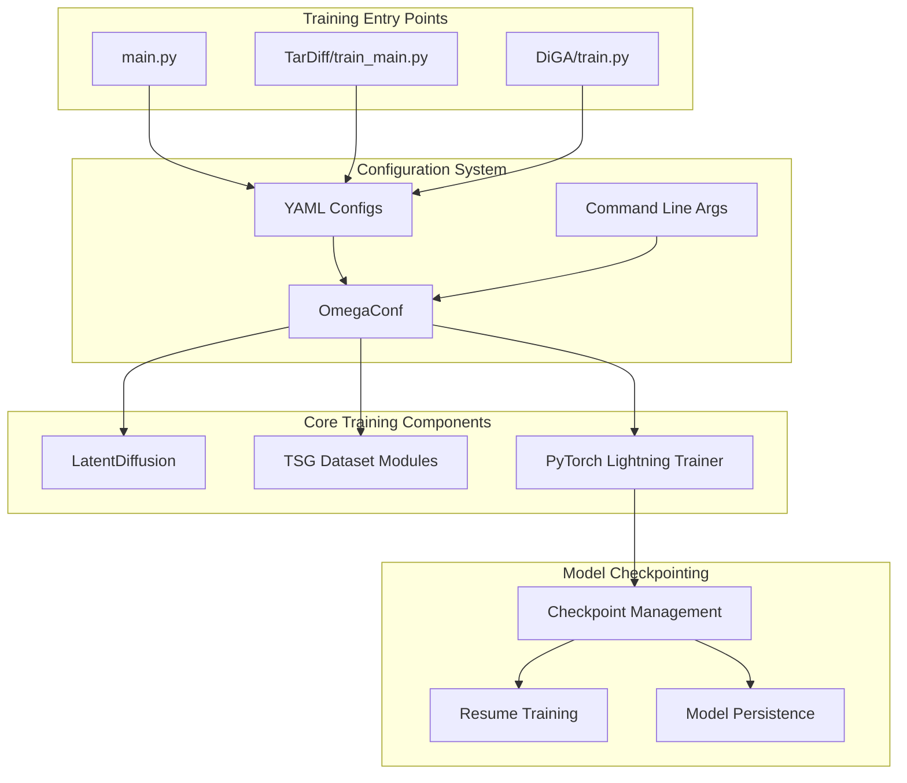
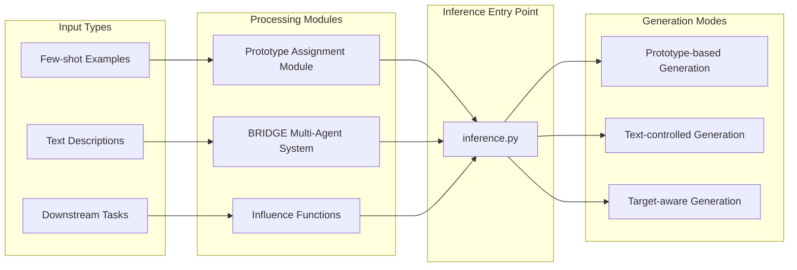
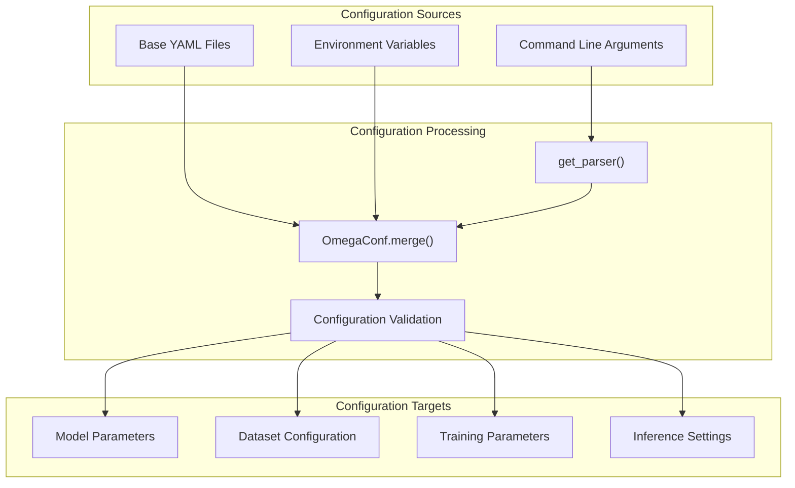
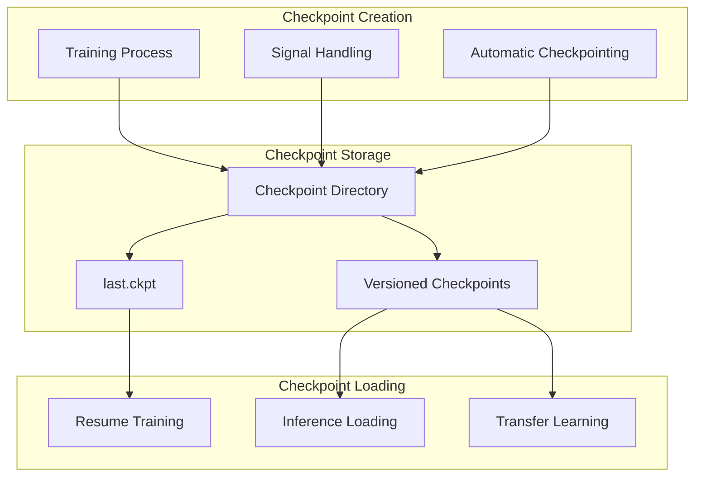

<!-- source: DeepWiki mcp.deepwiki.com · repo microsoft/TimeCraft · page 6 Training and Inference · fetched 2026-10-26 -->

# Training and Inference

<details>
<summary>Relevant source files</summary>

The following files were used as context for generating this wiki page:

- [BRIDGE/README.md](BRIDGE/README.md)
- [README.md](README.md)
- [TarDiff/train_main.py](TarDiff/train_main.py)
- [figures/pt_like_word_newcolors.png](figures/pt_like_word_newcolors.png)
- [supplementary/inference_guidance.md](supplementary/inference_guidance.md)
- [supplementary/inference_prototype.md](supplementary/inference_prototype.md)
- [supplementary/inference_prototype_text.md](supplementary/inference_prototype_text.md)

</details>


This document provides a comprehensive guide to training TimeCraft models and performing inference with different conditioning modes. It covers the main training workflows, inference modes, configuration management, and command-line interfaces used throughout the framework.

For detailed step-by-step training instructions, see [Training Guide](#6.1). For specific inference mode documentation, see [Inference and Generation](#6.2). For model architecture details, see [Model Components](#5).

## Training Overview

The TimeCraft framework supports multiple training workflows depending on the target application and specialization requirements. The training process is built on PyTorch Lightning and uses OmegaConf for configuration management.

### Training Workflows



**Training Workflow Architecture**

The training system uses a three-tier configuration approach where YAML files provide base configurations, command-line arguments allow runtime overrides, and OmegaConf manages the unified configuration state. The main training scripts instantiate LatentDiffusion models and TSG dataset modules based on these configurations.

Sources: [README.md:199-460](), [TarDiff/train_main.py:1-460]()

### Training Script Responsibilities

| Script | Purpose | Key Components |
|--------|---------|----------------|
| `main.py` | TimeCraft core training | Prototype Assignment Module, BRIDGE integration |
| `TarDiff/train_main.py` | Target-aware diffusion training | Guidance mechanisms, medical data handling |
| `DiGA/train.py` | Financial market data training | Trading data processing, RL integration |

The training scripts share common functionality through the `instantiate_from_config` utility and standardized argument parsing via `get_parser()` functions.

Sources: [TarDiff/train_main.py:12-267](), [README.md:199-205]()

## Inference Overview

TimeCraft supports three distinct inference modes that can be used individually or in combination, depending on the application requirements and available conditioning inputs.

### Inference Modes Architecture



**Inference Mode Processing Pipeline**

Each inference mode processes different input types through specialized modules before converging at the unified `inference.py` entry point. The system supports activating multiple modes simultaneously for hybrid conditioning.

Sources: [README.md:206-217](), [supplementary/inference_prototype.md:1-29](), [supplementary/inference_prototype_text.md:1-25](), [supplementary/inference_guidance.md:1-28]()

### Inference Mode Configuration

The inference modes are controlled through command-line flags and configuration parameters:

| Mode | Flag | Requirements | Output Type |
|------|------|-------------|-------------|
| Prototype-based | `--use_pam` | Few-shot examples | Cross-domain time series |
| Text-controlled | `--use_text` | Text embeddings directory | Controllable time series |
| Target-aware | `--use_guidance` | Downstream model, guidance set | Task-optimized time series |

Sources: [supplementary/inference_prototype.md:5-28](), [supplementary/inference_prototype_text.md:9-24](), [supplementary/inference_guidance.md:10-26]()

## Configuration Management

The framework uses a hierarchical configuration system built on OmegaConf that supports base configurations, runtime overrides, and environment-specific customizations.

### Configuration Hierarchy



**Configuration Management Flow**

Configuration processing follows a merge hierarchy where base YAML files provide defaults, command-line arguments allow runtime customization, and the system validates the final configuration before instantiating components.

Sources: [TarDiff/train_main.py:302-306](), [TarDiff/train_main.py:270-290]()

### Key Configuration Parameters

The training and inference scripts support extensive configuration through command-line arguments:

- **Model Configuration**: `--seq_len`, `--batch_size`, `--num_latents`, `--overwrite_learning_rate`
- **Training Control**: `--train`, `--resume`, `--max_steps`, `--seed`
- **Inference Modes**: `--use_pam`, `--use_text`, `--use_guidance`, `--uncond`
- **Path Management**: `--dataset_prefix`, `--ckpt_prefix`, `--sample_path`

Sources: [TarDiff/train_main.py:24-266]()

## Command Line Interface

The framework provides consistent command-line interfaces across all training and inference scripts, with shared argument parsing utilities and standardized parameter handling.

### Common CLI Patterns

Training command structure:
```bash
python main.py \
  --base config.yaml \
  --seq_len 168 \
  --batch_size 256 \
  --max_steps 20000 \
  --seed 42
```

Inference command structure:
```bash
python inference.py \
  --base config.yaml \
  --resume true \
  --ckpt_name ./checkpoints/ \
  --use_pam \
  --use_text \
  --text_emb_dir ./embeddings/
```

Sources: [supplementary/inference_prototype.md:7-28](), [supplementary/inference_prototype_text.md:11-24]()

### Argument Processing

The argument parsing system uses a standardized `get_parser()` function that defines common parameters and supports boolean argument handling through `str2bool()` conversion. The PyTorch Lightning trainer arguments are integrated through `Trainer.add_argparse_args()`.

Sources: [TarDiff/train_main.py:12-23](), [TarDiff/train_main.py:284-286]()

## Model Checkpointing and State Management

The framework implements comprehensive checkpoint management supporting training resumption, model versioning, and state persistence across different training stages.

### Checkpoint Management System



**Checkpoint Management Architecture**

The system handles checkpoint creation through training processes, signal handling, and automatic saves. Checkpoints are stored in organized directories with both latest and versioned files, supporting various loading scenarios.

Sources: [TarDiff/train_main.py:434-440](), [TarDiff/train_main.py:350-354]()

### Checkpoint Directory Structure

The framework creates structured logging and checkpoint directories:

```
logdir/
├── checkpoints/
│   ├── last.ckpt
│   └── epoch_*.ckpt
├── configs/
│   └── config.yaml
└── logs/
    └── training.log
```

The directory naming includes training parameters for easy identification: `{name}_{seq_len}_nl_{num_latents}_lr{learning_rate}_bs{batch_size}_ms{max_steps}k`

Sources: [TarDiff/train_main.py:333-355]()

### Resume Training

Training resumption is handled through the `--resume` flag, which automatically loads the last checkpoint and continues training from the previous state. The system preserves optimizer states, learning rate schedules, and training metrics.

Sources: [TarDiff/train_main.py:379-381](), [TarDiff/train_main.py:54-58]()

---

