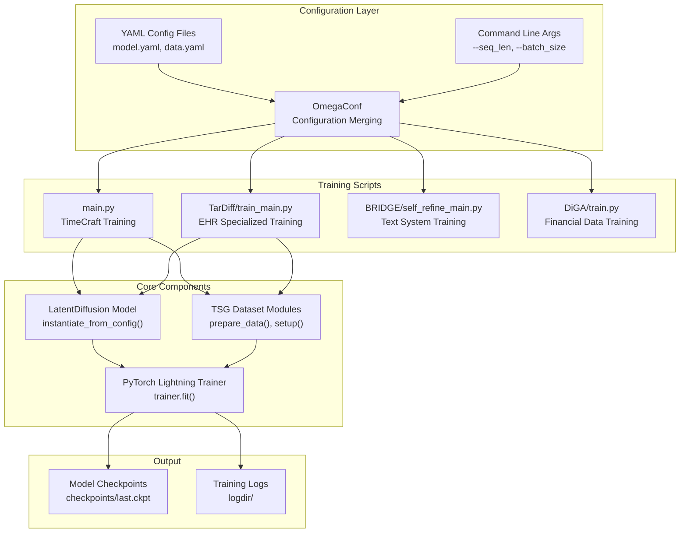
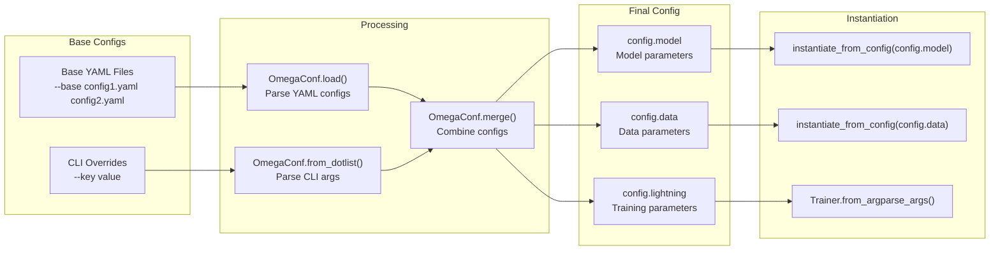
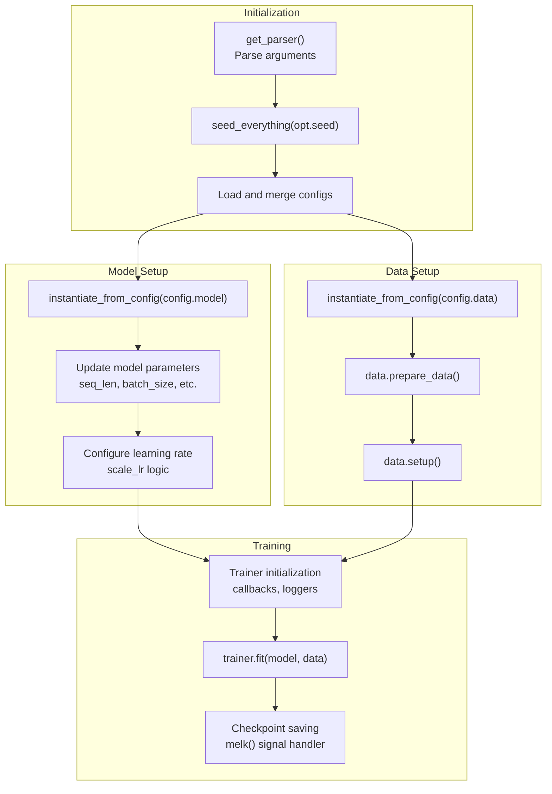
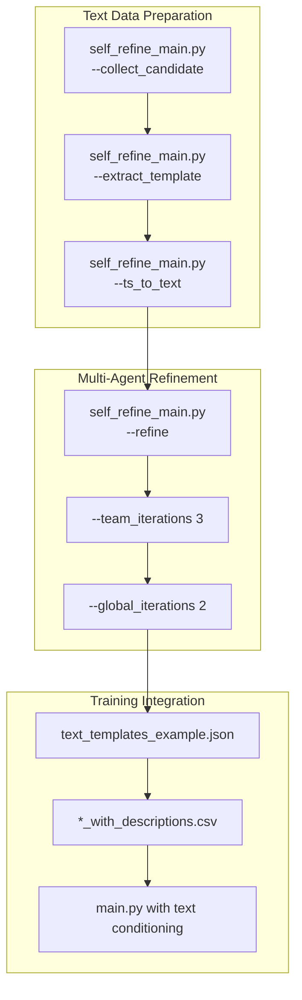
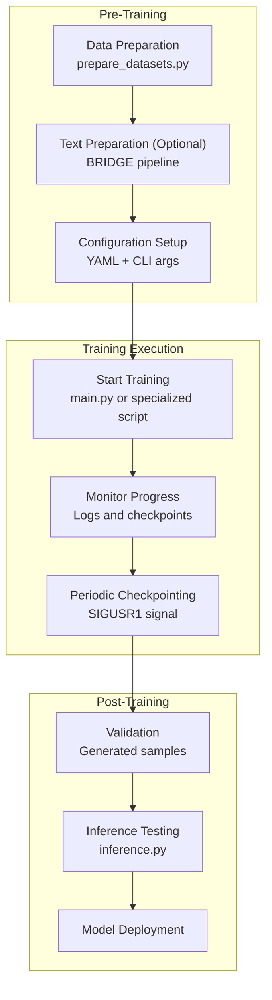

<!-- source: DeepWiki mcp.deepwiki.com · repo microsoft/TimeCraft · page 6.1 Training Guide · fetched 2026-10-26 -->

# Training Guide

<details>
<summary>Relevant source files</summary>

The following files were used as context for generating this wiki page:

- [BRIDGE/README.md](BRIDGE/README.md)
- [README.md](README.md)
- [TarDiff/train_main.py](TarDiff/train_main.py)
- [figures/pt_like_word_newcolors.png](figures/pt_like_word_newcolors.png)

</details>


This document provides comprehensive instructions for training TimeCraft models and their specialized implementations. It covers configuration management, command-line options, and training procedures for the core TimeCraft framework as well as specialized systems like TarDiff, BRIDGE, and DiGA.

For information about model inference and generation after training, see [Inference and Generation](#6.2). For details about diffusion model architecture configuration, see [Diffusion Model Configuration](#5.1). For dataset preparation before training, see [Dataset Preparation and Loading](#4.1).

## Training System Overview

The TimeCraft framework supports multiple training modes depending on your use case and target domain. The training infrastructure is built on PyTorch Lightning and uses OmegaConf for configuration management.

### Training Pipeline Architecture



Sources: [README.md:199-203](), [TarDiff/train_main.py:277-459]()

## Configuration Management

TimeCraft uses a hierarchical configuration system that combines YAML files with command-line overrides. The configuration flow follows this priority order: CLI arguments > YAML configs > defaults.

### Configuration Flow



Sources: [TarDiff/train_main.py:302-306](), [TarDiff/train_main.py:356-371]()

### Key Configuration Parameters

| Parameter | Description | Default | Example |
|-----------|-------------|---------|---------|
| `--seq_len` | Time series sequence length | 24 | `--seq_len 168` |
| `--batch_size` | Training batch size | 256 | `--batch_size 64` |
| `--max_steps` | Maximum training steps | 20000 | `--max_steps 50000` |
| `--overwrite_learning_rate` | Override base learning rate | None | `--overwrite_learning_rate 1e-4` |
| `--normalize` | Normalization method | None | `--normalize minmax` |
| `--seed` | Random seed | 23 | `--seed 42` |
| `--logdir` | Logging directory | `/mnt/storage/ts_diff_newer` | `--logdir ./logs` |

Sources: [TarDiff/train_main.py:188-265]()

## Core TimeCraft Training

The main TimeCraft framework is trained using `main.py` which supports all three core capabilities: cross-domain generation, text-based control, and target-aware adaptation.

### Basic Training Command

```bash
python main.py \
    --base configs/timecraft_base.yaml \
    --seq_len 168 \
    --batch_size 64 \
    --max_steps 50000 \
    --normalize minmax \
    --seed 42
```

### Training Process Flow



Sources: [TarDiff/train_main.py:277-459](), [README.md:199-203]()

### Advanced Training Options

For specialized training modes, additional flags are available:

| Flag | Purpose | Usage |
|------|---------|-------|
| `--uncond` | Unconditional generation | `--uncond` |
| `--use_prototype` | Enable prototype-based training | `--use_prototype` |
| `--ce_loss` | Use cross-entropy loss | `--ce_loss` |
| `--part_drop` | Partial dropout conditions | `--part_drop` |
| `--dis_weight` | Disentangling loss weight | `--dis_weight 0.5` |

Sources: [TarDiff/train_main.py:195-258]()

## Specialized System Training

### TarDiff: EHR Time Series Training

TarDiff specializes in Electronic Health Record time series generation and uses `TarDiff/train_main.py` for training.

#### TarDiff Configuration

```bash
python TarDiff/train_main.py \
    --base configs/tardiff_config.yaml \
    --dataset_name mimic \
    --seq_len 24 \
    --batch_size 128 \
    --max_step_sum 20000 \
    --train_stage pre \
    --dataset_prefix ./data \
    --ckpt_prefix ./outputs
```

#### TarDiff-Specific Parameters

| Parameter | Description | Example |
|-----------|-------------|---------|
| `--dataset_name` | Dataset identifier | `--dataset_name mimic` |
| `--train_stage` | Training stage (pre/dis) | `--train_stage pre` |
| `--dataset_prefix` | Data directory path | `--dataset_prefix ./data` |
| `--ckpt_prefix` | Checkpoint directory | `--ckpt_prefix ./outputs` |
| `--sample_path` | Sample output path | `--sample_path ./samples` |
| `--num_latents` | Number of latent dimensions | `--num_latents 16` |

Sources: [TarDiff/train_main.py:144-177]()

### BRIDGE: Text-Based Control Training

The BRIDGE system handles text-based control and requires a multi-stage training process.

#### BRIDGE Training Pipeline



Sources: [BRIDGE/README.md:27-66]()

#### BRIDGE Training Commands

1. **Collect Text Candidates:**
```bash
python BRIDGE/self_refine_main.py \
    --openai_key YOUR_API_KEY \
    --collect_candidate
```

2. **Extract Templates:**
```bash
python BRIDGE/self_refine_main.py \
    --openai_key YOUR_API_KEY \
    --extract_template \
    --template_input_file input.json
```

3. **Generate Descriptions:**
```bash
python BRIDGE/self_refine_main.py \
    --openai_key YOUR_API_KEY \
    --ts_file timeseries.csv \
    --dataset_name dataset_id \
    --ts_to_text
```

4. **Multi-Agent Refinement:**
```bash
python BRIDGE/self_refine_main.py \
    --openai_key YOUR_API_KEY \
    --ts_file timeseries.csv \
    --dataset_name dataset_id \
    --refine \
    --team_iterations 3 \
    --global_iterations 2
```

Sources: [BRIDGE/README.md:31-66]()

### DiGA: Financial Data Training

DiGA specializes in market trading data generation and uses domain-specific training procedures.

#### DiGA Training Command

```bash
python DiGA/train.py \
    --config configs/diga_config.yaml \
    --data_path ./financial_data \
    --seq_len 96 \
    --batch_size 32 \
    --epochs 100
```

Sources: [README.md:74-77]()

## Training Workflow and Best Practices

### Complete Training Workflow



Sources: [README.md:92-222](), [TarDiff/train_main.py:434-449]()

### Learning Rate Scaling

TimeCraft supports automatic learning rate scaling based on distributed training setup:

```bash
# Enable learning rate scaling
python main.py \
    --base config.yaml \
    --scale_lr \
    --batch_size 64
```

The scaling formula is: `lr = accumulate_grad_batches * num_gpus * batch_size * base_lr`

Sources: [TarDiff/train_main.py:422-431]()

### Checkpoint Management

Training checkpoints are automatically saved and can be resumed:

```bash
# Resume from checkpoint
python main.py \
    --base config.yaml \
    --resume \
    --logdir ./previous_run_logs
```

Manual checkpoint saving is triggered by sending `SIGUSR1` signal to the training process.

Sources: [TarDiff/train_main.py:434-449]()

### Training Monitoring

Monitor training progress through:

- **Logs**: Located in `logdir/` directory
- **Checkpoints**: Saved in `logdir/checkpoints/`
- **Configs**: Backed up in `logdir/configs/`
- **Samples**: Generated samples during training

Sources: [TarDiff/train_main.py:350-354]()

## Configuration Examples

### Basic TimeCraft Configuration

```yaml
model:
  target: ldm.models.diffusion.ddpm.LatentDiffusion
  params:
    image_size: 168
    unet_config:
      target: ldm.modules.diffusionmodules.openaimodel.UNet1DModel
      params:
        image_size: 168
        in_channels: 64
        out_channels: 64

data:
  target: main.DataModuleFromConfig
  params:
    batch_size: 64
    window: 168
    normalize: minmax

lightning:
  trainer:
    max_steps: 50000
    accelerator: gpu
    devices: 1
```

### Advanced Configuration with Prototypes

```yaml
model:
  target: ldm.models.diffusion.ddpm.LatentDiffusion
  params:
    use_prototype: true
    num_latents: 16
    prototype_assignment:
      target: ldm.modules.prototype.PrototypeAssignmentModule
      params:
        num_prototypes: 32
        embedding_dim: 256
```

Sources: [TarDiff/train_main.py:308-340]()

## Troubleshooting

### Common Issues

1. **CUDA Out of Memory**: Reduce `batch_size` or `seq_len`
2. **Configuration Conflicts**: Check CLI args override YAML configs
3. **Data Loading Errors**: Verify dataset paths and formats
4. **Checkpoint Loading**: Ensure checkpoint paths are correct for resume

### Debug Mode

Enable debug mode for troubleshooting:

```bash
python main.py \
    --base config.yaml \
    --debug \
    --max_steps 10
```

This reduces training steps and enables detailed logging.

Sources: [TarDiff/train_main.py:319-323]()

---

