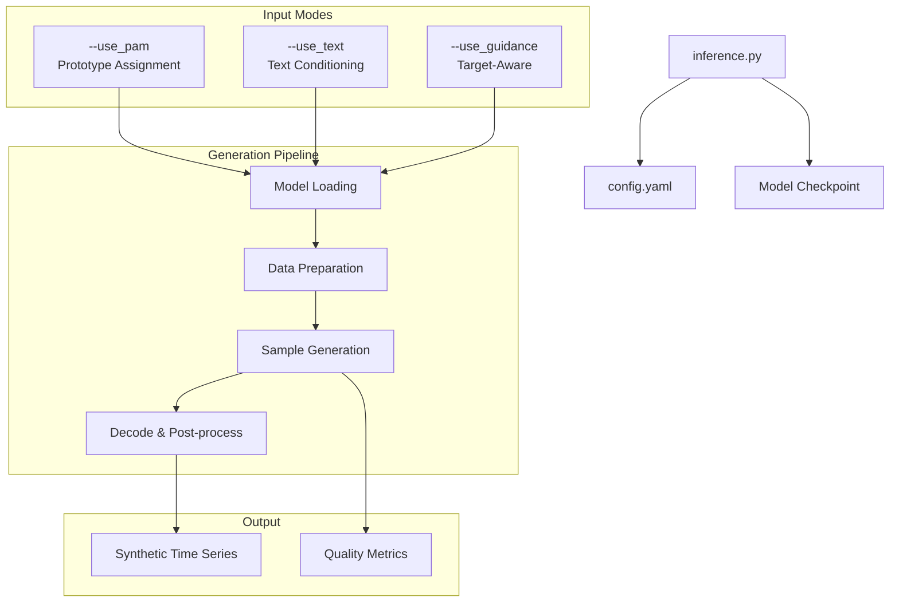
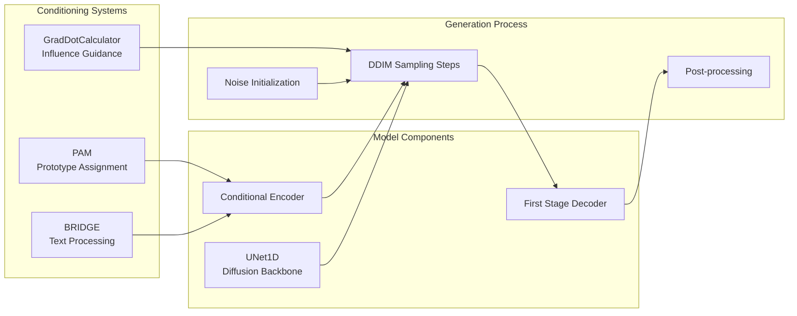
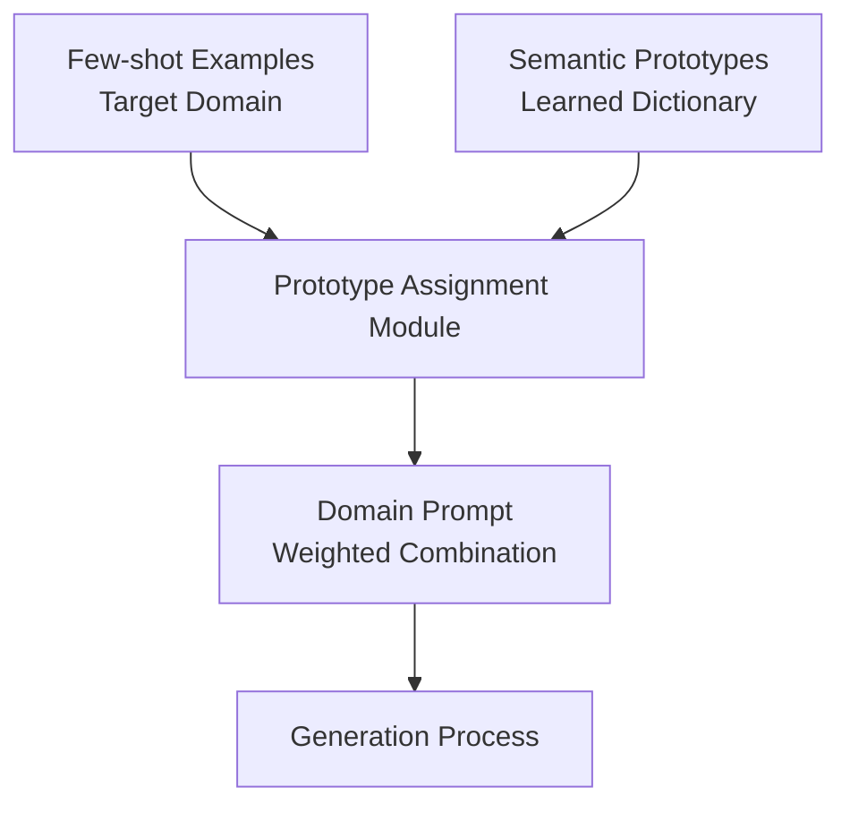
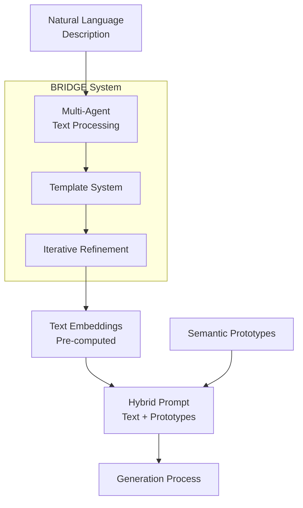
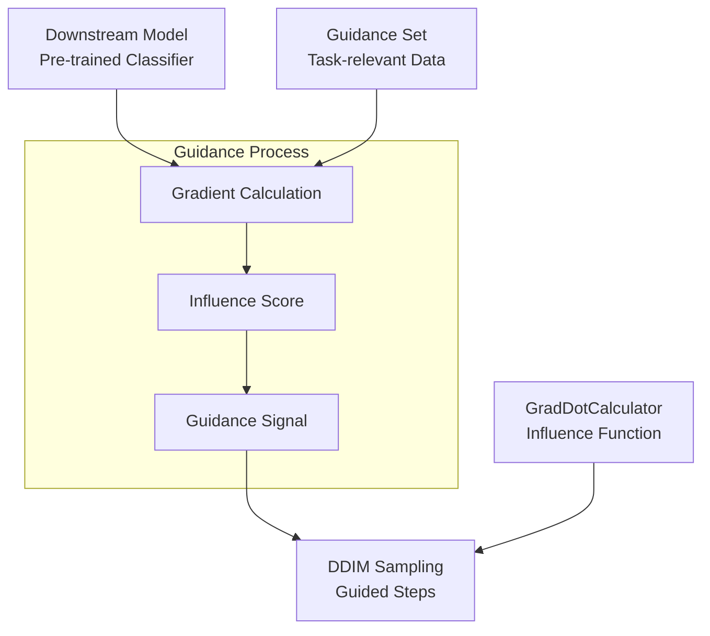

<!-- source: DeepWiki mcp.deepwiki.com · repo microsoft/TimeCraft · page 6.2 Inference and Generation · fetched 2026-10-26 -->

# Inference and Generation

<details>
<summary>Relevant source files</summary>

The following files were used as context for generating this wiki page:

- [BRIDGE/README.md](BRIDGE/README.md)
- [README.md](README.md)
- [TarDiff/guidance_generation.py](TarDiff/guidance_generation.py)
- [figures/pt_like_word_newcolors.png](figures/pt_like_word_newcolors.png)
- [supplementary/inference_guidance.md](supplementary/inference_guidance.md)
- [supplementary/inference_prototype.md](supplementary/inference_prototype.md)
- [supplementary/inference_prototype_text.md](supplementary/inference_prototype_text.md)

</details>


This document covers the inference and generation capabilities of TimeCraft, including the three main generation modes: prototype-based, text-conditioned, and target-aware generation. For training procedures and model configuration, see [Training Guide](#6.1). For visualization and analysis of generated outputs, see [Visualization and Analysis](#7).

## Overview

TimeCraft provides a unified inference framework supporting three distinct generation modes that can be used individually or in combination. The system is designed to generate high-quality synthetic time series data with varying degrees of control and specificity.

## Generation Modes

### Prototype-Based Generation

Uses learned semantic prototypes to generate cross-domain time series. The Prototype Assignment Module (PAM) computes domain-specific weights for universal prototypes, enabling few-shot adaptation to new domains.

**Key Components:**
- `inference.py` - Main inference script with `--use_pam` flag
- Prototype Assignment Module for domain adaptation
- Domain prompt construction from few-shot examples

### Text-Conditioned Generation

Leverages natural language descriptions to control time series characteristics. Uses the BRIDGE multi-agent system for text processing and hybrid conditioning that combines prototypes with textual prompts.

**Key Components:**
- `inference.py` with `--use_text` flag
- BRIDGE system for text processing
- Hybrid prompt construction combining prototypes and text embeddings

### Target-Aware Generation

Generates synthetic data optimized for specific downstream tasks using influence-guided diffusion. This mode uses gradients from downstream models to steer the generation process.

**Key Components:**
- `TarDiff/guidance_generation.py` - Specialized guidance generation
- `inference.py` with `--use_guidance` flag
- Influence function-based guidance mechanism

## Core Architecture

### Unified Inference Interface



Sources: [inference.py](), [supplementary/inference_prototype.md:1-28](), [supplementary/inference_prototype_text.md:1-24](), [supplementary/inference_guidance.md:1-27]()

### Generation Flow Components



Sources: [ldm/models/diffusion/ddim.py](), [TarDiff/guidance_generation.py:495-533]()

## Implementation Details

### Command Line Interface

The main inference script `inference.py` provides a flexible command-line interface supporting multiple generation modes:

| Flag | Purpose | Mode |
|------|---------|------|
| `--use_pam` | Enable prototype-based generation | Prototype |
| `--use_text` | Enable text conditioning | Text |
| `--use_guidance` | Enable target-aware generation | Guidance |
| `--uncond` | Unconditional generation | None |

### Prototype-Based Generation

The prototype system uses the Prototype Assignment Module to create domain prompts from few-shot examples:



**Configuration:**
- Enabled with `--use_pam` flag
- Requires trained semantic prototypes
- Supports cross-domain generalization

Sources: [supplementary/inference_prototype.md:1-28](), [README.md:9-11]()

### Text-Conditioned Generation

Text conditioning combines natural language descriptions with semantic prototypes through hybrid prompting:



**Configuration:**
- Enabled with `--use_text` flag
- Requires `--text_emb_dir` for pre-computed embeddings
- Can be combined with prototypes using `--use_pam --use_text`

Sources: [supplementary/inference_prototype_text.md:1-24](), [BRIDGE/README.md:1-92]()

### Target-Aware Generation

Target-aware generation uses influence functions to guide the diffusion process toward improving downstream task performance:



**Key Implementation:**
- `GradDotCalculator` class computes influence scores [TarDiff/guidance_generation.py:495-496]()
- Alpha parameter controls guidance strength [TarDiff/guidance_generation.py:455]()
- Integrates with DDIM sampling process [TarDiff/guidance_generation.py:504-512]()

Sources: [TarDiff/guidance_generation.py:455-535](), [supplementary/inference_guidance.md:1-27]()

## Configuration and Usage

### Basic Inference Commands

**Prototype-based generation:**
```bash
python inference.py \
  --base config.yaml \
  --resume true \
  --ckpt_name ./checkpoints/ \
  --use_pam
```

**Text-conditioned generation:**
```bash
python inference.py \
  --base config.yaml \
  --resume true \
  --ckpt_name ./checkpoints/ \
  --use_pam \
  --use_text \
  --text_emb_dir ./text_embeddings/
```

**Target-aware generation:**
```bash
python inference.py \
  --base config.yaml \
  --resume true \
  --ckpt_name ./checkpoints/ \
  --use_guidance \
  --downstream_pth_path ./classifier/checkpoints/best_model.pt \
  --guidance_path ./classifier/data/guidance_tuple.pkl
```

### Advanced Configuration

The inference system supports extensive configuration through command-line arguments:

| Parameter | Purpose | Default |
|-----------|---------|---------|
| `--seq_len` | Sequence length | 24 |
| `--batch_size` | Batch size | 256 |
| `--uncond` | Unconditional generation | False |
| `--normalize` | Normalization method | Config dependent |

### Specialized Generation Scripts

For specific use cases, TimeCraft provides specialized generation scripts:

- `TarDiff/guidance_generation.py` - Target-aware generation with influence guidance
- `DiGA/generate.py` - Financial market data generation
- `BRIDGE/ts_to_text.py` - Text description generation

## Output Processing

### Data Format

Generated time series data is typically output in the following formats:
- `.npy` files for numerical data
- `.pkl` files for structured data with labels
- `.csv` files for human-readable output

### Quality Metrics

The inference system can compute various quality metrics:
- Maximum Mean Discrepancy (MMD)
- Kullback-Leibler (KL) divergence
- Task-specific performance metrics

### Post-processing Pipeline


Sources: [TarDiff/guidance_generation.py:513-523](), [inference.py]()

## Integration with Other Systems

The inference system integrates with other TimeCraft components:

- **Data Infrastructure**: Uses TSG dataset modules for data loading and normalization (see [TSG Dataset Modules](#4.2))
- **Model Components**: Leverages diffusion models and encoders (see [Model Components](#5))
- **Visualization**: Outputs can be analyzed using visualization tools (see [Visualization and Analysis](#7))

Sources: [README.md:206-217](), [config.yaml files]()

---

