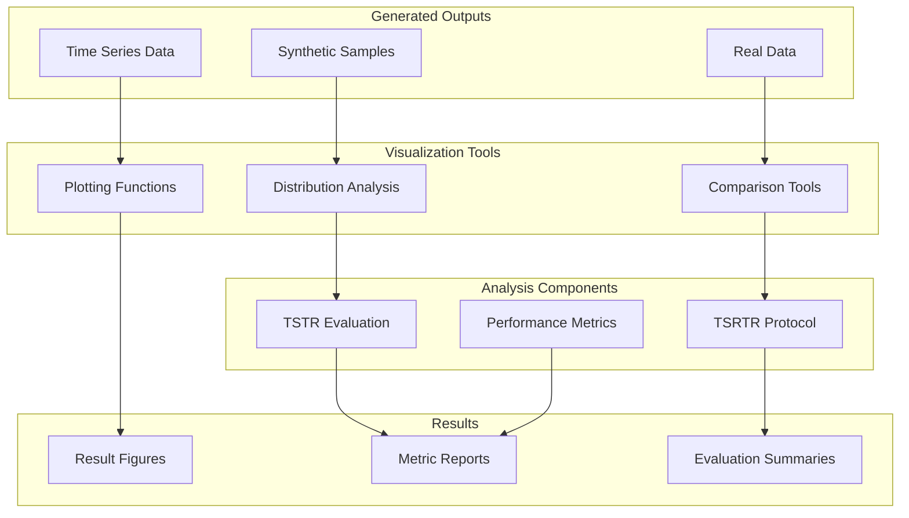
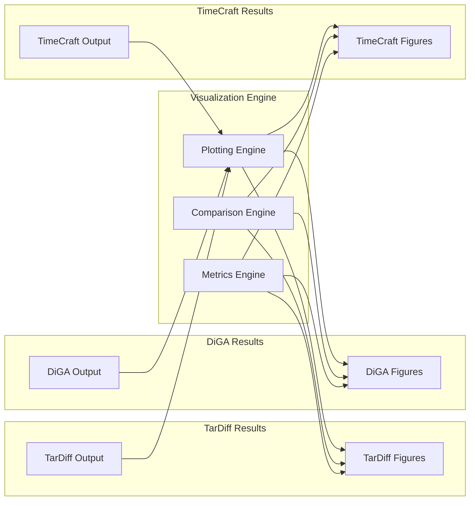
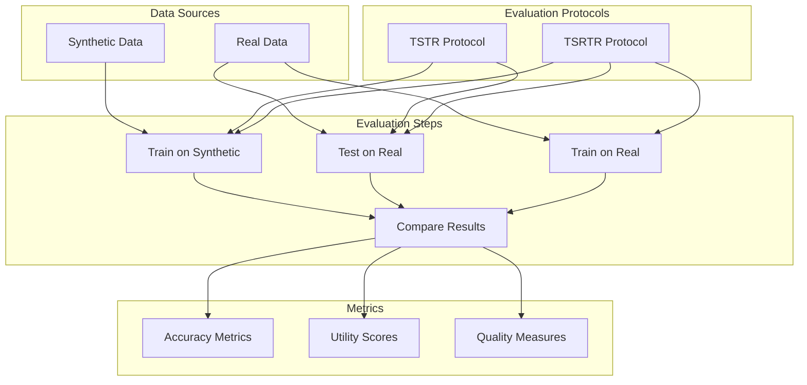
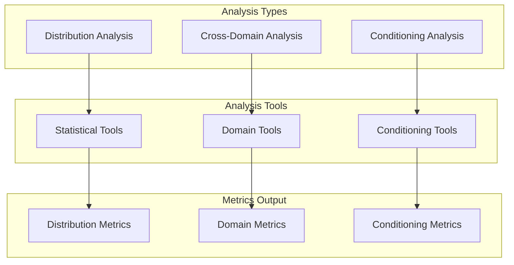
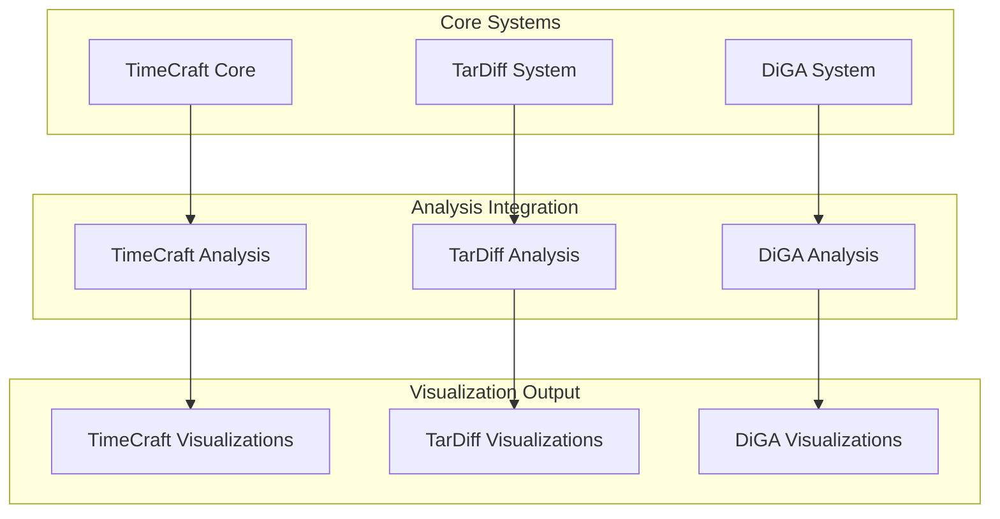

<!-- source: DeepWiki mcp.deepwiki.com · repo microsoft/TimeCraft · page 7 Visualization and Analysis · fetched 2026-10-26 -->

# Visualization and Analysis

Relevant source files

The following files were used as context for generating this wiki page:

- [figures/TarDiff_result.png](figures/TarDiff_result.png)
- [figures/pt_like_word_small.png](figures/pt_like_word_small.png)
- [figures/timedp_indomain.png](figures/timedp_indomain.png)

This document covers the visualization tools and analysis components available in the TimeCraft framework for understanding model outputs, evaluating performance, and interpreting results from time series generation tasks. These tools support both the main TimeCraft system and its specialized implementations (TarDiff and DiGA).

For information about the core inference and generation processes, see [Inference and Generation](#6.2). For details about the specialized systems that these tools analyze, see [TarDiff: EHR Time Series Generation](#3.1) and [DiGA: Market Trading Data Generation](#3.2).

## Overview

The visualization and analysis infrastructure provides comprehensive tools for:
- Visualizing generated time series data
- Comparing synthetic vs. real data distributions  
- Evaluating model performance across different conditioning modes
- Analyzing cross-domain generation capabilities
- Monitoring training progress and convergence

**Visualization and Analysis Pipeline**

Sources: [figures/TarDiff_result.png](), system architecture diagrams

## Result Visualization

The framework generates comprehensive visual results for different system outputs. The primary visualization capabilities include plotting generated time series, comparing distributions, and showing model performance across different conditions.

**Result Visualization Architecture**

Sources: [figures/TarDiff_result.png]()

## Performance Evaluation

The analysis infrastructure implements standardized evaluation protocols for assessing the quality and utility of generated time series data.

### TSTR (Train Synthetic, Test Real) Protocol

The TSTR protocol evaluates the quality of synthetic data by training models on generated samples and testing on real data. This measures how well the synthetic data captures the underlying patterns needed for downstream tasks.

### TSRTR (Train Synthetic, Test Real, Train Real) Protocol  

The TSRTR protocol provides a more comprehensive evaluation by comparing performance when training on synthetic data versus real data, helping assess the utility of generated samples for data augmentation.

**Evaluation Protocol Architecture**

Sources: System architecture diagrams, evaluation framework references

## Analysis Components

The framework provides several specialized analysis components for different aspects of time series generation and evaluation.

### Distribution Analysis

Tools for analyzing the statistical properties of generated time series compared to real data, including:
- Marginal distribution comparisons
- Temporal correlation analysis
- Spectral analysis
- Statistical distance measurements

### Cross-Domain Analysis

Specialized analysis for evaluating the cross-domain generation capabilities of the TimeCraft system:
- Domain transfer quality assessment
- Semantic prototype effectiveness
- Few-shot learning performance evaluation

### Conditioning Analysis

Analysis tools for evaluating different conditioning modes:
- Text-based conditioning effectiveness
- Prototype-based generation quality
- Target-aware adaptation performance

**Analysis Component Architecture**

Sources: System architecture diagrams, analysis framework references

## Integration with Core Systems

The visualization and analysis tools are integrated with the core TimeCraft systems to provide seamless evaluation and monitoring capabilities.

### TimeCraft Integration

The main TimeCraft system provides analysis hooks for:
- Semantic prototype visualization
- Cross-domain generation assessment
- Multi-modal conditioning evaluation

### TarDiff Integration

The TarDiff system includes specialized analysis for:
- EHR time series quality assessment
- Clinical performance evaluation
- Healthcare-specific metrics

### DiGA Integration

The DiGA system provides analysis capabilities for:
- Market data generation quality
- Trading strategy performance
- Financial metric evaluation

**System Integration Architecture**

Sources: [figures/TarDiff_result.png](), system architecture diagrams

---

