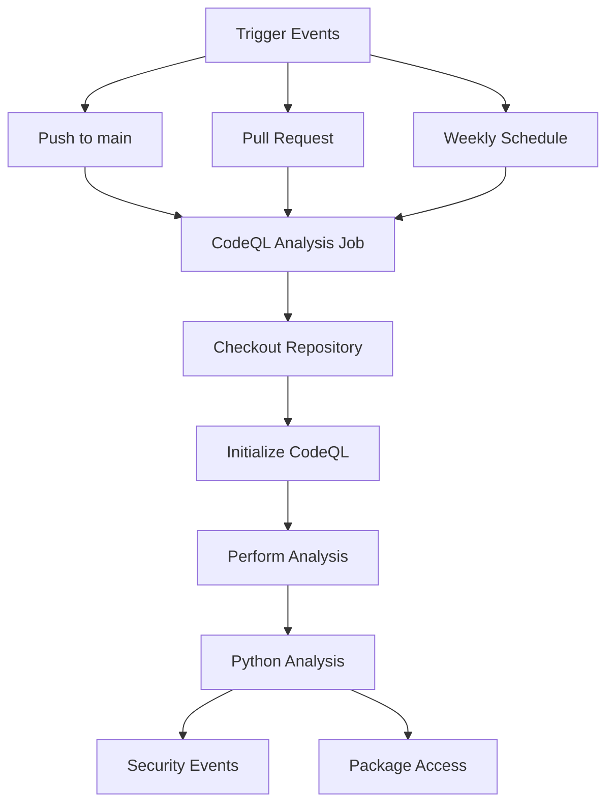
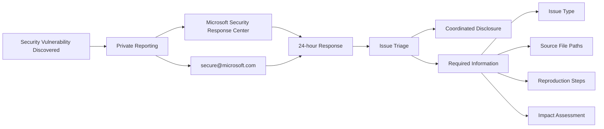
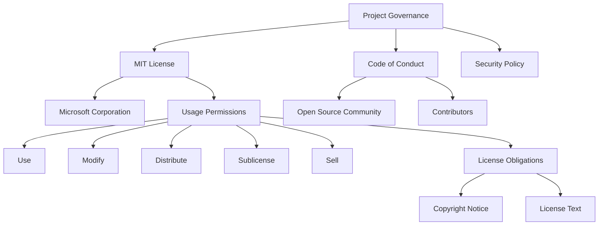
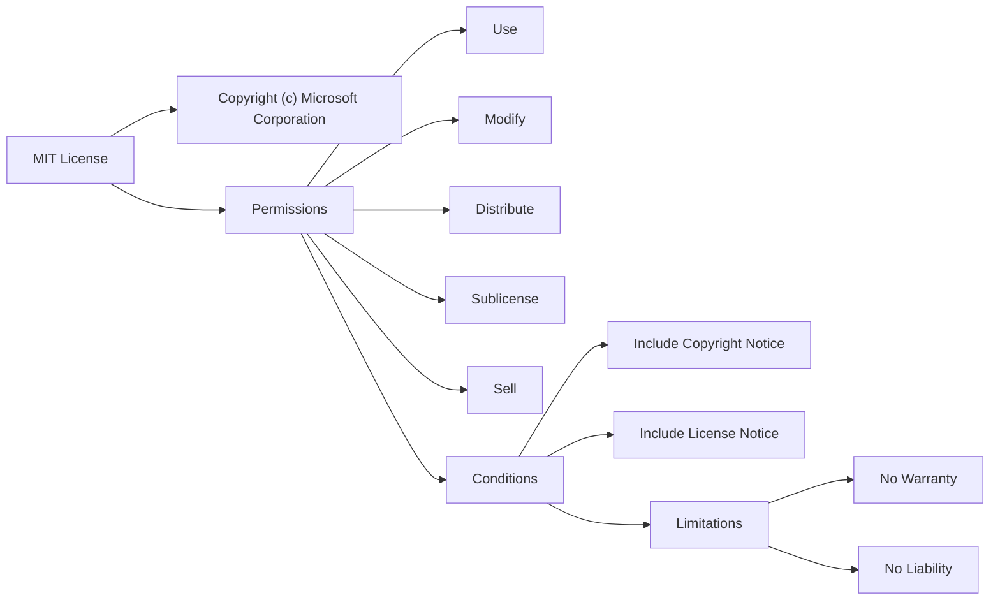
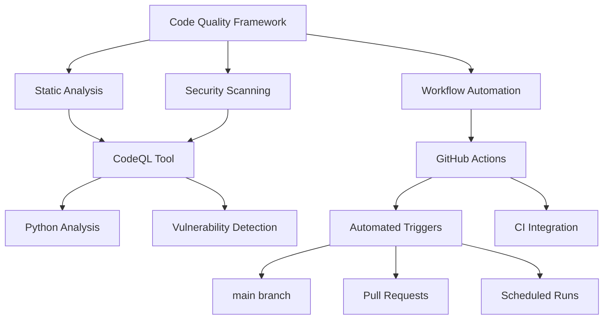
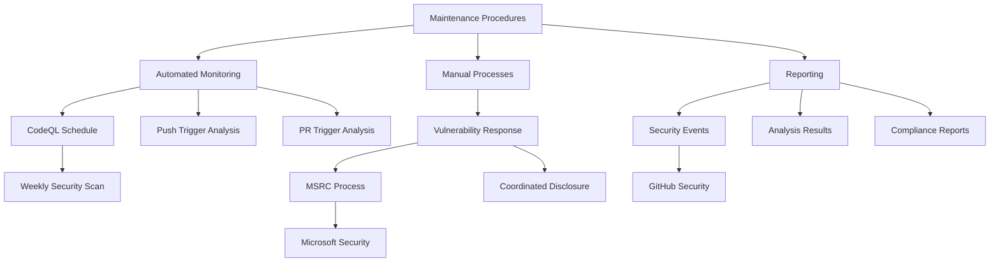

<!-- source: DeepWiki mcp.deepwiki.com · repo microsoft/TimeCraft · page 8 Development and Maintenance · fetched 2026-10-26 -->

# Development and Maintenance

Relevant source files

The following files were used as context for generating this wiki page:

- [.github/workflows/codeql.yml](.github/workflows/codeql.yml)
- [CODE_OF_CONDUCT.md](CODE_OF_CONDUCT.md)
- [LICENSE](LICENSE)
- [SECURITY.md](SECURITY.md)

## Purpose and Scope

This document covers the development practices, code quality standards, security protocols, and maintenance procedures for the TimeCraft repository. It includes information about continuous integration workflows, security vulnerability reporting, project governance, and development standards.

For information about training and inference procedures, see [Training and Inference](#6). For details about the core framework architecture, see [Core Framework Architecture](#2).

## Code Quality and Security

### Security Analysis Workflow

The repository implements automated security analysis through GitHub Actions using CodeQL Advanced scanning. The security workflow is configured to analyze Python code for vulnerabilities and security issues.

**CodeQL Analysis Workflow Structure**

The security analysis is configured with specific permissions and triggers:

| Component | Configuration |
|-----------|---------------|
| **Languages** | Python |
| **Build Mode** | None (interpreted language) |
| **Triggers** | Push to main, PR to main, Weekly schedule |
| **Runner** | ubuntu-22.04 |
| **Permissions** | security-events: write, packages: read, actions: read, contents: read |

Sources: [.github/workflows/codeql.yml:1-93]()

### Security Vulnerability Reporting

The repository follows Microsoft's security vulnerability disclosure process. Security issues must be reported through proper channels rather than public GitHub issues.

**Security Reporting Process**

Sources: [SECURITY.md:1-40]()

## Project Governance

### Open Source Governance

The TimeCraft repository operates under Microsoft's open source governance model with established policies for community participation and code contributions.

**Project Governance Structure**

### Code of Conduct

The repository follows the Microsoft Open Source Code of Conduct, which establishes standards for community interaction and participation.

| Aspect | Details |
|--------|---------|
| **Governing Policy** | Microsoft Open Source Code of Conduct |
| **Contact** | opencode@microsoft.com |
| **Resources** | FAQ and detailed guidelines available |
| **Enforcement** | Community-driven with Microsoft oversight |

Sources: [CODE_OF_CONDUCT.md:1-10]()

### Licensing

The repository is licensed under the MIT License, providing broad permissions for use, modification, and distribution.

**MIT License Structure**

Sources: [LICENSE:1-22]()

## Development Standards

### Code Analysis and Quality

The repository implements comprehensive code analysis through automated workflows that ensure code quality and security standards are maintained throughout the development lifecycle.

**Code Quality Analysis Framework**

Sources: [.github/workflows/codeql.yml:12-93]()

### Continuous Integration Configuration

The CI/CD pipeline is configured to provide comprehensive analysis coverage with specific focus on security and code quality metrics.

| Configuration Item | Value | Purpose |
|-------------------|-------|---------|
| **Workflow Name** | "CodeQL Advanced" | Identifies the security analysis workflow |
| **Python Build Mode** | none | Optimized for interpreted language analysis |
| **Analysis Schedule** | Weekly (Sunday 16:26 UTC) | Regular security assessment |
| **Fail Fast** | false | Ensures complete analysis even if one language fails |
| **Runner OS** | ubuntu-22.04 | Consistent Linux environment |

Sources: [.github/workflows/codeql.yml:12-47]()

## Maintenance Procedures

### Automated Security Monitoring

The repository implements continuous security monitoring through scheduled CodeQL analysis and event-driven scanning on code changes.

**Maintenance and Monitoring Framework**

### Security Event Handling

The repository follows a structured approach to security event handling with defined escalation procedures and response timelines.

| Event Type | Response Time | Process |
|------------|---------------|---------|
| **Automated Detection** | Immediate | CodeQL analysis results in GitHub Security |
| **Manual Report** | 24 hours | MSRC processing and triage |
| **Vulnerability Disclosure** | Coordinated | Following CVD principles |
| **Weekly Assessment** | Scheduled | Automated security scanning |

Sources: [SECURITY.md:17-39](), [.github/workflows/codeql.yml:19-21]()

### Development Workflow Integration

The maintenance procedures are integrated into the standard development workflow to ensure security and quality standards are maintained throughout the development lifecycle.

```mermaid
graph LR
    development["Development Workflow"]
    
    code_changes["Code Changes"]
    pull_request["Pull Request"]
    main_branch["Main Branch"]
    
    development --> code_changes
    code_changes --> pull_request
    pull_request --> main_branch
    
    automated_checks["Automated Checks"]
    codeql_pr["CodeQL on PR"]
    codeql_push["CodeQL on Push"]
    
    pull_request --> automated_checks
    main_branch --> automated_checks
    automated_checks --> codeql_pr
    automated_checks --> codeql_push
    
    security_assessment["Security Assessment"]
    vulnerability_scan["Vulnerability Scan"]
    quality_check["Quality Check"]
    
    codeql_pr --> security_assessment
    codeql_push --> security_assessment
    security_assessment --> vulnerability_scan
    security_assessment --> quality_check
    
    approval_process["Approval Process"]
    merge_protection["Merge Protection"]
    deployment["Deployment"]
    
    quality_check --> approval_process
    approval_process --> merge_protection
    merge_protection --> deployment
```

**Development Workflow Security Integration**

Sources: [.github/workflows/codeql.yml:14-18]()