# Page: TimeCraft Overview

# TimeCraft Overview

<details>
<summary>Relevant source files</summary>

The following files were used as context for generating this wiki page:

- [BRIDGE/README.md](BRIDGE/README.md)
- [README.md](README.md)
- [figures/pt_like_word_newcolors.png](figures/pt_like_word_newcolors.png)

</details>


## Purpose and Scope

TimeCraft is a diffusion-based time series generation framework designed for real-world applications. This document provides a high-level overview of the system architecture, core capabilities, and key components. For detailed information about specific subsystems, see [Core Framework Architecture](#2), [Specialized Systems](#3), and [Data Infrastructure](#4).

The framework addresses three main challenges in time series generation: cross-domain generalization, text-based controllability, and target-aware adaptation for downstream tasks.

## System Architecture

TimeCraft follows a layered architecture with three primary tiers: the core framework, specialized implementations, and supporting infrastructure.

### Overall System Structure

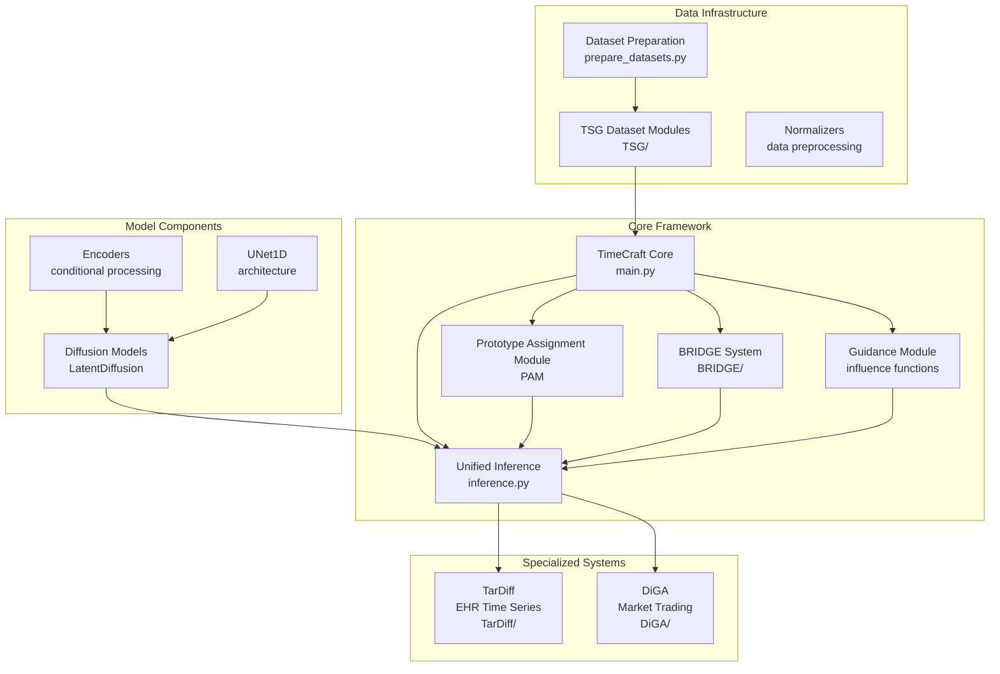

**Sources:** [README.md:1-308]()

### Core Input-Output Flow

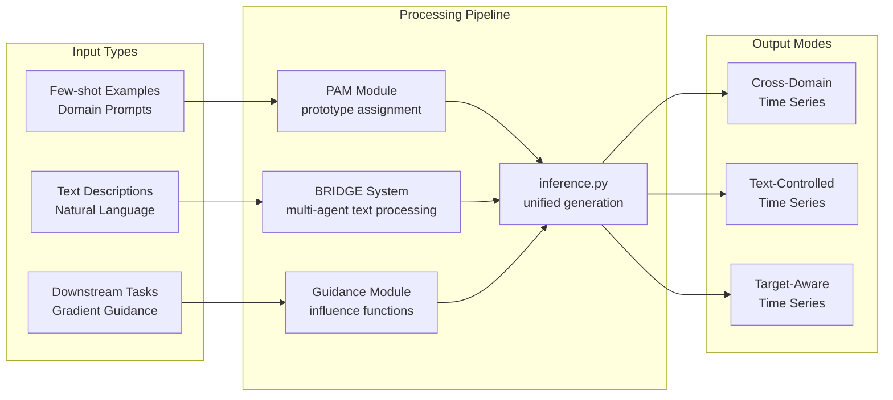

**Sources:** [README.md:26-37]()

## Core Capabilities

### 1. Cross-Domain Generalization

TimeCraft introduces semantic prototypes that act as reusable temporal patterns across domains. The `PAM` (Prototype Assignment Module) dynamically computes domain-specific weights using few-shot examples to construct domain prompts.

| Component | File/Module | Function |
|-----------|-------------|----------|
| Semantic Prototypes | Core framework | Learn domain-invariant features |
| PAM Module | `PAM` class | Compute domain-specific weights |
| Domain Prompts | Generated representations | Capture target domain characteristics |

### 2. Text-Based Control

The BRIDGE system enables natural language control over time series generation through a multi-agent framework.

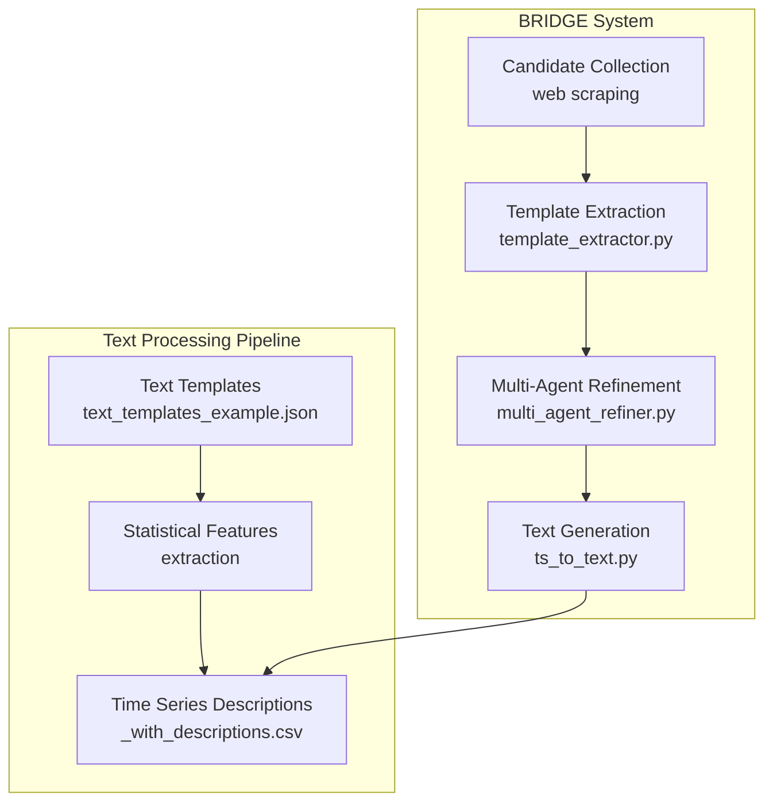

**Sources:** [README.md:139-155](), [BRIDGE/README.md:1-92]()

### 3. Target-Aware Adaptation

TimeCraft optimizes synthetic sample generation for downstream task performance using influence-guided diffusion.

| Component | Purpose | Implementation |
|-----------|---------|----------------|
| Guidance Set | Approximate downstream distribution | Training set or custom subset |
| Downstream Model | Task-specific requirements | Any differentiable architecture |
| Guidance Module | Gradient injection | Influence function computation |

## Key Components and Files

### Training and Inference

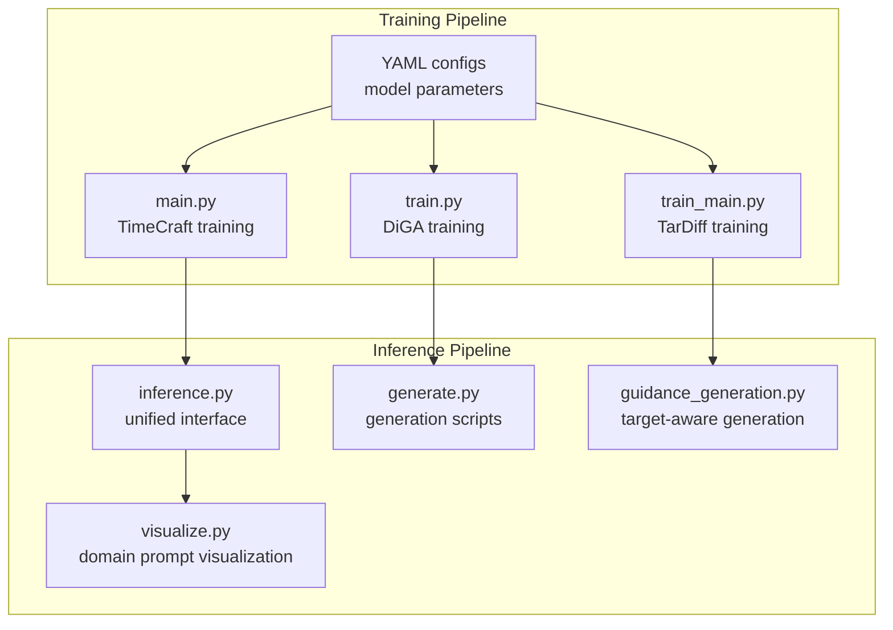

**Sources:** [README.md:199-217]()

### Data Processing Architecture

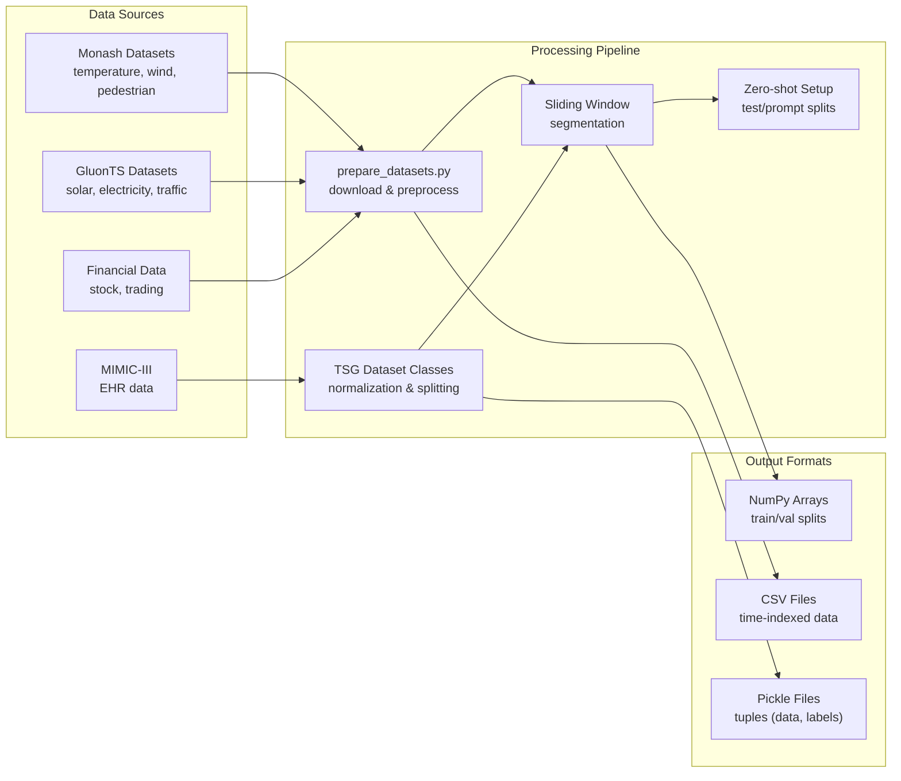

**Sources:** [README.md:99-138]()

## Usage Patterns

### Command-Line Interface

The framework supports flexible input combinations through command-line arguments:

```bash
# Domain prompt generation
python inference.py --domain_prompt

# Text-controlled generation  
python inference.py --text_control

# Target-aware generation
python inference.py --guidance_mode
```

### Configuration Management

The system uses YAML configuration files with OmegaConf for parameter management, supporting:

- Model architecture parameters
- Training hyperparameters  
- Dataset specifications
- Inference modes

### Extensibility

TimeCraft's modular design allows for:

- Custom dataset integration via TSG modules
- New specialized systems (like TarDiff and DiGA)
- Additional guidance mechanisms
- Custom text processing pipelines

**Sources:** [README.md:92-223]()

---

# Page: Core Framework Architecture

# Core Framework Architecture

<details>
<summary>Relevant source files</summary>

The following files were used as context for generating this wiki page:

- [BRIDGE/README.md](BRIDGE/README.md)
- [README.md](README.md)
- [figures/pt_like_word_newcolors.png](figures/pt_like_word_newcolors.png)
- [supplementary/inference_guidance.md](supplementary/inference_guidance.md)
- [supplementary/inference_prototype.md](supplementary/inference_prototype.md)
- [supplementary/inference_prototype_text.md](supplementary/inference_prototype_text.md)

</details>


## Purpose and Scope

This document provides a comprehensive overview of the TimeCraft framework's core architecture, focusing on its three primary capabilities: cross-domain generalization, text-based control, and target-aware adaptation. The architecture is designed as a unified diffusion-based time series generation system with flexible conditioning mechanisms.

For detailed implementation of specific capabilities, see [Cross-Domain Generation with Semantic Prototypes](#2.1), [Text-Based Control and BRIDGE System](#2.2), and [Target-Aware Adaptation](#2.3). For information about specialized domain implementations, see [Specialized Systems](#3).

## Framework Overview

TimeCraft implements a modular architecture centered around a diffusion model backbone with three distinct input conditioning branches. The system provides a unified inference interface while supporting multiple generation modes based on different types of conditioning inputs.

### Core Architecture Components

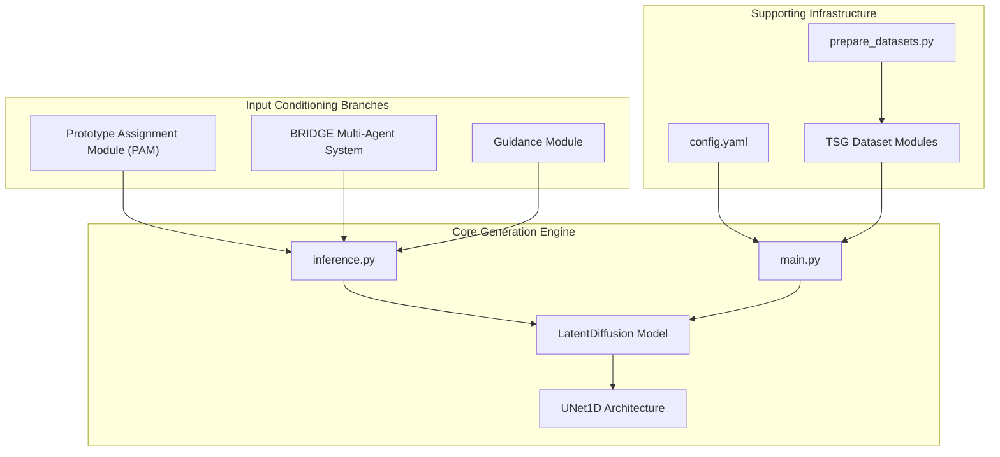

**Sources:** [README.md:26-38](), [main.py](), [inference.py]()

### Three-Branch Input System

The framework supports three flexible input branches that can be used independently or in combination:

| Branch | Component | Input Type | Purpose |
|--------|-----------|------------|---------|
| **Cross-Domain** | `PAM` | Few-shot examples | Domain adaptation via semantic prototypes |
| **Text-Based** | `BRIDGE` | Natural language | Controllable generation via text descriptions |
| **Target-Aware** | `Guidance Module` | Downstream model | Task-oriented optimization |

**Sources:** [README.md:28-37](), [supplementary/inference_prototype.md:1-28](), [supplementary/inference_prototype_text.md:1-24](), [supplementary/inference_guidance.md:1-28]()

## Core Generation Pipeline

### Unified Inference Interface

The `inference.py` script serves as the central orchestrator for all generation modes, providing a unified interface that dynamically configures the diffusion process based on input conditioning:

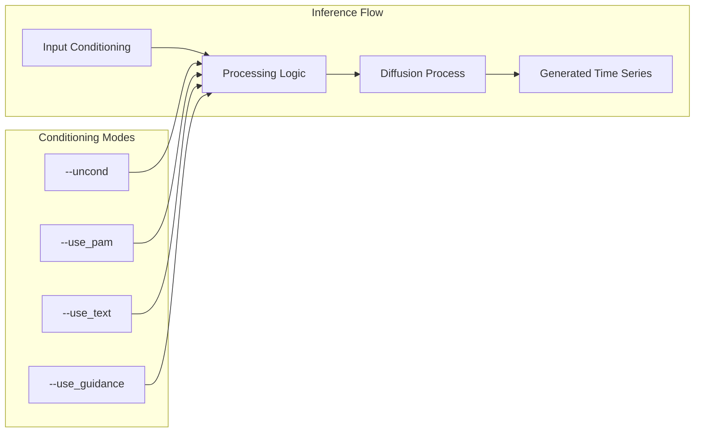

**Sources:** [inference.py](), [supplementary/inference_prototype.md:17-26](), [supplementary/inference_prototype_text.md:9-23](), [supplementary/inference_guidance.md:10-25]()

### Diffusion Model Architecture

The core generation engine implements a LatentDiffusion model with UNet1D architecture optimized for time series data:

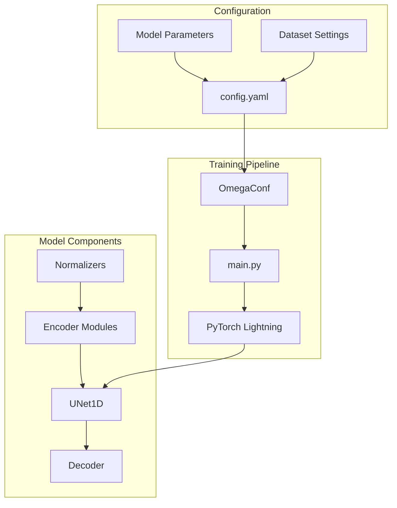

**Sources:** [README.md:199-201](), [main.py](), [supplementary/training_details.md]()

## Cross-Domain Generation Capability

### Semantic Prototypes System

The cross-domain generation capability centers on learning universal semantic prototypes that encode domain-invariant temporal patterns. These prototypes function as a "dictionary" of reusable temporal components:

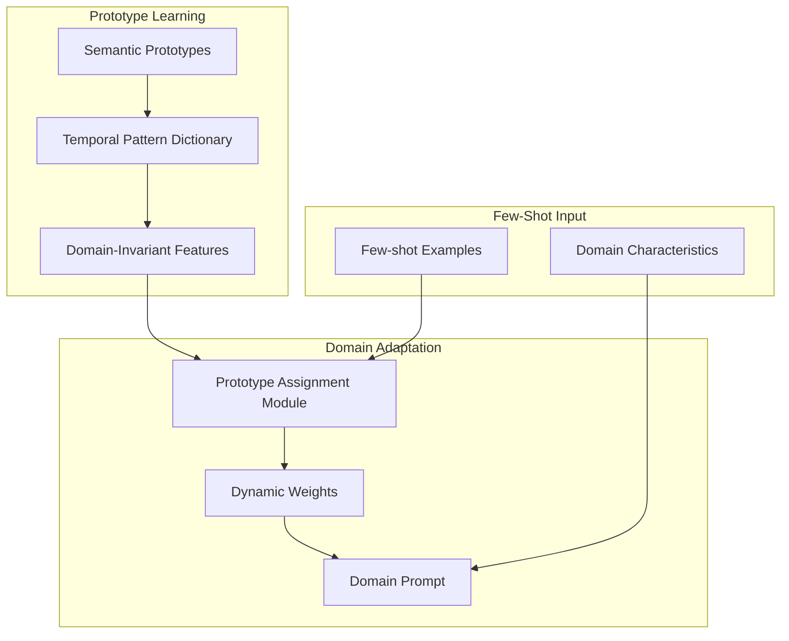

**Sources:** [README.md:9-12](), [README.md:226-245]()

## Text-Based Control Capability

### BRIDGE Multi-Agent System

The text-based control capability implements a sophisticated multi-agent framework for generating and refining textual descriptions of time series patterns:

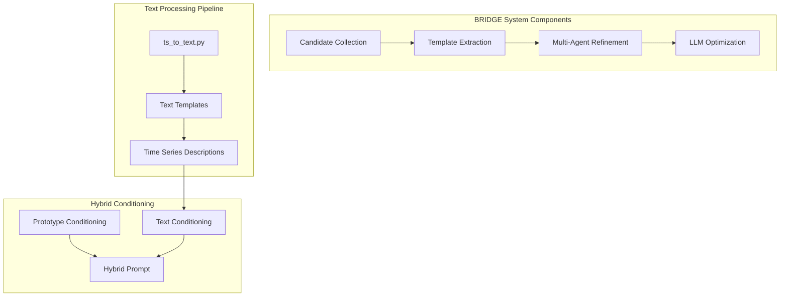

**Sources:** [README.md:14-15](), [README.md:248-268](), [BRIDGE/README.md:1-92]()

## Target-Aware Adaptation Capability

### Influence-Guided Diffusion

The target-aware adaptation capability uses influence functions to guide the diffusion process toward generating data that improves downstream task performance:

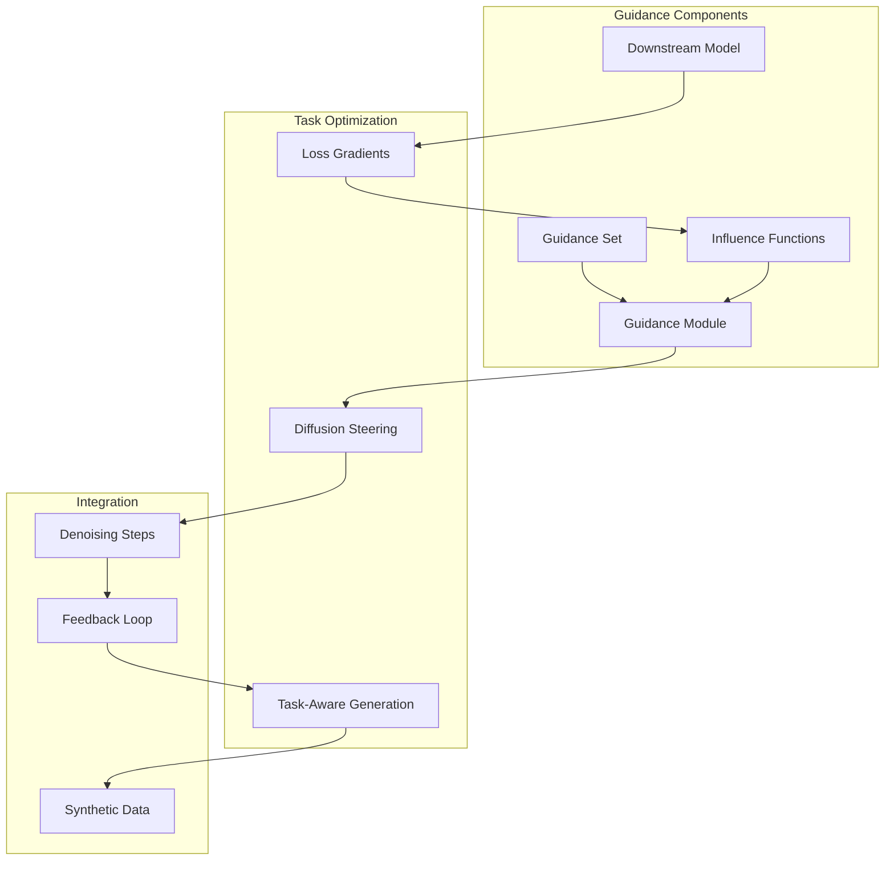

**Sources:** [README.md:17-18](), [README.md:271-282](), [supplementary/inference_guidance.md:1-28]()

## Data Processing Infrastructure

### Dataset Preparation Pipeline

The framework includes comprehensive data handling infrastructure for processing various time series datasets:

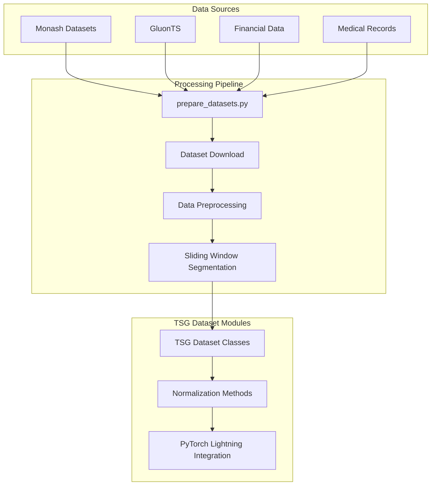

**Sources:** [README.md:107-137](), [prepare_datasets.py](), [supplementary/dataset_split.md]()

## Configuration and Training

### Configuration Management

The framework uses OmegaConf for hierarchical configuration management, enabling flexible model and dataset configuration:

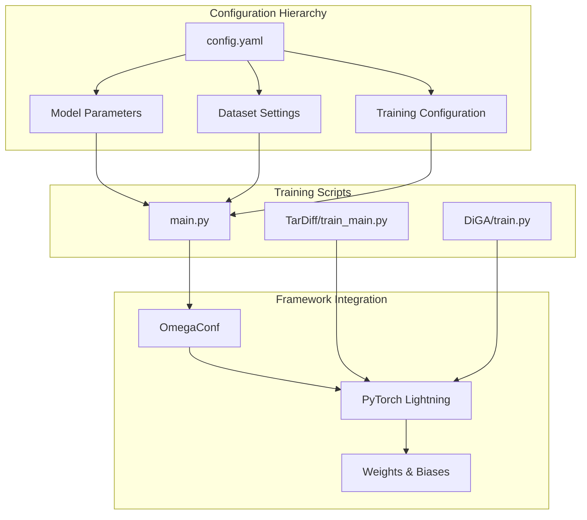

**Sources:** [main.py](), [supplementary/training_details.md](), [TarDiff/train_main.py](), [DiGA/train.py]()

The TimeCraft framework's modular architecture enables flexible time series generation across multiple domains while maintaining a unified interface for different conditioning modes. The three-branch input system allows users to leverage domain knowledge, natural language descriptions, or task-specific objectives to guide the generation process effectively.

---

# Page: Cross-Domain Generation with Semantic Prototypes

# Cross-Domain Generation with Semantic Prototypes

<details>
<summary>Relevant source files</summary>

The following files were used as context for generating this wiki page:

- [BRIDGE/README.md](BRIDGE/README.md)
- [README.md](README.md)
- [figures/pt_like_word_newcolors.png](figures/pt_like_word_newcolors.png)
- [supplementary/inference_guidance.md](supplementary/inference_guidance.md)
- [supplementary/inference_prototype.md](supplementary/inference_prototype.md)
- [supplementary/inference_prototype_text.md](supplementary/inference_prototype_text.md)

</details>


## Purpose and Scope

This document describes TimeCraft's cross-domain generation capability using semantic prototypes. This system enables the generation of synthetic time series data that generalizes across different domains (e.g., medical, financial, climate) without requiring domain-specific retraining. The core mechanism uses a shared vocabulary of temporal patterns (semantic prototypes) and a lightweight adaptation module (PAM) that can construct domain-specific prompts from few-shot examples.

For information about text-based control mechanisms, see [Text-Based Control and BRIDGE System](#2.2). For target-aware adaptation using influence functions, see [Target-Aware Adaptation](#2.3).

## Semantic Prototypes Overview

TimeCraft introduces a universal latent space for time series by learning a shared set of semantic prototypes. These prototypes function as a "dictionary" of temporal patterns, encoding domain-invariant features such as trends, seasonality, and periodic fluctuations that are reusable across domains.

### Prototype Conceptual Model

```mermaid
graph TB
    subgraph "Domain-Invariant Patterns"
        P1[Prototype_1<br/>"Trend: Linear Growth"]
        P2[Prototype_2<br/>"Seasonality: Daily Cycle"]
        P3[Prototype_3<br/>"Volatility: High Frequency"]
        P4[Prototype_N<br/>"..."]
    end
    
    subgraph "Domain-Specific Applications"
        D1[Medical_Domain<br/>"Heart Rate Patterns"]
        D2[Financial_Domain<br/>"Stock Price Movements"]
        D3[Climate_Domain<br/>"Temperature Cycles"]
    end
    
    subgraph "Weighted Combinations"
        W1[w1_med * P1 + w2_med * P2 + ...]
        W2[w1_fin * P1 + w2_fin * P2 + ...]
        W3[w1_cli * P1 + w2_cli * P2 + ...]
    end
    
    P1 --> W1
    P2 --> W1
    P3 --> W1
    P1 --> W2
    P2 --> W2
    P3 --> W2
    P1 --> W3
    P2 --> W3
    P3 --> W3
    
    W1 --> D1
    W2 --> D2
    W3 --> D3
```

Sources: [README.md:9-11](), [README.md:228-243]()

## Prototype Assignment Module (PAM)

The Prototype Assignment Module is a lightweight component that dynamically computes domain-specific weights for the learned prototypes using few-shot examples. PAM constructs domain prompts without requiring explicit labels or model retraining.

### PAM Architecture and Processing Flow

```mermaid
graph TB
    subgraph "Input Layer"
        FS[few_shot_examples<br/>"Target Domain Samples"]
        SP[semantic_prototypes<br/>"Learned Pattern Dictionary"]
    end
    
    subgraph "PAM Processing"
        WC[weight_computation<br/>"Domain-Specific Weighting"]
        DP[domain_prompt_construction<br/>"Latent Representation"]
    end
    
    subgraph "Generation Process"
        DM[diffusion_model<br/>"UNet1D + Encoders"]
        TS[synthetic_timeseries<br/>"Generated Output"]
    end
    
    FS --> WC
    SP --> WC
    WC --> DP
    DP --> DM
    DM --> TS
    
    style WC fill:#f9f9f9,stroke:#333,stroke-width:2px
    style DP fill:#f9f9f9,stroke:#333,stroke-width:2px
```

Sources: [README.md:240-243](), [supplementary/inference_prototype.md:1-16]()

## Domain Prompts and Few-Shot Learning

Domain prompts are latent representations that capture target domain characteristics. The system constructs these prompts automatically from a small number of example time series, enabling cross-domain generalization without manual specification.

### Few-Shot Prompting Mechanism

```mermaid
flowchart LR
    subgraph "Input_Stage"
        EX[target_domain_examples<br/>"2-5 sample time series"]
    end
    
    subgraph "PAM_Processing"
        FE[feature_extraction<br/>"Statistical Properties"]
        PC[prototype_correlation<br/>"Similarity Computation"]
        WA[weight_assignment<br/>"Domain-Specific Weights"]
    end
    
    subgraph "Prompt_Construction"
        DP[domain_prompt<br/>"Weighted Prototype Combination"]
        CR[conditional_representation<br/>"Diffusion Model Input"]
    end
    
    EX --> FE
    FE --> PC
    PC --> WA
    WA --> DP
    DP --> CR
    
    style FE fill:#f9f9f9,stroke:#333,stroke-width:2px
    style WA fill:#f9f9f9,stroke:#333,stroke-width:2px
```

Sources: [README.md:234-245](), [README.md:238-239]()

## Implementation Architecture

The cross-domain generation system integrates several key components within the TimeCraft framework. The implementation spans multiple modules that handle prototype learning, domain adaptation, and generation.

### Core Component Integration

```mermaid
graph TB
    subgraph "Configuration_Layer"
        CONFIG[config.yaml<br/>"Model Parameters"]
        CLI[command_line_interface<br/>"--use_pam flag"]
    end
    
    subgraph "PAM_Implementation"
        PAM_MODULE[prototype_assignment_module<br/>"Domain Weight Computation"]
        PROTO_STORAGE[semantic_prototypes<br/>"Learned Pattern Storage"]
    end
    
    subgraph "Generation_Pipeline"
        INFERENCE[inference.py<br/>"Main Inference Script"]
        DIFFUSION[diffusion_model<br/>"UNet1D Architecture"]
        ENCODER[conditional_encoder<br/>"Domain Prompt Processing"]
    end
    
    subgraph "Output_Generation"
        SYNTH[synthetic_timeseries<br/>"Generated Data"]
        EVAL[evaluation_metrics<br/>"Quality Assessment"]
    end
    
    CONFIG --> INFERENCE
    CLI --> INFERENCE
    INFERENCE --> PAM_MODULE
    PAM_MODULE --> PROTO_STORAGE
    PAM_MODULE --> ENCODER
    ENCODER --> DIFFUSION
    DIFFUSION --> SYNTH
    SYNTH --> EVAL
    
    style PAM_MODULE fill:#e8f5e8,stroke:#1b5e20,stroke-width:2px
    style PROTO_STORAGE fill:#e8f5e8,stroke:#1b5e20,stroke-width:2px
```

Sources: [supplementary/inference_prototype.md:7-13](), [supplementary/inference_prototype.md:17-26]()

## Usage and Inference Modes

The cross-domain generation system supports multiple inference modes depending on the available input and desired control level.

### Inference Mode Configuration

| Mode | Command Flag | Input Requirements | Output Characteristics |
|------|-------------|-------------------|----------------------|
| Prototype-Only | `--use_pam` | Few-shot examples | Domain-consistent generation |
| Unconditional | None | None | General time series patterns |
| Hybrid | `--use_pam --use_text` | Examples + text descriptions | Enhanced controllability |

### Command Line Interface

For prototype-based generation with domain prompts:

```bash
python inference.py \
  --base config.yaml \
  --resume true \
  --ckpt_name ./checkpoints/ \
  --use_pam
```

For unconditional generation without domain adaptation:

```bash
python inference.py \
  --base config.yaml \
  --resume true \
  --ckpt_name ./checkpoints/
```

Sources: [supplementary/inference_prototype.md:5-13](), [supplementary/inference_prototype.md:19-26]()

## Technical Implementation Details

The semantic prototype system operates within TimeCraft's diffusion-based architecture, utilizing learned representations that capture fundamental temporal patterns across domains.

### Prototype Learning Process

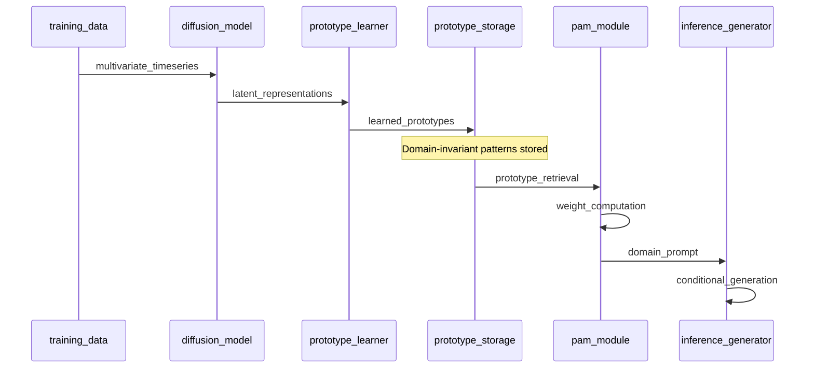

The system learns prototypes during training across multiple domains, then uses PAM to dynamically weight these prototypes for new domain adaptation during inference.

Sources: [README.md:226-243](), [README.md:9-11]()

## Integration with Diffusion Architecture

The prototype-based generation integrates seamlessly with TimeCraft's underlying diffusion model architecture, providing conditional inputs that guide the generation process.

### Conditional Generation Pipeline

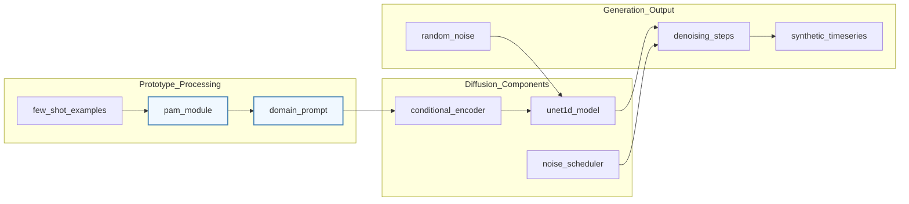

Sources: [README.md:240-243](), [supplementary/inference_prototype.md:1-16]()

---

# Page: Text-Based Control and BRIDGE System

# Text-Based Control and BRIDGE System

<details>
<summary>Relevant source files</summary>

The following files were used as context for generating this wiki page:

- [BRIDGE/README.md](BRIDGE/README.md)
- [README.md](README.md)
- [figures/pt_like_word_newcolors.png](figures/pt_like_word_newcolors.png)
- [supplementary/inference_guidance.md](supplementary/inference_guidance.md)
- [supplementary/inference_prototype.md](supplementary/inference_prototype.md)
- [supplementary/inference_prototype_text.md](supplementary/inference_prototype_text.md)

</details>


This document covers TimeCraft's text-based control capability and the BRIDGE multi-agent system that enables natural language conditioning for time series generation. For information about cross-domain generation using semantic prototypes, see [Cross-Domain Generation with Semantic Prototypes](#2.1). For target-aware adaptation mechanisms, see [Target-Aware Adaptation](#2.3).

## Overview

TimeCraft's text-based control system enables users to guide time series generation through natural language descriptions. The system leverages the BRIDGE (Bootstrapping Text to Control Time-Series Generation via Multi-Agent Iterative Optimization and Diffusion Modelling) framework to create high-quality text-to-time-series pairings and implements a hybrid conditioning mechanism that combines textual prompts with semantic prototypes.

## BRIDGE Multi-Agent System Architecture

The BRIDGE system implements a three-stage multi-agent framework for generating domain-specific textual descriptions of time series data:

### Core Components

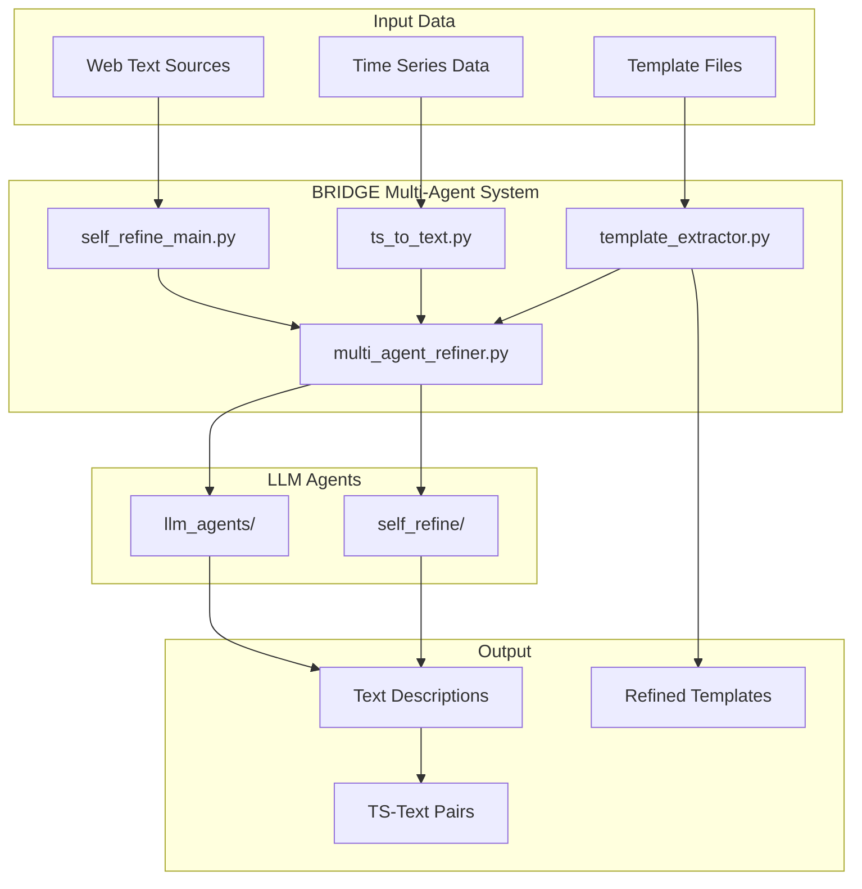

Sources: [BRIDGE/README.md:1-14](), [README.md:248-262]()

### Three-Stage Processing Pipeline

#### Stage 1: Text Template Collection
The system collects diverse time series-related texts from multiple sources to construct domain-agnostic templates:

```mermaid
graph LR
    subgraph "Collection Sources"
        ART["Articles"]
        REP["Reports"]
        NEWS["News"]
        WEB["Web Content"]
    end
    
    subgraph "Processing"
        CC["Candidate Collection"]
        TE["Template Extraction"]
    end
    
    subgraph "Output"
        GT["General Templates"]
        DS["Domain-Specific Templates"]
    end
    
    ART --> CC
    REP --> CC
    NEWS --> CC
    WEB --> CC
    
    CC --> TE
    TE --> GT
    GT --> DS
```

Sources: [README.md:254-256](), [BRIDGE/README.md:39-46]()

#### Stage 2: Automated Evaluation
Generated text descriptions are evaluated to assess their quality in supporting downstream tasks:

```mermaid
graph TB
    subgraph "Evaluation Pipeline"
        GEN["Generated Descriptions"]
        EVAL["Quality Assessment"]
        METRICS["Evaluation Metrics"]
        FEEDBACK["Feedback Generation"]
    end
    
    subgraph "Evaluation Criteria"
        ACC["Accuracy"]
        REL["Relevance"]
        COH["Coherence"]
        TASK["Task Alignment"]
    end
    
    GEN --> EVAL
    EVAL --> METRICS
    METRICS --> ACC
    METRICS --> REL
    METRICS --> COH
    METRICS --> TASK
    METRICS --> FEEDBACK
```

Sources: [README.md:257](), [BRIDGE/README.md:56-66]()

#### Stage 3: Feedback-Driven Refinement
The system iteratively improves descriptions based on evaluation results:

```mermaid
graph TB
    subgraph "Refinement Process"
        INIT["Initial Descriptions"]
        REFINE["multi_agent_refiner.py"]
        FEEDBACK["Feedback Analysis"]
        IMPROVE["Description Improvement"]
        CONV["Convergence Check"]
    end
    
    subgraph "Multi-Agent Framework"
        TEAM["Team Iterations"]
        GLOBAL["Global Iterations"]
        AGENTS["LLM Agents"]
    end
    
    INIT --> REFINE
    REFINE --> TEAM
    REFINE --> GLOBAL
    TEAM --> AGENTS
    GLOBAL --> AGENTS
    AGENTS --> FEEDBACK
    FEEDBACK --> IMPROVE
    IMPROVE --> CONV
    CONV --> REFINE
```

Sources: [README.md:258-261](), [BRIDGE/README.md:87-91]()

## Text Processing Pipeline

### Time Series to Text Conversion

The `ts_to_text.py` module handles the conversion of time series data into textual descriptions:

```mermaid
graph TB
    subgraph "Input Processing"
        TS["Time Series Data"]
        FEAT["Feature Extraction"]
        STATS["Statistical Analysis"]
    end
    
    subgraph "Template Application"
        TEMPL["Text Templates"]
        INJECT["Feature Injection"]
        FILL["Template Filling"]
    end
    
    subgraph "Enhancement"
        LLM["LLM Optimization"]
        REFINE["Description Refinement"]
        QUAL["Quality Check"]
    end
    
    subgraph "Output"
        DESC["Text Descriptions"]
        CSV["_with_descriptions.csv"]
    end
    
    TS --> FEAT
    FEAT --> STATS
    STATS --> INJECT
    TEMPL --> FILL
    INJECT --> FILL
    FILL --> LLM
    LLM --> REFINE
    REFINE --> QUAL
    QUAL --> DESC
    DESC --> CSV
```

Sources: [README.md:147-155](), [process/ts_to_text.py]()

### Statistical Feature Extraction

The system extracts key statistical features from time series windows:

| Feature Type | Description | Purpose |
|-------------|-------------|---------|
| Mean | Average value | Central tendency |
| Standard Deviation | Variability measure | Spread indication |
| Trend | Direction of change | Pattern identification |
| Seasonality | Periodic patterns | Cyclical behavior |
| Extremes | Min/max values | Range characteristics |

Sources: [README.md:149]()

## Hybrid Conditioning Mechanism

TimeCraft implements a hybrid framework that combines textual descriptions with semantic prototypes:

```mermaid
graph TB
    subgraph "Input Modalities"
        TEXT["Text Descriptions"]
        PROTO["Semantic Prototypes"]
        DOMAIN["Domain Prompts"]
    end
    
    subgraph "Conditioning Framework"
        HYBRID["Hybrid Prompt"]
        CROSS["Cross-Attention"]
        EMBED["Text Embeddings"]
    end
    
    subgraph "Diffusion Model"
        UNET["UNet Architecture"]
        DENOISE["Denoising Process"]
        CONTROL["Generation Control"]
    end
    
    subgraph "Output"
        CTRL["Controlled Generation"]
        TS_OUT["Time Series Output"]
    end
    
    TEXT --> EMBED
    PROTO --> HYBRID
    DOMAIN --> HYBRID
    EMBED --> HYBRID
    
    HYBRID --> CROSS
    CROSS --> UNET
    UNET --> DENOISE
    DENOISE --> CONTROL
    CONTROL --> CTRL
    CTRL --> TS_OUT
```

Sources: [README.md:264-268](), [supplementary/inference_prototype_text.md:1-24]()

## Implementation Details

### Command Line Interface

The BRIDGE system provides comprehensive command-line options for different operations:

```bash
# Generate descriptions from time series
python self_refine_main.py \
  --openai_key YOUR_API_KEY \
  --ts_file path/to/timeseries.csv \
  --dataset_name dataset_name \
  --ts_to_text

# Run multi-agent refinement
python self_refine_main.py \
  --openai_key YOUR_API_KEY \
  --ts_file path/to/timeseries.csv \
  --dataset_name dataset_name \
  --refine \
  --team_iterations 3 \
  --global_iterations 2
```

Sources: [BRIDGE/README.md:28-66]()

### Key Configuration Parameters

| Parameter | Description | Default |
|-----------|-------------|---------|
| `--openai_model` | OpenAI model name | `gpt-4o-2024-05-13` |
| `--prediction_length` | Time series window length | 168 |
| `--team_iterations` | Max iterations per team | 3 |
| `--global_iterations` | Max global refinement rounds | 2 |
| `--llm_optimize` | Use LLM for optimization | False |

Sources: [BRIDGE/README.md:68-92]()

### Integration with TimeCraft Inference

Text-based control is integrated with TimeCraft's inference system:

```mermaid
graph TB
    subgraph "Inference Configuration"
        CONFIG["config.yaml"]
        CKPT["Model Checkpoint"]
        FLAGS["Command Flags"]
    end
    
    subgraph "Text Control Options"
        USE_TEXT["--use_text"]
        TEXT_EMB["--text_emb_dir"]
        USE_PAM["--use_pam"]
    end
    
    subgraph "Processing Pipeline"
        INFERENCE["inference.py"]
        LOAD["Model Loading"]
        PROC["Text Processing"]
        GEN["Generation"]
    end
    
    subgraph "Output"
        CONTROLLED["Controlled Time Series"]
        RESULTS["Generation Results"]
    end
    
    CONFIG --> INFERENCE
    CKPT --> LOAD
    FLAGS --> PROC
    USE_TEXT --> PROC
    TEXT_EMB --> PROC
    USE_PAM --> PROC
    
    INFERENCE --> LOAD
    LOAD --> PROC
    PROC --> GEN
    GEN --> CONTROLLED
    CONTROLLED --> RESULTS
```

Sources: [supplementary/inference_prototype_text.md:9-24]()

## Usage Examples

### Basic Text-Controlled Generation

```bash
python inference.py \
  --base config.yaml \
  --resume true \
  --ckpt_name ./checkpoints/ \
  --use_text \
  --text_emb_dir ./text_embeddings/
```

### Hybrid Prototype-Text Control

```bash
python inference.py \
  --base config.yaml \
  --resume true \
  --ckpt_name ./checkpoints/ \
  --use_pam \
  --use_text \
  --text_emb_dir ./text_embeddings/
```

Sources: [supplementary/inference_prototype_text.md:9-24]()

### Text Template Processing

```bash
python BRIDGE/process/ts_to_text.py \
  --input_file data/dataset.csv \
  --template_file templates/domain_templates.json \
  --output_file data/dataset_with_descriptions.csv
```

Sources: [README.md:151]()

The text-based control system provides flexible and intuitive control over time series generation through natural language, enabling users to specify desired characteristics like trends, seasonality, and domain-specific patterns without requiring detailed technical knowledge of the underlying model architecture.

---

# Page: Target-Aware Adaptation

# Target-Aware Adaptation

<details>
<summary>Relevant source files</summary>

The following files were used as context for generating this wiki page:

- [BRIDGE/README.md](BRIDGE/README.md)
- [README.md](README.md)
- [figures/pt_like_word_newcolors.png](figures/pt_like_word_newcolors.png)
- [supplementary/inference_guidance.md](supplementary/inference_guidance.md)
- [supplementary/inference_prototype.md](supplementary/inference_prototype.md)
- [supplementary/inference_prototype_text.md](supplementary/inference_prototype_text.md)

</details>


This document describes the Target-Aware Adaptation mechanism within TimeCraft's core framework. This system enables synthetic time series generation that is explicitly optimized to improve downstream model performance rather than simply replicating training data distributions.

For cross-domain generation using semantic prototypes, see [Cross-Domain Generation with Semantic Prototypes](#2.1). For text-based control mechanisms, see [Text-Based Control and BRIDGE System](#2.2). For specialized EHR applications using target-aware adaptation, see [TarDiff: EHR Time Series Generation](#3.1).

## Overview

Target-Aware Adaptation represents a paradigm shift from traditional generative modeling approaches. Instead of focusing solely on distributional fidelity, this mechanism generates synthetic samples with the explicit goal of enhancing performance on specific downstream tasks such as forecasting, classification, and anomaly detection.

The system leverages influence functions to quantify the expected reduction in task-specific loss, enabling the diffusion process to generate data that is both realistic and strategically valuable for the target application.

## Core Architecture

The Target-Aware Adaptation system consists of three primary components that work in concert to guide the generation process:

### System Components

```mermaid
graph TB
    subgraph "Target-Aware Generation Pipeline"
        GS["Guidance Set<br/>guidance_tuple.pkl"]
        DM["Downstream Model<br/>downstream_pth_path"]
        GM["Guidance Module<br/>guidance_generation.py"]
        
        subgraph "Diffusion Process"
            DIFF["LatentDiffusion<br/>ldm/models/diffusion/"]
            UNET["UNet1D<br/>ldm/modules/diffusionmodules/"]
            DENOISE["Denoising Steps<br/>sampling loop"]
        end
        
        subgraph "Influence Computation"
            IF["Influence Functions<br/>gradient computation"]
            LOSS["Task Loss<br/>downstream objective"]
            GRAD["Gradient Guidance<br/>step-by-step direction"]
        end
    end
    
    GS --> GM
    DM --> LOSS
    LOSS --> IF
    IF --> GRAD
    GM --> GRAD
    GRAD --> DENOISE
    DENOISE --> UNET
    UNET --> DIFF
    
    style GM fill:#f9f,stroke:#333,stroke-width:2px
    style IF fill:#bbf,stroke:#333,stroke-width:2px
```

**Target-Aware Generation Architecture**

Sources: [README.md:271-283](), [supplementary/inference_guidance.md:1-28]()

### Component Responsibilities

| Component | Role | Implementation |
|-----------|------|----------------|
| **Guidance Set** | Small collection of time-series whose distribution mirrors the target task | Stored as `guidance_tuple.pkl` containing (data, labels) tuples |
| **Downstream Model** | Differentiable network trained on the task of interest | Any architecture (RNN, Transformer, CNN) loaded from `downstream_pth_path` |
| **Guidance Module** | Injects downstream gradients into denoising steps | Implemented in `guidance_generation.py` |

Sources: [README.md:276-282]()

## Implementation Details

### Influence-Guided Diffusion Process

The core innovation lies in the integration of influence functions into the diffusion sampling process. This mechanism computes gradients from the downstream model at each denoising step to steer generation toward task-beneficial samples.

```mermaid
graph LR
    subgraph "Sampling Loop"
        NOISE["Noise<br/>x_t"]
        PREDICT["Noise Prediction<br/>UNet1D"]
        DENOISE["Denoising Step<br/>DDIM/DDPM"]
        
        subgraph "Guidance Computation"
            FORWARD["Forward Pass<br/>downstream_model(x)"]
            TASKLOSS["Task Loss<br/>classification/regression"]
            GRADIENT["∇L/∇x<br/>influence gradient"]
            GUIDE["Guidance Signal<br/>weighted gradient"]
        end
        
        CLEAN["Clean Sample<br/>x_{t-1}"]
    end
    
    NOISE --> PREDICT
    PREDICT --> DENOISE
    DENOISE --> FORWARD
    FORWARD --> TASKLOSS
    TASKLOSS --> GRADIENT
    GRADIENT --> GUIDE
    GUIDE --> DENOISE
    DENOISE --> CLEAN
    
    style GRADIENT fill:#bbf,stroke:#333,stroke-width:2px
    style GUIDE fill:#f9f,stroke:#333,stroke-width:2px
```

**Influence-Guided Sampling Process**

Sources: [README.md:271-283](), [supplementary/inference_guidance.md:3-8]()

### Data Preparation Requirements

The system requires specific data formats and preprocessing steps:

#### Guidance Set Format

The guidance set must be provided as a pickled tuple containing:
- `data`: shape **(N, F, T)** representing N samples, F features, and T time steps
- `labels`: shape **(N,)** corresponding labels for each sample

#### Downstream Model Requirements

The downstream model must satisfy these criteria:
- Differentiable architecture (supports gradient computation)
- Trained on the same task as the generation target
- Compatible input/output shapes with guidance set format
- Stored as a PyTorch checkpoint file

Sources: [README.md:176-181](), [README.md:188-195]()

## Usage and Configuration

### Command Line Interface

Target-aware generation is activated through the `inference.py` script with specific flags:

```bash
python inference.py \
  --base config.yaml \
  --resume true \
  --ckpt_name ./checkpoints/ \
  --use_guidance \
  --uncond \
  --downstream_pth_path ./classifier/checkpoints/best_model.pt \
  --guidance_path ./classifier/data/guidance_tuple.pkl
```

### Configuration Parameters

| Parameter | Purpose | Requirements |
|-----------|---------|--------------|
| `--use_guidance` | Enables classifier-informed generation | Boolean flag |
| `--downstream_pth_path` | Path to trained downstream model | Must be a valid PyTorch checkpoint |
| `--guidance_path` | Path to guidance set | Must be a `.pkl` file with proper tuple format |
| `--uncond` | Unconditional generation mode | Used with guidance for pure task-aware generation |

Sources: [supplementary/inference_guidance.md:10-21]()

### Integration with Core Framework

The target-aware mechanism integrates seamlessly with TimeCraft's unified inference system:

```mermaid
graph TB
    subgraph "Unified Inference System"
        INFERENCE["inference.py<br/>main entry point"]
        
        subgraph "Generation Modes"
            PROTO["Prototype Mode<br/>--use_pam"]
            TEXT["Text Mode<br/>--use_text"]
            GUIDANCE["Guidance Mode<br/>--use_guidance"]
        end
        
        subgraph "Core Components"
            DIFF["LatentDiffusion<br/>diffusion backbone"]
            ENCODER["Encoder Modules<br/>conditional processing"]
            SAMPLER["Sampling Strategy<br/>DDIM/DDPM"]
        end
    end
    
    INFERENCE --> PROTO
    INFERENCE --> TEXT
    INFERENCE --> GUIDANCE
    
    PROTO --> DIFF
    TEXT --> DIFF
    GUIDANCE --> DIFF
    
    DIFF --> ENCODER
    DIFF --> SAMPLER
    
    style GUIDANCE fill:#f9f,stroke:#333,stroke-width:2px
    style INFERENCE fill:#bbf,stroke:#333,stroke-width:2px
```

**Integration with Unified Inference System**

Sources: [README.md:206-217](), [supplementary/inference_guidance.md:1-28]()

## Specialized Applications

### TarDiff Implementation

The TarDiff system represents a specialized implementation of target-aware adaptation for Electronic Health Record (EHR) time series generation. This system extends the core mechanisms with domain-specific optimizations:

- **Healthcare-specific guidance**: Optimized for clinical prediction tasks
- **Medical data preprocessing**: Specialized handling of EHR time series
- **Performance validation**: TSTR/TSRTR protocols for medical applications

### DiGA Market Applications

The DiGA system applies target-aware principles to financial market data generation, focusing on:

- **Trading strategy optimization**: Guidance for reinforcement learning agents
- **Market simulation**: Realistic synthetic trading environments
- **Risk assessment**: Generated data for stress testing financial models

Sources: [README.md:51-54](), [README.md:75-77]()

## Performance Characteristics

Target-aware adaptation demonstrates superior performance compared to traditional generative approaches:

- **Task-specific optimization**: Generated data consistently improves downstream model performance
- **Efficiency**: Lightweight guidance mechanism with minimal computational overhead
- **Generalizability**: Compatible with various downstream architectures and task types
- **Medical validation**: Outperforms real data in some clinical prediction scenarios

The system achieves these results through its novel integration of influence functions with diffusion-based generation, ensuring that synthetic samples are both realistic and strategically valuable for the target application.

Sources: [README.md:51-54](), [README.md:271-283]()

---

# Page: Specialized Systems

# Specialized Systems

<details>
<summary>Relevant source files</summary>

The following files were used as context for generating this wiki page:

- [DiGA/README.md](DiGA/README.md)
- [TarDiff/README.md](TarDiff/README.md)

</details>


This document covers the specialized implementations built on top of the TimeCraft framework for domain-specific time series generation. These systems extend the core TimeCraft capabilities to address specific use cases in healthcare and financial domains.

For information about the core TimeCraft framework architecture, see [Core Framework Architecture](#2). For details about training and inference procedures, see [Training and Inference](#6).

## System Architecture Overview

The specialized systems leverage TimeCraft's diffusion-based generation capabilities while implementing domain-specific adaptations for targeted applications.

### Specialized System Relationship to TimeCraft Core

```mermaid
graph TB
    subgraph "TimeCraft Core Framework"
        TC["TimeCraft Core"]
        DIFF["Diffusion Models"]
        GUIDE["Guidance Systems"]
    end
    
    subgraph "TarDiff Specialization"
        TD["TarDiff System"]
        TRAIN_MAIN["train_main.py"]
        GUIDANCE_GEN["guidance_generation.py"]
        EHR_DATA["EHR Data Processing"]
        CLASSIFIER["classifier/"]
    end
    
    subgraph "DiGA Specialization"
        DG["DiGA System"]
        TRAIN_PY["train.py"]
        GENERATE_PY["generate.py"]
        MARKET_DATA["Market Data Processing"]
        RLTASK["rltask/"]
    end
    
    TC --> TD
    TC --> DG
    DIFF --> TRAIN_MAIN
    DIFF --> TRAIN_PY
    GUIDE --> GUIDANCE_GEN
    GUIDE --> GENERATE_PY
    
    TD --> EHR_DATA
    TD --> CLASSIFIER
    DG --> MARKET_DATA
    DG --> RLTASK
```

**Sources:** [DiGA/README.md:1-88](), [TarDiff/README.md:1-101]()

## TarDiff: EHR Time Series Generation System

TarDiff implements target-oriented diffusion guidance for synthetic Electronic Health Record time series generation. The system addresses data scarcity and class imbalance in healthcare analytics through influence-guided generation.

### TarDiff Training Pipeline

```mermaid
graph LR
    subgraph "Stage 1: Base Training"
        BASE_CONFIG["configs/base/"]
        TRAIN_SH["train.sh"]
        BASE_MODEL["Base Diffusion Model"]
    end
    
    subgraph "Stage 2: Classifier Training"
        CLASSIFIER_DIR["classifier/"]
        CLASSIFIER_TRAIN["classifier/train.sh"]
        TASK_MODEL["Task Model Weights"]
    end
    
    subgraph "Stage 3: Guided Generation"
        GENERATION_SH["generation.sh"]
        GUIDANCE_GEN["guidance_generation.py"]
        SYNTHETIC_DATA["Synthetic EHR Data"]
    end
    
    subgraph "Stage 4: Evaluation"
        TSTR["TSTR Protocol"]
        TSRTR["TSRTR Protocol"]
        UTILITY_EVAL["Utility Assessment"]
    end
    
    BASE_CONFIG --> TRAIN_SH
    TRAIN_SH --> BASE_MODEL
    CLASSIFIER_DIR --> CLASSIFIER_TRAIN
    CLASSIFIER_TRAIN --> TASK_MODEL
    
    BASE_MODEL --> GENERATION_SH
    TASK_MODEL --> GENERATION_SH
    GENERATION_SH --> GUIDANCE_GEN
    GUIDANCE_GEN --> SYNTHETIC_DATA
    
    SYNTHETIC_DATA --> TSTR
    SYNTHETIC_DATA --> TSRTR
    TSTR --> UTILITY_EVAL
    TSRTR --> UTILITY_EVAL
```

**Sources:** [TarDiff/README.md:35-100]()

### TarDiff Data Processing

The system processes EHR data from MIMIC-III and eICU databases, focusing on multivariate time-series recordings. Data preprocessing utilities are provided for extraction and preparation.

| Component | Location | Purpose |
|-----------|----------|---------|
| Data Preprocessing | `data_preprocess/` | High-level extraction scripts |
| MIMIC-III Support | Raw data access | Clinical database integration |
| eICU Support | Raw data access | Collaborative research database |

**Sources:** [TarDiff/README.md:21-32]()

### TarDiff Evaluation Protocols

The system implements two complementary evaluation protocols for assessing synthetic data utility:

| Protocol | Training Set | Test Set | Purpose |
|----------|-------------|----------|---------|
| TSTR | Synthetic only | Real | Assess pure synthetic training effectiveness |
| TSRTR | Synthetic + Real (α ratios) | Real | Evaluate augmentation benefits |

**Sources:** [TarDiff/README.md:73-96]()

## DiGA: Market Trading Data Generation System

DiGA (Diffusion Guided Meta Agent) specializes in generating synthetic market trading records for training reinforcement learning agents in financial applications.

### DiGA System Components

```mermaid
graph TB
    subgraph "Meta Controller Training"
        TRAIN_PY["train.py"]
        CTRL_CONFIG["Control Configuration"]
        META_CTRL["Meta Controller Model"]
    end
    
    subgraph "Meta Agent Generation"
        GENERATE_PY["generate.py"]
        CTRL_CLASS["Control Classes"]
        TRADE_RECORDS["Trading Records"]
    end
    
    subgraph "RL Environment"
        RLTASK_DIR["rltask/"]
        TRAIN_TEST_RL["train_test_rl.py"]
        RL_AGENT["RL Agent"]
    end
    
    subgraph "Data Processing"
        MARKET_DATA["Market State Data"]
        DATA_SHAPE["(N, C, T) Format"]
        PRICE_ORDERS["Price/Order Features"]
    end
    
    TRAIN_PY --> CTRL_CONFIG
    CTRL_CONFIG --> META_CTRL
    META_CTRL --> GENERATE_PY
    GENERATE_PY --> CTRL_CLASS
    CTRL_CLASS --> TRADE_RECORDS
    
    TRADE_RECORDS --> RLTASK_DIR
    RLTASK_DIR --> TRAIN_TEST_RL
    TRAIN_TEST_RL --> RL_AGENT
    
    MARKET_DATA --> DATA_SHAPE
    DATA_SHAPE --> PRICE_ORDERS
    PRICE_ORDERS --> TRAIN_PY
```

**Sources:** [DiGA/README.md:1-43]()

### DiGA Training Configuration

The system supports flexible control mechanisms for generating targeted market behaviors:

| Parameter | Options | Purpose |
|-----------|---------|---------|
| `ctrl_type` | continuous, discrete | Control encoder type |
| `ctrl_target` | return, volatility | Target market characteristic |
| `n_bins` | Integer | Discretization granularity |
| `ctrl_class` | 0-n | Specific control condition |

**Sources:** [DiGA/README.md:44-78]()

### DiGA Data Format Requirements

The system requires market data in specific tensor format:
- **Shape**: `(N, C, T)` where N=samples, C=features, T=time steps
- **Features**: C=2 dimensions (mid-price log return rate, order count)
- **Temporal**: T=236 effective trading minutes per day

**Sources:** [DiGA/README.md:16-17]()

## Implementation Comparison

### Training Script Patterns

```mermaid
graph LR
    subgraph "TarDiff Training"
        TD_TRAIN["train.sh"]
        TD_CONFIG["configs/base/"]
        TD_MAIN["train_main.py"]
    end
    
    subgraph "DiGA Training"
        DG_TRAIN["train.py"]
        DG_ARGS["Command Line Args"]
        DG_CTRL["Control Parameters"]
    end
    
    subgraph "Common Elements"
        DIFFUSION["Diffusion Models"]
        CHECKPOINTS["Model Checkpoints"]
        DATA_PATHS["Data Path Management"]
    end
    
    TD_TRAIN --> TD_CONFIG
    TD_CONFIG --> TD_MAIN
    DG_TRAIN --> DG_ARGS
    DG_ARGS --> DG_CTRL
    
    TD_MAIN --> DIFFUSION
    DG_CTRL --> DIFFUSION
    DIFFUSION --> CHECKPOINTS
    CHECKPOINTS --> DATA_PATHS
```

**Sources:** [TarDiff/README.md:37-43](), [DiGA/README.md:22-28]()

### Generation and Evaluation Workflows

Both systems implement distinct generation and evaluation approaches:

- **TarDiff**: Uses influence-guided generation with `guidance_generation.py` and evaluates through TSTR/TSRTR protocols
- **DiGA**: Employs meta-agent sampling with `generate.py` and evaluates through RL training environments

The specialized systems demonstrate domain-specific adaptations while maintaining compatibility with the core TimeCraft diffusion framework.

**Sources:** [TarDiff/README.md:61-96](), [DiGA/README.md:30-42]()

---

# Page: TarDiff: EHR Time Series Generation

# TarDiff: EHR Time Series Generation

<details>
<summary>Relevant source files</summary>

The following files were used as context for generating this wiki page:

- [TarDiff/README.md](TarDiff/README.md)
- [TarDiff/configs/base/mimic_icustay_base.yaml](TarDiff/configs/base/mimic_icustay_base.yaml)
- [TarDiff/guidance_generation.py](TarDiff/guidance_generation.py)
- [TarDiff/ldm/data/tsg_dataset.py](TarDiff/ldm/data/tsg_dataset.py)
- [TarDiff/train_main.py](TarDiff/train_main.py)

</details>


TarDiff is a specialized target-oriented diffusion framework for generating synthetic Electronic Health Record (EHR) time series data. Unlike conventional approaches that focus on replicating statistical distributions, TarDiff optimizes synthetic samples to improve downstream model performance through influence function-guided diffusion.

This document covers the TarDiff system architecture, training procedures, configuration management, and evaluation protocols. For information about the core TimeCraft framework components, see [Core Framework Architecture](#2). For general time series data infrastructure, see [Data Infrastructure](#4).

## System Overview

TarDiff operates through a four-stage pipeline that transforms raw EHR data into utility-optimized synthetic samples:

```mermaid
graph TB
    subgraph "Stage 1: Base Model Training"
        A[train_main.py] --> B["LatentDiffusion Model"]
        C[mimic_icustay_base.yaml] --> A
    end
    
    subgraph "Stage 2: Downstream Task Training"
        D[classifier/train.sh] --> E["RNNClassifier"]
        F["EHR Training Data"] --> D
    end
    
    subgraph "Stage 3: Guidance Generation"
        G[guidance_generation.py] --> H["GradDotCalculator"]
        B --> G
        E --> G
        H --> I["Synthetic EHR Data"]
    end
    
    subgraph "Stage 4: Utility Evaluation"
        I --> J["TSTR Protocol"]
        I --> K["TSRTR Protocol"]
        J --> L["Performance Metrics"]
        K --> L
    end
    
    style B fill:#e1f5fe,stroke:#01579b,stroke-width:2px
    style E fill:#fff3e0,stroke:#e65100,stroke-width:2px
    style H fill:#f3e5f5,stroke:#4a148c,stroke-width:2px
```

**Sources:** [TarDiff/README.md:1-100](), [TarDiff/train_main.py:1-460](), [TarDiff/guidance_generation.py:1-535]()

## Core Components

### Diffusion Model Architecture

TarDiff uses a `LatentDiffusion` model configured specifically for EHR time series data. The model operates on 7-channel multivariate time series with a default sequence length of 24 timesteps.

| Component | Configuration | Purpose |
|-----------|---------------|---------|
| `UNetModel` | 1D convolutions, 64 model channels | Core denoising network |
| `DomainUnifiedEncoder` | 32-dimensional latent space | Conditional encoding |
| `IdentityFirstStage` | No compression | Direct time series processing |

The model configuration is defined in [TarDiff/configs/base/mimic_icustay_base.yaml:1-98]() with key parameters:

```yaml
model:
  target: ldm.models.diffusion.ddpm.LatentDiffusion
  params:
    timesteps: 200
    channels: 7
    image_size: 24
    conditioning_key: crossattn
```

**Sources:** [TarDiff/configs/base/mimic_icustay_base.yaml:1-98](), [TarDiff/train_main.py:374-384]()

### Data Processing Pipeline

The `TSClassCondTrainDataModule` handles EHR data preprocessing with specialized normalization and class-conditional sampling:

```mermaid
graph LR
    subgraph "Data Loading"
        A["Raw EHR Data"] --> B["load_data_from_file"]
        B --> C["Tuple Format (data, labels)"]
    end
    
    subgraph "Preprocessing"
        C --> D["fit_normalizer"]
        D --> E["transform"]
        E --> F["Normalized Data"]
    end
    
    subgraph "Dataset Creation"
        F --> G["TSClassCondDataset"]
        G --> H["Balanced Sampling"]
        H --> I["Training Batches"]
    end
    
    subgraph "Normalization Methods"
        J["zscore"] --> D
        K["centered_pit"] --> D
        L["robust_iqr"] --> D
    end
```

The `TSClassCondDataset` implements balanced sampling to ensure equal representation of positive and negative samples:

```python
# From TSClassCondDataset.__getitem__
if idx % 2 == 0:
    sample_idx = np.random.choice(self.pos_indices)
else:
    sample_idx = np.random.choice(self.neg_indices)
```

**Sources:** [TarDiff/ldm/data/tsg_dataset.py:15-46](), [TarDiff/ldm/data/tsg_dataset.py:48-141]()

### Influence Function Guidance

The `GradDotCalculator` implements influence function-based guidance to steer generation toward utility-optimized samples:

```mermaid
graph TB
    subgraph "Influence Calculation"
        A["Downstream Model"] --> B["GradDotCalculator"]
        C["Training DataLoader"] --> B
        D["BCEWithLogitsLoss"] --> B
        E["Alpha Parameter"] --> B
    end
    
    subgraph "Guidance Process"
        B --> F["Influence Gradient"]
        F --> G["Reverse Diffusion"]
        G --> H["Utility-Optimized Samples"]
    end
    
    subgraph "Generation Parameters"
        I["sem_guide=True"] --> G
        J["sem_guide_type='GDC'"] --> G
        K["ddim_steps=20"] --> G
    end
```

The guidance process integrates influence gradients into the sampling procedure through the `sample_log` method with semantic guidance enabled.

**Sources:** [TarDiff/guidance_generation.py:495-512](), [TarDiff/ldm/modules/guidance_scorer.py:26-34]()

## Training Procedures

### Stage 1: Base Model Training

Train the unconditional diffusion model using `train_main.py`:

```bash
python train_main.py -b configs/base/mimic_icustay_base.yaml
```

Key training parameters are configured through command-line arguments:

| Parameter | Default | Purpose |
|-----------|---------|---------|
| `--seq_len` | 24 | Time series sequence length |
| `--batch_size` | 256 | Training batch size |
| `--max_steps` | 20000 | Maximum training steps |
| `--normalize` | centered_pit | Normalization method |

The training script automatically configures the model based on sequence length and other parameters:

```python
config.model['params']['image_size'] = opt.seq_len
config.model['params']['unet_config']['params']['image_size'] = opt.seq_len
config.data['params']['window'] = opt.seq_len
```

**Sources:** [TarDiff/train_main.py:308-332](), [TarDiff/README.md:35-44]()

### Stage 2: Downstream Task Training

Train the RNN classifier for guidance:

```bash
cd classifier
bash train.sh
```

The `RNNClassifier` serves as the downstream task model:

```python
downstream_model = RNNClassifier(
    input_dim=7,
    hidden_dim=256,
    num_layers=2,
    rnn_type='gru',
    num_classes=1,
)
```

**Sources:** [TarDiff/guidance_generation.py:473-479](), [TarDiff/README.md:47-58]()

### Stage 3: Guided Generation

Generate synthetic samples with influence guidance:

```bash
python guidance_generation.py -g <diffusion_checkpoint> -pp <classifier_checkpoint> -sv <save_path>
```

The generation process maintains label distribution balance by generating samples for each class:

```python
for label_sample, total_samples in generation_nums_label.items():
    label = torch.tensor([label_sample] * total_samples, device='cuda')
    samples, z_denoise_row = model.sample_log(
        cond=None,
        batch_size=total_samples,
        ddim=True,
        ddim_steps=20,
        eta=1.,
        sem_guide=True,
        sem_guide_type='GDC',
        label=label,
        GDCalculater=c
    )
```

**Sources:** [TarDiff/guidance_generation.py:500-512](), [TarDiff/README.md:61-70]()

## Configuration Management

### Base Configuration Structure

The YAML configuration defines the complete model architecture:

```yaml
seq_length: &seqlen 24
model:
  target: ldm.models.diffusion.ddpm.LatentDiffusion
  params:
    timesteps: 200
    channels: 7
    unet_config:
      target: ldm.modules.diffusionmodules.unet1d.UNetModel
      params:
        image_size: *seqlen
        in_channels: 7
        out_channels: 7
        model_channels: 64
```

### Data Configuration

The data module configuration specifies normalization and dataset paths:

```yaml
data:
  target: ldm.data.tsg_dataset.TSClassCondTrainDataModule
  params:
    data_path_dict:
      MIMIC_III_Readmission: data/mimic_icustay/train_tuple.pkl
    window: 24
    normalize: centered_pit
    batch_size: 256
```

**Sources:** [TarDiff/configs/base/mimic_icustay_base.yaml:1-98]()

## Evaluation Protocols

### TSTR (Train-Synthetic, Test-Real)

Evaluates how well models trained purely on synthetic data generalize to real patients:

| Training Set | Test Set | Evaluation Question |
|-------------|----------|-------------------|
| Synthetic only | Real | "How well does synthetic-only training generalize?" |

### TSRTR (Train-Synthetic-Real, Test-Real)

Evaluates augmentation benefits by mixing synthetic and real training data:

| Training Set | Test Set | Evaluation Question |
|-------------|----------|-------------------|
| Synthetic + Real (α ratio) | Real | "Does synthetic augmentation improve performance?" |

Both protocols use the same classifier training infrastructure with different data configurations.

**Sources:** [TarDiff/README.md:73-96]()

## Implementation Details

### Normalization Methods

The system supports multiple normalization approaches for different data characteristics:

| Method | Formula | Use Case |
|--------|---------|----------|
| `zscore` | `(x - mean) / std` | Gaussian distributions |
| `centered_pit` | `2 * ECDF(x) - 1` | Non-parametric, robust |
| `robust_iqr` | `(x - median) / IQR` | Outlier-resistant |

### Memory Management

The data module implements efficient memory handling through:

- Lazy loading with `prepare_data()` and `setup()` methods
- Balanced sampling without full dataset replication
- Configurable batch sizes and worker processes

**Sources:** [TarDiff/ldm/data/tsg_dataset.py:211-281](), [TarDiff/ldm/data/tsg_dataset.py:179-198]()

## Integration with TimeCraft

TarDiff serves as a specialized implementation of the TimeCraft framework's target-aware adaptation capability. It demonstrates how influence functions can be integrated into the diffusion process for task-specific optimization.

The system uses standard TimeCraft components:
- `LatentDiffusion` base model
- `UNetModel` diffusion architecture  
- `TSGDataModule` data handling
- PyTorch Lightning training infrastructure

**Sources:** [TarDiff/train_main.py:374-384](), [TarDiff/guidance_generation.py:464-467]()

---

# Page: DiGA: Market Trading Data Generation

# DiGA: Market Trading Data Generation

<details>
<summary>Relevant source files</summary>

The following files were used as context for generating this wiki page:

- [DiGA/README.md](DiGA/README.md)

</details>


## Purpose and Scope

DiGA (Diffusion Guided Meta Agent) is a specialized system within the TimeCraft framework designed for generating synthetic market trading records and training reinforcement learning agents. This system enables the creation of controllable synthetic market environments for financial research and trading strategy development.

This document covers the DiGA system's architecture, training procedures, generation capabilities, and integration with reinforcement learning workflows. For information about the broader TimeCraft framework, see [Core Framework Architecture](#2). For other specialized systems, see [TarDiff: EHR Time Series Generation](#3.1).

## System Architecture

DiGA implements a two-stage architecture consisting of a meta controller and a meta agent that work together to generate synthetic market trading records.

### DiGA Component Overview

```mermaid
graph TB
    subgraph "DiGA System Architecture"
        MC["Meta Controller<br/>(train.py)"]
        MA["Meta Agent<br/>(generate.py)"]
        RLT["RL Training<br/>(rltask/train_test_rl.py)"]
    end
    
    subgraph "Data Processing"
        MD["Market Data<br/>(N, C, T) format"]
        CD["Control Data<br/>(return, volatility)"]
        GD["Generated Data<br/>(.pkl format)"]
    end
    
    subgraph "Control Mechanisms"
        CT["Control Type<br/>(continuous/discrete)"]
        CB["Control Binning<br/>(n_bins parameter)"]
        CFG["Classifier-Free Guidance<br/>(cond_scale)"]
    end
    
    MD --> MC
    CD --> MC
    MC --> MA
    
    CT --> MC
    CB --> MC
    CFG --> MA
    
    MA --> GD
    GD --> RLT
    
    MC -.-> MA
```

Sources: [DiGA/README.md:1-88]()

### Training and Generation Workflow

```mermaid
graph LR
    subgraph "Training Phase"
        TD["Training Data<br/>{data_name}_train.npy"]
        VD["Validation Data<br/>{data_name}_vali.npy"]
        TP["train.py"]
        CM["Checkpoints<br/>(last.ckpt)"]
    end
    
    subgraph "Generation Phase"
        GP["generate.py"]
        CC["Control Class<br/>(ctrl_class)"]
        DS["Diffusion Steps<br/>(samsteps)"]
        GR["Generated Records<br/>(.pkl format)"]
    end
    
    subgraph "RL Training"
        RLTP["train_test_rl.py"]
        ME["Market Environment"]
        RA["RL Agent"]
        RR["RL Results"]
    end
    
    TD --> TP
    VD --> TP
    TP --> CM
    
    CM --> GP
    CC --> GP
    DS --> GP
    GP --> GR
    
    GR --> RLTP
    RLTP --> ME
    ME --> RA
    RA --> RR
```

Sources: [DiGA/README.md:22-42]()

## Training Process

The DiGA training process involves training a meta controller using market data to learn controllable generation patterns.

### Training Configuration

The `train.py` script accepts multiple configuration parameters for training the meta controller:

| Parameter | Description | Example Value |
|-----------|-------------|---------------|
| `data_name` | Dataset identifier | "SZAMain" |
| `ctrl_type` | Control mechanism type | "continuous" or "discrete" |
| `ctrl_target` | Control target variable | "return" or "volatility" |
| `n_bins` | Discretization bins for control target | 5 |
| `diffsteps` | Number of diffusion steps | 200 |
| `epochs` | Maximum training epochs | 10 |
| `checkpoints` | Number of checkpoints to save | 3 |

### Training Command Example

```bash
python train.py --data_name "SZAMain" --ctrl_type "continuous" --ctrl_target "return" --n_bins 5 --diffsteps 200 --epochs 10 --checkpoints 3 --data_path {your_data_path} --output_path {your_output_path} --seed 0
```

The training process expects data files named `{data_name}_train.npy` and `{data_name}_vali.npy` in the specified data path. The trained model is saved in `{output_path}/DiGA_{data_name}_{ctrl_type}_{ctrl_target}_{seed}/` directory.

Sources: [DiGA/README.md:22-28](), [DiGA/README.md:45-61]()

## Generation Process

The generation process uses the trained meta controller to guide a meta agent in producing synthetic market trading records.

### Generation Workflow

```mermaid
graph TB
    subgraph "Generation Components"
        GS["generate.py"]
        CP["Checkpoint Path<br/>(checkpoint_path)"]
        CC["Control Class<br/>(ctrl_class)"]
        CS["Conditioning Scale<br/>(cond_scale)"]
    end
    
    subgraph "Generation Parameters"
        SS["Sampling Steps<br/>(samsteps)"]
        RP["Random Price<br/>(random_price)"]
        PP["Pseudo Price<br/>(pseudo_price)"]
    end
    
    subgraph "Output"
        OF["Output File<br/>({save_name}.pkl)"]
        TR["Trading Records<br/>(one trading day)"]
    end
    
    CP --> GS
    CC --> GS
    CS --> GS
    
    SS --> GS
    RP --> GS
    PP --> GS
    
    GS --> OF
    OF --> TR
```

### Generation Command Example

```bash
python generate.py --data_name "SZAMain" --ctrl_type "continuous" --ctrl_target "return" --ctrl_class 0 --cond_scale 1 --samsteps 20 --data_path {your_data_path} --output_path {your_output_path} --exp_name {your_exp_name} --checkpoint_path "last.ckpt" --save_name "DiGA_generation" --seed 0
```

The generation process samples from the trained meta controller conditioned on the specified `ctrl_class`. For discrete control, `ctrl_class` refers to the selected bin. For continuous control, it refers to the relative strength of the control target.

Sources: [DiGA/README.md:30-36](), [DiGA/README.md:62-78]()

## RL Integration

DiGA integrates with reinforcement learning workflows to enable training of RL agents in synthetic market environments.

### RL Training Architecture

```mermaid
graph TB
    subgraph "RL Training System"
        RLT["train_test_rl.py"]
        ME["Market Environment"]
        DM["DiGA Market"]
        RM["Replay Market"]
    end
    
    subgraph "Data Sources"
        DGD["DiGA Generated Data<br/>(dict format)"]
        RD["Replay Data<br/>(csv format)"]
    end
    
    subgraph "Training Components"
        TA["Training Agent"]
        EP["Evaluation Protocol<br/>(eval_eps)"]
        MS["Max Steps<br/>(max_steps)"]
    end
    
    subgraph "Output"
        TAR["Trained Agent"]
        TR["Testing Results"]
    end
    
    DGD --> DM
    RD --> RM
    
    DM --> ME
    RM --> ME
    
    RLT --> ME
    ME --> TA
    
    EP --> TA
    MS --> TA
    
    TA --> TAR
    TA --> TR
```

### RL Training Command Example

```bash
python rltask/train_test_rl.py --market "DiGA" --data_path {your_data_path} --test_replay_path {your_test_replay_path} --output_path {your_output_path} --save_name {your_save_name}
```

The RL training system supports two market environment types:
- **DiGA**: Uses pre-computed meta controller samples stored as dictionaries
- **Replay**: Uses historical order and transaction records in CSV format

Sources: [DiGA/README.md:38-42](), [DiGA/README.md:79-88]()

## Data Format and Requirements

DiGA processes market data in a specific format optimized for financial time series generation.

### Data Structure

The system expects data in shape `(N, C, T)` where:
- **N**: Number of samples
- **C**: Number of market state parameters (2 dimensions)
  - Dimension 1: Mid-price log return rate
  - Dimension 2: Number of orders within each minute
- **T**: Effective number of minutes (236 for one trading day)

### Data Processing Requirements

```mermaid
graph LR
    subgraph "Input Data"
        RD["Raw Data<br/>(Licensed vendors)"]
        WD["Wind Data"]
        TRD["Thomson Reuters Data"]
    end
    
    subgraph "Processing Pipeline"
        PS["Preprocessing<br/>(MarS library)"]
        NF["NPY Format<br/>(N, C, T) shape"]
        FS["File Structure<br/>({data_name}_train.npy)"]
    end
    
    subgraph "Output Format"
        TD["Training Data"]
        VD["Validation Data"]
        GD["Generated Data<br/>(.pkl format)"]
    end
    
    RD --> PS
    WD --> PS
    TRD --> PS
    
    PS --> NF
    NF --> FS
    
    FS --> TD
    FS --> VD
    TD --> GD
    VD --> GD
```

The system requires installation of the MarS library for proper data preprocessing. Original data can be purchased from licensed data vendors such as Wind or Thomson Reuters.

Sources: [DiGA/README.md:14-18]()

## Configuration Options

DiGA provides extensive configuration options for controlling the generation process and training parameters.

### Control Configuration

| Control Type | Description | ctrl_class Meaning |
|-------------|-------------|-------------------|
| `discrete` | Binned control targets | Selected bin index |
| `continuous` | Continuous control values | Relative strength (0-1) |

### Generation Parameters

| Parameter | Purpose | Default/Range |
|-----------|---------|---------------|
| `cond_scale` | Classifier-free guidance strength | 1.0 |
| `samsteps` | Diffusion sampling steps | 20 |
| `diffsteps` | Training diffusion steps | 200 |
| `n_bins` | Control target discretization | 5 |

### Training Parameters

| Parameter | Purpose | Options |
|-----------|---------|---------|
| `epochs` | Maximum training epochs | Integer |
| `maxsteps` | Maximum training steps | Integer |
| `batch_size` | Training batch size | Integer |
| `learning_rate` | Optimizer learning rate | Float |
| `num_workers` | Data loading workers | Integer |

The training process stops when either `epochs` or `maxsteps` limit is reached, whichever comes first.

Sources: [DiGA/README.md:45-88]()

---

# Page: Data Infrastructure

# Data Infrastructure

<details>
<summary>Relevant source files</summary>

The following files were used as context for generating this wiki page:

- [.gitignore](.gitignore)
- [TimeDP/ldm/data/tsg_dataset.py](TimeDP/ldm/data/tsg_dataset.py)
- [TimeDP/utils/prepare_datasets.py](TimeDP/utils/prepare_datasets.py)
- [diffusion/ldm/data/tsg_dataset.py](diffusion/ldm/data/tsg_dataset.py)

</details>


This document provides a comprehensive overview of the data handling infrastructure in the TimeCraft framework. The data infrastructure is responsible for loading, processing, normalizing, and serving time series data to the model training and inference systems. It supports multiple data formats, normalization methods, and conditioning modes including text-based and classification-based generation.

For information about specific dataset preparation utilities, see [Dataset Preparation and Loading](#4.1). For details on TSG dataset classes and their PyTorch Lightning integration, see [TSG Dataset Modules](#4.2).

## Core Data Infrastructure Architecture

The data infrastructure is built around a modular design that separates data loading, normalization, and serving responsibilities. The system supports multiple input formats and provides standardized interfaces for different conditioning modes.

```mermaid
graph TD
    subgraph "Data Sources"
        CSV["CSV Files"]
        TSF["TSF Files"]
        NPY["NPY Files"]
        PKL["PKL Files"]
    end
    
    subgraph "Data Loading Layer"
        LDFF["load_data_from_file()"]
        LDTF["load_data_text_from_file()"]
        CTSF["convert_tsf_to_dataframe()"]
    end
    
    subgraph "Dataset Classes"
        TSGD["TSGDataset"]
        TSGTD["TSGtextDataset"]
        TSCCD["TSClassCondDataset"]
    end
    
    subgraph "Data Modules"
        TSGDM["TSGDataModule"]
        TSGTDM["TSGtextDataModule"]
        TSCCDM["TSClassCondTrainDataModule"]
    end
    
    subgraph "Normalization Engine"
        FN["fit_normalizer()"]
        TRANS["transform()"]
        INVTRANS["inverse_transform()"]
    end
    
    subgraph "PyTorch Integration"
        DL["DataLoader"]
        WRS["WeightedRandomSampler"]
    end
    
    CSV --> LDFF
    TSF --> LDFF
    NPY --> LDFF
    PKL --> LDFF
    TSF --> CTSF
    LDFF --> LDTF
    
    LDFF --> TSGD
    LDTF --> TSGTD
    LDFF --> TSCCD
    
    TSGD --> TSGDM
    TSGTD --> TSGTDM
    TSCCD --> TSCCDM
    
    TSGDM --> FN
    TSGTDM --> FN
    TSCCDM --> FN
    
    FN --> TRANS
    TRANS --> INVTRANS
    
    TSGDM --> DL
    TSGTDM --> DL
    TSCCDM --> DL
    
    DL --> WRS
```

Sources: [diffusion/ldm/data/tsg_dataset.py:1-992]()

## Data Loading and Format Support

The system provides unified data loading through the `load_data_from_file` function, which automatically detects file formats and applies appropriate loading strategies. The loading layer abstracts away format-specific details and provides consistent numpy array outputs.

```mermaid
graph LR
    subgraph "File Formats"
        CSV_FORMAT["CSV\n(Pandas DataFrame)"]
        TSF_FORMAT["TSF\n(Time Series Format)"]
        NPY_FORMAT["NPY\n(NumPy Array)"]
        PKL_FORMAT["PKL\n(Pickle)"]
    end
    
    subgraph "Loading Functions"
        LDFF_MAIN["load_data_from_file()"]
        LDTF_MAIN["load_data_text_from_file()"]
        CTSF_MAIN["convert_tsf_to_dataframe()"]
    end
    
    subgraph "Data Processing"
        RESHAPE["Reshape Operations"]
        WINDOW["Window Slicing"]
        VALIDATE["Data Validation"]
    end
    
    subgraph "Output Format"
        NUMPY["NumPy Arrays\n(N, T, C)"]
        TEXT_EMB["Text Embeddings\n(N, 4096)"]
        LABELS["Labels\n(N,)"]
    end
    
    CSV_FORMAT --> LDFF_MAIN
    TSF_FORMAT --> LDFF_MAIN
    NPY_FORMAT --> LDFF_MAIN
    PKL_FORMAT --> LDFF_MAIN
    
    TSF_FORMAT --> CTSF_MAIN
    LDFF_MAIN --> LDTF_MAIN
    
    LDFF_MAIN --> RESHAPE
    LDTF_MAIN --> RESHAPE
    CTSF_MAIN --> RESHAPE
    
    RESHAPE --> WINDOW
    WINDOW --> VALIDATE
    
    VALIDATE --> NUMPY
    VALIDATE --> TEXT_EMB
    VALIDATE --> LABELS
```

Sources: [diffusion/ldm/data/tsg_dataset.py:828-846](), [diffusion/ldm/data/tsg_dataset.py:685-826](), [diffusion/ldm/data/tsg_dataset.py:849-991]()

## Normalization Methods

The data infrastructure supports six different normalization methods, each suited for different data characteristics and use cases. The normalization system provides both forward and inverse transforms, enabling proper denormalization of generated samples.

| Method | Description | Use Case | Transform Function |
|--------|-------------|----------|-------------------|
| `zscore` | Z-score normalization | Gaussian-like distributions | `(x - mean) / std` |
| `robust_iqr` | Robust scaling with IQR | Outlier-resistant | `(x - median) / IQR` |
| `robust_mad` | Robust scaling with MAD | Heavy outliers | `(x - median) / MAD` |
| `minmax` | Min-max scaling | Bounded range [0,1] | `(x - min) / (max - min)` |
| `pit` | Probability integral transform | Non-parametric | `ECDF(x)` |
| `centered_pit` | Centered PIT | Range [-1,1] | `2 * ECDF(x) - 1` |

```mermaid
graph TD
    subgraph "Normalization Pipeline"
        INPUT["Raw Data\n(N, T, C)"]
        FLATTEN["Flatten for Stats"]
        COMPUTE["Compute Statistics"]
        STORE["Store Normalizer"]
        TRANSFORM["Apply Transform"]
        OUTPUT["Normalized Data"]
    end
    
    subgraph "Normalizer Types"
        ZSCORE["Z-Score\n{mean, std}"]
        ROBUST_IQR["Robust IQR\n{median, iqr}"]
        ROBUST_MAD["Robust MAD\n{median, mad}"]
        MINMAX["MinMax\n{min, max}"]
        PIT["PIT\n{ecdf}"]
        CENTERED_PIT["Centered PIT\n{ecdf}"]
    end
    
    subgraph "Inverse Transform"
        DENORM["Denormalize"]
        ORIGINAL["Original Scale"]
    end
    
    INPUT --> FLATTEN
    FLATTEN --> COMPUTE
    COMPUTE --> ZSCORE
    COMPUTE --> ROBUST_IQR
    COMPUTE --> ROBUST_MAD
    COMPUTE --> MINMAX
    COMPUTE --> PIT
    COMPUTE --> CENTERED_PIT
    
    ZSCORE --> STORE
    ROBUST_IQR --> STORE
    ROBUST_MAD --> STORE
    MINMAX --> STORE
    PIT --> STORE
    CENTERED_PIT --> STORE
    
    STORE --> TRANSFORM
    TRANSFORM --> OUTPUT
    
    OUTPUT --> DENORM
    DENORM --> ORIGINAL
```

Sources: [diffusion/ldm/data/tsg_dataset.py:212-282](), [diffusion/ldm/data/tsg_dataset.py:413-474](), [diffusion/ldm/data/tsg_dataset.py:604-663]()

## Dataset Classes and Data Modules

The system provides specialized dataset classes for different conditioning modes, each paired with a PyTorch Lightning data module for seamless integration with the training pipeline.

```mermaid
graph TB
    subgraph "Base Dataset Classes"
        TSGD["TSGDataset\nBasic time series"]
        TSGTD["TSGtextDataset\nText-conditioned"]
        TSCCD["TSClassCondDataset\nClassification-conditioned"]
    end
    
    subgraph "Data Module Classes"
        TSGDM["TSGDataModule\nBasic training"]
        TSGTDM["TSGtextDataModule\nText training"]
        TSCCDM["TSClassCondTrainDataModule\nClassification training"]
    end
    
    subgraph "Core Methods"
        PREPARE["prepare_data()"]
        SPLIT["split_train_val()"]
        TRAIN_DL["train_dataloader()"]
        VAL_DL["val_dataloader()"]
    end
    
    subgraph "Sampling Support"
        WRS["WeightedRandomSampler\nDataset rebalancing"]
        STATS["cal_data_stats()\nDataset statistics"]
        REWEIGHT["get_reweight_sampler()\nSampling weights"]
    end
    
    TSGD --> TSGDM
    TSGTD --> TSGTDM
    TSCCD --> TSCCDM
    
    TSGDM --> PREPARE
    TSGTDM --> PREPARE
    TSCCDM --> PREPARE
    
    PREPARE --> SPLIT
    SPLIT --> TRAIN_DL
    SPLIT --> VAL_DL
    
    TSGD --> STATS
    TSGTD --> STATS
    TSCCD --> STATS
    
    STATS --> REWEIGHT
    REWEIGHT --> WRS
```

Sources: [diffusion/ldm/data/tsg_dataset.py:284-331](), [diffusion/ldm/data/tsg_dataset.py:476-533](), [diffusion/ldm/data/tsg_dataset.py:16-46]()

## Text-Based Data Processing

The system supports text-conditioned generation through specialized text processing pipelines that integrate with large language models for embedding generation. This enables natural language control over time series generation.

```mermaid
graph LR
    subgraph "Text Data Sources"
        CSV_TEXT["CSV with Text Columns\n_text_description\n_dataset_description"]
        TEXT_DATA["Raw Text Data"]
    end
    
    subgraph "Text Processing Pipeline"
        PREPROCESS["preprocess_text_data()"]
        TOKENIZE["Tokenizer\n(Llama-3.1-8B)"]
        EMBED["Model Embedding\n(Hidden States)"]
        AGGREGATE["Mean Pooling"]
    end
    
    subgraph "Text Embedding Output"
        TEXT_EMB_4096["Text Embeddings\n(N, 4096)"]
        DATASET_EMB["Dataset Embeddings\n(N, 4096)"]
    end
    
    subgraph "Integration with TSG"
        TSGTD_INT["TSGtextDataset"]
        TSGTDM_INT["TSGtextDataModule"]
        COMBINED["Combined Output\n{context, data_key, text_embedding}"]
    end
    
    CSV_TEXT --> PREPROCESS
    TEXT_DATA --> PREPROCESS
    
    PREPROCESS --> TOKENIZE
    TOKENIZE --> EMBED
    EMBED --> AGGREGATE
    
    AGGREGATE --> TEXT_EMB_4096
    AGGREGATE --> DATASET_EMB
    
    TEXT_EMB_4096 --> TSGTD_INT
    DATASET_EMB --> TSGTD_INT
    
    TSGTD_INT --> TSGTDM_INT
    TSGTDM_INT --> COMBINED
```

Sources: [diffusion/ldm/data/tsg_dataset.py:685-805](), [diffusion/ldm/data/tsg_dataset.py:673-684](), [diffusion/ldm/data/tsg_dataset.py:535-663]()

## Data Preparation and External Sources

The framework includes comprehensive utilities for downloading and preparing datasets from various public sources, with automatic format conversion and standardization.

```mermaid
graph TD
    subgraph "External Data Sources"
        MONASH["Monash Archive\n(Zenodo)"]
        GLUONTS["GluonTS Datasets"]
        TIMEGAN["TimeGAN Stock Data"]
        GITHUB["GitHub Raw Data"]
    end
    
    subgraph "Download Functions"
        DL_MONASH["download_monash_dataset()"]
        DL_STOCK["download_timegan_stock_dataset()"]
        CREATE_CSV["create_dataset_csv()"]
    end
    
    subgraph "Data Processing"
        GROUPER["MultivariateGrouper"]
        CONVERT["Format Conversion"]
        SLICE["Sequence Slicing"]
        SPLIT["Train/Val/Test Split"]
    end
    
    subgraph "Output Formats"
        CSV_OUT["CSV Files"]
        NPY_OUT["NPY Files"]
        PKL_OUT["PKL Files"]
    end
    
    MONASH --> DL_MONASH
    TIMEGAN --> DL_STOCK
    GLUONTS --> CREATE_CSV
    GITHUB --> DL_STOCK
    
    DL_MONASH --> GROUPER
    DL_STOCK --> CONVERT
    CREATE_CSV --> GROUPER
    
    GROUPER --> SLICE
    CONVERT --> SLICE
    SLICE --> SPLIT
    
    SPLIT --> CSV_OUT
    SPLIT --> NPY_OUT
    SPLIT --> PKL_OUT
```

Sources: [TimeDP/utils/prepare_datasets.py:24-52](), [TimeDP/utils/prepare_datasets.py:53-61](), [TimeDP/utils/prepare_datasets.py:63-153]()

## Data Flow and Training Integration

The complete data flow from raw sources through normalization to model training demonstrates the integrated nature of the data infrastructure with the broader TimeCraft framework.

```mermaid
graph TB
    subgraph "Data Sources"
        RAW_DATA["Raw Data Files\n(Various Formats)"]
        EXTERNAL["External APIs\n(Zenodo, GitHub)"]
    end
    
    subgraph "Data Preparation"
        PREPARE_SCRIPTS["prepare_datasets.py"]
        LOAD_FUNCS["load_data_from_file()"]
        VALIDATION["Data Validation"]
    end
    
    subgraph "Normalization Layer"
        FIT_NORM["fit_normalizer()"]
        APPLY_NORM["transform()"]
        STORE_NORM["Store Normalizers"]
    end
    
    subgraph "Dataset Layer"
        DATASET_CLASSES["Dataset Classes\n(TSG, TSGtext, TSClassCond)"]
        DATA_MODULES["Data Modules\n(PyTorch Lightning)"]
        SAMPLERS["Weighted Samplers"]
    end
    
    subgraph "Training Pipeline"
        TRAIN_LOADER["Training DataLoader"]
        VAL_LOADER["Validation DataLoader"]
        BATCH_DATA["Batched Data"]
    end
    
    subgraph "Model Interface"
        CONTEXT["Context Tensors"]
        CONDITIONING["Conditioning Info"]
        LABELS["Labels/Keys"]
    end
    
    RAW_DATA --> PREPARE_SCRIPTS
    EXTERNAL --> PREPARE_SCRIPTS
    
    PREPARE_SCRIPTS --> LOAD_FUNCS
    LOAD_FUNCS --> VALIDATION
    
    VALIDATION --> FIT_NORM
    FIT_NORM --> APPLY_NORM
    APPLY_NORM --> STORE_NORM
    
    STORE_NORM --> DATASET_CLASSES
    DATASET_CLASSES --> DATA_MODULES
    DATA_MODULES --> SAMPLERS
    
    SAMPLERS --> TRAIN_LOADER
    SAMPLERS --> VAL_LOADER
    TRAIN_LOADER --> BATCH_DATA
    VAL_LOADER --> BATCH_DATA
    
    BATCH_DATA --> CONTEXT
    BATCH_DATA --> CONDITIONING
    BATCH_DATA --> LABELS
```

Sources: [diffusion/ldm/data/tsg_dataset.py:98-141](), [diffusion/ldm/data/tsg_dataset.py:180-211](), [diffusion/ldm/data/tsg_dataset.py:397-408]()

---

# Page: Dataset Preparation and Loading

# Dataset Preparation and Loading

<details>
<summary>Relevant source files</summary>

The following files were used as context for generating this wiki page:

- [TimeDP/utils/prepare_datasets.py](TimeDP/utils/prepare_datasets.py)

</details>


This document covers the dataset preparation and loading infrastructure in TimeCraft, which provides utilities for downloading, processing, and standardizing various time series datasets. The system handles datasets from multiple sources including GluonTS, Monash repository, and TimeGAN, converting them into formats suitable for time series generation tasks.

For information about the TSG dataset classes used for PyTorch Lightning integration, see [TSG Dataset Modules](#4.2). For model training procedures that use these prepared datasets, see [Training Guide](#6.1).

## Dataset Sources and Download System

The dataset preparation system supports three primary data sources, each with specialized download and processing mechanisms:

```mermaid
graph TB
    subgraph "Dataset Sources"
        GluonTS["GluonTS Repository<br/>get_dataset()"]
        Monash["Monash Archive<br/>Zenodo Downloads"]
        TimeGAN["TimeGAN Repository<br/>GitHub Raw Files"]
    end
    
    subgraph "Download Functions"
        download_monash["download_monash_dataset()"]
        download_timegan["download_timegan_stock_dataset()"]
        get_gluon["Direct GluonTS Access"]
    end
    
    subgraph "Raw Data Storage"
        zip_files["ZIP Archives"]
        tsf_files["TSF Files"]
        csv_files["CSV Files"]
    end
    
    Monash --> download_monash
    TimeGAN --> download_timegan
    GluonTS --> get_gluon
    
    download_monash --> zip_files
    download_timegan --> csv_files
    get_gluon --> tsf_files
    
    zip_files --> tsf_files
```

**Dataset Source Categories**

The system handles three categories of datasets with different processing requirements:

| Dataset Category | Examples | Source | Format |
|------------------|----------|---------|---------|
| GluonTS Datasets | `solar`, `electricity`, `traffic`, `kddcup`, `taxi`, `exchange`, `fred_md`, `nn5`, `web` | GluonTS repository | Native GluonTS format |
| Monash Datasets | `temprain`, `wind_4_seconds`, `pedestrian` | Zenodo archive | TSF format |
| External Datasets | `stock` | TimeGAN repository | CSV format |

**Sources:** [TimeDP/utils/prepare_datasets.py:24-52](), [TimeDP/utils/prepare_datasets.py:53-61](), [TimeDP/utils/prepare_datasets.py:179-198]()

## Dataset Processing Pipeline

The core processing pipeline transforms raw datasets into standardized formats through a series of preprocessing steps:

```mermaid
graph LR
    subgraph "Raw Data"
        raw_gluon["GluonTS Format<br/>metadata + train/test"]
        raw_monash["TSF Format<br/>Time Series Forest"]
        raw_csv["CSV Format<br/>Direct CSV Files"]
    end
    
    subgraph "Processing Functions"
        create_csv["create_dataset_csv()"]
        convert_tsf["convert_tsf_to_dataframe()"]
        load_csv["pd.read_csv()"]
    end
    
    subgraph "Intermediate Processing"
        grouper["MultivariateGrouper<br/>max_target_dim=2000"]
        concatenate["np.concatenate()<br/>train + test merge"]
        dataframe["pd.DataFrame<br/>with DatetimeIndex"]
    end
    
    subgraph "Output Format"
        standardized_csv["Standardized CSV<br/>./data/{dataset}.csv"]
        processed_npy["Processed NPY<br/>windowed sequences"]
    end
    
    raw_gluon --> create_csv
    raw_monash --> convert_tsf
    raw_csv --> load_csv
    
    create_csv --> grouper
    convert_tsf --> concatenate
    load_csv --> dataframe
    
    grouper --> concatenate
    concatenate --> dataframe
    dataframe --> standardized_csv
    standardized_csv --> processed_npy
```

**Sources:** [TimeDP/utils/prepare_datasets.py:63-154](), [TimeDP/utils/prepare_datasets.py:155-177]()

## Data Transformation and Standardization

The `create_dataset_csv` function performs comprehensive data transformation for GluonTS datasets:

```mermaid
graph TB
    subgraph "Input Processing"
        alias_map["dataset_alias mapping<br/>simple_name -> gluon_name"]
        metadata_extract["Extract metadata<br/>prediction_length, freq"]
        grouper_config["Configure grouper<br/>max_target_dim=2000"]
    end
    
    subgraph "Data Grouping"
        train_group["train_grouper(dataset.train)"]
        test_group["test_grouper(dataset.test)"]
        special_cases["Handle special cases<br/>kddcup padding"]
    end
    
    subgraph "Data Merging"
        transpose["np.array().T<br/>transpose to (time, features)"]
        merge["np.concatenate()<br/>train + test_unique"]
        datetime_index["pd.date_range()<br/>freq-based index"]
    end
    
    subgraph "Output Generation"
        dataframe_create["pd.DataFrame<br/>with datetime index"]
        split_calculate["Calculate splits<br/>train/valid/test lengths"]
        csv_save["Save to ./data/{dataset}.csv"]
    end
    
    alias_map --> metadata_extract
    metadata_extract --> grouper_config
    grouper_config --> train_group
    train_group --> test_group
    test_group --> special_cases
    special_cases --> transpose
    transpose --> merge
    merge --> datetime_index
    datetime_index --> dataframe_create
    dataframe_create --> split_calculate
    split_calculate --> csv_save
```

**Key Processing Features:**
- **Multivariate Grouping**: Limits feature dimensions to 2000 for computational efficiency
- **Temporal Alignment**: Ensures proper train/test split boundaries
- **Frequency Handling**: Preserves original dataset frequency information
- **Special Case Handling**: Addresses dataset-specific issues like padding requirements

**Sources:** [TimeDP/utils/prepare_datasets.py:66-76](), [TimeDP/utils/prepare_datasets.py:82-98](), [TimeDP/utils/prepare_datasets.py:129-153]()

## Sequence Windowing and Preprocessing

The `more_data_loading` function implements sliding window sequence extraction:

```mermaid
graph LR
    subgraph "Input Data"
        data_path["Data Path Mapping<br/>data_name_path_map"]
        monash_data["Monash TSF Files<br/>convert_tsf_to_dataframe"]
        csv_data["CSV Files<br/>pd.read_csv()"]
    end
    
    subgraph "Windowing Parameters"
        seq_len["seq_len<br/>sequence length"]
        stride["stride<br/>sliding window step"]
        univar["univar<br/>univariate conversion"]
    end
    
    subgraph "Sequence Processing"
        sliding_window["for i in range(0, len-seq_len+1, stride)<br/>ori_data[i:i+seq_len]"]
        stack_sequences["np.vstack(temp_data)<br/>combine all windows"]
        reshape_univar["rearrange(data, 'n t c -> (n c) t 1')<br/>univariate reshape"]
    end
    
    data_path --> sliding_window
    monash_data --> sliding_window
    csv_data --> sliding_window
    
    seq_len --> sliding_window
    stride --> sliding_window
    sliding_window --> stack_sequences
    stack_sequences --> reshape_univar
    univar --> reshape_univar
```

**Windowing Configuration:**
- **Sequence Lengths**: `[24, 96, 168, 336]` timesteps
- **Stride Options**: Typically equals sequence length for non-overlapping windows
- **Univariate Mode**: Converts multivariate to multiple univariate series

**Sources:** [TimeDP/utils/prepare_datasets.py:155-177](), [TimeDP/utils/prepare_datasets.py:228-240]()

## Zero-Shot Learning Data Preparation

The system includes specialized preparation for zero-shot learning scenarios:

```mermaid
graph TB
    subgraph "Zero-Shot Configuration"
        schedule["zero_shot_schedule = [3, 10, 100]<br/>few-shot sample sizes"]
        datasets["Target datasets<br/>['web', 'stock']"]
        test_size["test_size = 2000<br/>evaluation samples"]
    end
    
    subgraph "Data Sampling"
        random_seed["np.random.seed(0)<br/>reproducible sampling"]
        sample_selection["np.random.choice()<br/>k_idx selection"]
        univariate_conv["rearrange() for univariate<br/>or normalize for stock"]
    end
    
    subgraph "Output Generation"
        test_samples["zero_shot_test_data<br/>k_idx[-2000:]"]
        prompt_samples["zero_shot_prompt<br/>k_idx[:k] for each k"]
        file_save["Save NPY and CSV<br/>different formats"]
    end
    
    schedule --> random_seed
    datasets --> sample_selection
    test_size --> sample_selection
    
    random_seed --> sample_selection
    sample_selection --> univariate_conv
    univariate_conv --> test_samples
    test_samples --> prompt_samples
    prompt_samples --> file_save
```

**Zero-Shot Data Structure:**
- **Test Samples**: 2000 sequences for evaluation
- **Prompt Samples**: 3, 10, or 100 sequences for few-shot conditioning
- **Output Formats**: Both NPY (for training) and CSV (for analysis)

**Sources:** [TimeDP/utils/prepare_datasets.py:266-290]()

## File Organization and Output Structure

The preparation system creates a standardized file structure in the `./data/` directory:

| File Type | Naming Pattern | Purpose |
|-----------|----------------|---------|
| Raw CSV | `{dataset}.csv` | Standardized dataset format |
| Training NPY | `{dataset}_{seq_len}_train.npy` | Training sequences |
| Validation NPY | `{dataset}_{seq_len}_val.npy` | Validation sequences |
| Zero-Shot NPY | `{dataset}_{seq_len}_k_{k}_sample.npy` | Few-shot prompts |
| Zero-Shot CSV | `{dataset}_dim0_{seq_len}_k_{k}_sample.csv` | Analysis format |

**Data Directory Structure:**
```
./data/
├── {dataset}.csv                    # Raw standardized data
├── {dataset}_{seq_len}_train.npy   # Training sequences
├── {dataset}_{seq_len}_val.npy     # Validation sequences
├── ts_data/new_zero_shot_data/     # Zero-shot learning data
│   ├── {dataset}_{seq_len}_test_sample.npy
│   ├── {dataset}_{seq_len}_k_{k}_sample.npy
│   └── {dataset}_dim0_{seq_len}_k_{k}_sample.csv
└── *.tsf                           # Monash TSF files
```

**Sources:** [TimeDP/utils/prepare_datasets.py:23](), [TimeDP/utils/prepare_datasets.py:237-238](), [TimeDP/utils/prepare_datasets.py:277-290]()

## Dataset Catalog and Aliases

The system maintains comprehensive mappings for supported datasets:

```mermaid
graph LR
    subgraph "Dataset Aliases"
        simple_names["Simple Names<br/>solar, electricity, traffic<br/>kddcup, taxi, exchange<br/>fred_md, nn5, web"]
        gluon_names["GluonTS Names<br/>solar_nips, electricity<br/>traffic_nips, kdd_cup_2018<br/>taxi_30min, exchange_rate_nips<br/>fred_md, nn5_daily, kaggle_web"]
    end
    
    subgraph "File Path Mappings"
        data_paths["data_name_path_map<br/>simple_name -> file_path"]
        monash_paths["monash_map<br/>dataset -> tsf_path"]
    end
    
    subgraph "Processing Categories"
        gluon_process["GluonTS Processing<br/>create_dataset_csv()"]
        monash_process["Monash Processing<br/>convert_tsf_to_dataframe()"]
        direct_load["Direct CSV Loading<br/>pd.read_csv()"]
    end
    
    simple_names --> gluon_names
    gluon_names --> gluon_process
    
    data_paths --> direct_load
    monash_paths --> monash_process
    
    gluon_process --> data_paths
    monash_process --> data_paths
```

**Supported Dataset Categories:**
- **Financial**: `stock`, `exchange`
- **Energy**: `solar`, `electricity` 
- **Transportation**: `traffic`, `taxi`
- **Environmental**: `temprain`, `wind_4_seconds`
- **Web Analytics**: `web`, `nn5`
- **Specialized**: `kddcup`, `fred_md`, `pedestrian`

**Sources:** [TimeDP/utils/prepare_datasets.py:66-76](), [TimeDP/utils/prepare_datasets.py:184-198](), [TimeDP/utils/prepare_datasets.py:179-183]()

---

# Page: TSG Dataset Modules

# TSG Dataset Modules

<details>
<summary>Relevant source files</summary>

The following files were used as context for generating this wiki page:

- [.gitignore](.gitignore)
- [TimeDP/ldm/data/tsg_dataset.py](TimeDP/ldm/data/tsg_dataset.py)
- [diffusion/ldm/data/tsg_dataset.py](diffusion/ldm/data/tsg_dataset.py)

</details>


This page documents the TSG (Time Series Generation) dataset modules, which provide the core data handling infrastructure for the TimeCraft framework. These modules handle data loading, normalization, train/validation splitting, and PyTorch Lightning integration for time series generation tasks.

For information about dataset preparation and downloading, see [Dataset Preparation and Loading](#4.1). For details about the diffusion model configuration that uses these datasets, see [Diffusion Model Configuration](#5.1).

## Core Dataset Classes

The TSG dataset modules provide several dataset classes designed for different time series generation scenarios. All classes follow PyTorch's `Dataset` interface and integrate with PyTorch Lightning's `LightningDataModule`.

### Dataset Class Hierarchy

```mermaid
graph TB
    subgraph "Dataset Classes"
        TSGDataset["TSGDataset<br/>Basic time series generation"]
        TSGtextDataset["TSGtextDataset<br/>Text-conditioned generation"]
        TSClassCondDataset["TSClassCondDataset<br/>Classification-conditioned generation"]
    end
    
    subgraph "PyTorch Lightning Modules"
        TSGDataModule["TSGDataModule<br/>Basic data module"]
        TSGtextDataModule["TSGtextDataModule<br/>Text-conditioned data module"]
        TSClassCondTrainDataModule["TSClassCondTrainDataModule<br/>Classification data module"]
    end
    
    subgraph "Utility Functions"
        load_data_from_file["load_data_from_file()"]
        convert_tsf_to_dataframe["convert_tsf_to_dataframe()"]
        preprocess_text_data["preprocess_text_data()"]
    end
    
    TSGDataset --> TSGDataModule
    TSGtextDataset --> TSGtextDataModule
    TSClassCondDataset --> TSClassCondTrainDataModule
    
    load_data_from_file --> TSGDataModule
    load_data_from_file --> TSGtextDataModule
    load_data_from_file --> TSClassCondTrainDataModule
    
    convert_tsf_to_dataframe --> load_data_from_file
    preprocess_text_data --> TSGtextDataModule
```

**Sources:** [diffusion/ldm/data/tsg_dataset.py:16-331](), [diffusion/ldm/data/tsg_dataset.py:333-411](), [diffusion/ldm/data/tsg_dataset.py:476-533](), [diffusion/ldm/data/tsg_dataset.py:535-603]()

### TSGDataset - Basic Time Series Generation

The `TSGDataset` class handles multiple datasets simultaneously and provides unified access to time series data for generation tasks.

```mermaid
graph LR
    subgraph "Data Structure"
        data_dict["data_dict<br/>{dataset_name: np.ndarray}"]
        key_list["key_list<br/>List of dataset names"]
        key_idx_list["key_idx_list<br/>Cumulative item counts"]
    end
    
    subgraph "Core Methods"
        __getitem__["__getitem__()<br/>Returns context and data_key"]
        cal_data_stats["cal_data_stats()<br/>Calculates dataset statistics"]
        get_reweight_sampler["get_reweight_sampler()<br/>Creates weighted sampler"]
    end
    
    data_dict --> cal_data_stats
    cal_data_stats --> key_list
    cal_data_stats --> key_idx_list
    key_idx_list --> __getitem__
    key_list --> get_reweight_sampler
```

**Sources:** [diffusion/ldm/data/tsg_dataset.py:284-331](), [TimeDP/ldm/data/tsg_dataset.py:14-61]()

### TSGtextDataset - Text-Conditioned Generation

The `TSGtextDataset` extends basic functionality to include text embeddings for text-conditioned time series generation.

| Field | Type | Description |
|-------|------|-------------|
| `context` | `np.ndarray` | Time series data with shape `(window,)` |
| `data_key` | `int` | Index identifying the source dataset |
| `text_embedding` | `np.ndarray` | Text embeddings with shape `(4096,)` |

**Sources:** [diffusion/ldm/data/tsg_dataset.py:476-533]()

### TSClassCondDataset - Classification-Conditioned Generation

The `TSClassCondDataset` handles binary classification tasks with balanced sampling between positive and negative examples.

```mermaid
graph TB
    subgraph "Data Structure"
        data_tuple["data[0]: Time series<br/>data[1]: Binary labels"]
        pos_indices["pos_indices<br/>Positive class indices"]
        neg_indices["neg_indices<br/>Negative class indices"]
    end
    
    subgraph "Sampling Logic"
        idx_check["idx % 2 == 0?"]
        sample_pos["Sample from pos_indices"]
        sample_neg["Sample from neg_indices"]
    end
    
    data_tuple --> pos_indices
    data_tuple --> neg_indices
    idx_check --> sample_pos
    idx_check --> sample_neg
```

**Sources:** [diffusion/ldm/data/tsg_dataset.py:16-47]()

## Data Normalization Methods

The TSG modules support multiple normalization techniques to handle different data distributions and characteristics.

### Normalization Options

| Method | Description | Parameters Stored |
|--------|-------------|-------------------|
| `zscore` | Standard z-score normalization | `mean`, `std` |
| `robust_iqr` | Robust scaling using IQR | `median`, `iqr` |
| `robust_mad` | Robust scaling using MAD | `median`, `mad` |
| `minmax` | Min-max scaling to [0,1] | `min`, `max` |
| `pit` | Probability integral transform | `ecdf` |
| `centered_pit` | Centered PIT to [-1,1] | `ecdf` |

### Normalization Pipeline

```mermaid
graph LR
    subgraph "Data Processing Flow"
        raw_data["Raw Data<br/>np.ndarray"]
        fit_normalizer["fit_normalizer()<br/>Compute statistics"]
        normalizer["Normalizer Dict<br/>{method: params}"]
        transform["transform()<br/>Apply normalization"]
        norm_data["Normalized Data<br/>np.ndarray"]
    end
    
    subgraph "Inverse Transform"
        inverse_transform["inverse_transform()<br/>Restore original scale"]
        original_scale["Original Scale Data<br/>np.ndarray"]
    end
    
    raw_data --> fit_normalizer
    fit_normalizer --> normalizer
    normalizer --> transform
    raw_data --> transform
    transform --> norm_data
    
    norm_data --> inverse_transform
    normalizer --> inverse_transform
    inverse_transform --> original_scale
```

**Sources:** [diffusion/ldm/data/tsg_dataset.py:212-233](), [diffusion/ldm/data/tsg_dataset.py:234-256](), [diffusion/ldm/data/tsg_dataset.py:257-282]()

## PyTorch Lightning Integration

The TSG modules integrate seamlessly with PyTorch Lightning's training framework through specialized `LightningDataModule` classes.

### Data Module Configuration

```mermaid
graph TB
    subgraph "Initialization Parameters"
        data_path_dict["data_path_dict<br/>{name: path}"]
        window["window<br/>Sequence length"]
        val_portion["val_portion<br/>Validation split ratio"]
        normalize["normalize<br/>Normalization method"]
        batch_size["batch_size<br/>Batch size"]
        reweight["reweight<br/>Dataset reweighting"]
    end
    
    subgraph "Data Processing"
        prepare_data["prepare_data()<br/>Load and normalize datasets"]
        split_train_val["split_train_val()<br/>Create train/val splits"]
    end
    
    subgraph "DataLoader Creation"
        train_dataloader["train_dataloader()<br/>Training data loader"]
        val_dataloader["val_dataloader()<br/>Validation data loader"]
        WeightedRandomSampler["WeightedRandomSampler<br/>Optional reweighting"]
    end
    
    data_path_dict --> prepare_data
    window --> prepare_data
    normalize --> prepare_data
    prepare_data --> split_train_val
    
    split_train_val --> train_dataloader
    split_train_val --> val_dataloader
    reweight --> WeightedRandomSampler
    WeightedRandomSampler --> train_dataloader
```

**Sources:** [diffusion/ldm/data/tsg_dataset.py:333-411](), [diffusion/ldm/data/tsg_dataset.py:535-603]()

### Dataset Reweighting

The framework supports automatic dataset reweighting to handle imbalanced multi-dataset scenarios:

```python
def get_reweight_sampler(self):
    dataset_weights = np.array([1 / self.items_dict[key] for key in self.key_list])
    sample_weights = np.repeat(dataset_weights, [self.items_dict[key] for key in self.key_list])
    sampler = WeightedRandomSampler(weights=sample_weights, num_samples=self.total_items)
    return sampler
```

**Sources:** [diffusion/ldm/data/tsg_dataset.py:309-313](), [diffusion/ldm/data/tsg_dataset.py:502-506]()

## Data Loading Utilities

The TSG modules provide comprehensive utilities for loading various time series data formats.

### Supported File Formats

```mermaid
graph LR
    subgraph "File Format Support"
        csv["CSV Files<br/>.csv"]
        tsf["TSF Files<br/>.tsf"]
        npy["NumPy Files<br/>.npy"]
        pkl["Pickle Files<br/>.pkl"]
    end
    
    subgraph "Loading Functions"
        load_data_from_file["load_data_from_file()"]
        convert_tsf_to_dataframe["convert_tsf_to_dataframe()"]
        load_data_text_from_file["load_data_text_from_file()"]
    end
    
    subgraph "Output Format"
        numpy_array["NumPy Arrays<br/>Shape: (N, T, C)"]
        text_embeddings["Text Embeddings<br/>Shape: (N, 4096)"]
    end
    
    csv --> load_data_from_file
    npy --> load_data_from_file
    pkl --> load_data_from_file
    tsf --> convert_tsf_to_dataframe
    convert_tsf_to_dataframe --> load_data_from_file
    
    load_data_from_file --> numpy_array
    load_data_text_from_file --> text_embeddings
```

**Sources:** [diffusion/ldm/data/tsg_dataset.py:828-846](), [diffusion/ldm/data/tsg_dataset.py:849-991](), [diffusion/ldm/data/tsg_dataset.py:685-805]()

### Text Processing Integration

For text-conditioned generation, the modules integrate with Hugging Face transformers to process textual descriptions:

| Component | Purpose | Implementation |
|-----------|---------|----------------|
| `preprocess_text_data()` | Clean and validate text data | [diffusion/ldm/data/tsg_dataset.py:673-683]() |
| `load_data_text_from_file()` | Load text with time series | [diffusion/ldm/data/tsg_dataset.py:685-805]() |
| `MLP` | Text embedding projection | [diffusion/ldm/data/tsg_dataset.py:665-671]() |

**Sources:** [diffusion/ldm/data/tsg_dataset.py:673-683](), [diffusion/ldm/data/tsg_dataset.py:685-805](), [diffusion/ldm/data/tsg_dataset.py:665-671]()

---

# Page: Model Components

# Model Components

<details>
<summary>Relevant source files</summary>

The following files were used as context for generating this wiki page:

- [TarDiff/configs/base/mimic_icustay_base.yaml](TarDiff/configs/base/mimic_icustay_base.yaml)
- [TarDiff/ldm/data/tsg_dataset.py](TarDiff/ldm/data/tsg_dataset.py)
- [diffusion/ldm/modules/encoders/__init__.py](diffusion/ldm/modules/encoders/__init__.py)

</details>


This document covers the core model components that form the foundation of the TimeCraft diffusion-based time series generation framework. These components include the diffusion model architecture, encoder modules, data processing systems, and their configuration mechanisms.

For information about training and inference workflows, see [Training and Inference](#6). For details about the overall framework architecture, see [Core Framework Architecture](#2).

## Core Diffusion Model Architecture

The TimeCraft framework is built around a latent diffusion model architecture that processes time series data through multiple stages. The core architecture consists of three main components: the diffusion model, the UNet backbone, and the conditioning system.

```mermaid
graph TB
    subgraph "LatentDiffusion Model"
        LDM["ldm.models.diffusion.ddpm.LatentDiffusion"]
        LDM --> UNET["ldm.modules.diffusionmodules.unet1d.UNetModel"]
        LDM --> FIRST["ldm.models.autoencoder.IdentityFirstStage"]
        LDM --> COND["ldm.modules.encoders.modules.DomainUnifiedEncoder"]
    end
    
    subgraph "Input Processing"
        DATA["TSClassCondDataset"] --> FIRST
        DATA --> COND
    end
    
    subgraph "UNet Configuration"
        UNET --> RESBLOCKS["num_res_blocks: 2"]
        UNET --> ATTENTION["attention_resolutions: [1,2,4]"]
        UNET --> CHANNELS["model_channels: 64"]
        UNET --> CONTEXT["context_dim: 32"]
    end
    
    subgraph "Conditioning System"
        COND --> PROTO["use_prototype: False"]
        COND --> LATENT["latent_dim: 32"]
        COND --> WINDOW["window: 24"]
    end
    
    COND --> UNET
    FIRST --> UNET
    
    style LDM fill:#f9f9f9,stroke:#333,stroke-width:2px
    style UNET fill:#f9f9f9,stroke:#333,stroke-width:2px
```

**Sources:** [TarDiff/configs/base/mimic_icustay_base.yaml:2-68]()

The `LatentDiffusion` model serves as the primary orchestrator, coordinating between the UNet backbone for denoising operations and the conditioning system for context-aware generation. The model supports various conditioning modes including cross-attention (`conditioning_key: crossattn`) and configurable dropout for conditional parts.

## Encoder Module System

The encoder system provides domain-specific and unified encoding capabilities for time series data. The framework supports multiple encoder types for different use cases and conditioning modes.

```mermaid
graph TB
    subgraph "Encoder Interface"
        ENCODER_INIT["diffusion/ldm/modules/encoders/__init__.py"]
    end
    
    subgraph "Domain Unified Encoder"
        DOMAIN_ENC["DomainUnifiedEncoder"]
        DOMAIN_ENC --> DIM["dim: 32"]
        DOMAIN_ENC --> WINDOW_PARAM["window: 24"]
        DOMAIN_ENC --> LATENT_DIM["latent_dim: 32"]
        DOMAIN_ENC --> CHANNELS["num_channels: 7"]
        DOMAIN_ENC --> PROTO_FLAG["use_prototype: False"]
    end
    
    subgraph "Encoder Types"
        SPLIT_TS["SplitTSEqEncoder"]
        SINGLE_TS["SingleTSEncoder"]
        DOMAIN_ENC --> SPLIT_TS
        DOMAIN_ENC --> SINGLE_TS
    end
    
    subgraph "Context Processing"
        CONTEXT["context_dim: 32"]
        REPRE_EMB["repre_emb_channels: 32"]
        CONTEXT --> DOMAIN_ENC
        REPRE_EMB --> DOMAIN_ENC
    end
    
    style DOMAIN_ENC fill:#f9f9f9,stroke:#333,stroke-width:2px
```

**Sources:** [TarDiff/configs/base/mimic_icustay_base.yaml:59-68](), [diffusion/ldm/modules/encoders/__init__.py:1-2]()

The encoder system is designed to handle multi-channel time series data with configurable dimensions and prototype-based conditioning. The `DomainUnifiedEncoder` can operate in different modes depending on the `use_prototype` flag and supports various time series encoding strategies.

## Data Processing Components

The data processing system provides comprehensive dataset handling, normalization, and batch preparation capabilities. The system is built around PyTorch Lightning data modules for efficient training and validation workflows.

```mermaid
graph TB
    subgraph "Data Module Hierarchy"
        BASE_DM["pl.LightningDataModule"]
        BASE_DM --> TSG_DM["TSGDataModule"]
        BASE_DM --> TSG_TEXT_DM["TSGtextDataModule"]
        BASE_DM --> TSG_COND_DM["TSClassCondTrainDataModule"]
    end
    
    subgraph "Dataset Classes"
        TSG_DATASET["TSGDataset"]
        TSG_TEXT_DATASET["TSGtextDataset"]
        TSG_COND_DATASET["TSClassCondDataset"]
    end
    
    subgraph "Data Loading"
        LOAD_FUNC["load_data_from_file"]
        LOAD_TEXT_FUNC["load_data_text_from_file"]
        PREPROCESS_FUNC["preprocess_text_data"]
        
        LOAD_FUNC --> CSV[".csv files"]
        LOAD_FUNC --> TSF[".tsf files"]
        LOAD_FUNC --> NPY[".npy files"]
        LOAD_FUNC --> PKL[".pkl files"]
    end
    
    subgraph "Normalization Methods"
        NORM_ZSCORE["zscore"]
        NORM_ROBUST["robust_iqr"]
        NORM_MAD["robust_mad"]
        NORM_PIT["pit"]
        NORM_CENTERED["centered_pit"]
        NORM_MINMAX["minmax"]
    end
    
    TSG_DM --> TSG_DATASET
    TSG_TEXT_DM --> TSG_TEXT_DATASET
    TSG_COND_DM --> TSG_COND_DATASET
    
    LOAD_FUNC --> TSG_DM
    LOAD_TEXT_FUNC --> TSG_TEXT_DM
    
    style TSG_DM fill:#f9f9f9,stroke:#333,stroke-width:2px
    style TSG_TEXT_DM fill:#f9f9f9,stroke:#333,stroke-width:2px
    style TSG_COND_DM fill:#f9f9f9,stroke:#333,stroke-width:2px
```

**Sources:** [TarDiff/ldm/data/tsg_dataset.py:15-991]()

### Dataset Classes and Their Roles

The framework provides specialized dataset classes for different use cases:

| Dataset Class | Purpose | Key Features |
|---------------|---------|--------------|
| `TSGDataset` | Basic time series generation | Cross-domain data handling, reweighting |
| `TSGtextDataset` | Text-conditioned generation | Text embedding integration, multi-modal support |
| `TSClassCondDataset` | Classification-conditioned generation | Label-based conditioning, balanced sampling |

**Sources:** [TarDiff/ldm/data/tsg_dataset.py:283-331](), [TarDiff/ldm/data/tsg_dataset.py:475-532](), [TarDiff/ldm/data/tsg_dataset.py:15-46]()

### Normalization System

The normalization system supports multiple strategies for time series data preprocessing:

```mermaid
graph TB
    subgraph "Normalization Pipeline"
        FIT["fit_normalizer()"]
        TRANSFORM["transform()"]
        INVERSE["inverse_transform()"]
    end
    
    subgraph "Normalization Methods"
        ZSCORE["Z-Score Normalization"]
        ROBUST_IQR["Robust IQR Normalization"]
        ROBUST_MAD["Robust MAD Normalization"]
        PIT["Probability Integral Transform"]
        CENTERED_PIT["Centered PIT"]
        MINMAX["Min-Max Normalization"]
    end
    
    subgraph "Statistical Components"
        MEAN["mean, std"]
        MEDIAN["median, iqr/mad"]
        ECDF["Empirical CDF"]
        MINMAX_VALS["min, max"]
    end
    
    FIT --> ZSCORE
    FIT --> ROBUST_IQR
    FIT --> ROBUST_MAD
    FIT --> PIT
    FIT --> CENTERED_PIT
    FIT --> MINMAX
    
    ZSCORE --> MEAN
    ROBUST_IQR --> MEDIAN
    ROBUST_MAD --> MEDIAN
    PIT --> ECDF
    CENTERED_PIT --> ECDF
    MINMAX --> MINMAX_VALS
    
    TRANSFORM --> INVERSE
    
    style FIT fill:#f9f9f9,stroke:#333,stroke-width:2px
    style TRANSFORM fill:#f9f9f9,stroke:#333,stroke-width:2px
    style INVERSE fill:#f9f9f9,stroke:#333,stroke-width:2px
```

**Sources:** [TarDiff/ldm/data/tsg_dataset.py:211-281](), [TarDiff/ldm/data/tsg_dataset.py:412-472](), [TarDiff/ldm/data/tsg_dataset.py:603-662]()

The normalization system uses a three-stage process: fitting normalizers on training data, transforming data during training and inference, and inverse transforming generated samples back to original scale.

## Configuration System Integration

The model components are configured through YAML files that define the complete pipeline from data loading to model architecture. The configuration system uses target-based instantiation for flexible component selection.

```mermaid
graph TB
    subgraph "Configuration Structure"
        CONFIG["mimic_icustay_base.yaml"]
        CONFIG --> MODEL_CONFIG["model"]
        CONFIG --> DATA_CONFIG["data"]
        CONFIG --> LIGHTNING_CONFIG["lightning"]
    end
    
    subgraph "Model Configuration"
        MODEL_CONFIG --> TARGET["target: ldm.models.diffusion.ddpm.LatentDiffusion"]
        MODEL_CONFIG --> UNET_CONFIG["unet_config"]
        MODEL_CONFIG --> FIRST_STAGE["first_stage_config"]
        MODEL_CONFIG --> COND_STAGE["cond_stage_config"]
        
        UNET_CONFIG --> UNET_TARGET["target: ldm.modules.diffusionmodules.unet1d.UNetModel"]
        FIRST_STAGE --> FIRST_TARGET["target: ldm.models.autoencoder.IdentityFirstStage"]
        COND_STAGE --> COND_TARGET["target: ldm.modules.encoders.modules.DomainUnifiedEncoder"]
    end
    
    subgraph "Data Configuration"
        DATA_CONFIG --> DATA_TARGET["target: ldm.data.tsg_dataset.TSClassCondTrainDataModule"]
        DATA_CONFIG --> DATA_PARAMS["data_path_dict"]
        DATA_CONFIG --> BATCH_SIZE["batch_size: 256"]
        DATA_CONFIG --> NORMALIZE["normalize: centered_pit"]
    end
    
    subgraph "Training Configuration"
        LIGHTNING_CONFIG --> CALLBACKS["callbacks"]
        LIGHTNING_CONFIG --> TRAINER["trainer"]
        CALLBACKS --> LOGGER["image_logger"]
        LOGGER --> LOGGER_TARGET["target: utils.callback_utils.TSLogger"]
    end
    
    style CONFIG fill:#f9f9f9,stroke:#333,stroke-width:2px
    style MODEL_CONFIG fill:#f9f9f9,stroke:#333,stroke-width:2px
    style DATA_CONFIG fill:#f9f9f9,stroke:#333,stroke-width:2px
```

**Sources:** [TarDiff/configs/base/mimic_icustay_base.yaml:1-98]()

The configuration system uses target strings to specify exact class paths, enabling flexible component swapping without code changes. Key configuration parameters include sequence length (`seq_length: 24`), model channels (`model_channels: 64`), and attention resolutions (`attention_resolutions: [1, 2, 4]`).

## Component Integration and Data Flow

The model components work together in a coordinated pipeline that processes time series data through multiple stages of encoding, conditioning, and generation.

```mermaid
graph TB
    subgraph "Data Flow Pipeline"
        RAW_DATA["Raw Time Series Data"]
        DATASET["TSClassCondDataset"]
        DATAMODULE["TSClassCondTrainDataModule"]
        ENCODER["DomainUnifiedEncoder"]
        DIFFUSION["LatentDiffusion"]
        UNET["UNet1D"]
        OUTPUT["Generated Time Series"]
    end
    
    subgraph "Processing Steps"
        LOAD["load_data_from_file()"]
        NORMALIZE["fit_normalizer() + transform()"]
        SPLIT["split_train_val()"]
        BATCH["DataLoader"]
        ENCODE["encode_context()"]
        DENOISE["denoise_timestep()"]
        DECODE["decode_output()"]
    end
    
    RAW_DATA --> LOAD
    LOAD --> NORMALIZE
    NORMALIZE --> SPLIT
    SPLIT --> DATASET
    DATASET --> DATAMODULE
    DATAMODULE --> BATCH
    BATCH --> ENCODER
    ENCODER --> ENCODE
    ENCODE --> DIFFUSION
    DIFFUSION --> UNET
    UNET --> DENOISE
    DENOISE --> DECODE
    DECODE --> OUTPUT
    
    style RAW_DATA fill:#f9f9f9,stroke:#333,stroke-width:2px
    style OUTPUT fill:#f9f9f9,stroke:#333,stroke-width:2px
    style DIFFUSION fill:#f9f9f9,stroke:#333,stroke-width:2px
```

**Sources:** [TarDiff/ldm/data/tsg_dataset.py:48-210](), [TarDiff/configs/base/mimic_icustay_base.yaml:35-68]()

The integration follows a modular design where each component can be configured independently through the YAML configuration system. The data modules handle preprocessing and batching, encoders provide contextual representations, and the diffusion model coordinates the generation process through the UNet architecture.

---

# Page: Diffusion Model Configuration

# Diffusion Model Configuration

<details>
<summary>Relevant source files</summary>

The following files were used as context for generating this wiki page:

- [TarDiff/configs/base/mimic_icustay_base.yaml](TarDiff/configs/base/mimic_icustay_base.yaml)
- [TarDiff/ldm/data/tsg_dataset.py](TarDiff/ldm/data/tsg_dataset.py)

</details>


This document describes the configuration structure and parameters for the LatentDiffusion models used throughout the TimeCraft framework. It covers the YAML configuration files, their relationship to code entities, and the key parameters that control model behavior during training and inference.

For information about the encoder modules that work with these diffusion models, see [Encoder Modules](#5.2). For details about the training process that uses these configurations, see [Training Guide](#6.1).

## Configuration Architecture

The diffusion model configuration follows a hierarchical structure where the main `LatentDiffusion` model coordinates several sub-components including the UNet, first stage model, and conditional stage encoder.

```mermaid
graph TD
    CONFIG["mimic_icustay_base.yaml"] --> LDM["ldm.models.diffusion.ddpm.LatentDiffusion"]
    LDM --> UNET["unet_config"]
    LDM --> FIRST["first_stage_config"]
    LDM --> COND["cond_stage_config"]
    LDM --> SCHED["scheduler_config"]
    
    UNET --> UNET1D["ldm.modules.diffusionmodules.unet1d.UNetModel"]
    FIRST --> IDENTITY["ldm.models.autoencoder.IdentityFirstStage"]
    COND --> ENCODER["ldm.modules.encoders.modules.DomainUnifiedEncoder"]
    SCHED --> LAMBDA["ldm.lr_scheduler.LambdaLinearScheduler"]
    
    CONFIG --> DATA["data"]
    DATA --> DATAMOD["ldm.data.tsg_dataset.TSClassCondTrainDataModule"]
    DATAMOD --> DATASET["TSClassCondDataset"]
```

**Configuration-to-Code Entity Mapping**

Sources: [TarDiff/configs/base/mimic_icustay_base.yaml:1-98]()

## Core LatentDiffusion Parameters

The main diffusion model is configured through the `model.params` section, which controls the fundamental behavior of the diffusion process:

| Parameter | Default Value | Description |
|-----------|---------------|-------------|
| `linear_start` | 0.0005 | Starting value for linear noise schedule |
| `linear_end` | 0.1 | Ending value for linear noise schedule |
| `timesteps` | 200 | Number of diffusion timesteps |
| `loss_type` | "l1" | Loss function type (l1, l2, etc.) |
| `conditioning_key` | "crossattn" | Type of conditioning mechanism |
| `image_size` | 24 | Sequence length for time series |
| `channels` | 7 | Number of input channels |

Additional configuration parameters control training behavior:

```mermaid
graph LR
    PARAMS["LatentDiffusion.params"] --> NOISE["Noise Schedule"]
    PARAMS --> LOSS["Loss Configuration"]
    PARAMS --> COND["Conditioning Setup"]
    PARAMS --> MONITOR["Monitoring"]
    
    NOISE --> LINEAR_START["linear_start: 0.0005"]
    NOISE --> LINEAR_END["linear_end: 0.1"]
    NOISE --> TIMESTEPS["timesteps: 200"]
    
    LOSS --> LOSS_TYPE["loss_type: l1"]
    LOSS --> PAIR_LOSS["pair_loss_flag: False"]
    LOSS --> DIS_LOSS["dis_loss_flag: False"]
    
    COND --> COND_KEY["conditioning_key: crossattn"]
    COND --> COND_TRAIN["cond_stage_trainable: True"]
    COND --> CONCAT["concat_mode: False"]
    
    MONITOR --> VAL_LOSS["monitor: val/loss_simple_ema"]
```

Sources: [TarDiff/configs/base/mimic_icustay_base.yaml:5-33]()

## UNet1D Configuration

The UNet architecture is configured through the `unet_config` section, specifying the 1D convolutional neural network that performs the actual denoising:

```yaml
unet_config:
  target: ldm.modules.diffusionmodules.unet1d.UNetModel
  params:
    image_size: 24
    dims: 1
    in_channels: 7
    out_channels: 7
    model_channels: 64
    attention_resolutions: [1, 2, 4]
    num_res_blocks: 2
    channel_mult: [1, 2, 4, 4]
    num_heads: 8
    use_scale_shift_norm: True
    resblock_updown: True
    context_dim: 32
    repre_emb_channels: 32
    use_cfg: True
    use_spatial_transformer: True
    num_classes: 2
```

The UNet architecture parameters control the model's capacity and attention mechanisms:

| Parameter | Value | Purpose |
|-----------|-------|---------|
| `model_channels` | 64 | Base number of channels in the UNet |
| `channel_mult` | [1,2,4,4] | Channel multiplication factors for each resolution level |
| `attention_resolutions` | [1,2,4] | Resolutions at which to apply attention |
| `num_res_blocks` | 2 | Number of residual blocks per resolution |
| `context_dim` | 32 | Dimensionality of conditioning context |
| `num_classes` | 2 | Number of classes for classification conditioning |

Sources: [TarDiff/configs/base/mimic_icustay_base.yaml:35-54]()

## Stage Configurations

### First Stage Configuration

The first stage model handles the initial encoding/decoding of the input data. For time series data, an identity transformation is used:

```yaml
first_stage_config:
  target: ldm.models.autoencoder.IdentityFirstStage
```

This configuration indicates that no preprocessing or encoding is applied to the time series data before it enters the diffusion process.

### Conditional Stage Configuration

The conditional stage encoder processes conditioning information that guides the generation process:

```yaml
cond_stage_config:
  target: ldm.modules.encoders.modules.DomainUnifiedEncoder
  params:
    dim: 32
    window: 24
    latent_dim: 32
    num_channels: 7
    use_prototype: False
```

The `DomainUnifiedEncoder` parameters control how conditioning information is processed:

- `dim`: Output dimension of the encoder
- `window`: Input sequence length
- `latent_dim`: Latent representation dimension
- `num_channels`: Number of input channels
- `use_prototype`: Whether to use prototype-based conditioning

Sources: [TarDiff/configs/base/mimic_icustay_base.yaml:56-67]()

## Learning Rate Scheduler Configuration

The training process uses a `LambdaLinearScheduler` for learning rate scheduling:

```mermaid
graph TD
    SCHED["scheduler_config"] --> TARGET["ldm.lr_scheduler.LambdaLinearScheduler"]
    TARGET --> WARMUP["warm_up_steps: [1000]"]
    TARGET --> CYCLE["cycle_lengths: [10000000000000]"]
    TARGET --> FSTART["f_start: [1.e-6]"]
    TARGET --> FMAX["f_max: [1.]"]
    TARGET --> FMIN["f_min: [1.]"]
    
    WARMUP --> PHASE1["Warmup Phase"]
    CYCLE --> PHASE2["Constant Phase"]
    FSTART --> LR_CURVE["Learning Rate Curve"]
    FMAX --> LR_CURVE
    FMIN --> LR_CURVE
```

The scheduler configuration creates a warmup phase followed by a constant learning rate:
- `warm_up_steps`: 1000 steps of gradual learning rate increase
- `cycle_lengths`: Extremely long cycle to maintain constant rate
- `f_start`: Starting factor (very small)
- `f_max` and `f_min`: Maximum and minimum factors (both 1.0)

Sources: [TarDiff/configs/base/mimic_icustay_base.yaml:26-33]()

## Data Configuration Integration

The diffusion model configuration integrates with the data pipeline through the `data` section:

```yaml
data:
  target: ldm.data.tsg_dataset.TSClassCondTrainDataModule
  params:
    data_path_dict:
      MIMIC_III_Readmission: data/mimic_icustay/train_tuple.pkl
    window: 24
    batch_size: 256
    normalize: centered_pit
    val_portion: 0.1
```

The `TSClassCondTrainDataModule` handles:
- Data loading from pickle files
- Normalization using various methods (`centered_pit`, `zscore`, `robust_iqr`, etc.)
- Train/validation splitting
- Batch processing for PyTorch Lightning integration

The data configuration must align with the model configuration, particularly:
- `window` parameter matches `image_size` in the model
- `channels` in the model matches the data dimensionality
- Normalization method affects the data distribution the model sees

Sources: [TarDiff/configs/base/mimic_icustay_base.yaml:69-81](), [TarDiff/ldm/data/tsg_dataset.py:48-96]()

## Configuration Validation and Relationships

The configuration system ensures consistency between different components through parameter sharing and validation:

```mermaid
graph LR
    SEQLEN["seq_length: &seqlen 24"] --> IMAGE_SIZE["model.params.image_size: *seqlen"]
    SEQLEN --> UNET_SIZE["unet_config.params.image_size: *seqlen"]
    SEQLEN --> COND_WINDOW["cond_stage_config.params.window: *seqlen"]
    SEQLEN --> DATA_WINDOW["data.params.window: *seqlen"]
    
    CHANNELS["model.params.channels: 7"] --> UNET_IN["unet_config.params.in_channels: 7"]
    CHANNELS --> UNET_OUT["unet_config.params.out_channels: 7"]
    CHANNELS --> COND_CHANNELS["cond_stage_config.params.num_channels: 7"]
    
    CONTEXT["unet_config.params.context_dim: 32"] --> COND_DIM["cond_stage_config.params.dim: 32"]
    CONTEXT --> COND_LATENT["cond_stage_config.params.latent_dim: 32"]
```

This YAML anchor system (`&seqlen` and `*seqlen`) ensures that sequence length remains consistent across all components, preventing configuration mismatches that could cause runtime errors.

Sources: [TarDiff/configs/base/mimic_icustay_base.yaml:1-1](), [TarDiff/configs/base/mimic_icustay_base.yaml:14-14](), [TarDiff/configs/base/mimic_icustay_base.yaml:38-38](), [TarDiff/configs/base/mimic_icustay_base.yaml:63-63]()

---

# Page: Encoder Modules

# Encoder Modules

<details>
<summary>Relevant source files</summary>

The following files were used as context for generating this wiki page:

- [diffusion/ldm/modules/encoders/__init__.py](diffusion/ldm/modules/encoders/__init__.py)

</details>


## Purpose and Scope

The encoder modules in TimeCraft provide conditional processing and domain-specific encoding capabilities for the diffusion-based time series generation framework. These modules serve as the interface between various conditioning inputs (text descriptions, semantic prototypes, task-specific guidance) and the core diffusion model architecture.

For information about the overall diffusion model configuration and architecture, see [Diffusion Model Configuration](#5.1). For details about the training and inference processes that utilize these encoders, see [Training Guide](#6.1) and [Inference and Generation](#6.2).

## Architecture Overview

The encoder modules are positioned as a critical bridge between conditioning inputs and the diffusion generation process. They transform various types of conditioning information into representations that can guide the time series generation process.

**Encoder Integration in TimeCraft Architecture**

```mermaid
graph TB
    subgraph "Conditioning Inputs"
        TEXT["Text Descriptions"]
        PROTO["Semantic Prototypes"] 
        GUIDE["Task Guidance"]
    end
    
    subgraph "Encoder Modules"
        TEXTENC["TextEncoder"]
        PROTOENC["PrototypeEncoder"]
        CONDENC["ConditionalEncoder"]
    end
    
    subgraph "Diffusion Core"
        UNET["UNet1D"]
        DENOISE["Denoising Process"]
    end
    
    TEXT --> TEXTENC
    PROTO --> PROTOENC
    GUIDE --> CONDENC
    
    TEXTENC --> UNET
    PROTOENC --> UNET
    CONDENC --> UNET
    
    UNET --> DENOISE
```

Sources: [diffusion/ldm/modules/encoders/__init__.py:1-2]()

## Encoder Types and Functions

Based on the TimeCraft framework's three core capabilities, the encoder modules support multiple conditioning modalities:

**Multi-Modal Encoder Architecture**

```mermaid
graph LR
    subgraph "Domain_Adaptation"
        CROSSDOM["Cross-Domain<br/>Semantic Prototypes"]
        BRIDGE["BRIDGE<br/>Text Processing"]
        INFLUENCE["Influence<br/>Guidance"]
    end
    
    subgraph "Encoder_Processing"
        SEMANTIC["semantic_encoder"]
        TEXTUAL["textual_encoder"]
        GUIDANCE["guidance_encoder"]
    end
    
    subgraph "Conditioning_Output"
        COND["Conditioning<br/>Embeddings"]
        CROSS["Cross-Attention<br/>Features"]
        INJECT["Injection<br/>Vectors"]
    end
    
    CROSSDOM --> SEMANTIC
    BRIDGE --> TEXTUAL
    INFLUENCE --> GUIDANCE
    
    SEMANTIC --> COND
    TEXTUAL --> CROSS
    GUIDANCE --> INJECT
```

Sources: [diffusion/ldm/modules/encoders/__init__.py:1-2]()

### Conditional Processing Capabilities

The encoder modules support three primary conditioning modes that align with TimeCraft's core capabilities:

| Encoder Type | Input Type | Purpose | Integration Point |
|--------------|------------|---------|-------------------|
| Semantic Encoder | Prototype vectors | Cross-domain generalization | UNet cross-attention |
| Text Encoder | Natural language | BRIDGE system integration | Conditioning embeddings |
| Guidance Encoder | Task gradients | Target-aware adaptation | Influence injection |

### Domain-Specific Encoding

The encoder architecture supports domain-specific adaptations for specialized systems:

**Domain-Specific Encoder Extensions**

```mermaid
graph TB
    subgraph "Base_Encoders"
        BASEENC["Base Encoder<br/>Modules"]
    end
    
    subgraph "TimeCraft_Extensions"
        TCENC["TimeCraft<br/>Encoders"]
        PROTENC["Prototype<br/>Encoder"]
        BRIDGEENC["BRIDGE<br/>Encoder"]
    end
    
    subgraph "Specialized_Systems"
        TARDIFF["TarDiff<br/>EHR Encoders"]
        DIGA["DiGA<br/>Market Encoders"]
    end
    
    BASEENC --> TCENC
    TCENC --> PROTENC
    TCENC --> BRIDGEENC
    
    TCENC --> TARDIFF
    TCENC --> DIGA
    
    PROTENC -.-> TARDIFF
    BRIDGEENC -.-> DIGA
```

Sources: [diffusion/ldm/modules/encoders/__init__.py:1-2]()

## Module Organization

The encoder modules are organized within the Latent Diffusion Model (LDM) framework structure:

**Encoder Module Structure**

```mermaid
graph TB
    subgraph "diffusion/ldm/modules/"
        ENCODERS["encoders/"]
        ATTENTION["attention/"]
        DIFFUSION["diffusionmodules/"]
    end
    
    subgraph "encoders/"
        INIT["__init__.py"]
        MODULES["encoder_modules.py"]
        UTILS["encoder_utils.py"]
    end
    
    subgraph "Integration_Points"
        UNET["unet.py"]
        MODEL["model.py"]
        COND["conditioning.py"]
    end
    
    ENCODERS --> INIT
    ENCODERS --> MODULES
    ENCODERS --> UTILS
    
    MODULES --> UNET
    UTILS --> MODEL
    ENCODERS --> COND
    
    ATTENTION --> ENCODERS
    DIFFUSION --> ENCODERS
```

Sources: [diffusion/ldm/modules/encoders/__init__.py:1-2]()

## Integration with Diffusion Models

The encoder modules integrate with the diffusion model architecture through multiple pathways:

### Conditioning Mechanisms

The encoders support various conditioning mechanisms for controlling the generation process:

**Conditioning Flow in Diffusion Process**

```mermaid
graph LR
    subgraph "Input_Processing"
        RAWINPUT["Raw Conditioning<br/>Input"]
        PREPROCESS["Preprocessing<br/>Pipeline"]
    end
    
    subgraph "Encoder_Stage"
        ENCODE["encode()"]
        EMBED["embedding_layer"]
        PROJ["projection_layer"]
    end
    
    subgraph "Diffusion_Integration"
        CROSSATTN["cross_attention"]
        INJECT["feature_injection"]
        GUIDANCE["guidance_scale"]
    end
    
    RAWINPUT --> PREPROCESS
    PREPROCESS --> ENCODE
    ENCODE --> EMBED
    EMBED --> PROJ
    
    PROJ --> CROSSATTN
    PROJ --> INJECT
    PROJ --> GUIDANCE
```

Sources: [diffusion/ldm/modules/encoders/__init__.py:1-2]()

### Training and Inference Integration

The encoder modules are integrated into both training and inference workflows:

- **Training Phase**: Encoders process conditioning inputs during the forward pass of the diffusion model
- **Inference Phase**: Encoders handle real-time conditioning for guided generation
- **Evaluation Phase**: Encoders support different conditioning modes for model assessment

## Usage in Specialized Systems

The encoder modules support the specialized implementations built on TimeCraft:

### TarDiff Integration

For EHR time series generation, encoders handle:
- Clinical domain-specific conditioning
- Patient trajectory encoding
- Medical concept embeddings

### DiGA Integration

For market data generation, encoders process:
- Financial domain features
- Trading strategy conditions
- Market regime embeddings

Sources: [diffusion/ldm/modules/encoders/__init__.py:1-2]()

---

# Page: Training and Inference

# Training and Inference

<details>
<summary>Relevant source files</summary>

The following files were used as context for generating this wiki page:

- [BRIDGE/README.md](BRIDGE/README.md)
- [README.md](README.md)
- [TarDiff/train_main.py](TarDiff/train_main.py)
- [figures/pt_like_word_newcolors.png](figures/pt_like_word_newcolors.png)
- [supplementary/inference_guidance.md](supplementary/inference_guidance.md)
- [supplementary/inference_prototype.md](supplementary/inference_prototype.md)
- [supplementary/inference_prototype_text.md](supplementary/inference_prototype_text.md)

</details>


This document provides a comprehensive guide to training TimeCraft models and performing inference with different conditioning modes. It covers the main training workflows, inference modes, configuration management, and command-line interfaces used throughout the framework.

For detailed step-by-step training instructions, see [Training Guide](#6.1). For specific inference mode documentation, see [Inference and Generation](#6.2). For model architecture details, see [Model Components](#5).

## Training Overview

The TimeCraft framework supports multiple training workflows depending on the target application and specialization requirements. The training process is built on PyTorch Lightning and uses OmegaConf for configuration management.

### Training Workflows

```mermaid
graph TD
    subgraph "Training Entry Points"
        MP["main.py"]
        TM["TarDiff/train_main.py"]
        DT["DiGA/train.py"]
    end
    
    subgraph "Configuration System"
        YC["YAML Configs"]
        OC["OmegaConf"]
        CLI["Command Line Args"]
    end
    
    subgraph "Core Training Components"
        LDM["LatentDiffusion"]
        DATA["TSG Dataset Modules"]
        TRAIN["PyTorch Lightning Trainer"]
    end
    
    subgraph "Model Checkpointing"
        CKPT["Checkpoint Management"]
        RESUME["Resume Training"]
        SAVE["Model Persistence"]
    end
    
    MP --> YC
    TM --> YC
    DT --> YC
    
    YC --> OC
    CLI --> OC
    OC --> LDM
    OC --> DATA
    OC --> TRAIN
    
    TRAIN --> CKPT
    CKPT --> RESUME
    CKPT --> SAVE
```

**Training Workflow Architecture**

The training system uses a three-tier configuration approach where YAML files provide base configurations, command-line arguments allow runtime overrides, and OmegaConf manages the unified configuration state. The main training scripts instantiate LatentDiffusion models and TSG dataset modules based on these configurations.

Sources: [README.md:199-460](), [TarDiff/train_main.py:1-460]()

### Training Script Responsibilities

| Script | Purpose | Key Components |
|--------|---------|----------------|
| `main.py` | TimeCraft core training | Prototype Assignment Module, BRIDGE integration |
| `TarDiff/train_main.py` | Target-aware diffusion training | Guidance mechanisms, medical data handling |
| `DiGA/train.py` | Financial market data training | Trading data processing, RL integration |

The training scripts share common functionality through the `instantiate_from_config` utility and standardized argument parsing via `get_parser()` functions.

Sources: [TarDiff/train_main.py:12-267](), [README.md:199-205]()

## Inference Overview

TimeCraft supports three distinct inference modes that can be used individually or in combination, depending on the application requirements and available conditioning inputs.

### Inference Modes Architecture

```mermaid
graph LR
    subgraph "Input Types"
        PROTO["Few-shot Examples"]
        TEXT["Text Descriptions"]
        GUIDE["Downstream Tasks"]
    end
    
    subgraph "Processing Modules"
        PAM["Prototype Assignment Module"]
        BRIDGE["BRIDGE Multi-Agent System"]
        INFGUIDE["Influence Functions"]
    end
    
    subgraph "Inference Entry Point"
        INFER["inference.py"]
    end
    
    subgraph "Generation Modes"
        PROTOGEN["Prototype-based Generation"]
        TEXTGEN["Text-controlled Generation"]
        TARGEGEN["Target-aware Generation"]
    end
    
    PROTO --> PAM
    TEXT --> BRIDGE
    GUIDE --> INFGUIDE
    
    PAM --> INFER
    BRIDGE --> INFER
    INFGUIDE --> INFER
    
    INFER --> PROTOGEN
    INFER --> TEXTGEN
    INFER --> TARGEGEN
```

**Inference Mode Processing Pipeline**

Each inference mode processes different input types through specialized modules before converging at the unified `inference.py` entry point. The system supports activating multiple modes simultaneously for hybrid conditioning.

Sources: [README.md:206-217](), [supplementary/inference_prototype.md:1-29](), [supplementary/inference_prototype_text.md:1-25](), [supplementary/inference_guidance.md:1-28]()

### Inference Mode Configuration

The inference modes are controlled through command-line flags and configuration parameters:

| Mode | Flag | Requirements | Output Type |
|------|------|-------------|-------------|
| Prototype-based | `--use_pam` | Few-shot examples | Cross-domain time series |
| Text-controlled | `--use_text` | Text embeddings directory | Controllable time series |
| Target-aware | `--use_guidance` | Downstream model, guidance set | Task-optimized time series |

Sources: [supplementary/inference_prototype.md:5-28](), [supplementary/inference_prototype_text.md:9-24](), [supplementary/inference_guidance.md:10-26]()

## Configuration Management

The framework uses a hierarchical configuration system built on OmegaConf that supports base configurations, runtime overrides, and environment-specific customizations.

### Configuration Hierarchy

```mermaid
graph TD
    subgraph "Configuration Sources"
        BASE["Base YAML Files"]
        CLI["Command Line Arguments"]
        ENV["Environment Variables"]
    end
    
    subgraph "Configuration Processing"
        OMEGA["OmegaConf.merge()"]
        PARSE["get_parser()"]
        VALID["Configuration Validation"]
    end
    
    subgraph "Configuration Targets"
        MODEL["Model Parameters"]
        DATA["Dataset Configuration"]
        TRAIN["Training Parameters"]
        INFER["Inference Settings"]
    end
    
    BASE --> OMEGA
    CLI --> PARSE
    ENV --> OMEGA
    
    PARSE --> OMEGA
    OMEGA --> VALID
    
    VALID --> MODEL
    VALID --> DATA
    VALID --> TRAIN
    VALID --> INFER
```

**Configuration Management Flow**

Configuration processing follows a merge hierarchy where base YAML files provide defaults, command-line arguments allow runtime customization, and the system validates the final configuration before instantiating components.

Sources: [TarDiff/train_main.py:302-306](), [TarDiff/train_main.py:270-290]()

### Key Configuration Parameters

The training and inference scripts support extensive configuration through command-line arguments:

- **Model Configuration**: `--seq_len`, `--batch_size`, `--num_latents`, `--overwrite_learning_rate`
- **Training Control**: `--train`, `--resume`, `--max_steps`, `--seed`
- **Inference Modes**: `--use_pam`, `--use_text`, `--use_guidance`, `--uncond`
- **Path Management**: `--dataset_prefix`, `--ckpt_prefix`, `--sample_path`

Sources: [TarDiff/train_main.py:24-266]()

## Command Line Interface

The framework provides consistent command-line interfaces across all training and inference scripts, with shared argument parsing utilities and standardized parameter handling.

### Common CLI Patterns

Training command structure:
```bash
python main.py \
  --base config.yaml \
  --seq_len 168 \
  --batch_size 256 \
  --max_steps 20000 \
  --seed 42
```

Inference command structure:
```bash
python inference.py \
  --base config.yaml \
  --resume true \
  --ckpt_name ./checkpoints/ \
  --use_pam \
  --use_text \
  --text_emb_dir ./embeddings/
```

Sources: [supplementary/inference_prototype.md:7-28](), [supplementary/inference_prototype_text.md:11-24]()

### Argument Processing

The argument parsing system uses a standardized `get_parser()` function that defines common parameters and supports boolean argument handling through `str2bool()` conversion. The PyTorch Lightning trainer arguments are integrated through `Trainer.add_argparse_args()`.

Sources: [TarDiff/train_main.py:12-23](), [TarDiff/train_main.py:284-286]()

## Model Checkpointing and State Management

The framework implements comprehensive checkpoint management supporting training resumption, model versioning, and state persistence across different training stages.

### Checkpoint Management System

```mermaid
graph TD
    subgraph "Checkpoint Creation"
        TRAIN["Training Process"]
        SIGNAL["Signal Handling"]
        AUTO["Automatic Checkpointing"]
    end
    
    subgraph "Checkpoint Storage"
        CKPTDIR["Checkpoint Directory"]
        LAST["last.ckpt"]
        VERSIONED["Versioned Checkpoints"]
    end
    
    subgraph "Checkpoint Loading"
        RESUME["Resume Training"]
        INFER["Inference Loading"]
        TRANSFER["Transfer Learning"]
    end
    
    TRAIN --> CKPTDIR
    SIGNAL --> CKPTDIR
    AUTO --> CKPTDIR
    
    CKPTDIR --> LAST
    CKPTDIR --> VERSIONED
    
    LAST --> RESUME
    VERSIONED --> INFER
    VERSIONED --> TRANSFER
```

**Checkpoint Management Architecture**

The system handles checkpoint creation through training processes, signal handling, and automatic saves. Checkpoints are stored in organized directories with both latest and versioned files, supporting various loading scenarios.

Sources: [TarDiff/train_main.py:434-440](), [TarDiff/train_main.py:350-354]()

### Checkpoint Directory Structure

The framework creates structured logging and checkpoint directories:

```
logdir/
├── checkpoints/
│   ├── last.ckpt
│   └── epoch_*.ckpt
├── configs/
│   └── config.yaml
└── logs/
    └── training.log
```

The directory naming includes training parameters for easy identification: `{name}_{seq_len}_nl_{num_latents}_lr{learning_rate}_bs{batch_size}_ms{max_steps}k`

Sources: [TarDiff/train_main.py:333-355]()

### Resume Training

Training resumption is handled through the `--resume` flag, which automatically loads the last checkpoint and continues training from the previous state. The system preserves optimizer states, learning rate schedules, and training metrics.

Sources: [TarDiff/train_main.py:379-381](), [TarDiff/train_main.py:54-58]()

---

# Page: Training Guide

# Training Guide

<details>
<summary>Relevant source files</summary>

The following files were used as context for generating this wiki page:

- [BRIDGE/README.md](BRIDGE/README.md)
- [README.md](README.md)
- [TarDiff/train_main.py](TarDiff/train_main.py)
- [figures/pt_like_word_newcolors.png](figures/pt_like_word_newcolors.png)

</details>


This document provides comprehensive instructions for training TimeCraft models and their specialized implementations. It covers configuration management, command-line options, and training procedures for the core TimeCraft framework as well as specialized systems like TarDiff, BRIDGE, and DiGA.

For information about model inference and generation after training, see [Inference and Generation](#6.2). For details about diffusion model architecture configuration, see [Diffusion Model Configuration](#5.1). For dataset preparation before training, see [Dataset Preparation and Loading](#4.1).

## Training System Overview

The TimeCraft framework supports multiple training modes depending on your use case and target domain. The training infrastructure is built on PyTorch Lightning and uses OmegaConf for configuration management.

### Training Pipeline Architecture

```mermaid
graph TB
    subgraph "Configuration Layer"
        YAML["YAML Config Files<br/>model.yaml, data.yaml"]
        CLI["Command Line Args<br/>--seq_len, --batch_size"]
        OMEGA["OmegaConf<br/>Configuration Merging"]
    end
    
    subgraph "Training Scripts"
        MAIN["main.py<br/>TimeCraft Training"]
        TAR["TarDiff/train_main.py<br/>EHR Specialized Training"]
        BRIDGE["BRIDGE/self_refine_main.py<br/>Text System Training"]
        DIGA["DiGA/train.py<br/>Financial Data Training"]
    end
    
    subgraph "Core Components"
        LDM["LatentDiffusion Model<br/>instantiate_from_config()"]
        DATA["TSG Dataset Modules<br/>prepare_data(), setup()"]
        TRAINER["PyTorch Lightning Trainer<br/>trainer.fit()"]
    end
    
    subgraph "Output"
        CKPT["Model Checkpoints<br/>checkpoints/last.ckpt"]
        LOGS["Training Logs<br/>logdir/"]
    end
    
    YAML --> OMEGA
    CLI --> OMEGA
    OMEGA --> MAIN
    OMEGA --> TAR
    OMEGA --> BRIDGE
    OMEGA --> DIGA
    
    MAIN --> LDM
    TAR --> LDM
    MAIN --> DATA
    TAR --> DATA
    
    LDM --> TRAINER
    DATA --> TRAINER
    TRAINER --> CKPT
    TRAINER --> LOGS
```

Sources: [README.md:199-203](), [TarDiff/train_main.py:277-459]()

## Configuration Management

TimeCraft uses a hierarchical configuration system that combines YAML files with command-line overrides. The configuration flow follows this priority order: CLI arguments > YAML configs > defaults.

### Configuration Flow

```mermaid
graph LR
    subgraph "Base Configs"
        BASE["Base YAML Files<br/>--base config1.yaml config2.yaml"]
        CLI_ARGS["CLI Overrides<br/>--key value"]
    end
    
    subgraph "Processing"
        LOAD["OmegaConf.load()<br/>Parse YAML configs"]
        MERGE["OmegaConf.merge()<br/>Combine configs"]
        DOTLIST["OmegaConf.from_dotlist()<br/>Parse CLI args"]
    end
    
    subgraph "Final Config"
        MODEL["config.model<br/>Model parameters"]
        DATA["config.data<br/>Data parameters"]
        LIGHTNING["config.lightning<br/>Training parameters"]
    end
    
    subgraph "Instantiation"
        INST_MODEL["instantiate_from_config(config.model)"]
        INST_DATA["instantiate_from_config(config.data)"]
        TRAINER_INIT["Trainer.from_argparse_args()"]
    end
    
    BASE --> LOAD
    LOAD --> MERGE
    CLI_ARGS --> DOTLIST
    DOTLIST --> MERGE
    
    MERGE --> MODEL
    MERGE --> DATA
    MERGE --> LIGHTNING
    
    MODEL --> INST_MODEL
    DATA --> INST_DATA
    LIGHTNING --> TRAINER_INIT
```

Sources: [TarDiff/train_main.py:302-306](), [TarDiff/train_main.py:356-371]()

### Key Configuration Parameters

| Parameter | Description | Default | Example |
|-----------|-------------|---------|---------|
| `--seq_len` | Time series sequence length | 24 | `--seq_len 168` |
| `--batch_size` | Training batch size | 256 | `--batch_size 64` |
| `--max_steps` | Maximum training steps | 20000 | `--max_steps 50000` |
| `--overwrite_learning_rate` | Override base learning rate | None | `--overwrite_learning_rate 1e-4` |
| `--normalize` | Normalization method | None | `--normalize minmax` |
| `--seed` | Random seed | 23 | `--seed 42` |
| `--logdir` | Logging directory | `/mnt/storage/ts_diff_newer` | `--logdir ./logs` |

Sources: [TarDiff/train_main.py:188-265]()

## Core TimeCraft Training

The main TimeCraft framework is trained using `main.py` which supports all three core capabilities: cross-domain generation, text-based control, and target-aware adaptation.

### Basic Training Command

```bash
python main.py \
    --base configs/timecraft_base.yaml \
    --seq_len 168 \
    --batch_size 64 \
    --max_steps 50000 \
    --normalize minmax \
    --seed 42
```

### Training Process Flow

```mermaid
graph TB
    subgraph "Initialization"
        PARSER["get_parser()<br/>Parse arguments"]
        SEED["seed_everything(opt.seed)"]
        CONFIG["Load and merge configs"]
    end
    
    subgraph "Model Setup"
        INST_MODEL["instantiate_from_config(config.model)"]
        PARAM_UPDATE["Update model parameters<br/>seq_len, batch_size, etc."]
        LR_SCALE["Configure learning rate<br/>scale_lr logic"]
    end
    
    subgraph "Data Setup"
        INST_DATA["instantiate_from_config(config.data)"]
        PREPARE["data.prepare_data()"]
        SETUP["data.setup()"]
    end
    
    subgraph "Training"
        TRAINER_INIT["Trainer initialization<br/>callbacks, loggers"]
        FIT["trainer.fit(model, data)"]
        SAVE["Checkpoint saving<br/>melk() signal handler"]
    end
    
    PARSER --> SEED
    SEED --> CONFIG
    CONFIG --> INST_MODEL
    INST_MODEL --> PARAM_UPDATE
    PARAM_UPDATE --> LR_SCALE
    CONFIG --> INST_DATA
    INST_DATA --> PREPARE
    PREPARE --> SETUP
    LR_SCALE --> TRAINER_INIT
    SETUP --> TRAINER_INIT
    TRAINER_INIT --> FIT
    FIT --> SAVE
```

Sources: [TarDiff/train_main.py:277-459](), [README.md:199-203]()

### Advanced Training Options

For specialized training modes, additional flags are available:

| Flag | Purpose | Usage |
|------|---------|-------|
| `--uncond` | Unconditional generation | `--uncond` |
| `--use_prototype` | Enable prototype-based training | `--use_prototype` |
| `--ce_loss` | Use cross-entropy loss | `--ce_loss` |
| `--part_drop` | Partial dropout conditions | `--part_drop` |
| `--dis_weight` | Disentangling loss weight | `--dis_weight 0.5` |

Sources: [TarDiff/train_main.py:195-258]()

## Specialized System Training

### TarDiff: EHR Time Series Training

TarDiff specializes in Electronic Health Record time series generation and uses `TarDiff/train_main.py` for training.

#### TarDiff Configuration

```bash
python TarDiff/train_main.py \
    --base configs/tardiff_config.yaml \
    --dataset_name mimic \
    --seq_len 24 \
    --batch_size 128 \
    --max_step_sum 20000 \
    --train_stage pre \
    --dataset_prefix ./data \
    --ckpt_prefix ./outputs
```

#### TarDiff-Specific Parameters

| Parameter | Description | Example |
|-----------|-------------|---------|
| `--dataset_name` | Dataset identifier | `--dataset_name mimic` |
| `--train_stage` | Training stage (pre/dis) | `--train_stage pre` |
| `--dataset_prefix` | Data directory path | `--dataset_prefix ./data` |
| `--ckpt_prefix` | Checkpoint directory | `--ckpt_prefix ./outputs` |
| `--sample_path` | Sample output path | `--sample_path ./samples` |
| `--num_latents` | Number of latent dimensions | `--num_latents 16` |

Sources: [TarDiff/train_main.py:144-177]()

### BRIDGE: Text-Based Control Training

The BRIDGE system handles text-based control and requires a multi-stage training process.

#### BRIDGE Training Pipeline

```mermaid
graph TB
    subgraph "Text Data Preparation"
        COLLECT["self_refine_main.py<br/>--collect_candidate"]
        EXTRACT["self_refine_main.py<br/>--extract_template"]
        TS_TO_TEXT["self_refine_main.py<br/>--ts_to_text"]
    end
    
    subgraph "Multi-Agent Refinement"
        REFINE["self_refine_main.py<br/>--refine"]
        TEAM_ITER["--team_iterations 3"]
        GLOBAL_ITER["--global_iterations 2"]
    end
    
    subgraph "Training Integration"
        TEMPLATES["text_templates_example.json"]
        DESCRIPTIONS["*_with_descriptions.csv"]
        MAIN_TRAIN["main.py with text conditioning"]
    end
    
    COLLECT --> EXTRACT
    EXTRACT --> TS_TO_TEXT
    TS_TO_TEXT --> REFINE
    REFINE --> TEAM_ITER
    TEAM_ITER --> GLOBAL_ITER
    GLOBAL_ITER --> TEMPLATES
    TEMPLATES --> DESCRIPTIONS
    DESCRIPTIONS --> MAIN_TRAIN
```

Sources: [BRIDGE/README.md:27-66]()

#### BRIDGE Training Commands

1. **Collect Text Candidates:**
```bash
python BRIDGE/self_refine_main.py \
    --openai_key YOUR_API_KEY \
    --collect_candidate
```

2. **Extract Templates:**
```bash
python BRIDGE/self_refine_main.py \
    --openai_key YOUR_API_KEY \
    --extract_template \
    --template_input_file input.json
```

3. **Generate Descriptions:**
```bash
python BRIDGE/self_refine_main.py \
    --openai_key YOUR_API_KEY \
    --ts_file timeseries.csv \
    --dataset_name dataset_id \
    --ts_to_text
```

4. **Multi-Agent Refinement:**
```bash
python BRIDGE/self_refine_main.py \
    --openai_key YOUR_API_KEY \
    --ts_file timeseries.csv \
    --dataset_name dataset_id \
    --refine \
    --team_iterations 3 \
    --global_iterations 2
```

Sources: [BRIDGE/README.md:31-66]()

### DiGA: Financial Data Training

DiGA specializes in market trading data generation and uses domain-specific training procedures.

#### DiGA Training Command

```bash
python DiGA/train.py \
    --config configs/diga_config.yaml \
    --data_path ./financial_data \
    --seq_len 96 \
    --batch_size 32 \
    --epochs 100
```

Sources: [README.md:74-77]()

## Training Workflow and Best Practices

### Complete Training Workflow

```mermaid
graph TB
    subgraph "Pre-Training"
        DATA_PREP["Data Preparation<br/>prepare_datasets.py"]
        TEXT_PREP["Text Preparation (Optional)<br/>BRIDGE pipeline"]
        CONFIG_SETUP["Configuration Setup<br/>YAML + CLI args"]
    end
    
    subgraph "Training Execution"
        TRAIN_START["Start Training<br/>main.py or specialized script"]
        MONITOR["Monitor Progress<br/>Logs and checkpoints"]
        CHECKPOINT["Periodic Checkpointing<br/>SIGUSR1 signal"]
    end
    
    subgraph "Post-Training"
        VALIDATE["Validation<br/>Generated samples"]
        INFERENCE["Inference Testing<br/>inference.py"]
        DEPLOYMENT["Model Deployment"]
    end
    
    DATA_PREP --> TEXT_PREP
    TEXT_PREP --> CONFIG_SETUP
    CONFIG_SETUP --> TRAIN_START
    TRAIN_START --> MONITOR
    MONITOR --> CHECKPOINT
    CHECKPOINT --> VALIDATE
    VALIDATE --> INFERENCE
    INFERENCE --> DEPLOYMENT
```

Sources: [README.md:92-222](), [TarDiff/train_main.py:434-449]()

### Learning Rate Scaling

TimeCraft supports automatic learning rate scaling based on distributed training setup:

```bash
# Enable learning rate scaling
python main.py \
    --base config.yaml \
    --scale_lr \
    --batch_size 64
```

The scaling formula is: `lr = accumulate_grad_batches * num_gpus * batch_size * base_lr`

Sources: [TarDiff/train_main.py:422-431]()

### Checkpoint Management

Training checkpoints are automatically saved and can be resumed:

```bash
# Resume from checkpoint
python main.py \
    --base config.yaml \
    --resume \
    --logdir ./previous_run_logs
```

Manual checkpoint saving is triggered by sending `SIGUSR1` signal to the training process.

Sources: [TarDiff/train_main.py:434-449]()

### Training Monitoring

Monitor training progress through:

- **Logs**: Located in `logdir/` directory
- **Checkpoints**: Saved in `logdir/checkpoints/`
- **Configs**: Backed up in `logdir/configs/`
- **Samples**: Generated samples during training

Sources: [TarDiff/train_main.py:350-354]()

## Configuration Examples

### Basic TimeCraft Configuration

```yaml
model:
  target: ldm.models.diffusion.ddpm.LatentDiffusion
  params:
    image_size: 168
    unet_config:
      target: ldm.modules.diffusionmodules.openaimodel.UNet1DModel
      params:
        image_size: 168
        in_channels: 64
        out_channels: 64

data:
  target: main.DataModuleFromConfig
  params:
    batch_size: 64
    window: 168
    normalize: minmax

lightning:
  trainer:
    max_steps: 50000
    accelerator: gpu
    devices: 1
```

### Advanced Configuration with Prototypes

```yaml
model:
  target: ldm.models.diffusion.ddpm.LatentDiffusion
  params:
    use_prototype: true
    num_latents: 16
    prototype_assignment:
      target: ldm.modules.prototype.PrototypeAssignmentModule
      params:
        num_prototypes: 32
        embedding_dim: 256
```

Sources: [TarDiff/train_main.py:308-340]()

## Troubleshooting

### Common Issues

1. **CUDA Out of Memory**: Reduce `batch_size` or `seq_len`
2. **Configuration Conflicts**: Check CLI args override YAML configs
3. **Data Loading Errors**: Verify dataset paths and formats
4. **Checkpoint Loading**: Ensure checkpoint paths are correct for resume

### Debug Mode

Enable debug mode for troubleshooting:

```bash
python main.py \
    --base config.yaml \
    --debug \
    --max_steps 10
```

This reduces training steps and enables detailed logging.

Sources: [TarDiff/train_main.py:319-323]()

---

# Page: Inference and Generation

# Inference and Generation

<details>
<summary>Relevant source files</summary>

The following files were used as context for generating this wiki page:

- [BRIDGE/README.md](BRIDGE/README.md)
- [README.md](README.md)
- [TarDiff/guidance_generation.py](TarDiff/guidance_generation.py)
- [figures/pt_like_word_newcolors.png](figures/pt_like_word_newcolors.png)
- [supplementary/inference_guidance.md](supplementary/inference_guidance.md)
- [supplementary/inference_prototype.md](supplementary/inference_prototype.md)
- [supplementary/inference_prototype_text.md](supplementary/inference_prototype_text.md)

</details>


This document covers the inference and generation capabilities of TimeCraft, including the three main generation modes: prototype-based, text-conditioned, and target-aware generation. For training procedures and model configuration, see [Training Guide](#6.1). For visualization and analysis of generated outputs, see [Visualization and Analysis](#7).

## Overview

TimeCraft provides a unified inference framework supporting three distinct generation modes that can be used individually or in combination. The system is designed to generate high-quality synthetic time series data with varying degrees of control and specificity.

## Generation Modes

### Prototype-Based Generation

Uses learned semantic prototypes to generate cross-domain time series. The Prototype Assignment Module (PAM) computes domain-specific weights for universal prototypes, enabling few-shot adaptation to new domains.

**Key Components:**
- `inference.py` - Main inference script with `--use_pam` flag
- Prototype Assignment Module for domain adaptation
- Domain prompt construction from few-shot examples

### Text-Conditioned Generation

Leverages natural language descriptions to control time series characteristics. Uses the BRIDGE multi-agent system for text processing and hybrid conditioning that combines prototypes with textual prompts.

**Key Components:**
- `inference.py` with `--use_text` flag
- BRIDGE system for text processing
- Hybrid prompt construction combining prototypes and text embeddings

### Target-Aware Generation

Generates synthetic data optimized for specific downstream tasks using influence-guided diffusion. This mode uses gradients from downstream models to steer the generation process.

**Key Components:**
- `TarDiff/guidance_generation.py` - Specialized guidance generation
- `inference.py` with `--use_guidance` flag
- Influence function-based guidance mechanism

## Core Architecture

### Unified Inference Interface

```mermaid
graph TB
    InferenceScript["inference.py"]
    Config["config.yaml"]
    Checkpoint["Model Checkpoint"]
    
    subgraph "Input Modes"
        PAM["--use_pam<br/>Prototype Assignment"]
        TextMode["--use_text<br/>Text Conditioning"]
        Guidance["--use_guidance<br/>Target-Aware"]
    end
    
    subgraph "Generation Pipeline"
        ModelLoad["Model Loading"]
        DataPrep["Data Preparation"]
        SampleGen["Sample Generation"]
        Decode["Decode & Post-process"]
    end
    
    subgraph "Output"
        SyntheticData["Synthetic Time Series"]
        Metrics["Quality Metrics"]
    end
    
    InferenceScript --> Config
    InferenceScript --> Checkpoint
    PAM --> ModelLoad
    TextMode --> ModelLoad
    Guidance --> ModelLoad
    
    ModelLoad --> DataPrep
    DataPrep --> SampleGen
    SampleGen --> Decode
    Decode --> SyntheticData
    SampleGen --> Metrics
```

Sources: [inference.py](), [supplementary/inference_prototype.md:1-28](), [supplementary/inference_prototype_text.md:1-24](), [supplementary/inference_guidance.md:1-27]()

### Generation Flow Components

```mermaid
graph LR
    subgraph "Model Components"
        UNet["UNet1D<br/>Diffusion Backbone"]
        Encoder["Conditional Encoder"]
        Decoder["First Stage Decoder"]
    end
    
    subgraph "Conditioning Systems"
        PrototypeSystem["PAM<br/>Prototype Assignment"]
        TextSystem["BRIDGE<br/>Text Processing"]
        GuidanceSystem["GradDotCalculator<br/>Influence Guidance"]
    end
    
    subgraph "Generation Process"
        NoiseInit["Noise Initialization"]
        DDIMSteps["DDIM Sampling Steps"]
        PostProcess["Post-processing"]
    end
    
    PrototypeSystem --> Encoder
    TextSystem --> Encoder
    GuidanceSystem --> DDIMSteps
    
    NoiseInit --> DDIMSteps
    Encoder --> DDIMSteps
    UNet --> DDIMSteps
    DDIMSteps --> Decoder
    Decoder --> PostProcess
```

Sources: [ldm/models/diffusion/ddim.py](), [TarDiff/guidance_generation.py:495-533]()

## Implementation Details

### Command Line Interface

The main inference script `inference.py` provides a flexible command-line interface supporting multiple generation modes:

| Flag | Purpose | Mode |
|------|---------|------|
| `--use_pam` | Enable prototype-based generation | Prototype |
| `--use_text` | Enable text conditioning | Text |
| `--use_guidance` | Enable target-aware generation | Guidance |
| `--uncond` | Unconditional generation | None |

### Prototype-Based Generation

The prototype system uses the Prototype Assignment Module to create domain prompts from few-shot examples:

```mermaid
graph TB
    FewShotExamples["Few-shot Examples<br/>Target Domain"]
    PAM["Prototype Assignment Module"]
    SemanticPrototypes["Semantic Prototypes<br/>Learned Dictionary"]
    DomainPrompt["Domain Prompt<br/>Weighted Combination"]
    
    FewShotExamples --> PAM
    SemanticPrototypes --> PAM
    PAM --> DomainPrompt
    DomainPrompt --> GenerationProcess["Generation Process"]
```

**Configuration:**
- Enabled with `--use_pam` flag
- Requires trained semantic prototypes
- Supports cross-domain generalization

Sources: [supplementary/inference_prototype.md:1-28](), [README.md:9-11]()

### Text-Conditioned Generation

Text conditioning combines natural language descriptions with semantic prototypes through hybrid prompting:

```mermaid
graph TB
    TextInput["Natural Language<br/>Description"]
    TextEmbedding["Text Embeddings<br/>Pre-computed"]
    Prototypes["Semantic Prototypes"]
    
    subgraph "BRIDGE System"
        MultiAgent["Multi-Agent<br/>Text Processing"]
        TemplateSystem["Template System"]
        Refinement["Iterative Refinement"]
    end
    
    HybridPrompt["Hybrid Prompt<br/>Text + Prototypes"]
    
    TextInput --> MultiAgent
    MultiAgent --> TemplateSystem
    TemplateSystem --> Refinement
    Refinement --> TextEmbedding
    
    TextEmbedding --> HybridPrompt
    Prototypes --> HybridPrompt
    HybridPrompt --> Generation["Generation Process"]
```

**Configuration:**
- Enabled with `--use_text` flag
- Requires `--text_emb_dir` for pre-computed embeddings
- Can be combined with prototypes using `--use_pam --use_text`

Sources: [supplementary/inference_prototype_text.md:1-24](), [BRIDGE/README.md:1-92]()

### Target-Aware Generation

Target-aware generation uses influence functions to guide the diffusion process toward improving downstream task performance:

```mermaid
graph TB
    DownstreamModel["Downstream Model<br/>Pre-trained Classifier"]
    GuidanceSet["Guidance Set<br/>Task-relevant Data"]
    InfluenceCalc["GradDotCalculator<br/>Influence Function"]
    
    subgraph "Guidance Process"
        GradientCalc["Gradient Calculation"]
        InfluenceScore["Influence Score"]
        GuidanceSignal["Guidance Signal"]
    end
    
    DDIMSampling["DDIM Sampling<br/>Guided Steps"]
    
    DownstreamModel --> GradientCalc
    GuidanceSet --> GradientCalc
    GradientCalc --> InfluenceScore
    InfluenceScore --> GuidanceSignal
    GuidanceSignal --> DDIMSampling
    InfluenceCalc --> DDIMSampling
```

**Key Implementation:**
- `GradDotCalculator` class computes influence scores [TarDiff/guidance_generation.py:495-496]()
- Alpha parameter controls guidance strength [TarDiff/guidance_generation.py:455]()
- Integrates with DDIM sampling process [TarDiff/guidance_generation.py:504-512]()

Sources: [TarDiff/guidance_generation.py:455-535](), [supplementary/inference_guidance.md:1-27]()

## Configuration and Usage

### Basic Inference Commands

**Prototype-based generation:**
```bash
python inference.py \
  --base config.yaml \
  --resume true \
  --ckpt_name ./checkpoints/ \
  --use_pam
```

**Text-conditioned generation:**
```bash
python inference.py \
  --base config.yaml \
  --resume true \
  --ckpt_name ./checkpoints/ \
  --use_pam \
  --use_text \
  --text_emb_dir ./text_embeddings/
```

**Target-aware generation:**
```bash
python inference.py \
  --base config.yaml \
  --resume true \
  --ckpt_name ./checkpoints/ \
  --use_guidance \
  --downstream_pth_path ./classifier/checkpoints/best_model.pt \
  --guidance_path ./classifier/data/guidance_tuple.pkl
```

### Advanced Configuration

The inference system supports extensive configuration through command-line arguments:

| Parameter | Purpose | Default |
|-----------|---------|---------|
| `--seq_len` | Sequence length | 24 |
| `--batch_size` | Batch size | 256 |
| `--uncond` | Unconditional generation | False |
| `--normalize` | Normalization method | Config dependent |

### Specialized Generation Scripts

For specific use cases, TimeCraft provides specialized generation scripts:

- `TarDiff/guidance_generation.py` - Target-aware generation with influence guidance
- `DiGA/generate.py` - Financial market data generation
- `BRIDGE/ts_to_text.py` - Text description generation

## Output Processing

### Data Format

Generated time series data is typically output in the following formats:
- `.npy` files for numerical data
- `.pkl` files for structured data with labels
- `.csv` files for human-readable output

### Quality Metrics

The inference system can compute various quality metrics:
- Maximum Mean Discrepancy (MMD)
- Kullback-Leibler (KL) divergence
- Task-specific performance metrics

### Post-processing Pipeline

```mermaid
graph LR
    RawSamples["Raw Samples<br/>Latent Space"]
    Decoder["First Stage Decoder"]
    Denormalize["Inverse Transform"]
    FormatOutput["Format Output"]
    
    RawSamples --> Decoder
    Decoder --> Denormalize
    Denormalize --> FormatOutput
    FormatOutput --> FinalOutput["Final Time Series"]
```

Sources: [TarDiff/guidance_generation.py:513-523](), [inference.py]()

## Integration with Other Systems

The inference system integrates with other TimeCraft components:

- **Data Infrastructure**: Uses TSG dataset modules for data loading and normalization (see [TSG Dataset Modules](#4.2))
- **Model Components**: Leverages diffusion models and encoders (see [Model Components](#5))
- **Visualization**: Outputs can be analyzed using visualization tools (see [Visualization and Analysis](#7))

Sources: [README.md:206-217](), [config.yaml files]()

---

# Page: Visualization and Analysis

# Visualization and Analysis

<details>
<summary>Relevant source files</summary>

The following files were used as context for generating this wiki page:

- [figures/TarDiff_result.png](figures/TarDiff_result.png)
- [figures/pt_like_word_small.png](figures/pt_like_word_small.png)
- [figures/timedp_indomain.png](figures/timedp_indomain.png)

</details>


This document covers the visualization tools and analysis components available in the TimeCraft framework for understanding model outputs, evaluating performance, and interpreting results from time series generation tasks. These tools support both the main TimeCraft system and its specialized implementations (TarDiff and DiGA).

For information about the core inference and generation processes, see [Inference and Generation](#6.2). For details about the specialized systems that these tools analyze, see [TarDiff: EHR Time Series Generation](#3.1) and [DiGA: Market Trading Data Generation](#3.2).

## Overview

The visualization and analysis infrastructure provides comprehensive tools for:
- Visualizing generated time series data
- Comparing synthetic vs. real data distributions  
- Evaluating model performance across different conditioning modes
- Analyzing cross-domain generation capabilities
- Monitoring training progress and convergence

```mermaid
graph TB
    subgraph "Generated Outputs"
        TS["Time Series Data"]
        SYNTH["Synthetic Samples"]
        REAL["Real Data"]
    end
    
    subgraph "Visualization Tools"
        PLOT["Plotting Functions"]
        DIST["Distribution Analysis"]
        COMP["Comparison Tools"]
    end
    
    subgraph "Analysis Components"
        TSTR["TSTR Evaluation"]
        TSRTR["TSRTR Protocol"]
        PERF["Performance Metrics"]
    end
    
    subgraph "Results"
        FIG["Result Figures"]
        METRICS["Metric Reports"]
        EVAL["Evaluation Summaries"]
    end
    
    TS --> PLOT
    SYNTH --> DIST
    REAL --> COMP
    
    PLOT --> FIG
    DIST --> TSTR
    COMP --> TSRTR
    
    TSTR --> METRICS
    TSRTR --> EVAL
    PERF --> METRICS
```

**Visualization and Analysis Pipeline**

Sources: [figures/TarDiff_result.png](), system architecture diagrams

## Result Visualization

The framework generates comprehensive visual results for different system outputs. The primary visualization capabilities include plotting generated time series, comparing distributions, and showing model performance across different conditions.

```mermaid
graph LR
    subgraph "TarDiff Results"
        TD_OUT["TarDiff Output"]
        TD_FIG["TarDiff Figures"]
    end
    
    subgraph "DiGA Results"
        DG_OUT["DiGA Output"]  
        DG_FIG["DiGA Figures"]
    end
    
    subgraph "TimeCraft Results"
        TC_OUT["TimeCraft Output"]
        TC_FIG["TimeCraft Figures"]
    end
    
    subgraph "Visualization Engine"
        PLOT_ENGINE["Plotting Engine"]
        COMP_ENGINE["Comparison Engine"]
        METRIC_ENGINE["Metrics Engine"]
    end
    
    TD_OUT --> PLOT_ENGINE
    DG_OUT --> PLOT_ENGINE  
    TC_OUT --> PLOT_ENGINE
    
    PLOT_ENGINE --> TD_FIG
    PLOT_ENGINE --> DG_FIG
    PLOT_ENGINE --> TC_FIG
    
    COMP_ENGINE --> TD_FIG
    COMP_ENGINE --> DG_FIG
    COMP_ENGINE --> TC_FIG
    
    METRIC_ENGINE --> TD_FIG
    METRIC_ENGINE --> DG_FIG
    METRIC_ENGINE --> TC_FIG
```

**Result Visualization Architecture**

Sources: [figures/TarDiff_result.png]()

## Performance Evaluation

The analysis infrastructure implements standardized evaluation protocols for assessing the quality and utility of generated time series data.

### TSTR (Train Synthetic, Test Real) Protocol

The TSTR protocol evaluates the quality of synthetic data by training models on generated samples and testing on real data. This measures how well the synthetic data captures the underlying patterns needed for downstream tasks.

### TSRTR (Train Synthetic, Test Real, Train Real) Protocol  

The TSRTR protocol provides a more comprehensive evaluation by comparing performance when training on synthetic data versus real data, helping assess the utility of generated samples for data augmentation.

```mermaid
graph TB
    subgraph "Evaluation Protocols"
        TSTR_PROTO["TSTR Protocol"]
        TSRTR_PROTO["TSRTR Protocol"]
    end
    
    subgraph "Data Sources"
        SYNTH_DATA["Synthetic Data"]
        REAL_DATA["Real Data"]
    end
    
    subgraph "Evaluation Steps"
        TRAIN_SYNTH["Train on Synthetic"]
        TEST_REAL["Test on Real"]
        TRAIN_REAL["Train on Real"]
        COMPARE["Compare Results"]
    end
    
    subgraph "Metrics"
        ACCURACY["Accuracy Metrics"]
        UTILITY["Utility Scores"]
        QUALITY["Quality Measures"]
    end
    
    SYNTH_DATA --> TRAIN_SYNTH
    REAL_DATA --> TEST_REAL
    REAL_DATA --> TRAIN_REAL
    
    TSTR_PROTO --> TRAIN_SYNTH
    TSTR_PROTO --> TEST_REAL
    
    TSRTR_PROTO --> TRAIN_SYNTH
    TSRTR_PROTO --> TEST_REAL
    TSRTR_PROTO --> TRAIN_REAL
    
    TRAIN_SYNTH --> COMPARE
    TEST_REAL --> COMPARE
    TRAIN_REAL --> COMPARE
    
    COMPARE --> ACCURACY
    COMPARE --> UTILITY
    COMPARE --> QUALITY
```

**Evaluation Protocol Architecture**

Sources: System architecture diagrams, evaluation framework references

## Analysis Components

The framework provides several specialized analysis components for different aspects of time series generation and evaluation.

### Distribution Analysis

Tools for analyzing the statistical properties of generated time series compared to real data, including:
- Marginal distribution comparisons
- Temporal correlation analysis
- Spectral analysis
- Statistical distance measurements

### Cross-Domain Analysis

Specialized analysis for evaluating the cross-domain generation capabilities of the TimeCraft system:
- Domain transfer quality assessment
- Semantic prototype effectiveness
- Few-shot learning performance evaluation

### Conditioning Analysis

Analysis tools for evaluating different conditioning modes:
- Text-based conditioning effectiveness
- Prototype-based generation quality
- Target-aware adaptation performance

```mermaid
graph TB
    subgraph "Analysis Types"
        DIST_ANALYSIS["Distribution Analysis"]
        DOMAIN_ANALYSIS["Cross-Domain Analysis"] 
        COND_ANALYSIS["Conditioning Analysis"]
    end
    
    subgraph "Analysis Tools"
        STAT_TOOLS["Statistical Tools"]
        DOMAIN_TOOLS["Domain Tools"]
        COND_TOOLS["Conditioning Tools"]
    end
    
    subgraph "Metrics Output"
        DIST_METRICS["Distribution Metrics"]
        DOMAIN_METRICS["Domain Metrics"]
        COND_METRICS["Conditioning Metrics"]
    end
    
    DIST_ANALYSIS --> STAT_TOOLS
    DOMAIN_ANALYSIS --> DOMAIN_TOOLS
    COND_ANALYSIS --> COND_TOOLS
    
    STAT_TOOLS --> DIST_METRICS
    DOMAIN_TOOLS --> DOMAIN_METRICS
    COND_TOOLS --> COND_METRICS
```

**Analysis Component Architecture**

Sources: System architecture diagrams, analysis framework references

## Integration with Core Systems

The visualization and analysis tools are integrated with the core TimeCraft systems to provide seamless evaluation and monitoring capabilities.

### TimeCraft Integration

The main TimeCraft system provides analysis hooks for:
- Semantic prototype visualization
- Cross-domain generation assessment
- Multi-modal conditioning evaluation

### TarDiff Integration

The TarDiff system includes specialized analysis for:
- EHR time series quality assessment
- Clinical performance evaluation
- Healthcare-specific metrics

### DiGA Integration

The DiGA system provides analysis capabilities for:
- Market data generation quality
- Trading strategy performance
- Financial metric evaluation

```mermaid
graph TB
    subgraph "Core Systems"
        TIMECRAFT["TimeCraft Core"]
        TARDIFF["TarDiff System"]
        DIGA["DiGA System"]
    end
    
    subgraph "Analysis Integration"
        TC_ANALYSIS["TimeCraft Analysis"]
        TD_ANALYSIS["TarDiff Analysis"]
        DG_ANALYSIS["DiGA Analysis"]
    end
    
    subgraph "Visualization Output"
        TC_VIZ["TimeCraft Visualizations"]
        TD_VIZ["TarDiff Visualizations"]
        DG_VIZ["DiGA Visualizations"]
    end
    
    TIMECRAFT --> TC_ANALYSIS
    TARDIFF --> TD_ANALYSIS
    DIGA --> DG_ANALYSIS
    
    TC_ANALYSIS --> TC_VIZ
    TD_ANALYSIS --> TD_VIZ
    DG_ANALYSIS --> DG_VIZ
```

**System Integration Architecture**

Sources: [figures/TarDiff_result.png](), system architecture diagrams

---

# Page: Development and Maintenance

# Development and Maintenance

<details>
<summary>Relevant source files</summary>

The following files were used as context for generating this wiki page:

- [.github/workflows/codeql.yml](.github/workflows/codeql.yml)
- [CODE_OF_CONDUCT.md](CODE_OF_CONDUCT.md)
- [LICENSE](LICENSE)
- [SECURITY.md](SECURITY.md)

</details>


## Purpose and Scope

This document covers the development practices, code quality standards, security protocols, and maintenance procedures for the TimeCraft repository. It includes information about continuous integration workflows, security vulnerability reporting, project governance, and development standards.

For information about training and inference procedures, see [Training and Inference](#6). For details about the core framework architecture, see [Core Framework Architecture](#2).

## Code Quality and Security

### Security Analysis Workflow

The repository implements automated security analysis through GitHub Actions using CodeQL Advanced scanning. The security workflow is configured to analyze Python code for vulnerabilities and security issues.

```mermaid
graph TD
    trigger["Trigger Events"]
    push["Push to main"]
    pr["Pull Request"]
    schedule["Weekly Schedule"]
    
    trigger --> push
    trigger --> pr
    trigger --> schedule
    
    codeql["CodeQL Analysis Job"]
    checkout["Checkout Repository"]
    init["Initialize CodeQL"]
    analyze["Perform Analysis"]
    
    push --> codeql
    pr --> codeql
    schedule --> codeql
    
    codeql --> checkout
    checkout --> init
    init --> analyze
    
    python["Python Analysis"]
    security["Security Events"]
    packages["Package Access"]
    
    analyze --> python
    python --> security
    python --> packages
```

**CodeQL Analysis Workflow Structure**

The security analysis is configured with specific permissions and triggers:

| Component | Configuration |
|-----------|---------------|
| **Languages** | Python |
| **Build Mode** | None (interpreted language) |
| **Triggers** | Push to main, PR to main, Weekly schedule |
| **Runner** | ubuntu-22.04 |
| **Permissions** | security-events: write, packages: read, actions: read, contents: read |

Sources: [.github/workflows/codeql.yml:1-93]()

### Security Vulnerability Reporting

The repository follows Microsoft's security vulnerability disclosure process. Security issues must be reported through proper channels rather than public GitHub issues.

```mermaid
graph LR
    discover["Security Vulnerability Discovered"]
    private["Private Reporting"]
    msrc["Microsoft Security Response Center"]
    email["secure@microsoft.com"]
    
    discover --> private
    private --> msrc
    private --> email
    
    response["24-hour Response"]
    triage["Issue Triage"]
    disclosure["Coordinated Disclosure"]
    
    msrc --> response
    email --> response
    response --> triage
    triage --> disclosure
    
    report_info["Required Information"]
    issue_type["Issue Type"]
    source_paths["Source File Paths"]
    reproduction["Reproduction Steps"]
    impact["Impact Assessment"]
    
    triage --> report_info
    report_info --> issue_type
    report_info --> source_paths
    report_info --> reproduction
    report_info --> impact
```

**Security Reporting Process**

Sources: [SECURITY.md:1-40]()

## Project Governance

### Open Source Governance

The TimeCraft repository operates under Microsoft's open source governance model with established policies for community participation and code contributions.

```mermaid
graph TB
    governance["Project Governance"]
    
    license["MIT License"]
    conduct["Code of Conduct"]
    security["Security Policy"]
    
    governance --> license
    governance --> conduct
    governance --> security
    
    microsoft["Microsoft Corporation"]
    opensource["Open Source Community"]
    contributors["Contributors"]
    
    license --> microsoft
    conduct --> opensource
    conduct --> contributors
    
    permissions["Usage Permissions"]
    use["Use"]
    modify["Modify"]
    distribute["Distribute"]
    sublicense["Sublicense"]
    sell["Sell"]
    
    license --> permissions
    permissions --> use
    permissions --> modify
    permissions --> distribute
    permissions --> sublicense
    permissions --> sell
    
    obligations["License Obligations"]
    copyright["Copyright Notice"]
    license_text["License Text"]
    
    permissions --> obligations
    obligations --> copyright
    obligations --> license_text
```

**Project Governance Structure**

### Code of Conduct

The repository follows the Microsoft Open Source Code of Conduct, which establishes standards for community interaction and participation.

| Aspect | Details |
|--------|---------|
| **Governing Policy** | Microsoft Open Source Code of Conduct |
| **Contact** | opencode@microsoft.com |
| **Resources** | FAQ and detailed guidelines available |
| **Enforcement** | Community-driven with Microsoft oversight |

Sources: [CODE_OF_CONDUCT.md:1-10]()

### Licensing

The repository is licensed under the MIT License, providing broad permissions for use, modification, and distribution.

```mermaid
graph LR
    mit_license["MIT License"]
    copyright["Copyright (c) Microsoft Corporation"]
    
    mit_license --> copyright
    
    permissions["Permissions"]
    use_perm["Use"]
    modify_perm["Modify"]
    distribute_perm["Distribute"]
    sublicense_perm["Sublicense"]
    sell_perm["Sell"]
    
    mit_license --> permissions
    permissions --> use_perm
    permissions --> modify_perm
    permissions --> distribute_perm
    permissions --> sublicense_perm
    permissions --> sell_perm
    
    conditions["Conditions"]
    copyright_notice["Include Copyright Notice"]
    license_notice["Include License Notice"]
    
    permissions --> conditions
    conditions --> copyright_notice
    conditions --> license_notice
    
    limitations["Limitations"]
    no_warranty["No Warranty"]
    no_liability["No Liability"]
    
    conditions --> limitations
    limitations --> no_warranty
    limitations --> no_liability
```

**MIT License Structure**

Sources: [LICENSE:1-22]()

## Development Standards

### Code Analysis and Quality

The repository implements comprehensive code analysis through automated workflows that ensure code quality and security standards are maintained throughout the development lifecycle.

```mermaid
graph TB
    code_quality["Code Quality Framework"]
    
    static_analysis["Static Analysis"]
    security_scan["Security Scanning"]
    workflow_automation["Workflow Automation"]
    
    code_quality --> static_analysis
    code_quality --> security_scan
    code_quality --> workflow_automation
    
    codeql_tool["CodeQL Tool"]
    python_analysis["Python Analysis"]
    vulnerability_detection["Vulnerability Detection"]
    
    static_analysis --> codeql_tool
    security_scan --> codeql_tool
    codeql_tool --> python_analysis
    codeql_tool --> vulnerability_detection
    
    github_actions["GitHub Actions"]
    automated_triggers["Automated Triggers"]
    ci_integration["CI Integration"]
    
    workflow_automation --> github_actions
    github_actions --> automated_triggers
    github_actions --> ci_integration
    
    main_branch["main branch"]
    pull_requests["Pull Requests"]
    scheduled_runs["Scheduled Runs"]
    
    automated_triggers --> main_branch
    automated_triggers --> pull_requests
    automated_triggers --> scheduled_runs
```

**Code Quality Analysis Framework**

Sources: [.github/workflows/codeql.yml:12-93]()

### Continuous Integration Configuration

The CI/CD pipeline is configured to provide comprehensive analysis coverage with specific focus on security and code quality metrics.

| Configuration Item | Value | Purpose |
|-------------------|-------|---------|
| **Workflow Name** | "CodeQL Advanced" | Identifies the security analysis workflow |
| **Python Build Mode** | none | Optimized for interpreted language analysis |
| **Analysis Schedule** | Weekly (Sunday 16:26 UTC) | Regular security assessment |
| **Fail Fast** | false | Ensures complete analysis even if one language fails |
| **Runner OS** | ubuntu-22.04 | Consistent Linux environment |

Sources: [.github/workflows/codeql.yml:12-47]()

## Maintenance Procedures

### Automated Security Monitoring

The repository implements continuous security monitoring through scheduled CodeQL analysis and event-driven scanning on code changes.

```mermaid
graph TD
    maintenance["Maintenance Procedures"]
    
    automated_monitoring["Automated Monitoring"]
    manual_processes["Manual Processes"]
    reporting["Reporting"]
    
    maintenance --> automated_monitoring
    maintenance --> manual_processes
    maintenance --> reporting
    
    codeql_schedule["CodeQL Schedule"]
    weekly_scan["Weekly Security Scan"]
    push_trigger["Push Trigger Analysis"]
    pr_trigger["PR Trigger Analysis"]
    
    automated_monitoring --> codeql_schedule
    codeql_schedule --> weekly_scan
    automated_monitoring --> push_trigger
    automated_monitoring --> pr_trigger
    
    vulnerability_response["Vulnerability Response"]
    msrc_process["MSRC Process"]
    coordinated_disclosure["Coordinated Disclosure"]
    
    manual_processes --> vulnerability_response
    vulnerability_response --> msrc_process
    vulnerability_response --> coordinated_disclosure
    
    security_events["Security Events"]
    analysis_results["Analysis Results"]
    compliance_reports["Compliance Reports"]
    
    reporting --> security_events
    reporting --> analysis_results
    reporting --> compliance_reports
    
    github_security["GitHub Security"]
    microsoft_security["Microsoft Security"]
    
    security_events --> github_security
    msrc_process --> microsoft_security
```

**Maintenance and Monitoring Framework**

### Security Event Handling

The repository follows a structured approach to security event handling with defined escalation procedures and response timelines.

| Event Type | Response Time | Process |
|------------|---------------|---------|
| **Automated Detection** | Immediate | CodeQL analysis results in GitHub Security |
| **Manual Report** | 24 hours | MSRC processing and triage |
| **Vulnerability Disclosure** | Coordinated | Following CVD principles |
| **Weekly Assessment** | Scheduled | Automated security scanning |

Sources: [SECURITY.md:17-39](), [.github/workflows/codeql.yml:19-21]()

### Development Workflow Integration

The maintenance procedures are integrated into the standard development workflow to ensure security and quality standards are maintained throughout the development lifecycle.

```mermaid
graph LR
    development["Development Workflow"]
    
    code_changes["Code Changes"]
    pull_request["Pull Request"]
    main_branch["Main Branch"]
    
    development --> code_changes
    code_changes --> pull_request
    pull_request --> main_branch
    
    automated_checks["Automated Checks"]
    codeql_pr["CodeQL on PR"]
    codeql_push["CodeQL on Push"]
    
    pull_request --> automated_checks
    main_branch --> automated_checks
    automated_checks --> codeql_pr
    automated_checks --> codeql_push
    
    security_assessment["Security Assessment"]
    vulnerability_scan["Vulnerability Scan"]
    quality_check["Quality Check"]
    
    codeql_pr --> security_assessment
    codeql_push --> security_assessment
    security_assessment --> vulnerability_scan
    security_assessment --> quality_check
    
    approval_process["Approval Process"]
    merge_protection["Merge Protection"]
    deployment["Deployment"]
    
    quality_check --> approval_process
    approval_process --> merge_protection
    merge_protection --> deployment
```

**Development Workflow Security Integration**

Sources: [.github/workflows/codeql.yml:14-18]()