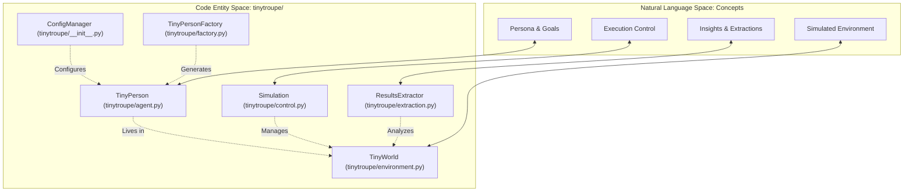
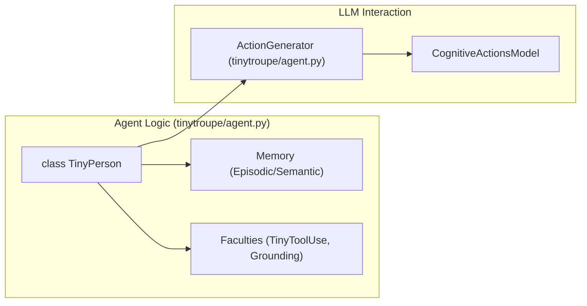

<!-- source: DeepWiki mcp.deepwiki.com · repo microsoft/TinyTroupe · page 1 Overview · fetched 2026-10-26 -->

# Overview

Relevant source files

The following files were used as context for generating this wiki page:

- [README.md](README.md)
- [data/extractions/appartment_rent_ad.extraction.json](data/extractions/appartment_rent_ad.extraction.json)
- [data/extractions/synthetic_data_generation.out.csv](data/extractions/synthetic_data_generation.out.csv)
- [docs/index.html](docs/index.html)
- [examples/Vision for Product, Diagnosis and Appreciation Feedback (image modality).ipynb](examples/Vision for Product, Diagnosis and Appreciation Feedback (image modality).ipynb)
- [tinytroupe/__init__.py](tinytroupe/__init__.py)

TinyTroupe is an experimental Python library for **LLM-powered multiagent persona simulation**. It enables the creation of artificial agents—`TinyPerson`s—with specific personalities, interests, and goals. These agents can interact within simulated environments—`TinyWorld`s—leveraging Large Language Models (LLMs) like GPT-4o and GPT-5-mini to generate realistic human-like behavior.

For detailed installation instructions, see [Installation and Setup](#1.1). For configuration options, see [Configuration Options](#1.2).

## Purpose and Key Concepts

TinyTroupe is designed for "imagination enhancement" in business and productivity contexts. Unlike AI assistants, which aim to help users directly, TinyTroupe simulates realistic human behavior to improve understanding of people, consumers, and social dynamics. Its key applications include:

- **Market Research**: Evaluating digital ads or product proposals with simulated audiences.
- **Software Testing**: Providing test input to systems (e.g., chatbots) and evaluating results.
- **Synthetic Data Generation**: Creating realistic datasets for training models or opportunity analysis.
- **Product Management**: Getting feedback from specific personas (e.g., physicians, lawyers).
- **Brainstorming**: Simulating focus groups for product feedback.

Sources: [README.md:17-25](), [README.md:57-71]()

## Core Architecture

TinyTroupe is structured around two primary abstractions: `TinyPerson` (the agent) and `TinyWorld` (the environment). These are supported by a `ConfigManager` for system settings and a `Simulation` controller for lifecycle management.

### System Architecture Diagram

Sources: [tinytroupe/__init__.py:29-44](), [README.md:206-211]()

## TinyPerson: Agent Architecture

A `TinyPerson` consists of a detailed persona, mental state (emotions, goals, attention), and various mental faculties. It processes stimuli and generates actions using a "Generate-Check-Correct" loop to ensure persona adherence and fluency.

### Agent Component Mapping

A `TinyPerson` can perform actions like `TALK`, `THINK`, and `REACH_OUT`. They now support **vision modality**, allowing them to "see" images and react based on visual perception rather than just text descriptions.

Sources: [README.md:57-62](), [README.md:91-93](), [tinytroupe/__init__.py:177-188]()

## TinyWorld: Environment Architecture

`TinyWorld` manages the interactions between agents. It handles the simulation step loop, agent accessibility (who can hear whom), and can be extended into specialized environments like `TinySocialNetwork`.

- **Time Management**: Controlled through simulation steps.
- **Accessibility**: Managed via `TinySocialNetwork` to constrain agent interactions.
- **Parallelism**: Agents can now run actions in parallel within the environment to improve performance.

Sources: [README.md:93-94](), [README.md:385-396]()

## Configuration and Integration

TinyTroupe uses a `ConfigManager` to load settings from `config.ini`. It supports OpenAI, Azure OpenAI, and experimental local models via Ollama.

| Category | Key Parameters |
|----------|----------------|
| **OpenAI** | `MODEL` (e.g., gpt-5-mini), `API_TYPE`, `CACHE_API_CALLS`, `MAX_CONCURRENT_MODEL_CALLS` |
| **Simulation** | `PARALLEL_AGENT_ACTIONS`, `RAI_HARMFUL_CONTENT_PREVENTION` |
| **Cognition** | `ENABLE_MEMORY_CONSOLIDATION`, `MAX_EPISODE_LENGTH` |
| **ActionGenerator** | `ENABLE_QUALITY_CHECKS`, `MAX_ATTEMPTS` |

Sources: [tinytroupe/__init__.py:82-188](), [README.md:65-71]()

## Results Extraction and Analysis

After a simulation, users utilize the `ResultsExtractor` and `ResultsReducer` to turn raw agent dialogues into structured data.

- **ResultsExtractor**: Parses interactions into JSON or CSV.
- **ResultsReporter**: Generates HTML reports.
- **SimulationExperimentEmpiricalValidator**: Compares simulation results against real-world data using statistical tests (t-test, KS-test) to validate agent behavior.

Sources: [README.md:68-69](), [data/extractions/appartment_rent_ad.extraction.json:1-8]()

## Project Structure

| Directory | Description |
|-----------|-------------|
| `/tinytroupe` | Core implementation (agents, environments, extraction, etc.). |
| `/examples` | Jupyter notebooks demonstrating vision, market research, and validation. |
| `/tests` | Pytest suite for core and slow tests. |
| `/data` | Input data for simulations and output examples (CSV, JSON). |

Sources: [README.md:194-201](), [data/extractions/synthetic_data_generation.out.csv:1-15]()

## Getting Started

1. **Install**: `pip install git+https://github.com/microsoft/TinyTroupe.git@main`
2. **Configure**: Set `OPENAI_API_KEY` and verify `config.ini` settings.
3. **Run**: Use provided example notebooks in `/examples` to explore vision modality or market research.

For more detailed information, see:
- [Installation and Setup](#1.1)
- [TinyPerson](#3) for agent details.
- [TinyWorld](#4) for environment details.
- [Market Research](#5.1) for specific use cases.

Sources: [README.md:118-139](), [examples/Vision for Product, Diagnosis and Appreciation Feedback (image modality).ipynb:8-14]()

---

