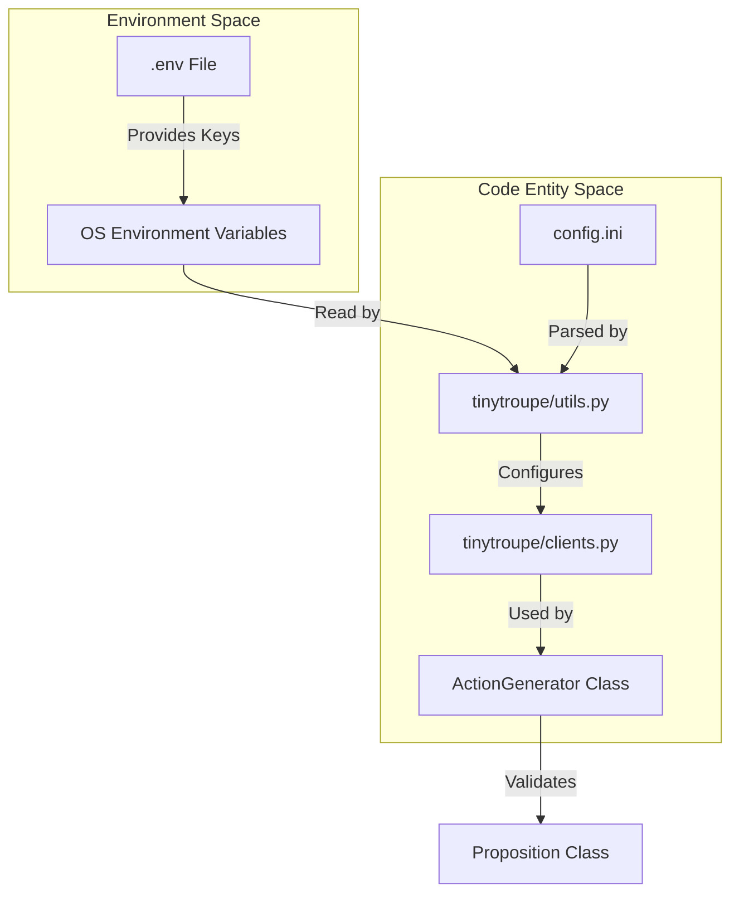
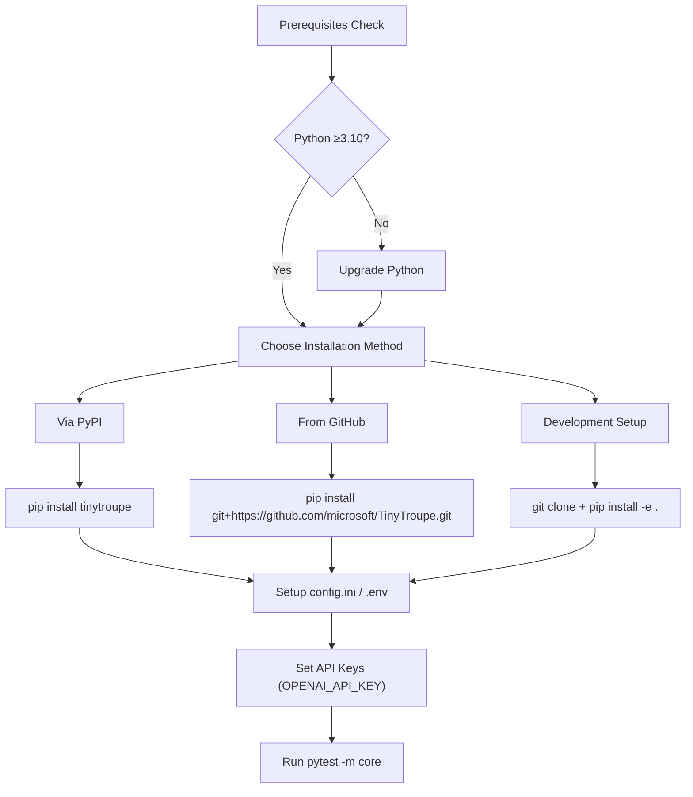

<!-- source: DeepWiki mcp.deepwiki.com · repo microsoft/TinyTroupe · page 1.1 Installation and Setup · fetched 2026-10-26 -->

# Installation and Setup

<details>
<summary>Relevant source files</summary>

The following files were used as context for generating this wiki page:

- [.env.example](.env.example)
- [MANIFEST.in](MANIFEST.in)
- [pyproject.toml](pyproject.toml)
- [tests/unit/test_tinyperson.py](tests/unit/test_tinyperson.py)
- [tinytroupe/agent/action_generator.py](tinytroupe/agent/action_generator.py)

</details>


## Purpose

This document provides step-by-step instructions for installing TinyTroupe and configuring it for successful operation. It covers installation methods, configuration file setup, API key configuration, and verification steps. For detailed information about all configuration options, see [Configuration Options](#1.2).

## Prerequisites

- Python ≥3.10 [pyproject.toml:17-17]()
- Access to OpenAI API, Azure OpenAI Service, or Ollama.
- The following key dependencies will be installed automatically:
  - `openai >= 1.65` [pyproject.toml:27-27]()
  - `pandas`, `matplotlib`, `seaborn`, `scipy` [pyproject.toml:25-39]()
  - `llama-index` and related integration packages [pyproject.toml:32-32]()
  - `tiktoken`, `msal`, `pydantic>=2.5.0` [pyproject.toml:29-37]()
  - `rich`, `requests`, `chevron`, `textdistance` [pyproject.toml:31-38]()
  - `pypandoc`, `python-docx`, `markdown` [pyproject.toml:33-33]()

Sources: [pyproject.toml:9-40]()

## Installation Methods

### Via PyPI (Recommended)

```bash
pip install tinytroupe
```

### From GitHub (Latest Version)

```bash
pip install git+https://github.com/microsoft/TinyTroupe.git
```

### Development Setup

```bash
git clone https://github.com/microsoft/TinyTroupe.git
cd TinyTroupe
pip install -e .
```

Sources: [pyproject.toml:1-46]()

## Configuration Setup

### Configuration File

TinyTroupe uses a `config.ini` file for configuration settings. The library looks for this file to initialize its internal state. The file is structured into several sections, including:

- `[OpenAI]`: Settings for OpenAI API, Azure OpenAI Service, or Ollama.
- `[Simulation]`: Settings for simulation behavior, including Responsible AI (RAI) toggles.
- `[Logging]`: Logging level configuration.

A default configuration file is included in the package. Users can provide a local `.env` file for sensitive keys as shown in `.env.example`.

Sources: [.env.example:1-8](), [tinytroupe/agent/action_generator.py:12-30]()

### Key Configuration Parameters

| Section | Parameter | Description | Default/Example |
|---------|-----------|-------------|--------------|
| OpenAI | API_TYPE | API provider (`openai`, `azure`, or `ollama`) | `openai` |
| OpenAI | MODEL | LLM model to use (e.g., `gpt-4o-mini`) | `gpt-4o-mini` |
| OpenAI | MAX_TOKENS | Maximum tokens per API call | `4000` |
| OpenAI | TEMPERATURE | Model temperature (randomness) | `1.2` |
| OpenAI | CACHE_API_CALLS | Enable API call caching to save costs | `True` |
| Simulation | RAI_HARMFUL_CONTENT_PREVENTION | Prevent harmful content generation | `True` |
| Simulation | RAI_COPYRIGHT_INFRINGEMENT_PREVENTION | Prevent copyright infringement | `True` |

Sources: [.env.example:1-8](), [tinytroupe/agent/action_generator.py:51-75]()

## API Key Setup

TinyTroupe requires API keys to communicate with LLM providers. These can be set as environment variables or within a `.env` file in the project root.

**For OpenAI:**
```bash
# In .env or shell
OPENAI_API_KEY="your-openai-api-key"
```

**For Azure OpenAI Service:**
```bash
# In .env or shell
AZURE_OPENAI_API_KEY="your-azure-openai-key"
AZURE_OPENAI_ENDPOINT="your-azure-endpoint"
```
*Note: To use Entra ID authentication with Azure, do not set the API key.*

Sources: [.env.example:1-8]()

## Package Initialization and Verification

When `tinytroupe` is imported, it initializes the configuration and logging systems. To verify the installation, you can run a basic script or use the provided test suite.

### Code Verification
```python
import tinytroupe
from tinytroupe.examples import create_oscar_the_architect

# Initialize an example agent
oscar = create_oscar_the_architect()

# Test a simple interaction
actions = oscar.listen_and_act("Tell me a bit about your life.", return_actions=True)

# Verify results
print(actions)
```
Sources: [tests/unit/test_tinyperson.py:11-25]()

### Running Tests
The project uses `pytest` with specific markers for validation:
- `pytest -m core`: Runs core validation tests.
- `pytest -m slow`: Runs comprehensive but slower tests.

Sources: [pyproject.toml:54-62]()

## Diagrams

### Installation and Environment Flow
This diagram maps the setup process to the configuration entities defined in the codebase.


Sources: [.env.example:1-8](), [tinytroupe/agent/action_generator.py:4-12](), [pyproject.toml:45-52]()

### System Component Initialization
This diagram illustrates the data flow from installation requirements to the execution of a `TinyPerson` agent.

```mermaid
flowchart LR
    subgraph "Natural Language Space"
        personaDef["Persona Description"]
        userPrompt["User Stimulus"]
    end

    subgraph "Code Entity Space"
        tpFactory["TinyPersonFactory"]
        tpInstance["TinyPerson Instance"]
        memory["EpisodicMemory"]
        actGen["ActionGenerator"]
    end

    personaDef -->|Input to| tpFactory
    tpFactory -->|Creates| tpInstance
    userPrompt -->|listen()| tpInstance
    tpInstance -->|Stores in| memory
    tpInstance -->|Calls act()| actGen
    actGen -->|Returns| actions["List of Actions"]
```
Sources: [tests/unit/test_tinyperson.py:37-45](), [tinytroupe/agent/action_generator.py:95-115]()

### Installation Process


Sources: [pyproject.toml:1-62](), [.env.example:1-8]()

---

