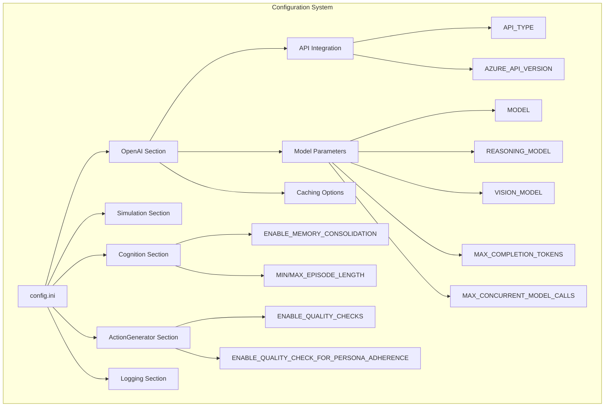
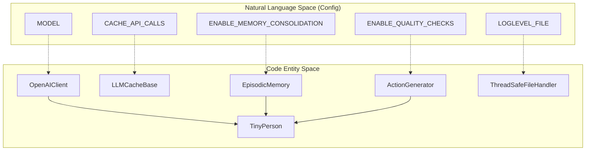

<!-- source: DeepWiki mcp.deepwiki.com · repo microsoft/TinyTroupe · page 1.2 Configuration Options · fetched 2026-10-26 -->

# Configuration Options

Relevant source files

The following files were used as context for generating this wiki page:

- [config.ini](config.ini)
- [examples/config.ini](examples/config.ini)
- [tinytroupe/config.ini](tinytroupe/config.ini)
- [tinytroupe/extraction/results_extractor.py](tinytroupe/extraction/results_extractor.py)
- [tinytroupe/utils/config.py](tinytroupe/utils/config.py)

This page details the configuration parameters that control TinyTroupe's behavior, including OpenAI API integration, simulation settings, and logging options. Configuration is managed through an INI file format, allowing you to adjust various aspects of the system to suit your specific requirements.

## Configuration File Structure

TinyTroupe uses INI-format configuration files organized into logical sections. The system provides a default configuration in the package, but you can override settings using a custom configuration file in the current working directory.

Sources: [tinytroupe/config.ini:1-126](), [examples/config.ini:1-49]()

## Configuration Location and Loading

The configuration is managed by `tinytroupe/utils/config.py`. TinyTroupe looks for configuration in the following order:

1. **Default configuration**: Bundled with the package at `tinytroupe/config.ini` [tinytroupe/utils/config.py:118-122]().
2. **Custom configuration**: A file named `config.ini` in the current working directory (`Path.cwd()`) [tinytroupe/utils/config.py:128-135]().

The `read_config_file` function handles this hierarchy, where values in the custom file override the defaults [tinytroupe/utils/config.py:108-151]().

## OpenAI Configuration Section

This section controls the interaction with OpenAI, Azure OpenAI Service, or local providers like Ollama.

### API Integration Settings

| Parameter | Description | Values | Default |
|-----------|-------------|--------|---------|
| `API_TYPE` | Specifies the API service provider | `openai`, `azure` | `openai` |
| `AZURE_API_VERSION` | API version for Azure OpenAI Service | String (e.g., "2024-12-01-preview") | `2024-12-01-preview` |
| `AZURE_EMBEDDING_MODEL_API_VERSION` | API version for Azure embedding models | String | `2023-05-15` |

Sources: [tinytroupe/config.ini:7-12](), [tinytroupe/config.ini:34-35]()

### Model Selection

TinyTroupe supports different models for different cognitive tasks:

| Parameter | Description | Default |
|-----------|-------------|---------|
| `MODEL` | Main text generation model for agent responses | `gpt-5-mini` |
| `REASONING_MODEL` | Used for precise reasoning and detailed analysis | `o3-mini` |
| `VISION_MODEL` | Used for image understanding (defaults to `MODEL` if unset) | Unset |
| `EMBEDDING_MODEL` | Model used for text similarity and memory retrieval | `text-embedding-3-small` |

Sources: [tinytroupe/config.ini:19-33]()

### Model Execution Parameters

| Parameter | Description | Default |
|-----------|-------------|---------|
| `MAX_COMPLETION_TOKENS` | Maximum tokens per API response | `128000` |
| `TIMEOUT` | API call timeout in seconds | `480` |
| `MAX_ATTEMPTS` | Max retry attempts for failed API calls | `5` |
| `WAITING_TIME` | Initial waiting time between retries (seconds) | `1` |
| `EXPONENTIAL_BACKOFF_FACTOR` | Factor for backoff between retries | `5` |
| `MAX_CONCURRENT_MODEL_CALLS` | Limits concurrent API invocations (0/NONE to disable) | `4` |
| `REASONING_EFFORT` | Effort level for reasoning models | `high` |
| `VISION_DETAIL` | Detail level for image tokens (`auto`, `low`, `high`) | `auto` |

Sources: [tinytroupe/config.ini:40-49](), [tinytroupe/config.ini:30]()

### Caching Settings

Caching prevents redundant API calls and reduces costs during development.

| Parameter | Description | Values | Default |
|-----------|-------------|--------|---------|
| `CACHE_API_CALLS` | Enable/disable API response caching | `True`, `False` | `False` |
| `CACHE_FILE_NAME` | File name for the JSON cache | String | `openai_api_cache.json` |

Sources: [tinytroupe/config.ini:55-56]()

## Simulation Configuration Section

Controls simulation-wide behaviors and safety filters.

| Parameter | Description | Default |
|-----------|-------------|---------|
| `PARALLEL_AGENT_GENERATION` | Whether to generate agents in parallel | `True` |
| `PARALLEL_AGENT_ACTIONS` | Whether to process agent actions in parallel | `True` |
| `RAI_HARMFUL_CONTENT_PREVENTION` | Enable/disable harmful content filters | `True` |
| `RAI_COPYRIGHT_INFRINGEMENT_PREVENTION` | Enable/disable copyright filters | `True` |

Sources: [tinytroupe/config.ini:66-70]()

## Cognition and Memory Settings

These parameters define how `TinyPerson` agents manage their internal state and memory.

| Parameter | Description | Default |
|-----------|-------------|---------|
| `ENABLE_MEMORY_CONSOLIDATION` | Enables the transition of episodic to semantic memory | `True` |
| `ENABLE_CONTINUOUS_CONTEXTUAL_SEMANTIC_MEMORY_RETRIEVAL` | Enables RAG-style retrieval for memory | `True` |
| `MIN_EPISODE_LENGTH` | Minimum interaction steps before consolidation | `10` |
| `MAX_EPISODE_LENGTH` | Maximum interaction steps before consolidation | `15` |
| `EPISODIC_MEMORY_FIXED_PREFIX_LENGTH` | Number of early interactions kept in fixed context | `10` |
| `EPISODIC_MEMORY_LOOKBACK_LENGTH` | Number of recent interactions kept in sliding window | `20` |

Sources: [tinytroupe/config.ini:74-81]()

## ActionGenerator Quality Checks

TinyTroupe can perform self-correction on agent actions to ensure high-quality outputs.

| Parameter | Description | Default |
|-----------|-------------|---------|
| `ENABLE_QUALITY_CHECKS` | Master switch for all quality verifications | `False` |
| `MAX_ATTEMPTS` | Retries for the Generate-Check-Correct loop | `2` |
| `QUALITY_THRESHOLD` | Threshold (0-9) for accepting an action | `5` |
| `ENABLE_REGENERATION` | Allow the model to try again on failure | `True` |
| `ENABLE_QUALITY_CHECK_FOR_PERSONA_ADHERENCE` | Verify action matches persona | `True` |
| `ENABLE_QUALITY_CHECK_FOR_SELFCONSISTENCY` | Verify action is logically consistent | `False` |
| `CONTINUE_ON_FAILURE` | Proceed even if quality checks fail after max retries | `True` |

Sources: [tinytroupe/config.ini:84-101]()

## Logging Configuration Section

Managed by `start_logger` in `tinytroupe/utils/config.py` [tinytroupe/utils/config.py:212-258]().

| Parameter | Description | Default |
|-----------|-------------|---------|
| `LOGLEVEL` | Default log level for root and `tinytroupe` loggers | `ERROR` |
| `LOGLEVEL_CONSOLE` | Log level for stdout (set `NONE` to disable) | `INFO` |
| `LOGLEVEL_FILE` | Log level for the generated `.log` file | `DEBUG` |
| `LOG_INCLUDE_THREAD_ID` | Include thread names and IDs in log format | `True` |

Sources: [tinytroupe/config.ini:107-121]()

## Configuration Flow and Usage

The following diagram associates configuration parameters with the specific code entities they influence.

Sources: [tinytroupe/utils/config.py:83-86](), [tinytroupe/config.ini:1-126](), [tinytroupe/extraction/results_extractor.py:159-161]()

## Implementation Details: Data Flow

When TinyTroupe starts, the `read_config_file` function is called to populate a global `_config` object [tinytroupe/utils/config.py:11-108](). This object is then accessed throughout the codebase using the `config` object returned by the utility.

### Logging Initialization
The `start_logger` function [tinytroupe/utils/config.py:212-258]() reads the `[Logging]` section and:
1. Determines the `_effective_root_level` by taking the minimum of console, file, and root levels [tinytroupe/utils/config.py:66-72]().
2. Creates a `ThreadSafeFileHandler` if `LOGLEVEL_FILE` is not `NONE` [tinytroupe/utils/config.py:83-86]().
3. Applies formatters that include thread IDs if `LOG_INCLUDE_THREAD_ID` is `True` [tinytroupe/utils/config.py:21-29]().

### API Client Configuration
The `OpenAIClient` (and related classes in `tinytroupe/clients.py`) uses parameters like `TIMEOUT`, `MAX_ATTEMPTS`, and `EXPONENTIAL_BACKOFF_FACTOR` to configure its request loop. It also checks `CACHE_API_CALLS` to decide whether to wrap calls in the caching layer.

Sources: [tinytroupe/utils/config.py:1-258](), [tinytroupe/config.ini:1-126]()

---

