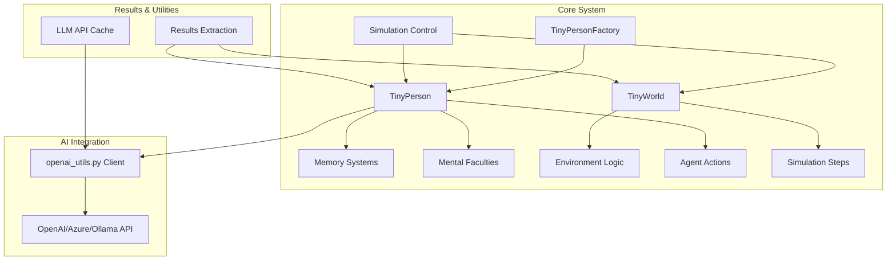
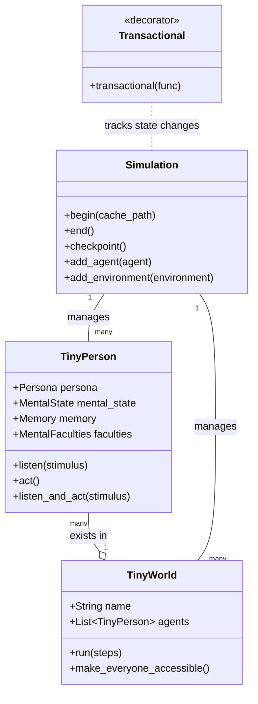
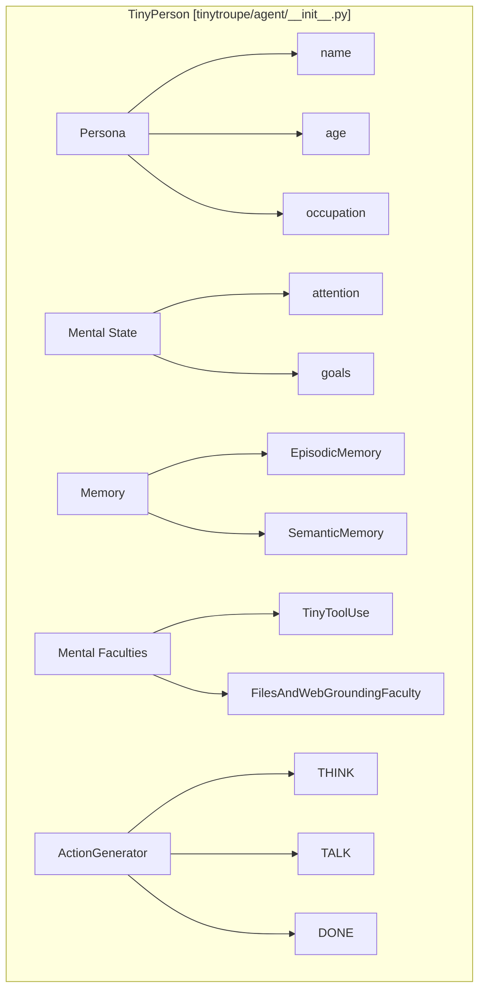
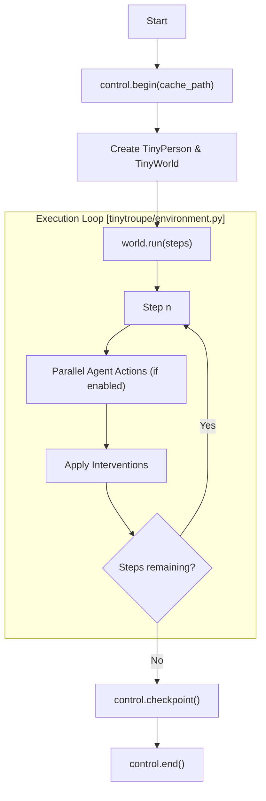

<!-- source: DeepWiki mcp.deepwiki.com · repo microsoft/TinyTroupe · page 2 Core Architecture · fetched 2026-10-26 -->

# Core Architecture

Relevant source files

The following files were used as context for generating this wiki page:

- [README.md](README.md)
- [data/extractions/appartment_rent_ad.extraction.json](data/extractions/appartment_rent_ad.extraction.json)
- [data/extractions/synthetic_data_generation.out.csv](data/extractions/synthetic_data_generation.out.csv)
- [examples/Vision for Product, Diagnosis and Appreciation Feedback (image modality).ipynb](examples/Vision for Product, Diagnosis and Appreciation Feedback (image modality).ipynb)
- [tinytroupe/__init__.py](tinytroupe/__init__.py)

This document describes the fundamental architecture and components of the TinyTroupe system. It focuses on the core design elements, data flow, and relationships between primary system components. For details on specific subsystems like mental faculties or memory systems, see the corresponding pages: [TinyPerson](#3), [Mental Faculties](#3.2), [Memory Systems](#3.3), and [Simulation Control](#2.1).

## Overview

TinyTroupe is built as a framework for LLM-powered multiagent simulations. Its architecture follows a modular design that separates agent behavior from environment dynamics, enabling flexible simulation configurations while maintaining a consistent execution model.

Sources: [README.md:1-50](), [tinytroupe/agent/__init__.py:1-20]()

## Primary Components

The TinyTroupe system consists of three primary components that form the foundation of the architecture:

1. **TinyPerson**: Agent class representing simulated individuals with personas, mental states, and cognitive abilities [tinytroupe/agent/__init__.py:32-48]().
2. **TinyWorld**: Environment where agents interact, providing the context and rules for simulation [tinytroupe/environment/__init__.py:10-25]().
3. **Control System**: Orchestrates simulations, manages state via the `Simulation` class, and provides caching mechanisms [tinytroupe/control.py:14-136]().

These components interact through a well-defined lifecycle and transaction model, which ensures deterministic simulation behavior and efficient resource usage.

Sources: [tinytroupe/control.py:14-136](), [README.md:204-220](), [tinytroupe/agent/__init__.py:32-48]()

### TinyPerson (Agent)

The `TinyPerson` class represents individual agents. Each agent has a persona (static attributes), mental state (dynamic attributes), memory systems, and mental faculties. Recent updates include action correction mechanisms to improve persona adherence [README.md:91-91]().

Sources: [tinytroupe/agent/__init__.py:32-48](), [README.md:214-216](), [tinytroupe/__init__.py:177-185]()

### TinyWorld (Environment)

`TinyWorld` serves as the base environment class. It manages the simulation timeline and agent accessibility. In version 0.5.1+, `TinyWorld` supports running agents in parallel within each step to improve performance [README.md:93-93]().

Key features:
- **Parallel Actions**: Controlled by `PARALLEL_AGENT_ACTIONS` in `config.ini` [tinytroupe/__init__.py:151-153]().
- **Accessibility**: Managed via `make_everyone_accessible()` to allow all agents to talk to each other [tinytroupe/environment/__init__.py:100-110]().

Sources: [README.md:384-397](), [tinytroupe/__init__.py:151-153]()

### Control System

The control system, residing in `tinytroupe/control.py`, manages simulation state through the `Simulation` class. It uses a `transactional` decorator to wrap methods that modify agent or environment state, allowing for state capture and rollback/caching [tinytroupe/control.py:159-200]().

For details, see [Simulation Control](#2.1).

Sources: [tinytroupe/control.py:384-572]()

## Simulation Lifecycle

A TinyTroupe simulation follows a defined lifecycle managed by the `control` module.

Sources: [tinytroupe/control.py:66-116](), [README.md:462-469](), [tinytroupe/__init__.py:151-153]()

## LLM Integration and Caching

TinyTroupe abstracts LLM interactions through a configuration-driven client. It supports OpenAI, Azure OpenAI, and experimental Ollama support [README.md:71-71]().

### Caching Tiers
1. **Simulation Cache**: Managed by `control.py`, stores the high-level state of the simulation (agent memories, world state) [tinytroupe/control.py:159-170]().
2. **API Cache**: Managed by the LLM client, stores raw request/response pairs in a JSON file (default: `openai_api_cache.json`) to save costs and speed up repeated runs [tinytroupe/__init__.py:143-145]().

### Configuration Management
The `ConfigManager` class in `tinytroupe/__init__.py` handles settings from `config.ini`, including model selection (defaulting to `gpt-4o` or `gpt-5-mini`), temperature, and concurrency limits [tinytroupe/__init__.py:82-138]().

For details, see [OpenAI Integration](#2.2).

Sources: [tinytroupe/__init__.py:29-150](), [README.md:467-471]()

---

