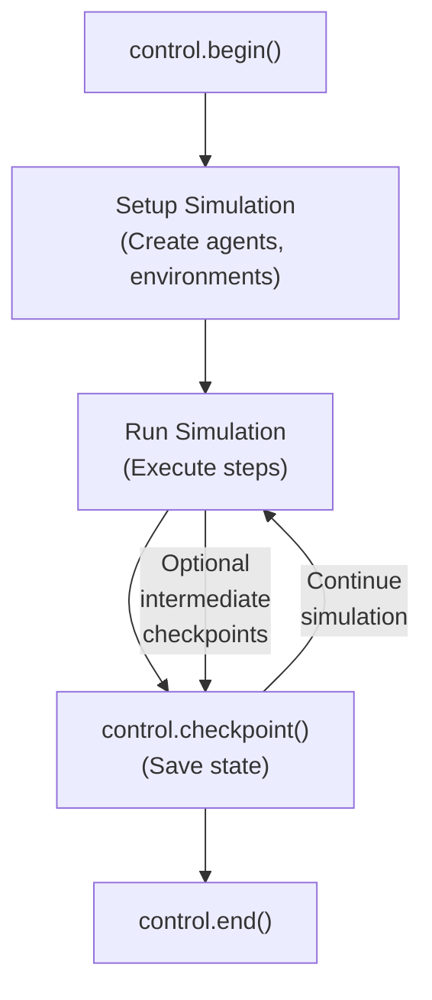
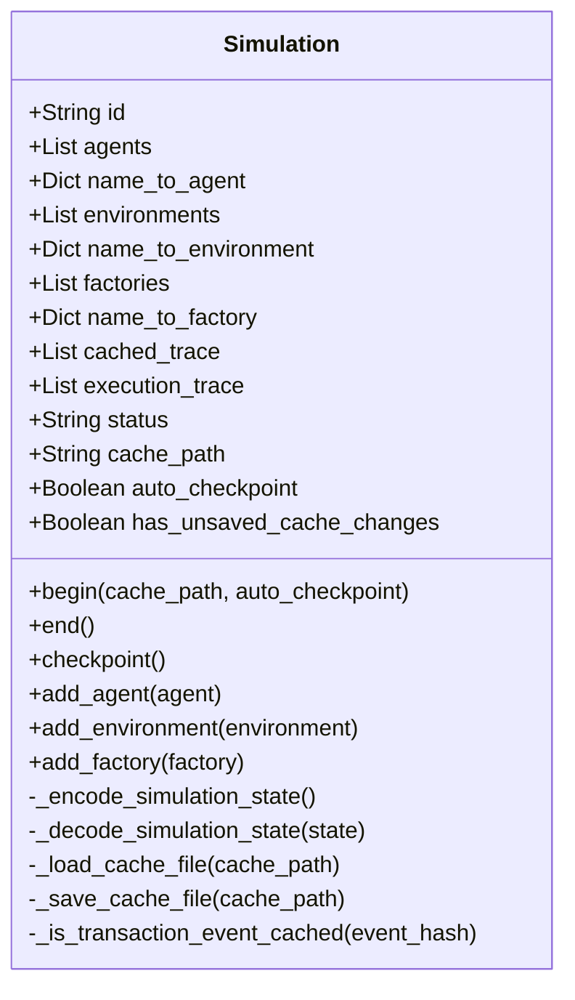
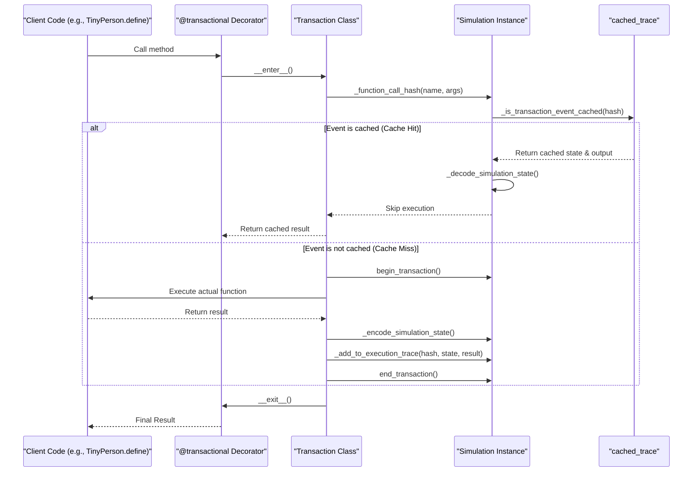
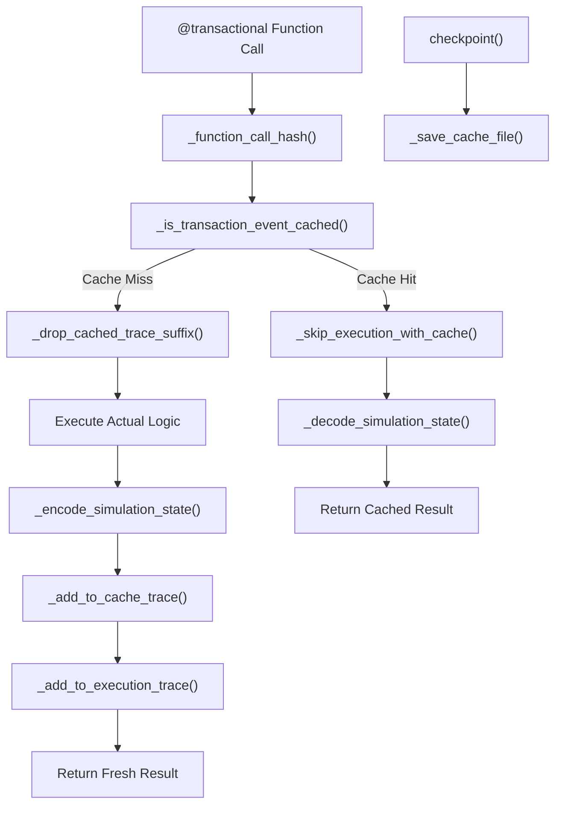
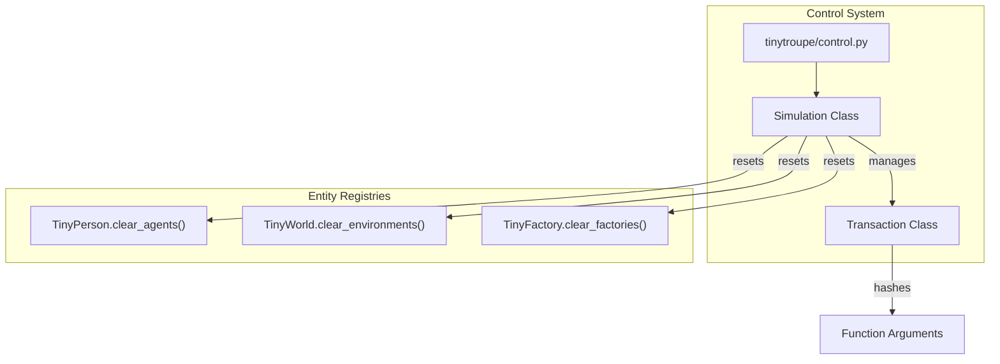

<!-- source: DeepWiki mcp.deepwiki.com · repo microsoft/TinyTroupe · page 2.1 Simulation Control · fetched 2026-10-26 -->

# Simulation Control

<details>
<summary>Relevant source files</summary>

The following files were used as context for generating this wiki page:

- [examples/Travel Product Market Research.ipynb](examples/Travel Product Market Research.ipynb)
- [tests/scenarios/test_basic_scenarios.py](tests/scenarios/test_basic_scenarios.py)
- [tests/scenarios/test_brainstorming_scenarios.py](tests/scenarios/test_brainstorming_scenarios.py)
- [tests/testing_utils.py](tests/testing_utils.py)
- [tests/unit/test_control.py](tests/unit/test_control.py)
- [tinytroupe/control.py](tinytroupe/control.py)
- [tinytroupe/examples/loaders.py](tinytroupe/examples/loaders.py)
- [tinytroupe/factory/prompts/generate_person.mustache](tinytroupe/factory/prompts/generate_person.mustache)

</details>


This page explains how simulations are managed in TinyTroupe, including starting, running, checkpointing, and ending simulations via the `control` module. The simulation control system is responsible for tracking the state of the simulation, managing transactions, and providing caching mechanisms for efficient execution.

## Overview

The simulation control module provides the infrastructure for managing the lifecycle of a simulation. It allows you to:

- Begin and end simulations.
- Track agents, environments, and factories.
- Save simulation state to disk (checkpointing).
- Optimize performance through caching of execution traces.
- Apply a transactional approach to ensure state consistency and reproducibility.

Sources: [tinytroupe/control.py:1-9](), [tests/scenarios/test_basic_scenarios.py:33-58]()

## Simulation Lifecycle

The simulation lifecycle in TinyTroupe follows a specific pattern of initialization, execution, and termination.

### Lifecycle Diagram



Sources: [tinytroupe/control.py:78-130](), [tests/scenarios/test_basic_scenarios.py:33-58]()

A typical simulation follows these steps:

1.  **Begin**: Initialize the simulation with `control.begin()`. This resets internal counters and prepares the cache file [tinytroupe/control.py:78-119]().
2.  **Setup**: Create agents, environments, and establish relationships. Entities are automatically registered with the current simulation [tinytroupe/control.py:142-171]().
3.  **Run**: Execute simulation steps (e.g., `agent.listen_and_act()` or `world.run()`).
4.  **Checkpoint**: Save the simulation state with `control.checkpoint()`, which writes unsaved changes to the cache file [tinytroupe/control.py:131-140]().
5.  **End**: Terminate the simulation with `control.end()`, which performs a final checkpoint and stops the simulation [tinytroupe/control.py:120-130]().

## The Simulation Class

The `Simulation` class is the core of the simulation control system. It maintains the state of all entities and handles the execution chain.

### Key Attributes

| Attribute | Purpose |
|-----------|---------|
| `agents` | List of `TinyPerson` instances in the simulation [tinytroupe/control.py:30](). |
| `environments` | List of `TinyWorld` instances in the simulation [tinytroupe/control.py:33](). |
| `factories` | List of `TinyFactory` instances (e.g., `TinyPersonFactory`) [tinytroupe/control.py:35](). |
| `cached_trace` | A list of historical simulation states loaded from a cache file [tinytroupe/control.py:63-66](). |
| `execution_trace` | The actual current execution path being built [tinytroupe/control.py:76](). |
| `status` | Current status: `STATUS_STARTED` or `STATUS_STOPPED` [tinytroupe/control.py:39](). |
| `cache_path` | File path for simulation state persistence [tinytroupe/control.py:41](). |
| `auto_checkpoint` | If `True`, saves to disk after every transaction [tinytroupe/control.py:44](). |

### Simulation Class Structure



Sources: [tinytroupe/control.py:22-77](), [tinytroupe/control.py:142-171](), [tinytroupe/control.py:274-382]()

## Global Control Functions

The `control` module provides a functional interface to the `default` simulation instance, facilitating easy management in scripts and notebooks.

| Function | Purpose |
|----------|---------|
| `begin(cache_path, id, auto_checkpoint)` | Starts a simulation and clears existing entity registries [tinytroupe/control.py:577-601](). |
| `end(id)` | Stops the simulation and saves the final state [tinytroupe/control.py:603-611](). |
| `checkpoint(id)` | Explicitly saves the simulation trace to the cache file [tinytroupe/control.py:613-621](). |
| `reset()` | Clears the `_current_simulations` dictionary and resets global state [tinytroupe/control.py:633-642](). |
| `current_simulation()` | Returns the simulation object currently in scope [tinytroupe/control.py:623-631](). |

Sources: [tinytroupe/control.py:577-642]()

## Transactional Processing

The simulation uses a transactional approach to ensure consistency. This is implemented through the `Transaction` class and the `@transactional` decorator. When a method is marked as `@transactional`, the system checks if that specific event (function name + arguments) has already occurred in the `cached_trace`.

### Transaction Flow



Sources: [tinytroupe/control.py:384-539](), [tinytroupe/control.py:541-574]()

## Caching Mechanism

The caching system avoids redundant LLM calls and computations. It relies on:
1.  **State Encoding**: Converting the entire simulation state (agents, environments, etc.) into a JSON-serializable dictionary [tinytroupe/control.py:274-308]().
2.  **Event Hashing**: Hashing function names and arguments to identify unique "events" [tinytroupe/control.py:182-224]().
3.  **Trace Matching**: Comparing the current execution against the `cached_trace`. If a mismatch occurs, the cache suffix is dropped to maintain consistency [tinytroupe/control.py:226-245]().

### Caching System Diagram



Sources: [tinytroupe/control.py:176-272]()

## Example Usage

In scenarios like market research, `control.begin()` is used to load existing results and avoid re-generating the same population or survey responses.

```python
import tinytroupe.control as control
from tinytroupe.examples import create_oscar_the_architect

# Start with a specific cache file
control.begin("my_simulation.cache.json")

# This creation is transactional and will be cached
agent = create_oscar_the_architect()

# Define properties (transactional)
agent.define("age", 19)

# Save the trace to the JSON file
control.checkpoint()

# Finalize
control.end()
```

Sources: [tests/scenarios/test_basic_scenarios.py:33-58](), [examples/Travel Product Market Research.ipynb:137]()

## Integration with Other Components

The simulation control system acts as a central registry. When `Simulation.begin()` is called, it clears the global registries of other classes to ensure a fresh state.



Sources: [tinytroupe/control.py:108-111](), [tests/testing_utils.py:213-218]()

---

