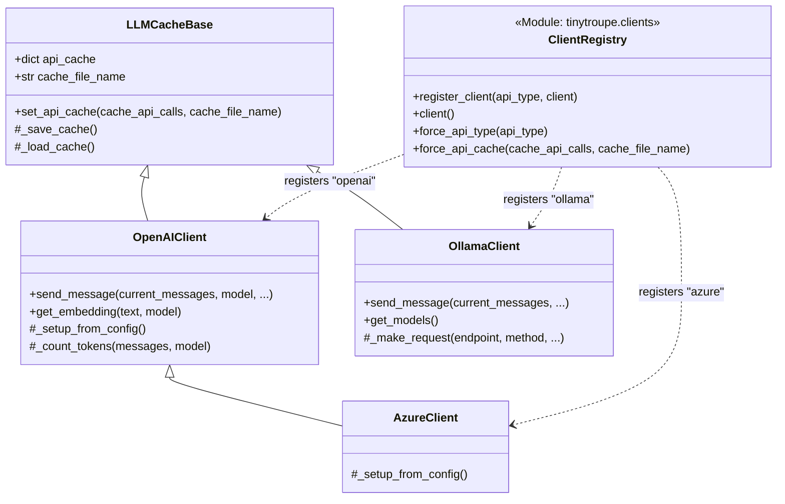
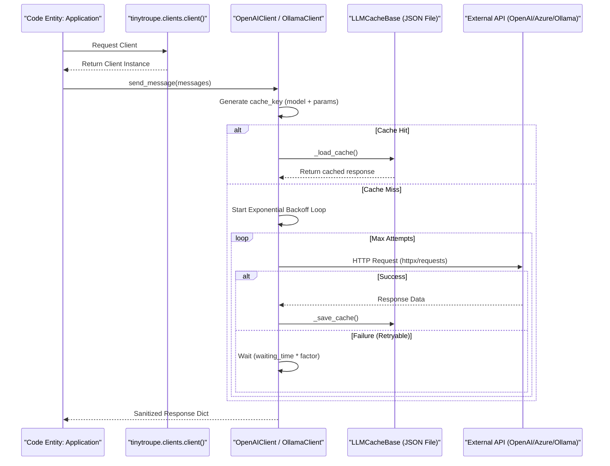

<!-- source: DeepWiki mcp.deepwiki.com · repo microsoft/TinyTroupe · page 2.2 OpenAI Integration · fetched 2026-10-26 -->

# OpenAI Integration

Relevant source files

The following files were used as context for generating this wiki page:

- [tests/non_functional/test_security.py](tests/non_functional/test_security.py)
- [tests/unit/test_api_cache.py](tests/unit/test_api_cache.py)
- [tests/unit/test_api_cache_integration.py](tests/unit/test_api_cache_integration.py)
- [tinytroupe/clients/__init__.py](tinytroupe/clients/__init__.py)
- [tinytroupe/clients/azure_client.py](tinytroupe/clients/azure_client.py)
- [tinytroupe/clients/ollama_client.py](tinytroupe/clients/ollama_client.py)
- [tinytroupe/clients/openai_client.py](tinytroupe/clients/openai_client.py)

TinyTroupe integrates with Large Language Models (LLMs) through a flexible client architecture that supports **OpenAI**, **Azure OpenAI Service**, and **Ollama**. This integration handles the complexities of API communication, including caching, exponential backoff, token counting, and structured output parsing.

## Client Architecture

The integration is built on a provider-agnostic registry pattern. All clients inherit from `LLMCacheBase` to provide consistent JSON-based caching functionality.

Sources: [tinytroupe/clients/openai_client.py:28-32](), [tinytroupe/clients/openai_client.py:82-85](), [tinytroupe/clients/azure_client.py:15-15](), [tinytroupe/clients/ollama_client.py:13-13](), [tinytroupe/clients/__init__.py:45-121]()

## Request Flow and Caching

When a message is sent via `send_message`, the client follows a specific execution path that prioritizes the local JSON cache to save costs and improve performance.

### Exponential Backoff
TinyTroupe implements its own retry logic rather than relying on library defaults. It uses an `exponential_backoff_factor` and a `waiting_time` defined in the configuration [tinytroupe/clients/openai_client.py:183-185](). For OpenAI, `max_retries` is set to 0 in the underlying `OpenAI` object to allow TinyTroupe's custom loop to manage retries [tinytroupe/clients/openai_client.py:171-174]().

### Token Counting
The `OpenAIClient` uses `tiktoken` to estimate token usage [tinytroupe/clients/openai_client.py:12](). It tracks statistics including `_input_tokens`, `_output_tokens`, and `_total_tokens` [tinytroupe/clients/openai_client.py:143-145]().

Sources: [tinytroupe/clients/openai_client.py:213-250](), [tinytroupe/clients/openai_client.py:171-174](), [tinytroupe/clients/ollama_client.py:105-154](), [tinytroupe/clients/openai_client.py:138-148]()

## Client Registry and Overrides

The `tinytroupe.clients` module maintains a registry of available API clients. By default, it registers `OpenAIClient`, `AzureClient`, and `OllamaClient` [tinytroupe/clients/__init__.py:118-120]().

### Key Functions
- `client()`: Returns the client instance corresponding to the `api_type` defined in `config.ini` [tinytroupe/clients/__init__.py:75-86]().
- `force_api_type(api_type)`: Globally overrides the configured API type, useful for switching between local Ollama and cloud OpenAI during execution [tinytroupe/clients/__init__.py:92-100]().
- `force_api_cache(cache_api_calls, cache_file_name)`: Updates the caching settings for all registered clients simultaneously [tinytroupe/clients/__init__.py:103-115]().

Sources: [tinytroupe/clients/__init__.py:45-121]()

## Implementation Details

### LLMCacheBase
The `LLMCacheBase` class provides `_save_cache()` and `_load_cache()` methods that handle reading and writing the API cache as a JSON file [tinytroupe/clients/openai_client.py:34-52](). This allows for human-readable inspection of cached LLM interactions.

### OpenAI vs. Azure Configuration
- **OpenAIClient**: Uses the `OPENAI_API_KEY` environment variable [tinytroupe/clients/openai_client.py:173]().
- **AzureClient**: Can use either an API key (`AZURE_OPENAI_KEY`) or **Entra ID Authentication** via `DefaultAzureCredential` [tinytroupe/clients/azure_client.py:42-65](). It requires an `AZURE_OPENAI_ENDPOINT` and `AZURE_API_VERSION` [tinytroupe/clients/azure_client.py:44-47]().

### Ollama Integration
The `OllamaClient` interacts with local LLMs via direct HTTP requests to the Ollama server (default: `http://localhost:11434/v1`) [tinytroupe/clients/ollama_client.py:23](). It supports a specific `num_ctx` parameter for controlling the input context size [tinytroupe/clients/ollama_client.py:91]().

Sources: [tinytroupe/clients/openai_client.py:28-76](), [tinytroupe/clients/azure_client.py:25-66](), [tinytroupe/clients/ollama_client.py:13-41]()

## Configuration Parameters

The clients are initialized using values from the `config.ini` file, processed via the `@config_manager.config_defaults` decorator.

| Parameter | Description | Client Usage |
|-----------|-------------|--------------|
| `api_type` | `openai`, `azure`, or `ollama` | Registry selection |
| `model` | The LLM model name (e.g., `gpt-4o`) | All clients |
| `cache_api_calls` | Boolean to enable/disable JSON caching | All clients |
| `max_attempts` | Number of retries for failed requests | All clients |
| `timeout` | Request timeout in seconds | OpenAI/Azure (via httpx) |
| `max_concurrent_model_calls` | Limits parallel API requests | OpenAIClient |

Sources: [tinytroupe/clients/openai_client.py:87-97](), [tinytroupe/clients/openai_client.py:176-188](), [tinytroupe/clients/ollama_client.py:29-42](), [tinytroupe/clients/__init__.py:79-83]()

---

