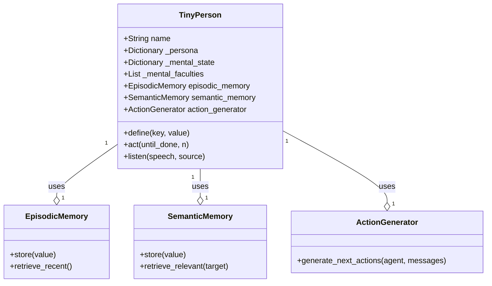
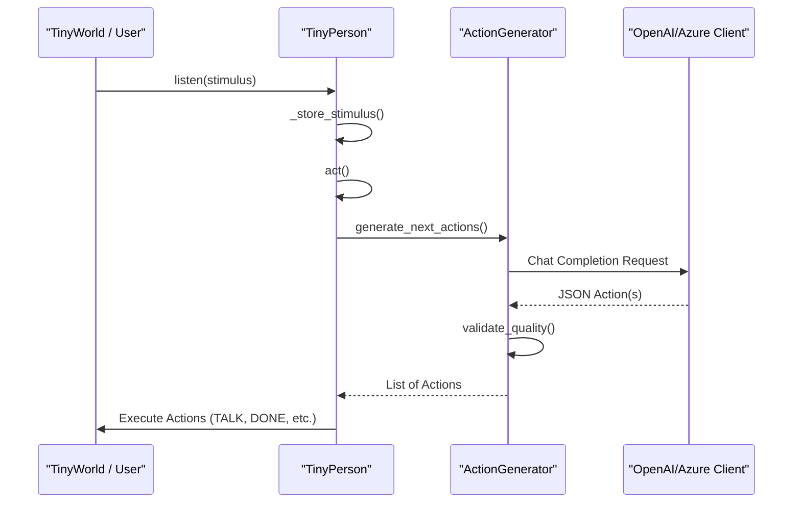

<!-- source: DeepWiki mcp.deepwiki.com · repo microsoft/TinyTroupe · page 3 TinyPerson · fetched 2026-10-26 -->

# TinyPerson

Relevant source files

The following files were used as context for generating this wiki page:

- [pyproject.toml](pyproject.toml)
- [tests/unit/test_tinyperson.py](tests/unit/test_tinyperson.py)
- [tinytroupe/agent/action_generator.py](tinytroupe/agent/action_generator.py)
- [tinytroupe/agent/tiny_person.py](tinytroupe/agent/tiny_person.py)
- [tinytroupe/environment/tiny_social_network.py](tinytroupe/environment/tiny_social_network.py)

TinyPerson is the core agent class in the TinyTroupe framework, representing a simulated person with cognitive capabilities, memory, goals, emotions, and the ability to interact with other agents and environments. This page provides a high-level guide to the TinyPerson architecture and its primary components.

For detailed guides on specific subsystems, see the following child pages:
*   [Creating Agents](#3.1) — Methods for defining personas, loading JSON specs, and using `TinyPersonFactory`.
*   [Mental Faculties](#3.2) — Specialized capabilities like `TinyToolUse` and `FilesAndWebGroundingFaculty`.
*   [Memory Systems](#3.3) — Details on `EpisodicMemory`, `SemanticMemory`, and consolidation.
*   [Action Generation](#3.4) — The internal pipeline for generating and validating agent actions.

## Overview of TinyPerson

A `TinyPerson` represents a simulated human-like agent with a persistent personality, mental state, memory systems, and interaction capabilities. Unlike traditional AI assistants, TinyTroupe agents are designed to exhibit human-like behaviors, including idiosyncrasies and emotions.

Each `TinyPerson` includes:
*   A **persona** with attributes like name, age, and occupation.
*   A **mental state** with dynamic attributes like goals and emotions.
*   **Memory systems** for storing experiences (`EpisodicMemory`) and knowledge (`SemanticMemory`).
*   **Mental faculties** that provide specialized capabilities like tool use.

Sources: [tinytroupe/agent/tiny_person.py:29-88](), [tinytroupe/agent/tiny_person.py:127-196]()

## TinyPerson Architecture

The following diagram illustrates the relationship between the `TinyPerson` class and its core components in the codebase.

*TinyPerson Code Entity Diagram*

Sources: [tinytroupe/agent/tiny_person.py:29-123](), [tinytroupe/agent/tiny_person.py:161-180]()

## Core Components

### Persona and Mental State
The persona defines static attributes (e.g., age, nationality, occupation), while the mental state tracks dynamic variables like current location, goals, and emotions. These are managed via the `_persona` and `_mental_state` dictionaries and can be modified using the `define()` method.

For details on configuring these, see [Creating Agents](#3.1).

Sources: [tinytroupe/agent/tiny_person.py:56-71](), [tinytroupe/agent/tiny_person.py:292-325]()

### Memory Systems
TinyPerson utilizes two primary memory types:
1.  **Episodic Memory**: A chronological log of stimuli and actions.
2.  **Semantic Memory**: A vector-based store for factual knowledge and document grounding.

For details on how these systems function and consolidate information, see [Memory Systems](#3.3).

Sources: [tinytroupe/agent/tiny_person.py:107-112](), [tinytroupe/agent/memory.py:17-156]()

### Mental Faculties
Faculties are modular components that extend an agent's abilities. Common faculties include `RecallFaculty` for memory access and `TinyToolUse` for executing external code or API calls.

For details on available faculties and how to create new ones, see [Mental Faculties](#3.2).

Sources: [tinytroupe/agent/tiny_person.py:386-405](), [tinytroupe/agent/mental_faculties.py:1-20]()

## Interaction and Action Flow

Agents interact with the world through a cycle of receiving stimuli and generating actions. The `ActionGenerator` handles the complex logic of producing valid, persona-consistent behaviors.

*From Stimulus to Action: Code Flow*

For a deep dive into the generation pipeline, quality checks, and repetition prevention, see [Action Generation](#3.4).

Sources: [tinytroupe/agent/tiny_person.py:407-510](), [tinytroupe/agent/action_generator.py:95-115]()

## Agent Interaction Methods

### Receiving Stimuli
Agents perceive their environment through several methods that update their internal state and memory:
*   `listen(speech, source)`: Processes conversational input.
*   `see(visual_description, source)`: Processes visual descriptions.
*   `think(thought)`: Adds internal monologue to the agent's context.

Sources: [tinytroupe/agent/tiny_person.py:511-606]()

### Producing Actions
The `act()` method is the primary entry point for agent behavior. It can be configured to run until the agent decides it is finished (`until_done=True`) or for a fixed number of steps.
*   `act(until_done, n, return_actions)`: Triggers the action generation loop.
*   `listen_and_act(speech)`: A convenience wrapper for immediate response.

Sources: [tinytroupe/agent/tiny_person.py:407-440](), [tinytroupe/agent/tiny_person.py:634-645]()

## Environment and Social Context
Agents can be placed in a `TinyWorld` or `TinySocialNetwork`. Their behavior is influenced by their `_accessible_agents` list and the `environment` they are currently in.
*   `make_agent_accessible(other_agent)`: Allows the agent to target others with actions like `TALK`.
*   `move_to(location)`: Updates the agent's spatial context.

Sources: [tinytroupe/agent/tiny_person.py:712-770](), [tinytroupe/environment/tiny_social_network.py:59-74]()

## State Management
`TinyPerson` supports full serialization for saving and loading simulation states.
*   `save_specification(path)`: Exports the agent's persona and state to JSON.
*   `load_specification(path)`: Reconstitutes an agent from a file.

Sources: [tinytroupe/agent/tiny_person.py:1214-1268]()

---

