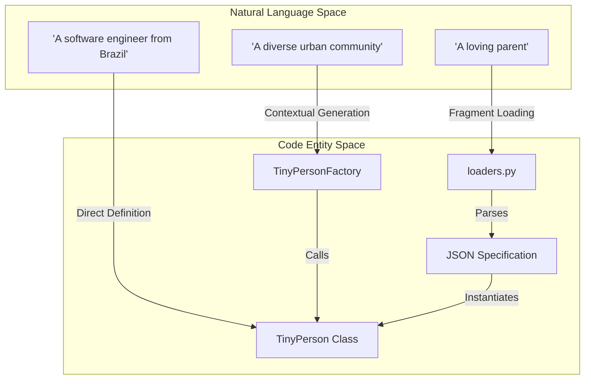
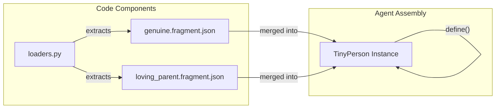

<!-- source: DeepWiki mcp.deepwiki.com · repo microsoft/TinyTroupe · page 3.1 Creating Agents · fetched 2026-10-26 -->

# Creating Agents

<details>
<summary>Relevant source files</summary>

The following files were used as context for generating this wiki page:

- [examples/agents/Friedrich_Wolf.agent.json](examples/agents/Friedrich_Wolf.agent.json)
- [examples/agents/Lila.agent.json](examples/agents/Lila.agent.json)
- [examples/agents/Lisa.agent.json](examples/agents/Lisa.agent.json)
- [examples/fragments/genuine.agent.fragment.json](examples/fragments/genuine.agent.fragment.json)
- [examples/fragments/loving_parent.agent.fragment.json](examples/fragments/loving_parent.agent.fragment.json)
- [examples/information/populations/brazil.json](examples/information/populations/brazil.json)
- [examples/information/populations/usa.json](examples/information/populations/usa.json)
- [tests/unit/test_control.py](tests/unit/test_control.py)
- [tests/unit/test_factory.py](tests/unit/test_factory.py)
- [tinytroupe/examples/loaders.py](tinytroupe/examples/loaders.py)
- [tinytroupe/factory/tiny_person_factory.py](tinytroupe/factory/tiny_person_factory.py)

</details>


This page explains the methods and patterns for creating and configuring `TinyPerson` agents within the TinyTroupe framework. You'll learn how to instantiate agents directly, use the `TinyPersonFactory` for automated generation, and leverage pre-defined examples and fragments.

## Overview

TinyTroupe agents are instances of the `TinyPerson` class, which represents simulated individuals with specific personalities, backgrounds, and capabilities. Creating agents involves instantiating this class and configuring its persona via natural language or structured data.

### Agent Creation Pathways

The following diagram maps the Natural Language descriptions to the Code Entities responsible for agent creation.



Sources: [tinytroupe/agent/tiny_person.py:22-45](), [tinytroupe/factory/tiny_person_factory.py:24-36](), [tinytroupe/examples/loaders.py:4-14]()

## Basic Agent Creation Methods

### Direct Instantiation
The most fundamental way to create an agent is by instantiating `TinyPerson` [tinytroupe/agent/tiny_person.py:47-76](). Once created, you use the `define` method to build the persona.

```python
from tinytroupe.agent import TinyPerson

# 1. Instantiate
alice = TinyPerson(name="Alice")

# 2. Configure via define()
alice.define("age", 30)
alice.define("occupation", "Data Scientist")
alice.define("personality", ["curious", "analytical"])
```
The `define` method [tinytroupe/agent/tiny_person.py:290-325]() is versatile; it can take strings, numbers, or complex dictionaries and lists, merging them into the agent's internal `_persona` dictionary.

Sources: [tinytroupe/agent/tiny_person.py:47-76](), [tinytroupe/agent/tiny_person.py:290-325]()

### Loading from Specifications
Agents can be entirely defined in JSON files and loaded using `TinyPerson.load_specification` [tinytroupe/agent/tiny_person.py:1232-1259]().

| Feature | Description |
| :--- | :--- |
| **JSON Schema** | Includes `name`, `age`, `gender`, `occupation`, `personality`, `beliefs`, etc. |
| **Example Files** | `Lila.agent.json`, `Lisa.agent.json`, `Friedrich_Wolf.agent.json`. |
| **Flexibility** | Allows overriding the agent name during load to avoid global name collisions. |

Sources: [tinytroupe/agent/tiny_person.py:1232-1259](), [examples/agents/Lila.agent.json:1-17](), [examples/agents/Friedrich_Wolf.agent.json:1-20]()

## Automated Generation with TinyPersonFactory

The `TinyPersonFactory` [tinytroupe/factory/tiny_person_factory.py:24-225]() uses LLMs to automate the creation of agents based on high-level contexts.

### Factory Initialization and Context
A factory is initialized with a `context` (the environment description) and optionally a `sampling_space_description` [tinytroupe/factory/tiny_person_factory.py:29-54]().

```python
from tinytroupe.factory import TinyPersonFactory

bank_context = "A large Brazilian bank facing competition from fintechs."
factory = TinyPersonFactory(context=bank_context)

# Generate a specific person
banker = factory.generate_person("A vice-president with an MBA in finance.")
```

### Batch Generation and Demographics
TinyTroupe supports generating entire populations using demographic data [tinytroupe/factory/tiny_person_factory.py:120-153](). You can provide a file path to demographic distributions (e.g., `brazil.json` or `usa.json`) to the `create_factory_from_demography` method.

| Parameter | Role |
| :--- | :--- |
| `total_population_size` | The theoretical size of the group being sampled from. |
| `agent_particularities` | Specific constraints for the generated batch (e.g., "All must be students"). |
| `temperature` | Controls the diversity of the generated personas [tests/unit/test_factory.py:42-71](). |

Sources: [tinytroupe/factory/tiny_person_factory.py:24-64](), [tinytroupe/factory/tiny_person_factory.py:120-153](), [tests/unit/test_factory.py:92-126](), [examples/information/populations/usa.json:1-15]()

## Using Example Agents and Fragments

TinyTroupe provides a set of pre-configured agents and "persona fragments" to speed up development.

### Example Loaders
The `tinytroupe.examples.loaders` module provides utility functions to access bundled assets [tinytroupe/examples/loaders.py:4-44]():
- `load_example_agent_specification(name)`: Loads a full agent JSON.
- `load_example_fragment_specification(name)`: Loads a partial persona (e.g., "loving parent" or "genuine").

### Persona Fragments
Fragments allow you to "mix-in" traits to an existing agent. For example, the `loving_parent.agent.fragment.json` defines specific interests (Children, Education) and behaviors (priority on safety) [examples/fragments/loving_parent.agent.fragment.json:1-37]().



Sources: [tinytroupe/examples/loaders.py:16-26](), [examples/fragments/loving_parent.agent.fragment.json:1-37](), [examples/fragments/genuine.agent.fragment.json:1-18]()

## Configuration and Persistence

### Post-Processing
When using factories, you can pass a `post_processing_func` to `generate_person` to programmatically modify agents immediately after they are created by the LLM [tests/unit/test_factory.py:74-90](). This is useful for adding specific technical metadata or mandatory traits.

### Unique Names
The `TinyPersonFactory` maintains an `all_unique_names` list to ensure that every generated agent has a globally unique name within the simulation [tinytroupe/factory/tiny_person_factory.py:27-27]().

### Caching and Simulations
Agent creation is integrated with the `tinytroupe.control` module. When a simulation is active via `control.begin()`, agent generation results are cached in the simulation's execution trace [tests/unit/test_control.py:105-135](). Subsequent runs with the same parameters will load agents from the cache rather than calling the LLM again.

Sources: [tests/unit/test_factory.py:74-90](), [tinytroupe/factory/tiny_person_factory.py:27-27](), [tests/unit/test_control.py:105-135]()

---

