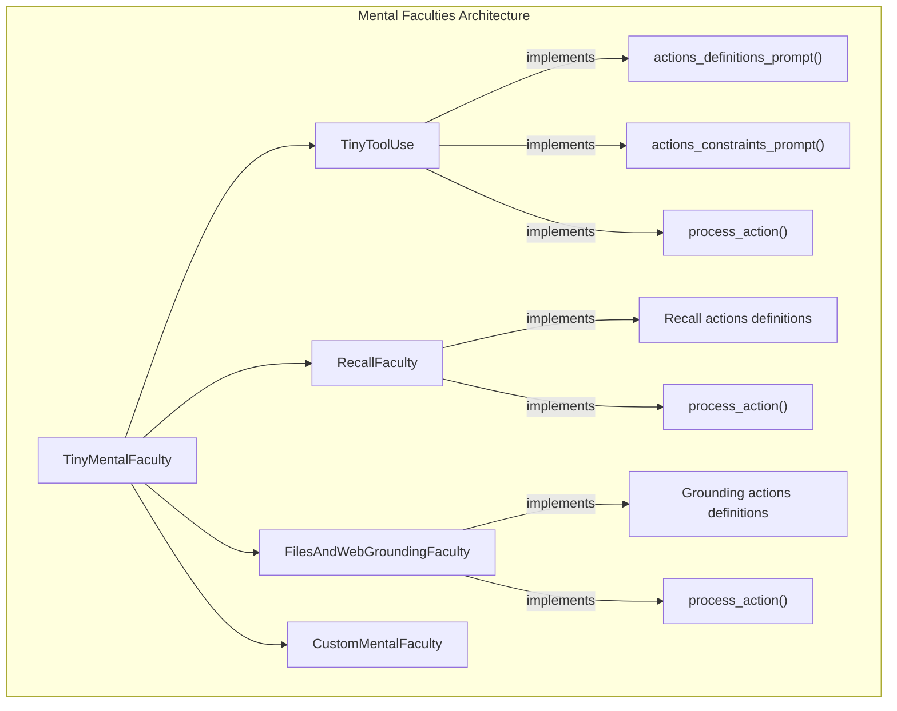
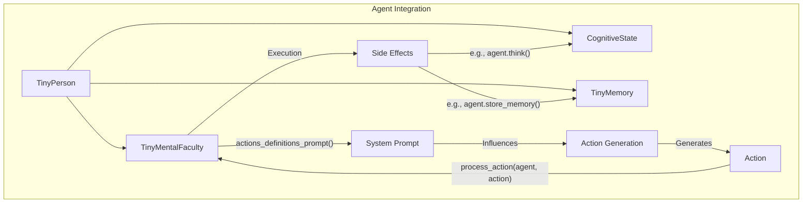
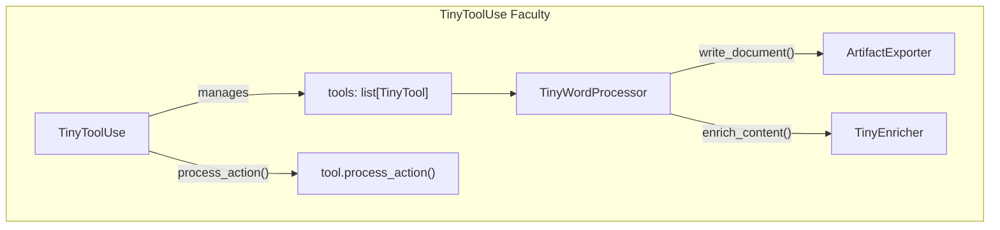
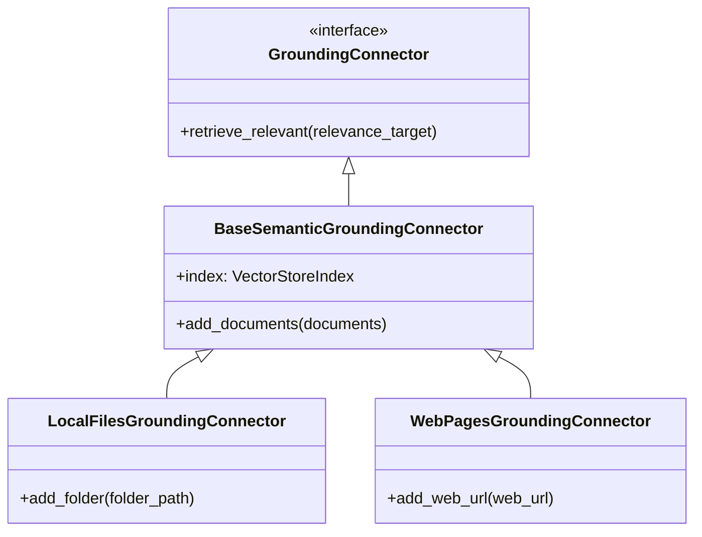

<!-- source: DeepWiki mcp.deepwiki.com · repo microsoft/TinyTroupe · page 3.2 Mental Faculties · fetched 2026-10-26 -->

# Mental Faculties

<details>
<summary>Relevant source files</summary>

The following files were used as context for generating this wiki page:

- [tinytroupe/agent/__init__.py](tinytroupe/agent/__init__.py)
- [tinytroupe/agent/memory.py](tinytroupe/agent/memory.py)
- [tinytroupe/agent/mental_faculty.py](tinytroupe/agent/mental_faculty.py)
- [tinytroupe/enrichment/tiny_enricher.py](tinytroupe/enrichment/tiny_enricher.py)
- [tinytroupe/environment/__init__.py](tinytroupe/environment/__init__.py)
- [tinytroupe/tools/tiny_tool.py](tinytroupe/tools/tiny_tool.py)
- [tinytroupe/tools/tiny_word_processor.py](tinytroupe/tools/tiny_word_processor.py)
- [tinytroupe/utils/llm.py](tinytroupe/utils/llm.py)

</details>


Mental Faculties are specialized cognitive capabilities that can be added to `TinyPerson` agents in the TinyTroupe framework. They extend an agent's abilities beyond basic thinking and communication, enabling them to interact with external tools, access grounded knowledge, and recall information in specific ways. This page details the available mental faculties, how they work, and how to use them in your agent simulations.

For information about general agent architecture, see [3. TinyPerson](). For details about memory systems that work alongside mental faculties, see [3.3. Memory Systems]().

## Overview of Mental Faculties

Mental faculties in TinyTroupe are modular components inheriting from the `TinyMentalFaculty` base class [tinytroupe/agent/mental_faculty.py:19-22](). Each faculty provides specific action definitions and constraints that are incorporated into the agent's system prompt. When an agent performs an action, each of its mental faculties has an opportunity to process that action via the `process_action` method [tinytroupe/agent/mental_faculty.py:47-57]().

### Mental Faculties Architecture



Sources: [tinytroupe/agent/mental_faculty.py:19-194](), [tinytroupe/agent/mental_faculty.py:228-232]()

## Integration with Agent Architecture

Mental faculties are integrated into the `TinyPerson` class. When an agent generates its system prompt, it iterates through its `_mental_faculties` list to collect action definitions and constraints [tinytroupe/agent/tiny_person.py:214-216](). During the `act()` loop, the agent passes every generated action to each faculty's `process_action()` method to trigger logic execution [tinytroupe/agent/tiny_person.py:474-475]().

### Agent Interaction Flow



Sources: [tinytroupe/agent/tiny_person.py:32-33](), [tinytroupe/agent/tiny_person.py:118-119](), [tinytroupe/agent/tiny_person.py:386-405](), [tinytroupe/agent/mental_faculty.py:47-57]()

## Available Mental Faculties

### TinyToolUse Faculty

The `TinyToolUse` faculty enables agents to interact with `TinyTool` instances [tinytroupe/agent/mental_faculty.py:228-232](). It acts as a bridge, translating agent actions into tool method calls. For example, the `TinyWordProcessor` tool allows agents to write documents that can be enriched and exported [tinytroupe/tools/tiny_word_processor.py:7-10]().



Sources: [tinytroupe/agent/mental_faculty.py:228-275](), [tinytroupe/tools/tiny_word_processor.py:7-38]()

#### TinyTool and TinyWordProcessor
`TinyTool` is the base class for all tools [tinytroupe/tools/tiny_tool.py:6](). It includes a retry mechanism `repeat_on_error` that attempts to re-run tool logic up to 3 times if an exception occurs [tinytroupe/tools/tiny_tool.py:65-69]().
`TinyWordProcessor` specifically handles the `WRITE_DOCUMENT` action [tinytroupe/tools/tiny_word_processor.py:39-40](). It uses a `TinyEnricher` to expand drafts [tinytroupe/tools/tiny_word_processor.py:15-26]() and an `ArtifactExporter` to save files in `md`, `docx`, and `json` formats [tinytroupe/tools/tiny_word_processor.py:28-37]().

### Files and Web Grounding Faculty

The `FilesAndWebGroundingFaculty` enables agents to ground their knowledge in external sources via `GroundingConnector` instances [tinytroupe/agent/mental_faculty.py:278-281]().

#### Grounding Connectors

The grounding system uses `llama-index` to create a `VectorStoreIndex` for semantic retrieval [tinytroupe/agent/grounding.py:51-54]().

1. **BaseSemanticGroundingConnector**: Core functionality for document retrieval [tinytroupe/agent/grounding.py:41]().
2. **LocalFilesGroundingConnector**: Indexes local folders and files [tinytroupe/agent/grounding.py:161]().
3. **WebPagesGroundingConnector**: Scrapes and indexes content from web URLs [tinytroupe/agent/grounding.py:228]().



Sources: [tinytroupe/agent/grounding.py:13-272]()

### Recall Faculty

The `RecallFaculty` implements the `RECALL` action [tinytroupe/agent/mental_faculty.py:173](). When an agent performs a recall, the faculty calls `agent.retrieve_relevant_memories()` [tinytroupe/agent/mental_faculty.py:176-178](). If information is found, the agent "thinks" the result, bringing it into the current context [tinytroupe/agent/mental_faculty.py:186-189]().

## Working with Mental Faculties

### Custom Mental Faculty Development

Users can define custom faculties using `CustomMentalFaculty` by providing a dictionary of action configurations [tinytroupe/agent/mental_faculty.py:72-86]().

```python
def my_custom_logic(agent, action):
    print(f"{agent.name} is performing {action['type']}")

custom_faculty = CustomMentalFaculty("MyFaculty")
custom_faculty.add_action(
    action_name="SPECIAL_ACTION",
    description="Allows the agent to do something unique.",
    function=my_custom_logic
)
agent.add_mental_faculty(custom_faculty)
```

Sources: [tinytroupe/agent/mental_faculty.py:114-119]()

### Action Processing and Prompting

The `TinyPerson` class manages faculties through these key lifecycle points:

1. **Initialization**: Faculties are stored in `self._mental_faculties` [tinytroupe/agent/tiny_person.py:118-119]().
2. **Prompting**: `actions_definitions_prompt()` and `actions_constraints_prompt()` are called to build the LLM system message [tinytroupe/agent/tiny_person.py:214-216]().
3. **Execution**: Every action in `self.act()` is passed to `faculty.process_action(self, action)` [tinytroupe/agent/tiny_person.py:474-475]().

### Summary Table of Faculty Methods

| Method | Purpose | Implementation Detail |
| :--- | :--- | :--- |
| `actions_definitions_prompt()` | Returns the prompt for defining actions. | [tinytroupe/agent/mental_faculty.py:59-63]() |
| `actions_constraints_prompt()` | Returns the constraints for actions. | [tinytroupe/agent/mental_faculty.py:65-69]() |
| `process_action(agent, action)` | Executes logic when an action is triggered. | [tinytroupe/agent/mental_faculty.py:47-57]() |

Sources: [tinytroupe/agent/mental_faculty.py:47-69]()

---

