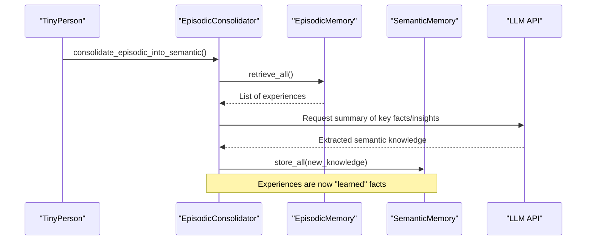

<!-- source: DeepWiki mcp.deepwiki.com · repo microsoft/TinyTroupe · page 3.3 Memory Systems · fetched 2026-10-26 -->

# Memory Systems

<details>
<summary>Relevant source files</summary>

The following files were used as context for generating this wiki page:

- [tests/unit/test_memory.py](tests/unit/test_memory.py)
- [tinytroupe/agent/__init__.py](tinytroupe/agent/__init__.py)
- [tinytroupe/agent/memory.py](tinytroupe/agent/memory.py)
- [tinytroupe/agent/mental_faculty.py](tinytroupe/agent/mental_faculty.py)
- [tinytroupe/agent/tiny_person.py](tinytroupe/agent/tiny_person.py)
- [tinytroupe/environment/__init__.py](tinytroupe/environment/__init__.py)
- [tinytroupe/environment/tiny_social_network.py](tinytroupe/environment/tiny_social_network.py)

</details>


## Purpose and Scope

This document explains the memory systems used by TinyPerson agents in the TinyTroupe framework. It covers the architecture of both episodic and semantic memory, how they're integrated into agent behavior, and the mechanisms for memory consolidation. TinyTroupe agents utilize a cognitive psychology-inspired model where memory is not a monolithic storage but a set of specialized systems.

Sources: [tinytroupe/agent/__init__.py:1-14](), [tinytroupe/agent/memory.py:12-17]()

## Memory Architecture

TinyTroupe implements a cognitive psychology-inspired memory model that divides agent memory into two distinct systems, both inheriting from the `TinyMemory` base class (which is a `TinyMentalFaculty`).

```mermaid
flowchart TD
    subgraph "Code Entity Space: Memory Classes"
        TMF["TinyMentalFaculty [tinytroupe/agent/mental_faculty.py]"]
        TM["TinyMemory [tinytroupe/agent/memory.py]"]
        EM["EpisodicMemory [tinytroupe/agent/memory.py]"]
        SM["SemanticMemory [tinytroupe/agent/memory.py]"]
        EC["EpisodicConsolidator [tinytroupe/agent/memory.py]"]
        
        TMF <|-- TM
        TM <|-- EM
        TM <|-- SM
        EC -- "processes" --> EM
        EC -- "extracts to" --> SM
    end

    subgraph "Natural Language Space: Cognitive Concepts"
        EP["Episodic Memory\n(Experiences)"]
        SEM["Semantic Memory\n(Facts/Knowledge)"]
        CON["Consolidation\n(Learning)"]
    end

    EM -.-> EP
    SM -.-> SEM
    EC -.-> CON
```

Sources: [tinytroupe/agent/memory.py:17-20](), [tinytroupe/agent/memory.py:172-175](), [tinytroupe/agent/memory.py:372-375](), [tinytroupe/agent/memory.py:591-594]()

## Episodic Memory

`EpisodicMemory` stores the agent's personal experiences in a temporally organized buffer. It tracks stimuli received and actions performed.

### Structure and Storage
Episodic memories are stored in two parts:
1. `episodic_buffer`: A temporary storage for the current ongoing episode.
2. `memory`: A list of committed episodes (past experiences).

The agent uses `store(value)` to add a new event (stimulus or action) to the buffer. When an episode concludes, `commit_episode()` moves the buffer content into permanent memory.

Sources: [tinytroupe/agent/memory.py:172-192](), [tinytroupe/agent/memory.py:223-233]()

### Retrieval and Context
Retrieval from episodic memory is primarily used to construct the LLM prompt. The `retrieve` method allows fetching `first_n` and `last_n` memories, often used to maintain a "fixed prefix" of important early context and a "lookback" of recent events.

Sources: [tinytroupe/agent/memory.py:251-270](), [tinytroupe/agent/tiny_person.py:40-45]()

## Semantic Memory

`SemanticMemory` stores general knowledge, facts, and concepts. Unlike episodic memory, it is designed for similarity-based retrieval and is often grounded in external data sources.

### Knowledge Grounding
Semantic memory can be populated using `BaseSemanticGroundingConnector` implementations. It supports:
- `Document` objects from `llama_index`.
- Text-based facts.
- Information extracted from web pages or local files via the `FilesAndWebGroundingFaculty`.

Sources: [tinytroupe/agent/memory.py:372-385](), [tinytroupe/agent/mental_faculty.py:196-210]()

### Retrieval Mechanism
Retrieval is performed via `retrieve_relevant(relevance_target, top_k)`, which typically uses embeddings to find the most pertinent information for the agent's current situation. It also supports a `summarize_relevant_via_full_scan` method, which uses an LLM to process batches of memories and accumulate information relevant to a specific query.

Sources: [tinytroupe/agent/memory.py:441-450](), [tinytroupe/agent/memory.py:96-115]()

## Memory Consolidation

Memory consolidation is the process of moving information from short-term episodic experiences into long-term semantic knowledge. This is handled by the `EpisodicConsolidator`.



Sources: [tinytroupe/agent/memory.py:591-610](), [tinytroupe/agent/memory.py:615-635]()

### Consolidator Types
1. **EpisodicConsolidator**: Focuses on extracting factual information and experiences from episodic memory to semantic memory.
2. **ReflectionConsolidator**: A specialized consolidator that encourages the agent to "reflect" on its experiences to derive higher-level insights or self-knowledge.

Sources: [tinytroupe/agent/memory.py:591-594](), [tinytroupe/agent/memory.py:657-660]()

## Memory Integration with Agent Behavior

Memory is integrated into the `TinyPerson` through the `RecallFaculty` and the main action loop.

| Method | Role | File Reference |
| :--- | :--- | :--- |
| `TinyPerson.think()` | Internal cognitive action stored in episodic memory. | [tinytroupe/agent/tiny_person.py:452-465]() |
| `TinyPerson.act()` | Generates actions; retrieves recent episodic context. | [tinytroupe/agent/tiny_person.py:734-750]() |
| `RecallFaculty.process_action()` | Handles "RECALL" actions by querying semantic memory. | [tinytroupe/agent/mental_faculty.py:170-185]() |
| `TinyPerson.retrieve_relevant_memories()` | Contextual retrieval from semantic memory. | [tinytroupe/agent/tiny_person.py:865-885]() |

Sources: [tinytroupe/agent/tiny_person.py:452-465](), [tinytroupe/agent/mental_faculty.py:170-185]()

## Persistence and Serialization

Both memory systems are fully serializable, allowing agents to be saved and restored with their "minds" intact.

- **Episodic Memory Serialization**: Saves the list of committed memories and the current buffer.
- **Semantic Memory Serialization**: Saves the indexed knowledge base.
- **TinyPerson Integration**: The `serializable_attributes` list in `TinyPerson` includes `episodic_memory` and `semantic_memory`.

Sources: [tinytroupe/agent/tiny_person.py:56-65](), [tinytroupe/agent/memory.py:349-360](), [tinytroupe/agent/memory.py:565-575]()

---

