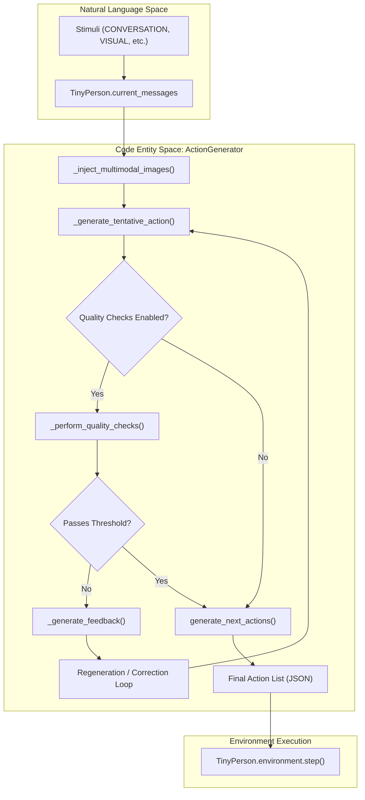
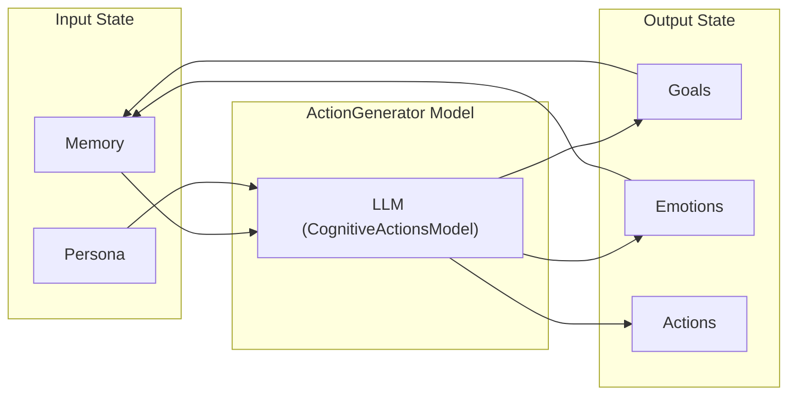

<!-- source: DeepWiki mcp.deepwiki.com · repo microsoft/TinyTroupe · page 3.4 Action Generation · fetched 2026-10-26 -->

# Action Generation

Relevant source files

The following files were used as context for generating this wiki page:

- [pyproject.toml](pyproject.toml)
- [tests/unit/test_action_generator.py](tests/unit/test_action_generator.py)
- [tests/unit/test_tinyperson.py](tests/unit/test_tinyperson.py)
- [tinytroupe/agent/action_generator.py](tinytroupe/agent/action_generator.py)
- [tinytroupe/agent/prompts/tiny_person.mustache](tinytroupe/agent/prompts/tiny_person.mustache)
- [tinytroupe/agent/prompts/tiny_person.v2.mustache](tinytroupe/agent/prompts/tiny_person.v2.mustache)
- [tinytroupe/profiling.py](tinytroupe/profiling.py)

The **Action Generation** system is the core engine responsible for transforming a `TinyPerson`'s mental state and external stimuli into concrete behaviors. It operates through the `ActionGenerator` class, which implements a sophisticated **Generate-Check-Correct** loop to ensure that agent outputs are high-quality, persona-consistent, and non-repetitive.

## Overview of the Action Pipeline

When an agent needs to act (typically via `TinyPerson.act()`), the request is delegated to the `ActionGenerator`. The pipeline follows these primary stages:

1.  **Stimuli Processing**: Recent messages and stimuli are prepared, including resolving multimodal content (images) if present.
2.  **Tentative Generation**: An initial sequence of actions is generated using the underlying LLM.
3.  **Quality Assessment**: The tentative actions are evaluated against a set of "Propositions" (quality checks).
4.  **Iterative Correction**: If checks fail, the system attempts to regenerate or correct the actions until they pass or the maximum number of attempts is reached.
5.  **Normalization**: The output is formatted into a consistent sequence of actions, ensuring a `DONE` action terminates the turn.

### Action Generation Data Flow

The following diagram illustrates the flow from stimuli to the final validated action sequence.

**Diagram: Action Generation Data Flow**

Sources: [tinytroupe/agent/action_generator.py:95-115](), [tinytroupe/agent/action_generator.py:117-151](), [tinytroupe/agent/prompts/tiny_person.mustache:41-62]()

---

## The Generate-Check-Correct Loop

The `ActionGenerator` does not simply accept the first output from an LLM. It uses an internal loop to refine results based on semantic validation.

### Implementation Details
*   **Max Attempts**: Defined by `self.max_attempts` (default is 2) [tinytroupe/agent/action_generator.py:16-16]().
*   **Quality Threshold**: A score (default 7/10) that an action must meet across enabled dimensions to be accepted [tinytroupe/agent/action_generator.py:26-26]().
*   **Feedback Mechanism**: If an action fails, the system generates "negative feedback" describing why it failed (e.g., "The action is not consistent with the persona's age"). This feedback is fed back into the next LLM prompt [tinytroupe/agent/action_generator.py:134-136]().

### Quality Propositions
The system evaluates actions using the `Proposition` class, which uses an LLM to "judge" the content against specific criteria:

| Dimension | Code Reference | Description |
| :--- | :--- | :--- |
| **Persona Adherence** | `action_persona_adherence` | Ensures the action matches the agent's defined style, age, and knowledge [tinytroupe/agent/action_generator.py:79-81](). |
| **Self-Consistency** | `action_self_consistency` | Checks if the action contradicts previous statements or the agent's current goals [tinytroupe/agent/action_generator.py:82-82](). |
| **Fluency** | `action_fluency` | Ensures the text is natural, well-structured, and lacks robotic repetition [tinytroupe/agent/action_generator.py:83-83](). |
| **Similarity** | `max_action_similarity` | Uses Jaccard similarity to prevent the agent from repeating the exact same content in consecutive turns [tinytroupe/agent/action_generator.py:27-27](). |

Sources: [tinytroupe/agent/action_generator.py:51-93](), [tinytroupe/experimentation.py:7-7]()

---

## Cognitive Actions Model

TinyTroupe agents follow a "Cognitive State" pattern. Every action generation request expects the LLM to output not just the `action`, but also an updated `cognitive_state`.

### Structure of the Output
The LLM is prompted (via `tiny_person.mustache`) to return a JSON object containing:
1.  **Goals**: Short-term, medium-term, and long-term objectives [tinytroupe/agent/prompts/tiny_person.mustache:66-73]().
2.  **Attention**: What the agent is currently focused on [tinytroupe/agent/prompts/tiny_person.mustache:74-74]().
3.  **Emotions**: The agent's current feelings [tinytroupe/agent/prompts/tiny_person.mustache:75-75]().
4.  **Actions**: A list of actions (e.g., `TALK`, `THINK`, `REACH_OUT`) [tinytroupe/agent/prompts/tiny_person.mustache:51-62]().

**Diagram: Cognitive State Update Loop**

Sources: [tinytroupe/agent/prompts/tiny_person.mustache:65-82](), [tinytroupe/agent/action_generator.py:107-115]()

---

## Repetition Prevention: Jaccard Similarity Check

To prevent agents from getting stuck in "loops" (repeating the same phrase or thought), the `ActionGenerator` implements a similarity check.

### Implementation
1.  **Similarity Metric**: The system uses Jaccard similarity to compare the `content` of a newly generated action with the `content` of the previous action [tinytroupe/agent/action_generator.py:27-27]().
2.  **Threshold**: If the similarity exceeds `max_action_similarity` (default 0.6), the action is flagged as a failure [tinytroupe/agent/action_generator.py:73-73]().
3.  **Correction**: The agent is then prompted to "rephrase or provide a different action" to maintain simulation variety.

Sources: [tinytroupe/agent/action_generator.py:24-27](), [tinytroupe/agent/prompts/tiny_person.v2.mustache:87-88]()

---

## Multimodal Action Generation

The `ActionGenerator` supports vision-capable models. If an agent "sees" an image (a stimulus with an image ID), the `_inject_multimodal_images` function resolves these IDs into the actual image data before calling the LLM.

*   **Function**: `_inject_multimodal_images(agent, current_messages)` [tinytroupe/agent/action_generator.py:132-132]().
*   **Action Type**: Agents can use the `SHOW` action to share image IDs with other agents [tinytroupe/agent/prompts/tiny_person.v2.mustache:52-52]().

Sources: [tinytroupe/agent/action_generator.py:129-132](), [tinytroupe/agent/prompts/tiny_person.v2.mustache:39-39]()

---

