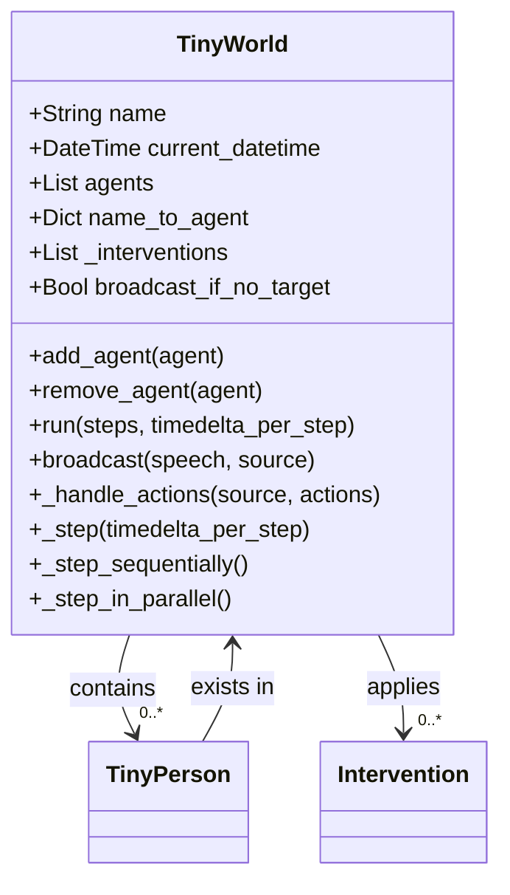
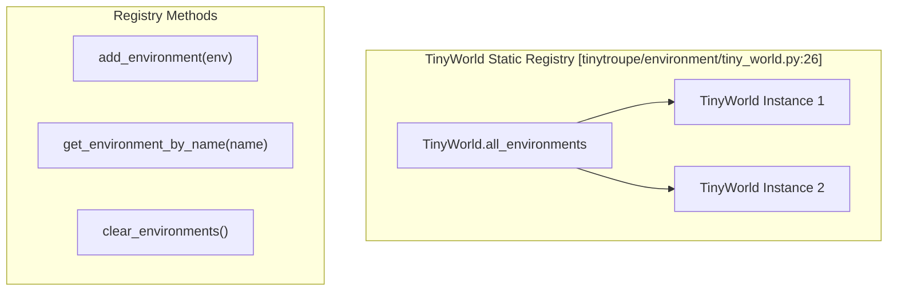
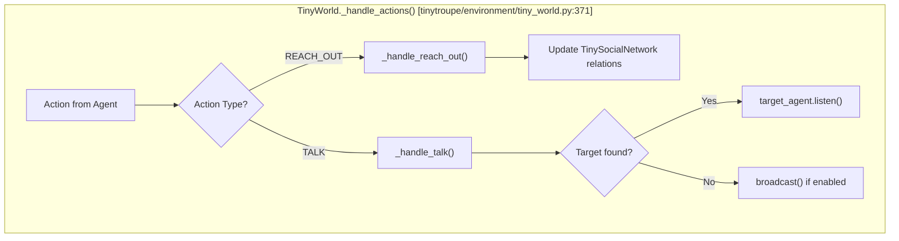

<!-- source: DeepWiki mcp.deepwiki.com · repo microsoft/TinyTroupe · page 4 TinyWorld · fetched 2026-10-26 -->

# TinyWorld

Relevant source files

The following files were used as context for generating this wiki page:

- [tests/scenarios/test_basic_scenarios.py](tests/scenarios/test_basic_scenarios.py)
- [tests/scenarios/test_brainstorming_scenarios.py](tests/scenarios/test_brainstorming_scenarios.py)
- [tests/testing_utils.py](tests/testing_utils.py)
- [tinytroupe/environment/tiny_world.py](tinytroupe/environment/tiny_world.py)

TinyWorld serves as the environment component in the TinyTroupe framework, providing a controlled simulation space where `TinyPerson` agents interact, communicate, and perform actions. It manages simulation time progression, handles agent interactions, and orchestrates the overall simulation flow through a step-based loop.

For information about agent implementation details, see [TinyPerson](#3). For social relationships between agents, see [TinySocialNetwork](#4.1).

## Core Architecture

TinyWorld functions as a container and coordinator for agent interactions, implementing the environment where simulated participants exist and operate. It maintains the list of active agents, controls simulation time, and processes agent actions either sequentially or in parallel.

Sources: [tinytroupe/environment/tiny_world.py:20-109](), [tinytroupe/environment/tiny_world.py:147-184]()

### Key Attributes

TinyWorld maintains several important attributes for simulation state and configuration:

| Attribute | Type | Description |
|-----------|------|-------------|
| `name` | string | Identifier for the environment. [tinytroupe/environment/tiny_world.py:61-63]() |
| `current_datetime` | datetime | Current simulation time, defaults to `default_initial_datetime` or `now()`. [tinytroupe/environment/tiny_world.py:65-70]() |
| `agents` | list | List of `TinyPerson` agents in the environment. [tinytroupe/environment/tiny_world.py:74-74]() |
| `name_to_agent` | dict | Maps agent names to agent objects for quick lookup. [tinytroupe/environment/tiny_world.py:75-75]() |
| `_interventions` | list | List of interventions applied at each simulation step. [tinytroupe/environment/tiny_world.py:77-77]() |
| `broadcast_if_no_target` | bool | If True, broadcast actions if the target is not found. [tinytroupe/environment/tiny_world.py:71-71]() |

Sources: [tinytroupe/environment/tiny_world.py:60-90]()

### Static Registry

TinyWorld maintains a static registry of all environments, allowing for global retrieval and cleanup during testing.

Sources: [tinytroupe/environment/tiny_world.py:26-26](), [tinytroupe/environment/tiny_world.py:754-797]()

## Simulation Control

TinyWorld provides methods to run and manage simulations through a step-based model. Each step represents a discrete unit of time where agents can observe and act.

### The Simulation Loop

The core simulation process occurs in the `_step()` method, which is decorated with `@transactional()` to support simulation state management.

1. **Advance Time**: Increments `current_datetime` by the specified `timedelta_per_step`. [tinytroupe/environment/tiny_world.py:114-114]()
2. **Apply Interventions**: Checks `intervention.check_precondition()` and applies effects. Interventions are never parallelized to avoid race conditions. [tinytroupe/environment/tiny_world.py:123-132]()
3. **Agent Actions**: Agents act either sequentially (`_step_sequentially`) or in parallel (`_step_in_parallel`) using a `ThreadPoolExecutor`. [tinytroupe/environment/tiny_world.py:135-143]()

Sources: [tinytroupe/environment/tiny_world.py:100-145](), [tinytroupe/environment/tiny_world.py:174-178]()

### Time Management

The environment supports various time-unit shortcuts for running simulations:

| Method | Time Unit | Step Logic |
|--------|-----------|------------|
| `run_minutes(minutes)` | Minutes | 1-minute steps. [tinytroupe/environment/tiny_world.py:218-220]() |
| `run_hours(hours)` | Hours | 1-hour steps. [tinytroupe/environment/tiny_world.py:226-228]() |
| `run_days(days)` | Days | 1-day steps. [tinytroupe/environment/tiny_world.py:234-236]() |

Sources: [tinytroupe/environment/tiny_world.py:218-268]()

## Agent Management

TinyWorld manages the lifecycle and accessibility of agents within its scope.

### Adding and Removing Agents

When an agent is added via `add_agent(agent)`, the environment ensures the agent's name is unique within that world and sets the agent's `environment` reference to itself.

Sources: [tinytroupe/environment/tiny_world.py:273-305]()

### Agent Accessibility

By default, agents in a world may not be aware of each other. The `make_everyone_accessible()` method establishes mutual accessibility between all agents currently in the environment, allowing them to interact without a prior "reach out" action.

Sources: [tinytroupe/environment/tiny_world.py:497-505]()

## Communication and Interaction

TinyWorld mediates agent communications, translating agent actions into environmental stimuli.

### Action Handling

For details on how relationships and reaching out are handled, see [TinySocialNetwork](#4.1).

Sources: [tinytroupe/environment/tiny_world.py:371-438]()

### Broadcasting

TinyWorld can send stimuli to all agents simultaneously. This is useful for environmental changes or moderator instructions.
- `broadcast(speech)`: Every agent receives a `listen` stimulus. [tinytroupe/environment/tiny_world.py:442-453]()
- `broadcast_thought(thought)`: Every agent receives a `think` stimulus. [tinytroupe/environment/tiny_world.py:455-466]()

Sources: [tinytroupe/environment/tiny_world.py:442-496]()

## State Management

TinyWorld supports full state serialization, which is essential for the `control` module's checkpointing features.

- `encode_complete_state()`: Captures the environment's metadata and calls `encode_complete_state()` on all contained agents. [tinytroupe/environment/tiny_world.py:687-711]()
- `decode_complete_state(state)`: Reconstructs the environment and its agents from a dictionary. [tinytroupe/environment/tiny_world.py:713-751]()

Sources: [tinytroupe/environment/tiny_world.py:687-751]()

---

