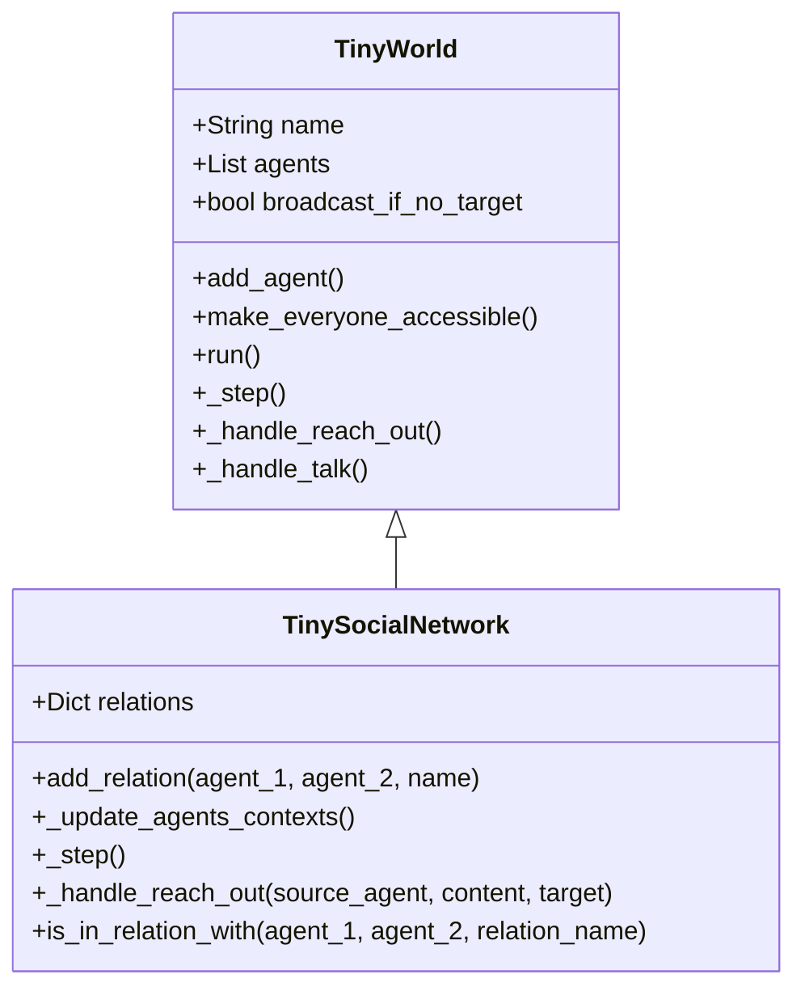
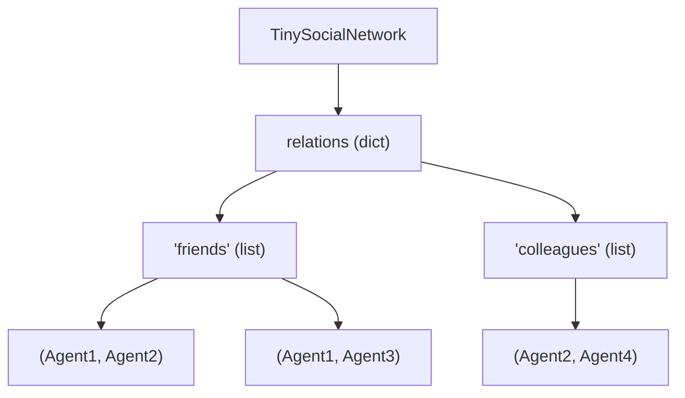
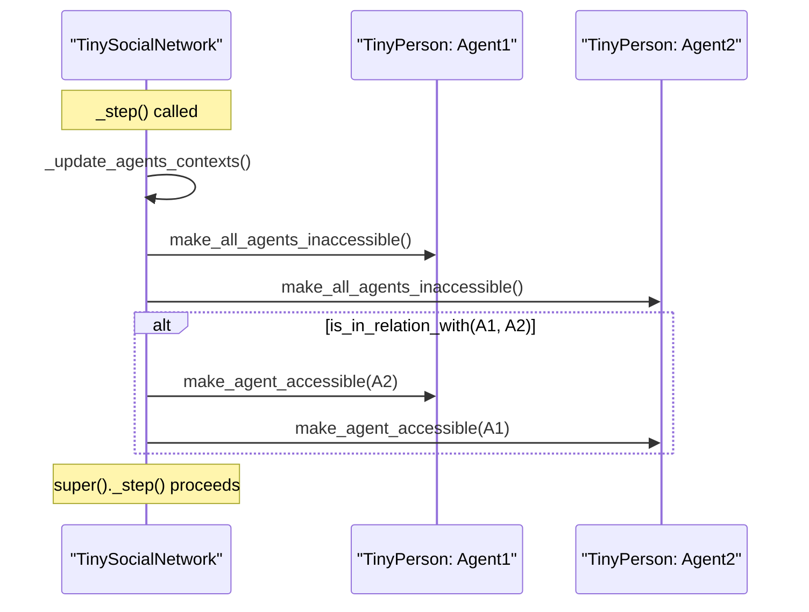
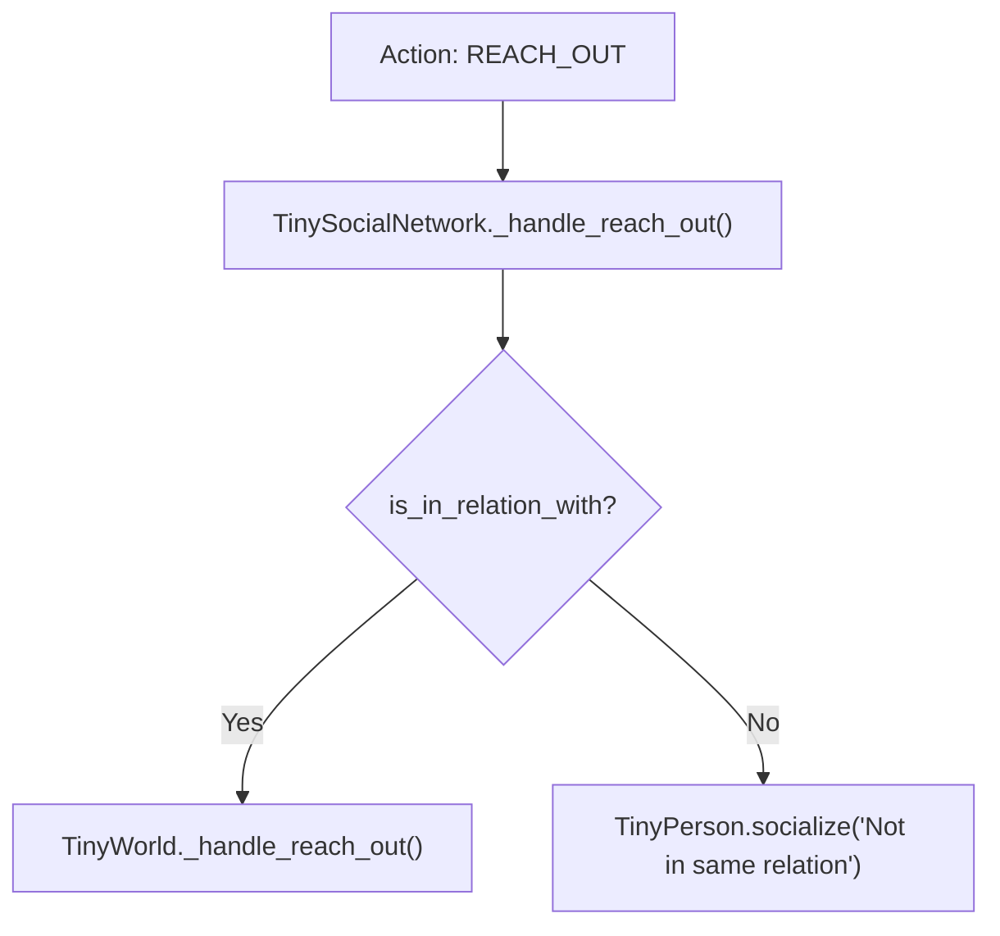
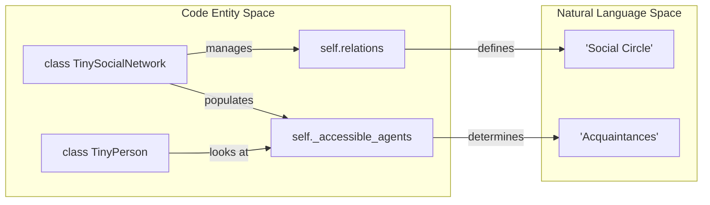

<!-- source: DeepWiki mcp.deepwiki.com · repo microsoft/TinyTroupe · page 4.1 TinySocialNetwork · fetched 2026-10-26 -->

# TinySocialNetwork

<details>
<summary>Relevant source files</summary>

The following files were used as context for generating this wiki page:

- [tinytroupe/agent/tiny_person.py](tinytroupe/agent/tiny_person.py)
- [tinytroupe/environment/tiny_social_network.py](tinytroupe/environment/tiny_social_network.py)
- [tinytroupe/environment/tiny_world.py](tinytroupe/environment/tiny_world.py)

</details>


## Purpose and Scope

This document describes the `TinySocialNetwork` class, a specialized environment that extends the base `TinyWorld` environment to model and manage social relationships between agents. It enables the creation of relationship structures between agents and controls how they can interact based on those relationships. For information about the base environment system, see [TinyWorld](4.0).

Sources: [tinytroupe/environment/tiny_social_network.py:16-17](), [tinytroupe/environment/tiny_world.py:20-21]()

## Class Architecture

`TinySocialNetwork` inherits from `TinyWorld` and adds functionality for managing agent relationships. It implements mechanisms for defining, querying, and enforcing relationships that determine which agents can interact with each other.

### TinySocialNetwork Class Hierarchy



Sources: [tinytroupe/environment/tiny_social_network.py:16-30](), [tinytroupe/environment/tiny_world.py:20-45]()

## Core Concepts

### Relationships

The core concept in `TinySocialNetwork` is the **relation** between agents. Relations:
- Are undirected: if agent A has a relation with agent B, then agent B also has the same relation with agent A [tinytroupe/environment/tiny_social_network.py:108-112]().
- Can be named (e.g., "friends", "colleagues", "family") [tinytroupe/environment/tiny_social_network.py:33-41]().
- Control which agents can interact with each other [tinytroupe/environment/tiny_social_network.py:68-73]().

Relationships are stored in the `self.relations` dictionary, where:
- Keys are relation names (strings).
- Values are lists of agent pairs (tuples of two `TinyPerson` objects).



Sources: [tinytroupe/environment/tiny_social_network.py:30-54]()

### Agent Accessibility

The `TinySocialNetwork` controls which agents can perceive and interact with each other based on their relationships. This is enforced via the `_update_agents_contexts` method:

1. **Reset**: All agent accessibility is cleared using `agent.make_all_agents_inaccessible()` [tinytroupe/environment/tiny_social_network.py:65-66]().
2. **Establish**: Accessibility is restored only for agents sharing a relation using `agent.make_agent_accessible(other_agent)` [tinytroupe/environment/tiny_social_network.py:68-73]().
3. **Enforcement**: This process occurs during every simulation `_step` before agents are allowed to act [tinytroupe/environment/tiny_social_network.py:76-80]().



Sources: [tinytroupe/environment/tiny_social_network.py:59-80](), [tinytroupe/agent/tiny_person.py:152-153]()

## Creating and Managing Relationships

### Creating the Social Network

To create a social network environment:

```python
network = TinySocialNetwork("My Social Network")
```

The constructor `__init__` takes a `name` and an optional `broadcast_if_no_target` boolean [tinytroupe/environment/tiny_social_network.py:18-28](). If `True`, the environment will attempt to broadcast actions through available relations if a specific target is missing [tinytroupe/environment/tiny_social_network.py:24-25]().

Sources: [tinytroupe/environment/tiny_social_network.py:18-31]()

### Adding Relations

Relations are added using `add_relation(agent_1, agent_2, name="default")` [tinytroupe/environment/tiny_social_network.py:33]().

This method:
1. Automatically adds agents to the environment's `self.agents` list if they are not already present [tinytroupe/environment/tiny_social_network.py:46-49]().
2. Appends the agent pair to the specified relation list in `self.relations` [tinytroupe/environment/tiny_social_network.py:51-54]().
3. Returns `self` to allow for method chaining [tinytroupe/environment/tiny_social_network.py:56]().

Sources: [tinytroupe/environment/tiny_social_network.py:33-56]()

## Social Interactions

### Handling Social Actions

The `TinySocialNetwork` overrides interaction handlers to enforce relationship constraints:

**REACH_OUT Action**:
An agent can only reach out to another agent if they share a relation.
- The system checks `is_in_relation_with(source_agent, target_agent)` [tinytroupe/environment/tiny_social_network.py:95]().
- If successful, it calls the parent `TinyWorld._handle_reach_out` [tinytroupe/environment/tiny_social_network.py:96]().
- If unsuccessful, it sends a private stimulus to the source agent via `source_agent.socialize()` explaining that the target is not reachable [tinytroupe/environment/tiny_social_network.py:99]().



Sources: [tinytroupe/environment/tiny_social_network.py:83-100]()

### Checking Relationships

The `is_in_relation_with` method provides a utility to query the network state:
- If `relation_name` is `None`, it iterates through all relations to find any match [tinytroupe/environment/tiny_social_network.py:122-126]().
- If a `relation_name` is provided, it checks only that specific key in `self.relations` [tinytroupe/environment/tiny_social_network.py:128-131]().
- It checks both directions `(agent_1, agent_2)` and `(agent_2, agent_1)` to ensure undirected symmetry [tinytroupe/environment/tiny_social_network.py:130]().

Sources: [tinytroupe/environment/tiny_social_network.py:108-132]()

## Implementation Details

### Transactional Operations

All state-modifying methods in `TinySocialNetwork` use the `@transactional()` decorator [tinytroupe/environment/tiny_social_network.py:32, 58, 75, 82](). This ensures that if the simulation is running within a `tinytroupe.control.Simulation` context, changes to the social structure are recorded in the execution trace and can be checkpointed.

Sources: [tinytroupe/environment/tiny_social_network.py:8, 32, 58, 75, 82]()

### Relationship to Core Architecture

`TinySocialNetwork` acts as a filter for the `_accessible_agents` list maintained by every `TinyPerson` [tinytroupe/agent/tiny_person.py:152]().



Sources: [tinytroupe/environment/tiny_social_network.py:16-17](), [tinytroupe/environment/tiny_social_network.py:59-73](), [tinytroupe/agent/tiny_person.py:150-153]()

---

