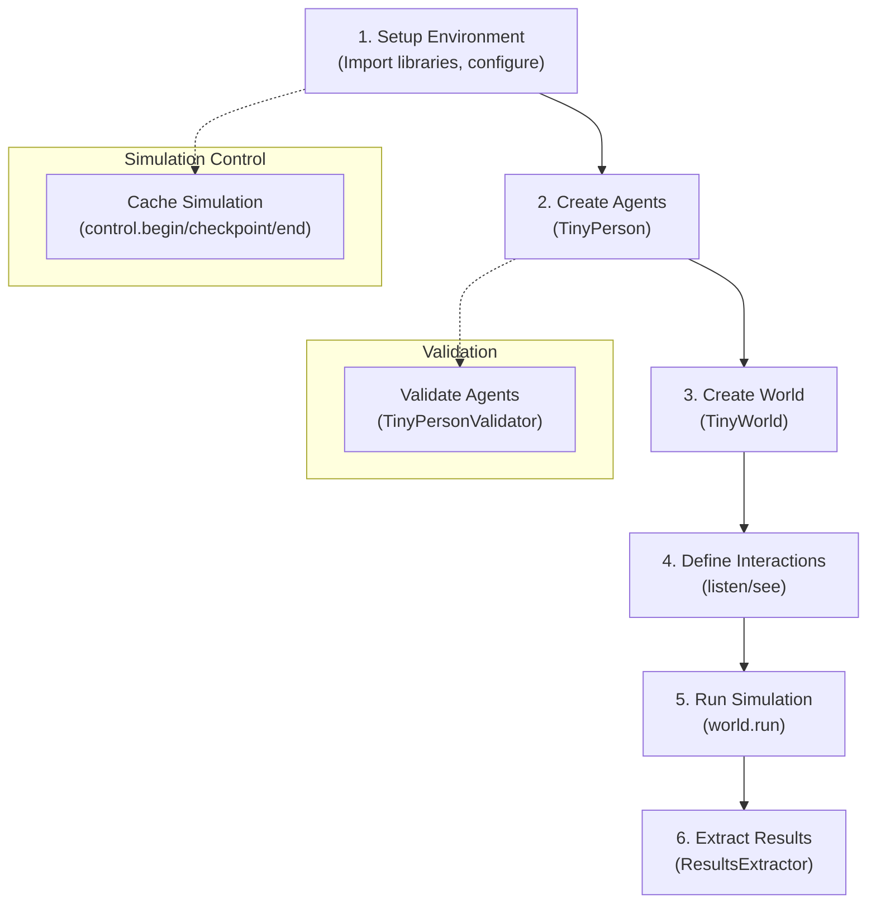
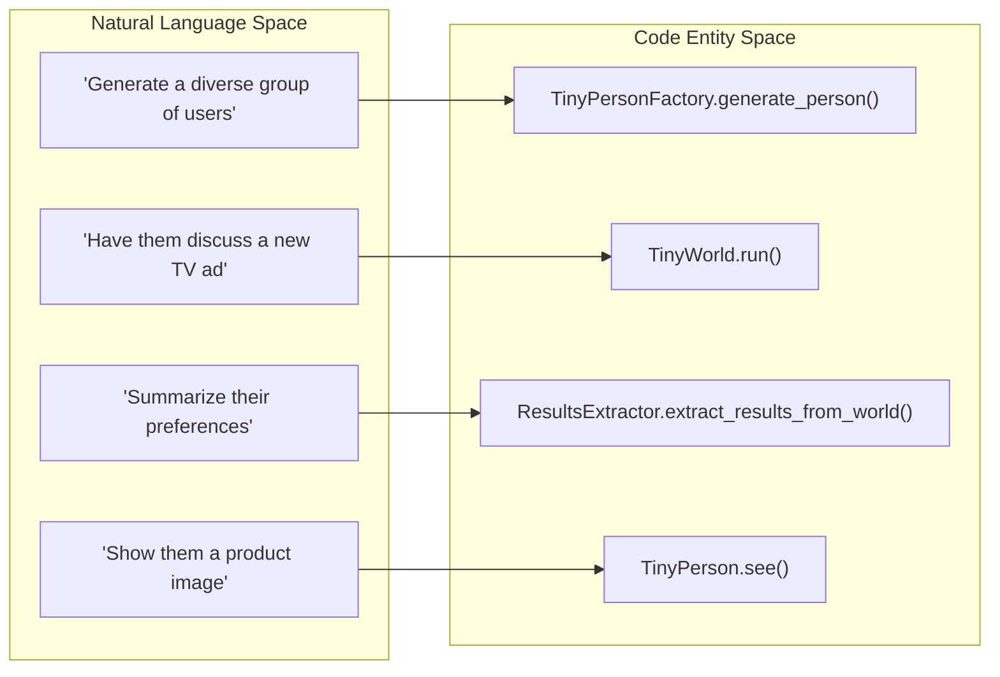

<!-- source: DeepWiki mcp.deepwiki.com · repo microsoft/TinyTroupe · page 5 Using TinyTroupe · fetched 2026-10-26 -->

# Using TinyTroupe

<details>
<summary>Relevant source files</summary>

The following files were used as context for generating this wiki page:

- [README.md](README.md)
- [data/extractions/appartment_rent_ad.extraction.json](data/extractions/appartment_rent_ad.extraction.json)
- [data/extractions/synthetic_data_generation.out.csv](data/extractions/synthetic_data_generation.out.csv)
- [examples/Advertisement for TV.ipynb](examples/Advertisement for TV.ipynb)
- [examples/Simple Chat.ipynb](examples/Simple Chat.ipynb)
- [examples/Vision for Product, Diagnosis and Appreciation Feedback (image modality).ipynb](examples/Vision for Product, Diagnosis and Appreciation Feedback (image modality).ipynb)
- [tests/scenarios/test_extended_scenarios.py](tests/scenarios/test_extended_scenarios.py)
- [tests/unit/test_profiling.py](tests/unit/test_profiling.py)

</details>


This page provides an overview of common patterns and workflows when using the TinyTroupe framework for LLM-based people simulation. It covers the basic workflow of setting up, running, and analyzing simulations, as well as the typical use cases and best practices.

For specific use cases like market research, advertisement evaluation, or brainstorming sessions, see the respective dedicated pages ([Market Research](#5.1), [Advertisement Evaluation](#5.2), [Brainstorming Sessions](#5.3), and [Synthetic Data Generation](#5.4)).

## Basic Simulation Workflow

Using TinyTroupe involves a series of steps that typically follow this pattern:



### 1. Setup Environment

Start by importing the necessary modules and setting up any configuration. TinyTroupe uses a `config.ini` file to manage LLM parameters and simulation behavior [README.md:34-36]().

```python
import tinytroupe
from tinytroupe.agent import TinyPerson
from tinytroupe.environment import TinyWorld
from tinytroupe.factory import TinyPersonFactory
from tinytroupe.extraction import ResultsExtractor
from tinytroupe import control
```

If you want to cache simulation results to avoid recalculating expensive steps, use the `control` module [tinytroupe/control.py:46-60]().

```python
control.begin("my_simulation.cache.json")
```

Sources: [README.md:92-101](), [tinytroupe/control.py:46-60]()

### 2. Create Agents

There are several ways to create `TinyPerson` agents [tinytroupe/agent.py:23-45]():

1.  **Using pre-defined examples**:
    ```python
    from tinytroupe.examples import create_lisa_the_data_scientist
    lisa = create_lisa_the_data_scientist()
    ```
2.  **Loading from JSON specification**:
    ```python
    lisa = TinyPerson.load_specification("./agents/Lisa.agent.json")
    ```
3.  **Defining programmatically**:
    ```python
    lisa = TinyPerson("Lisa")
    lisa.define("age", 28)
    lisa.define("occupation", {"title": "Data Scientist"})
    ```
4.  **Using TinyPersonFactory**:
    This uses a plan-based approach to generate diverse populations [README.md:91-92]().

Sources: [tinytroupe/agent.py:23-45](), [examples/Simple Chat.ipynb:118-120](), [README.md:91-92]()

### 3. Create World

Create a `TinyWorld` to serve as the environment. You can manage agent accessibility to simulate specific social structures [tinytroupe/environment.py:24-35]().

```python
world = TinyWorld("Chat Room", [lisa, oscar])
world.make_everyone_accessible() 
```

Sources: [tinytroupe/environment.py:24-35](), [examples/Simple Chat.ipynb:135-136]()

### 4. Define Interactions and Run

Provide initial stimuli via `listen` or `see` (for vision-capable models) and execute the simulation loop [tinytroupe/agent.py:468-482]().

```python
world.broadcast("Welcome to the brainstorming session.")
world.run(3) # Run for 3 simulation steps
```

Sources: [tinytroupe/agent.py:468-482](), [tests/scenarios/test_extended_scenarios.py:62-66]()

### 5. Extract Results

Use `ResultsExtractor` to get structured data from the agents' episodic memories or the world state [tinytroupe/extraction.py:28-45]().

```python
extractor = ResultsExtractor()
results = extractor.extract_results_from_world(
    world, 
    extraction_objective="Identify the top 3 product ideas"
)
```

Sources: [tinytroupe/extraction.py:28-45](), [tests/scenarios/test_extended_scenarios.py:69-75]()

## Common Use Patterns

The following diagram bridges natural language objectives to the specific code entities used to achieve them.



### Vision-Based Evaluation
TinyTroupe supports a **vision modality**, allowing agents to "see" and react to images without text descriptions [examples/Vision for Product, Diagnosis and Appreciation Feedback (image modality).ipynb:10-14](). This is useful for product design and diagnostic feedback.

### Synthetic Data Generation
Agents can collaborate to produce artifacts like documents or datasets. The `ArtifactExporter` and `TinyWordProcessor` tool are used to save these outputs in formats like CSV or DOCX [README.md:21-23]().

## Advanced Features

### Simulation Control and Caching
The `tinytroupe.control` module manages the simulation lifecycle.
*   `control.begin(file_path)`: Starts a transaction and loads from cache if it exists [tinytroupe/control.py:46-60]().
*   `control.checkpoint()`: Saves the current state of all registered agents and worlds [tinytroupe/control.py:112-125]().

### Mental Faculties
Agents can be equipped with `MentalFaculty` objects to extend their capabilities [tinytroupe/agent.py:155-165]():
*   `TinyToolUse`: Enables agents to use external tools [README.md:94]().
*   `FilesAndWebGroundingFaculty`: Allows agents to query documents or web pages.

### Empirical Validation
The `SimulationExperimentEmpiricalValidator` allows users to compare simulation results against real-world data using statistical tests like t-tests [README.md:68-69]().

## Best Practices

1.  **Model Selection**: The default is `gpt-5-mini`. Note that different model series (GPT-4 vs GPT-5) may require configuration adjustments [README.md:67-68]().
2.  **Parallelism**: Enable `parallel_agent_actions` in `config.ini` to speed up simulations involving many agents [examples/Simple Chat.ipynb:64-64]().
3.  **Cost Tracking**: Use the built-in cost tracking utilities at the client and agent levels to monitor API expenses [README.md:70-71]().
4.  **Interactive Debugging**: Use the `AgentChatJupyterWidget` for real-time interaction with agents during development [README.md:69-70]().

Sources: [README.md:67-71](), [tinytroupe/control.py:46-125](), [tinytroupe/agent.py:155-165]()

---

### Child Pages
*   [Market Research](#5.1) — Detailed population generation and demographic analysis.
*   [Advertisement Evaluation](#5.2) — Focus groups and ad copy testing.
*   [Brainstorming Sessions](#5.3) — Multi-agent ideation workflows.
*   [Synthetic Data Generation](#5.4) — Exporting agent interactions to structured files.

---

