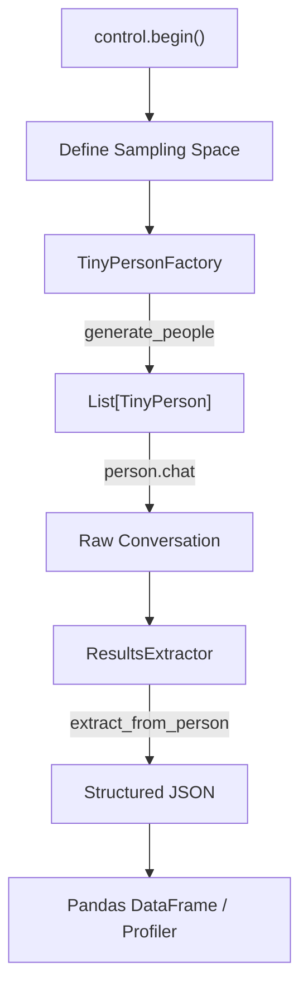
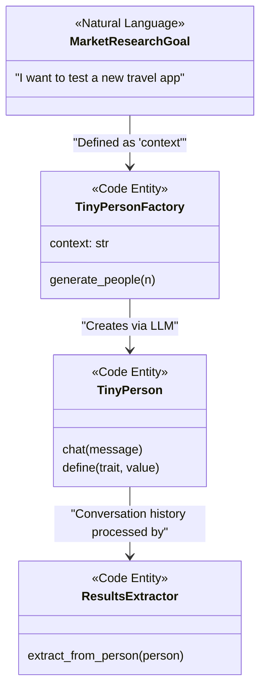

<!-- source: DeepWiki mcp.deepwiki.com · repo microsoft/TinyTroupe · page 5.1 Market Research · fetched 2026-10-26 -->

# Market Research

<details>
<summary>Relevant source files</summary>

The following files were used as context for generating this wiki page:

- [examples/AI-enabled Children Story Telling Market Research.ipynb](examples/AI-enabled Children Story Telling Market Research.ipynb)
- [examples/Bottled Gazpacho Market Research 5 (with behavior correction).ipynb](examples/Bottled Gazpacho Market Research 5 (with behavior correction).ipynb)
- [examples/Bottled Gazpacho Market Research 5.ipynb](examples/Bottled Gazpacho Market Research 5.ipynb)
- [examples/Travel Product Market Research.ipynb](examples/Travel Product Market Research.ipynb)
- [examples/information/populations/colombia.json](examples/information/populations/colombia.json)
- [examples/information/populations/colombia_extra_info.txt](examples/information/populations/colombia_extra_info.txt)
- [tests/unit/test_factory.py](tests/unit/test_factory.py)
- [tinytroupe/control.py](tinytroupe/control.py)
- [tinytroupe/factory/prompts/generate_person.mustache](tinytroupe/factory/prompts/generate_person.mustache)
- [tinytroupe/factory/tiny_person_factory.py](tinytroupe/factory/tiny_person_factory.py)

</details>


Market Research in TinyTroupe enables simulating customer research through AI-generated personas that respond to product concepts, surveys, and interviews. This page documents the technical implementation of the population generation pipeline, the use of demographic data files, and the workflow for extracting customer insights.

## Overview of Market Research in TinyTroupe

TinyTroupe's market research capabilities allow for the creation of a simulated population with diverse demographics and preferences. This population is then presented with product concepts or surveys to gauge interest, understand objections, and identify market segments.

### Market Research Simulation Flow
The following diagram maps the high-level research process to specific code entities and data structures.


Sources: [tinytroupe/factory/tiny_person_factory.py:24-36](), [tinytroupe/control.py:78-119](), [examples/Travel Product Market Research.ipynb:137-138]()

## Population Generation Pipeline

The core of market research is the `TinyPersonFactory`, which automates the creation of diverse agents.

### TinyPersonFactory Implementation
The `TinyPersonFactory` [tinytroupe/factory/tiny_person_factory.py:24-211]() uses LLM-based sampling to ensure that the generated agents are not repetitive and cover the requested demographic dimensions.

- **`generate_person(agent_particularities, temperature)`**: Generates a single `TinyPerson`. It uses a Mustache template [tinytroupe/factory/prompts/generate_person.mustache:1-80]() to provide the LLM with context and rules for generating authentic, non-cliché personas.
- **`generate_people(number_of_people, agent_particularities)`**: Generates a list of agents. It can run in parallel if `parallel_agent_generation` is enabled in `config.ini` [tinytroupe/factory/tiny_person_factory.py:261-300]().
- **`all_unique_names`**: A class-level list used to ensure that every agent generated across different factory instances has a globally unique name [tinytroupe/factory/tiny_person_factory.py:27-27]().

### Demographic Data Integration
TinyTroupe supports generating populations based on real-world statistical data. The method `create_factory_from_demography` [tinytroupe/factory/tiny_person_factory.py:120-153]() allows users to pass a path to a JSON file containing demographic distributions.

Example demographic files include:
- `examples/information/populations/colombia.json`: Contains fine-grained data on age distribution, ethnic composition, and household income [examples/information/populations/colombia.json:6-41]().
- `examples/information/populations/colombia_extra_info.txt`: Provides qualitative dimensions like "General Attitude" (ranging from "Extremely Optimistic" to "Cynical Skeptic") and "Shopping Habits" [examples/information/populations/colombia_extra_info.txt:13-65]().

Sources: [tinytroupe/factory/tiny_person_factory.py:120-170](), [examples/information/populations/colombia.json:1-100]()

## Structured Data Extraction

To turn agent conversations into actionable insights, TinyTroupe uses the `ResultsExtractor`.

### Extraction Workflow
1. **Define Objective**: Specify what needs to be extracted (e.g., "Find whether the person would buy the product").
2. **Define Fields**: List the specific JSON fields required (e.g., `["response", "justification"]`).
3. **Field Hints**: Provide constraints to the LLM (e.g., "Response must be exactly 'Yes' or 'No'").

```python
results_extractor = ResultsExtractor(
    extraction_objective="Find interest in Gazpacho",
    fields=["response", "justification"],
    fields_hints={"response": "Must be 'Yes', 'No', or 'Maybe'"}
)
```
Sources: [examples/Travel Product Market Research.ipynb:201-205](), [examples/AI-enabled Children Story Telling Market Research.ipynb:119-120]()

## Advanced Simulation Control

For reproducible and efficient research, the `control` module manages the simulation lifecycle.

- **Caching**: `control.begin("file.cache.json")` [tinytroupe/control.py:78-119]() ensures that expensive LLM calls for agent generation and survey responses are cached. If the simulation is re-run with the same parameters, results are pulled from the cache.
- **Transactional Execution**: The `@transactional` decorator [tinytroupe/factory/tiny_person_factory.py:246-246]() is used during agent generation to ensure that the simulation state is consistent and can be checkpointed.

### Natural Language to Code Mapping

The following diagram shows how research concepts in natural language are mapped to specific classes and methods in the codebase.


Sources: [tinytroupe/factory/tiny_person_factory.py:24-36](), [tinytroupe/agent.py:1-50](), [tinytroupe/control.py:22-76]()

## Example Notebooks

TinyTroupe provides several reference implementations for market research:

1.  **Travel Product Market Research**: Demonstrates generating a population of 50-70 Americans to test travel product ideas [examples/Travel Product Market Research.ipynb:167-171]().
2.  **Bottled Gazpacho**: A classic example testing a Spanish food product in the American market, including behavior correction and 0-4 scale rating systems [examples/Bottled Gazpacho Market Research 5.ipynb:7-14]().
3.  **AI Children Story Telling**: Focuses on a niche tech product, utilizing `SimulationExperimentEmpiricalValidator` to compare simulation results against expected market data [examples/AI-enabled Children Story Telling Market Research.ipynb:119-123]().

## Best Practices for Market Research

- **Fine-Grained Context**: When initializing the `TinyPersonFactory`, provide a "Sampling Space Description" that mandates diversity (e.g., "from the simplest professions to those of the highest ranks") [examples/Travel Product Market Research.ipynb:196-205]().
- **Temperature Variance**: Use different temperatures in `generate_person` to increase the variance of the generated population [tests/unit/test_factory.py:42-71]().
- **Validation**: Use `TinyPersonValidator` or `SimulationExperimentEmpiricalValidator` to ensure the generated population is realistic and adheres to the intended demographics [examples/AI-enabled Children Story Telling Market Research.ipynb:116-122]().

Sources: [tinytroupe/factory/tiny_person_factory.py:24-55](), [tests/unit/test_factory.py:92-125](), [examples/Travel Product Market Research.ipynb:196-205]()

---

