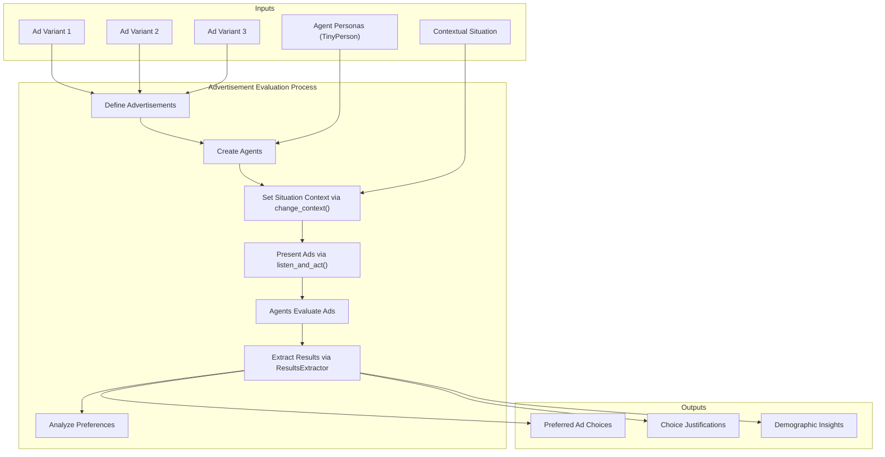
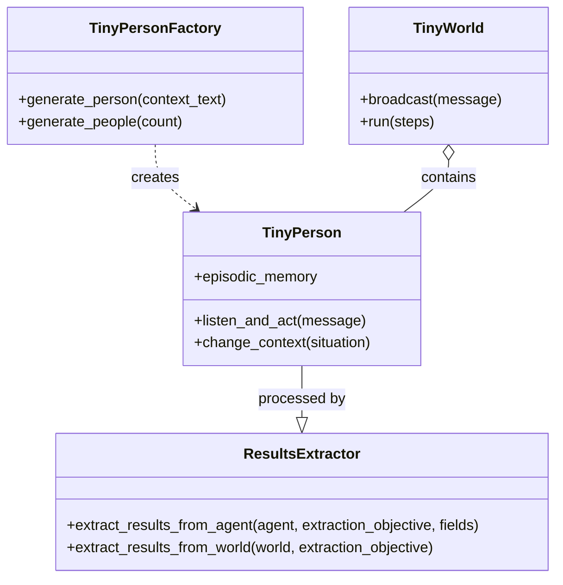
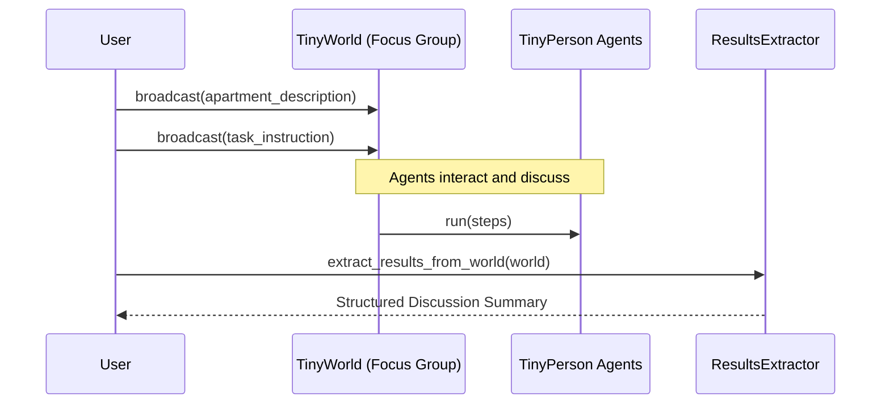

<!-- source: DeepWiki mcp.deepwiki.com · repo microsoft/TinyTroupe · page 5.2 Advertisement Evaluation · fetched 2026-10-26 -->

# Advertisement Evaluation

<details>
<summary>Relevant source files</summary>

The following files were used as context for generating this wiki page:

- [examples/Advertisement for TV.ipynb](examples/Advertisement for TV.ipynb)
- [examples/Create Ad for Apartment.ipynb](examples/Create Ad for Apartment.ipynb)
- [examples/Online Advertisement for Travel.ipynb](examples/Online Advertisement for Travel.ipynb)
- [examples/Simple Chat.ipynb](examples/Simple Chat.ipynb)
- [tests/scenarios/test_advertisement_scenarios.py](tests/scenarios/test_advertisement_scenarios.py)
- [tests/scenarios/test_extended_scenarios.py](tests/scenarios/test_extended_scenarios.py)
- [tests/unit/test_profiling.py](tests/unit/test_profiling.py)
- [tinytroupe/extraction/normalizer.py](tinytroupe/extraction/normalizer.py)
- [tinytroupe/extraction/prompts/normalizer.system.mustache](tinytroupe/extraction/prompts/normalizer.system.mustache)
- [tinytroupe/extraction/prompts/normalizer.user.mustache](tinytroupe/extraction/prompts/normalizer.user.mustache)

</details>


## Purpose and Scope

This documentation describes how to use TinyTroupe for evaluating advertisements with simulated agents. The advertisement evaluation system allows users to test different ad options with a diverse set of synthetic personas to determine which advertisements are most effective for different audience segments. This capability is particularly useful for market research, A/B testing of ad variants, and understanding consumer preferences before launching advertising campaigns.

Sources: [examples/Advertisement for TV.ipynb:7-10](), [examples/Online Advertisement for Travel.ipynb:7-9]()

## Overview

The advertisement evaluation system creates a group of simulated agents, each with distinct personalities, preferences, and backgrounds. These agents are presented with multiple advertisement variants and asked to choose the most convincing one based on their specific characteristics. The system then extracts structured data from their responses, allowing for an analysis of which ads appeal to which demographic segments.

### Workflow Diagram



Sources: [examples/Advertisement for TV.ipynb:137-181](), [examples/Advertisement for TV.ipynb:232-232](), [tests/scenarios/test_advertisement_scenarios.py:103-126]()

## Implementation Components

The advertisement evaluation system utilizes several key TinyTroupe components that work together:

### System Entity Mapping

The following diagram maps the logical evaluation steps to the specific classes and methods in the codebase.



Sources: [tinytroupe/agent.py:27-27](), [tinytroupe/factory.py:12-12](), [tinytroupe/extraction/results_extractor.py:13-13](), [tinytroupe/environment.py:10-10]()

## Setting Up Advertisement Evaluation

### 1. Define Advertisements

Advertisements are typically defined as multi-line strings containing the title, URL, and ad copy.

```python
# Ad targeting tech enthusiasts
tv_ad_1 = """
The Ultimate Gaming Experience - LG 4K Ultra HD TV
https://www.lg.com/tv/oled
AdExperience Next-Level Gaming with LG's 4K OLED TV. Unmatched Picture Quality.
"""
```

Sources: [examples/Advertisement for TV.ipynb:140-152](), [tests/scenarios/test_advertisement_scenarios.py:32-58]()

### 2. Create Evaluation Request

Construct a prompt that instructs agents to evaluate the ads. This prompt often includes specific instructions to select only one ad and explain the reasoning.

```python
eval_request_msg = f"""
Can you please evaluate these Bing ads for me? Which one convinces you more to buy their particular offering? 
Select **ONLY** one. Please explain your reasoning, based on your background and personality.

# AD 1
{tv_ad_1}
...
"""
```

Sources: [tests/scenarios/test_advertisement_scenarios.py:103-126](), [examples/Advertisement for TV.ipynb:191-216]()

### 3. Define Situation Context

The `situation` string provides the behavioral framing for the agent, ensuring they act as a consumer in a specific state of mind.

```python
situation = "You decided you want to visit Europe and you are planning your next vacations."
```

Sources: [tests/scenarios/test_advertisement_scenarios.py:130-130](), [examples/Advertisement for TV.ipynb:232-232]()

### 4. Create and Configure Agents

Agents can be created manually, loaded from JSON, or generated via `TinyPersonFactory`. Before the evaluation, their context is updated using `change_context`.

```python
from tinytroupe.examples import create_oscar_the_architect
from tinytroupe.factory import TinyPersonFactory

# Option A: Predefined
oscar = create_oscar_the_architect()

# Option B: Factory generated
factory = TinyPersonFactory("Diverse consumers from different demographics.")
consumer = factory.generate_person("A budget-conscious shopper.")

# Apply context
oscar.change_context(situation)
```

Sources: [tests/scenarios/test_advertisement_scenarios.py:134-138](), [tests/scenarios/test_advertisement_scenarios.py:156-160]()

### 5. Execution and Extraction

Agents process the ads via `listen_and_act`. The `ResultsExtractor` then parses the resulting agent interactions into structured formats (JSON/Dict).

```python
from tinytroupe.extraction import ResultsExtractor

# Agent acts
oscar.listen_and_act(eval_request_msg)

# Extract structured choice
extractor = ResultsExtractor()
res = extractor.extract_results_from_agent(
    oscar,
    extraction_objective="Find the ad the agent chose. Extract the Ad number, title and justification.",
    fields=["ad_id", "ad_title", "justification"]
)
```

Sources: [tests/scenarios/test_advertisement_scenarios.py:138-149](), [examples/Advertisement for TV.ipynb:460-466]()

## Advanced Evaluation: Focus Groups

Beyond individual evaluation, ads can be discussed in a `TinyWorld` focus group. This allows agents to influence each other and provides insights into how an ad might be perceived in social discussions.

### Focus Group Workflow



Sources: [tests/scenarios/test_advertisement_scenarios.py:166-194](), [examples/Create Ad for Apartment.ipynb:121-169]()

## Result Normalization

When evaluating ads across a large population, agents might use different terms for the same concept. The `Normalizer` class can be used to cluster these responses into canonical categories.

- **Class**: `Normalizer` [tinytroupe/extraction/normalizer.py:12-12]()
- **Functionality**: Uses LLM-based clustering to map diverse strings to a fixed number `n` of normalized elements [tinytroupe/extraction/normalizer.py:29-30]().
- **Constraints**: Enforces a hard upper bound on categories and maximum character lengths for labels [tinytroupe/extraction/normalizer.py:101-103]().

Sources: [tinytroupe/extraction/normalizer.py:59-68](), [tinytroupe/extraction/prompts/normalizer.system.mustache:9-13]()

## Best Practices

1.  **Shuffle Ads**: To avoid primacy/recency bias, instruct agents to consider the content regardless of the order [examples/Online Advertisement for Travel.ipynb:187-187]().
2.  **Specific Extraction Fields**: Always define clear `fields` in `ResultsExtractor` (e.g., `["ad_id", "justification"]`) to ensure the LLM returns consistent keys [tests/scenarios/test_advertisement_scenarios.py:148-148]().
3.  **Diverse Population**: Use `TinyPersonFactory` to generate a "long tail" of personas, ensuring the ad is tested against niche demographics [examples/Online Advertisement for Travel.ipynb:746-759]().
4.  **Verification**: Use `proposition_holds` or assertions to verify that the extracted `ad_id` matches the provided options [tests/scenarios/test_advertisement_scenarios.py:153-157]().

Sources: [tests/scenarios/test_advertisement_scenarios.py:144-157](), [tinytroupe/factory.py:44-51]()

---

