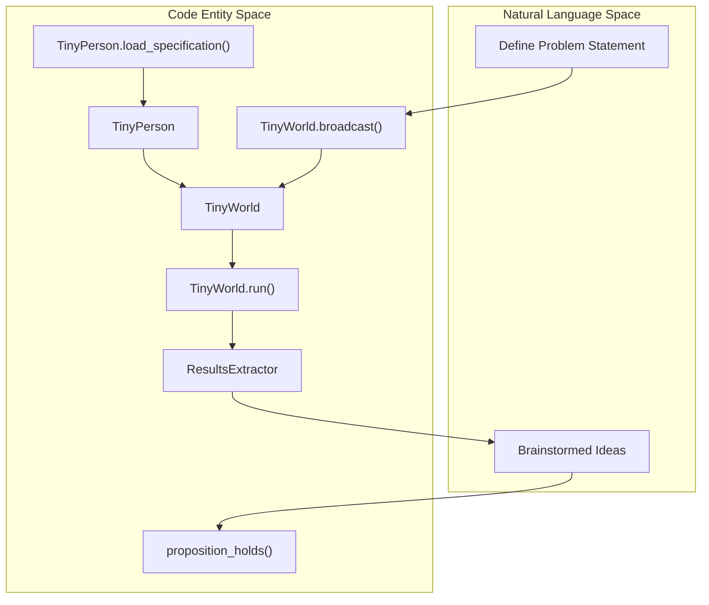
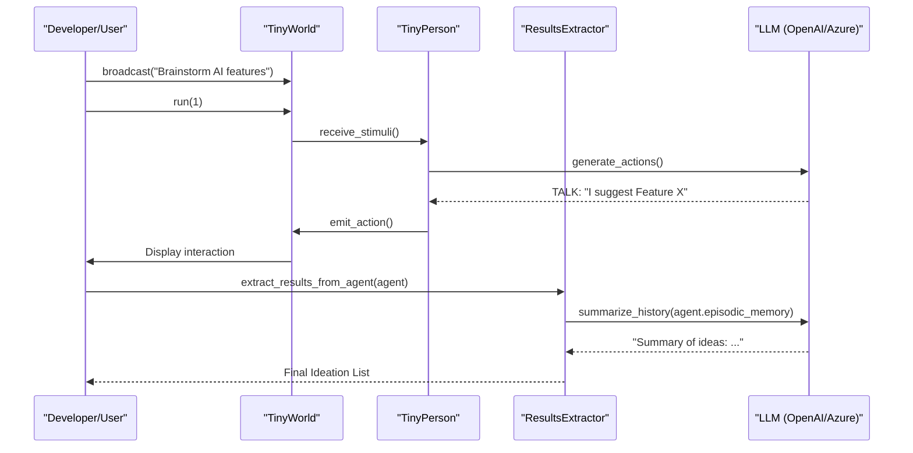

<!-- source: DeepWiki mcp.deepwiki.com · repo microsoft/TinyTroupe · page 5.3 Brainstorming Sessions · fetched 2026-10-26 -->

# Brainstorming Sessions

<details>
<summary>Relevant source files</summary>

The following files were used as context for generating this wiki page:

- [examples/Product Brainstorming (with behavior correction).ipynb](examples/Product Brainstorming (with behavior correction).ipynb)
- [examples/Product Brainstorming.ipynb](examples/Product Brainstorming.ipynb)
- [tests/scenarios/test_basic_scenarios.py](tests/scenarios/test_basic_scenarios.py)
- [tests/scenarios/test_brainstorming_scenarios.py](tests/scenarios/test_brainstorming_scenarios.py)
- [tests/testing_utils.py](tests/testing_utils.py)
- [tests/unit/test_grounding.py](tests/unit/test_grounding.py)

</details>


This document explains how to conduct brainstorming and ideation sessions using the TinyTroupe framework. Brainstorming sessions enable you to create a group of `TinyPerson` agents with different expertise and backgrounds, place them in a shared environment, and have them collaboratively generate and develop ideas around a specific topic or problem.

## Overview

Brainstorming sessions in TinyTroupe leverage the multi-agent capabilities of the framework to simulate realistic ideation processes. Multiple agents with distinct personalities and expertise engage in conversations, analyze problems, and generate creative solutions collaboratively.

The process typically involves:
1. Creating specialized agents with relevant expertise via `TinyPerson.load_specification` or `TinyPersonFactory`.
2. Setting up a shared environment using `TinyWorld`.
3. Distributing prompts to all agents using `TinyWorld.broadcast`.
4. Running the simulation loop with `TinyWorld.run`.
5. Extracting and validating generated ideas using `ResultsExtractor` and `proposition_holds`.

### Brainstorming Workflow Logic

The following diagram maps the conceptual workflow to the specific code entities involved in a brainstorming session.



Sources: [examples/Product Brainstorming.ipynb:123-125](), [examples/Product Brainstorming.ipynb:141-141](), [tests/scenarios/test_brainstorming_scenarios.py:23-47](), [tests/testing_utils.py:114-119]()

## Setting Up a Brainstorming Session

### Creating Expert Agents
For effective brainstorming, you need to create agents with diverse expertise. This is typically done by loading pre-defined JSON specifications or using factories.

```python
# Loading agents with distinct personas
lisa = TinyPerson.load_specification("./agents/Lisa.agent.json") # Data Scientist
oscar = TinyPerson.load_specification("./agents/Oscar.agent.json") # Architect
marcos = TinyPerson.load_specification("./agents/Marcos.agent.json") # Physician
```

Sources: [examples/Product Brainstorming.ipynb:123-125]()

### Setting Up the Environment
A brainstorming session takes place in a `TinyWorld` instance. This environment manages the communication bus between agents.

```python
world = TinyWorld("Focus group", [lisa, oscar, marcos])
```

Sources: [examples/Product Brainstorming.ipynb:141-141]()

## Running the Brainstorming Process

### Broadcasting Prompts
The `TinyWorld.broadcast` method is the primary tool for delivering instructions to all participants simultaneously. In a brainstorming context, it is used to present the problem statement.

```python
world.broadcast(
    """
    Folks, we need to brainstorm ideas for a new product. Your mission is to discuss potential AI feature ideas
    to add to Microsoft Word. In general, we want features that make you or your industry more productive.
    """
)
```

Sources: [tests/scenarios/test_brainstorming_scenarios.py:23-31]()

### Simulation Execution
The `run(n)` method executes the simulation for `n` steps. During each step, agents process the stimuli (the broadcasted message) and generate actions (talking, thinking).

```python
world.run(1)
```

Sources: [tests/scenarios/test_brainstorming_scenarios.py:33-33]()

## Extracting and Validating Results

### Using ResultsExtractor
Once the simulation has run, you can use the `ResultsExtractor` to parse the interaction history and summarize the ideas generated.

```python
from tinytroupe.extraction import ResultsExtractor

extractor = ResultsExtractor()
results = extractor.extract_results_from_agent(
    agent,
    extraction_objective="Summarize the ideas that the group came up with as a list.",
    situation="A focus group to brainstorm AI features for Word."
)
```

Sources: [tests/scenarios/test_brainstorming_scenarios.py:39-47]()

### Semantic Validation
To programmatically verify if the brainstorming session was successful (e.g., in a CI/CD pipeline or automated experiment), TinyTroupe provides `proposition_holds`. This function uses an LLM to check if a natural language statement is true regarding the results.

```python
assert proposition_holds(
    f"The following contains some ideas for new product features: '{results}'"
)
```

Sources: [tests/testing_utils.py:114-119](), [tests/scenarios/test_brainstorming_scenarios.py:51-53]()

## Advanced Interaction Patterns

### Behavior Correction
For more rigorous brainstorming, you can enable quality checks and reasoning steps within the `ActionGenerator` of the agents. This forces agents to self-correct and adhere more strictly to their personas.

```python
for person in people:
    person.action_generator.enable_quality_checks = True
    person.action_generator.max_attempts = 5
    person.action_generator.quality_threshold = 5
```

Sources: [examples/Product Brainstorming (with behavior correction).ipynb:136-142]()

### Component Interaction Diagram

This diagram shows how data flows through the system during a brainstorming session, from the initial broadcast to the final extraction.



Sources: [tests/scenarios/test_brainstorming_scenarios.py:23-49](), [tests/testing_utils.py:134-134]()

## Summary of Key Functions

| Class/Function | Role in Brainstorming | Source |
| :--- | :--- | :--- |
| `TinyWorld.broadcast()` | Sends the brainstorming prompt to all agents simultaneously. | [tests/scenarios/test_brainstorming_scenarios.py:23-31]() |
| `TinyWorld.run()` | Advances the simulation, allowing agents to discuss ideas. | [tests/scenarios/test_brainstorming_scenarios.py:33-33]() |
| `ResultsExtractor.extract_results_from_agent()` | Distills the conversation into a structured list of ideas. | [tests/scenarios/test_brainstorming_scenarios.py:43-47]() |
| `proposition_holds()` | Validates that the output contains relevant brainstorming content. | [tests/testing_utils.py:114-119]() |
| `ActionGenerator.enable_quality_checks` | Ensures agents provide high-quality, relevant ideas. | [examples/Product Brainstorming (with behavior correction).ipynb:138-138]() |

Sources: [tests/scenarios/test_brainstorming_scenarios.py:23-53](), [tests/testing_utils.py:114-119](), [examples/Product Brainstorming (with behavior correction).ipynb:136-142]()

---

