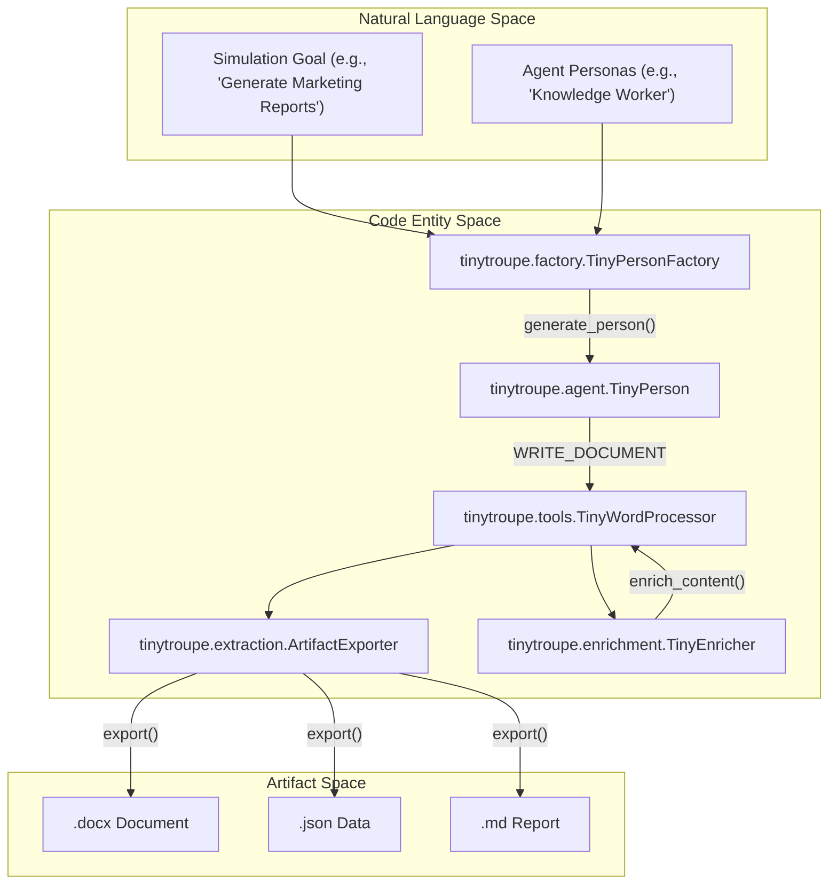
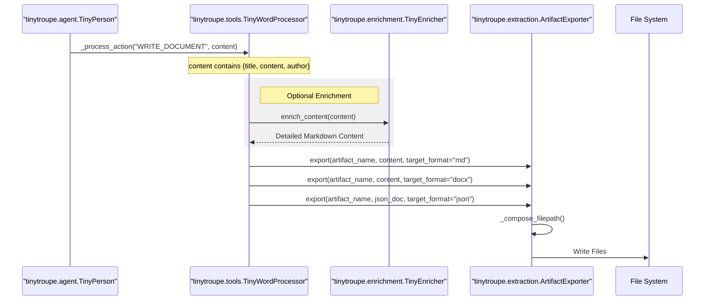

<!-- source: DeepWiki mcp.deepwiki.com · repo microsoft/TinyTroupe · page 5.4 Synthetic Data Generation · fetched 2026-10-26 -->

# Synthetic Data Generation

<details>
<summary>Relevant source files</summary>

The following files were used as context for generating this wiki page:

- [examples/Synthetic Data Generation.ipynb](examples/Synthetic Data Generation.ipynb)
- [examples/Word Processor Tool Usage.ipynb](examples/Word Processor Tool Usage.ipynb)
- [tinytroupe/enrichment/tiny_enricher.py](tinytroupe/enrichment/tiny_enricher.py)
- [tinytroupe/extraction/artifact_exporter.py](tinytroupe/extraction/artifact_exporter.py)
- [tinytroupe/tools/tiny_tool.py](tinytroupe/tools/tiny_tool.py)
- [tinytroupe/tools/tiny_word_processor.py](tinytroupe/tools/tiny_word_processor.py)
- [tinytroupe/utils/llm.py](tinytroupe/utils/llm.py)

</details>


Synthetic data generation in TinyTroupe involves using simulated agents to produce structured or unstructured datasets that mimic real-world human output. This is achieved through the interaction of agents within a `TinyWorld`, the use of specialized tools like the `TinyWordProcessor`, and the final export of data via the `ArtifactExporter`.

## Overview of the Data Generation Pipeline

The generation of synthetic data typically follows a pipeline where agents are initialized, interact to produce content, and then that content is captured and formatted into external files.

### Data Flow and System Entities
The following diagram illustrates how natural language simulation goals are transformed into concrete code entities and finally into synthetic data artifacts.

**Synthetic Data Generation Flow**

**Sources:** [tinytroupe/tools/tiny_word_processor.py:7-10](), [tinytroupe/extraction/artifact_exporter.py:13-22](), [examples/Synthetic Data Generation.ipynb:129-174]()

---

## Core Components for Generation

### 1. ArtifactExporter
The `ArtifactExporter` is the primary class responsible for writing simulation results to the file system. It handles various formats and ensures filenames are sanitized.

*   **Initialization:** Requires a `base_output_folder` [tinytroupe/extraction/artifact_exporter.py:19-20]().
*   **Export Formats:** Supports `json`, `txt`, `md`, and `docx` [tinytroupe/extraction/artifact_exporter.py:56-63]().
*   **Sanitization:** Automatically replaces invalid characters (e.g., `:`, `*`, `?`) in artifact names with hyphens to ensure cross-platform file compatibility [tinytroupe/extraction/artifact_exporter.py:45-51]().

### 2. TinyWordProcessor
The `TinyWordProcessor` is a `TinyTool` that allows agents to perform the `WRITE_DOCUMENT` action. When an agent uses this tool, it triggers the creation of artifacts.

*   **Action Handling:** Processes the `WRITE_DOCUMENT` action which expects a JSON object containing `title`, `content`, and optionally `author` [tinytroupe/tools/tiny_word_processor.py:39-52]().
*   **Automatic Multi-Format Export:** By default, it calls the exporter to produce Markdown, DOCX, and JSON versions of the same document [tinytroupe/tools/tiny_word_processor.py:33-37]().

### 3. TinyEnricher
To ensure synthetic data is "long and detailed," the `TinyEnricher` can be attached to the word processor. It uses an LLM to expand a draft or outline into a full-length document [tinytroupe/enrichment/tiny_enricher.py:15-25]().

**Sources:** [tinytroupe/extraction/artifact_exporter.py:13-63](), [tinytroupe/tools/tiny_word_processor.py:7-52](), [tinytroupe/enrichment/tiny_enricher.py:8-39]()

---

## Implementation Detail: Word Processor Interaction

The interaction between the agent's mental faculty and the file system is managed through the `TinyToolUse` faculty.

**Tool and Exporter Integration**

**Sources:** [tinytroupe/tools/tiny_word_processor.py:12-38](), [tinytroupe/tools/tiny_tool.py:52-69](), [tinytroupe/extraction/artifact_exporter.py:22-53]()

---

## Example Usage: Generating a Dataset

To generate a synthetic dataset, you typically define a factory to produce agents, provide them with the word processor tool, and run a simulation.

### Configuration Snippet
```python
# Setup Exporter and Tool
exporter = ArtifactExporter(base_output_folder="./synthetic_data")
enricher = TinyEnricher()
word_proc = TinyWordProcessor(exporter=exporter, enricher=enricher)

# Assign to Agent
agent = TinyPerson("Data Scientist")
agent.add_mental_faculties([TinyToolUse(tools=[word_proc])])

# Agent Action (triggered via simulation or direct prompt)
# The agent will now use WRITE_DOCUMENT which invokes the exporter.
```
**Sources:** [examples/Word Processor Tool Usage.ipynb:146-192](), [tinytroupe/tools/tiny_word_processor.py:59-67]()

### Supported Output Formats
| Format | Method | Description |
| :--- | :--- | :--- |
| **JSON** | `_export_as_json` | Saves a dictionary as a formatted JSON file. [tinytroupe/extraction/artifact_exporter.py:79-88]() |
| **DOCX** | `_export_as_docx` | Converts Markdown to HTML, then to DOCX using `pypandoc`. [tinytroupe/extraction/artifact_exporter.py:90-119]() |
| **Markdown**| `_export_as_txt` | Saves raw string content with a `.md` extension. [tinytroupe/extraction/artifact_exporter.py:66-77]() |
| **CSV** | (via ResultsReducer) | While not directly in `ArtifactExporter`, notebooks show CSV generation via `pandas` on extracted results. [examples/Synthetic Data Generation.ipynb:97-106]() |

**Sources:** [tinytroupe/extraction/artifact_exporter.py:56-119](), [examples/Synthetic Data Generation.ipynb:97-106]()

---

