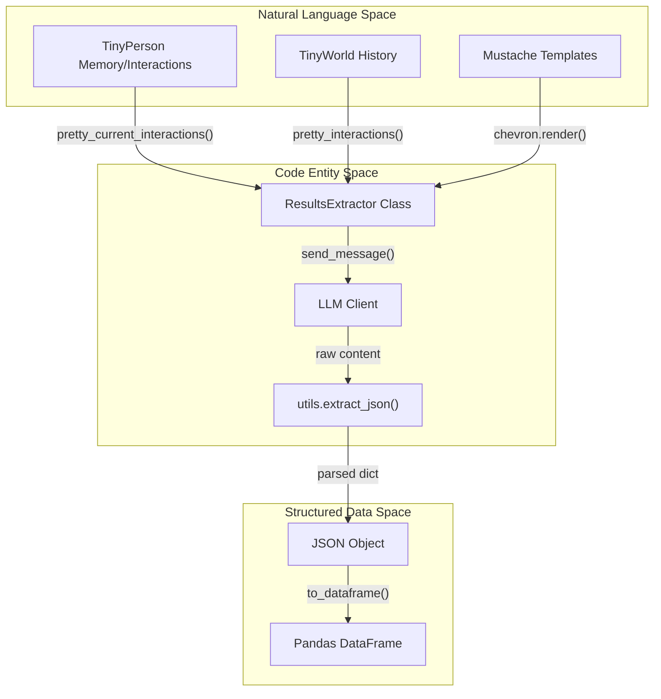
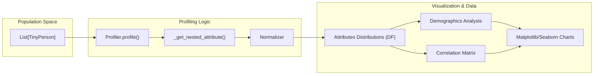

<!-- source: DeepWiki mcp.deepwiki.com · repo microsoft/TinyTroupe · page 6 Results Extraction · fetched 2026-10-26 -->

# Results Extraction

<details>
<summary>Relevant source files</summary>

The following files were used as context for generating this wiki page:

- [tests/scenarios/test_advertisement_scenarios.py](tests/scenarios/test_advertisement_scenarios.py)
- [tests/unit/test_normalizer.py](tests/unit/test_normalizer.py)
- [tinytroupe/agent/prompts/tiny_person.mustache](tinytroupe/agent/prompts/tiny_person.mustache)
- [tinytroupe/extraction/normalizer.py](tinytroupe/extraction/normalizer.py)
- [tinytroupe/extraction/prompts/normalizer.system.mustache](tinytroupe/extraction/prompts/normalizer.system.mustache)
- [tinytroupe/extraction/prompts/normalizer.user.mustache](tinytroupe/extraction/prompts/normalizer.user.mustache)
- [tinytroupe/extraction/results_extractor.py](tinytroupe/extraction/results_extractor.py)
- [tinytroupe/extraction/results_reporter.py](tinytroupe/extraction/results_reporter.py)
- [tinytroupe/profiling.py](tinytroupe/profiling.py)
- [tinytroupe/utils/config.py](tinytroupe/utils/config.py)

</details>


## Purpose and Scope

This document describes the Results Extraction system in TinyTroupe, which provides mechanisms for extracting structured data from agent interactions and simulation states. The system moves beyond raw logs to provide structured insights through a suite of specialized classes: `ResultsExtractor`, `ResultsReducer`, `ResultsReporter`, `Normalizer`, and `Profiler`.

The Results Extraction system is primarily used to convert natural language responses from agents into structured formats like JSON, DataFrames, or Markdown reports, enabling quantitative analysis and population-level profiling.

## ResultsExtractor Overview

The `ResultsExtractor` class in [tinytroupe/extraction/results_extractor.py:15-176]() is the primary component for converting unstructured interaction history into structured data. It uses LLM-based parsing to extract specific fields defined by the user.



**Diagram: ResultsExtractor Data Flow (Natural Language to Code Entities)**

Sources: [tinytroupe/extraction/results_extractor.py:113-176](), [tinytroupe/extraction/results_extractor.py:15-176]()

### Core Extraction Logic
The `ResultsExtractor` utilizes the following parameters to guide the LLM:
*   **`extraction_objective`**: A string describing the goal (e.g., "Extract the user's preference for travel ads"). [tinytroupe/extraction/results_extractor.py:23-23]()
*   **`fields`**: A list of keys to be present in the output JSON. [tinytroupe/extraction/results_extractor.py:25-25]()
*   **`fields_hints`**: Specific instructions for each field. [tinytroupe/extraction/results_extractor.py:26-26]()

The extraction is performed via `extract_results_from_agent` [tinytroupe/extraction/results_extractor.py:85-176]() or `extract_results_from_world` [tinytroupe/extraction/results_extractor.py:178-233](). Results are cached in `self.agent_extraction` and `self.world_extraction`. [tinytroupe/extraction/results_extractor.py:50-51]()

## Results Reporting and Reduction

### ResultsReporter
The `ResultsReporter` [tinytroupe/extraction/results_reporter.py:15-212]() generates human-readable Markdown reports. It offers three primary strategies:
1.  **`report_from_agents`**: Interviews agents directly using a `reporting_task`. [tinytroupe/extraction/results_reporter.py:36-85]()
2.  **`report_from_interactions`**: Analyzes historical logs via `pretty_current_interactions`. [tinytroupe/extraction/results_reporter.py:87-135]()
3.  **`report_from_data`**: Formats existing structured data into a narrative. [tinytroupe/extraction/results_reporter.py:137-161]()

### Normalizer
When dealing with diverse text inputs (e.g., varying job titles), the `Normalizer` [tinytroupe/extraction/normalizer.py:12-182]() clusters similar elements into canonical categories.
*   It enforces a hard upper bound `n` on categories. [tinytroupe/extraction/normalizer.py:101-104]()
*   It uses `LLMChat` with `normalizer.system.mustache` to perform semantic clustering. [tinytroupe/extraction/normalizer.py:59-70]()
*   It maintains a `normalizing_map` to ensure consistency across multiple calls. [tinytroupe/extraction/normalizer.py:49-49]()

Sources: [tinytroupe/extraction/results_reporter.py:15-212](), [tinytroupe/extraction/normalizer.py:12-182]()

## Population Analysis with Profiler

The `Profiler` class [tinytroupe/profiling.py:29-335]() provides high-level statistical analysis of agent populations. It bridges the gap between individual agent states and population-wide distributions.



**Diagram: Profiling Pipeline (Population to Visualization)**

Sources: [tinytroupe/profiling.py:76-129](), [tinytroupe/profiling.py:133-172]()

### Key Profiling Functions
*   **`_analyze_demographics`**: Computes mean, median, and diversity indices for age, occupation, and nationality. [tinytroupe/profiling.py:133-172]()
*   **`_analyze_persona_composition`**: Uses the `Normalizer` to categorize complex persona facets like "interests" or "beliefs". [tinytroupe/profiling.py:210-238]()
*   **`_analyze_correlations`**: Calculates a correlation matrix between numeric or normalized categorical attributes. [tinytroupe/profiling.py:240-272]()
*   **`render`**: Generates visual charts (histograms, pie charts, heatmaps) and stores the underlying data in `self.plot_data`. [tinytroupe/profiling.py:274-335]()

## Common Usage Patterns

### Market Research Scenario
In market research, the workflow typically involves extracting choice data and then profiling the segments.

```python
# Extract choices from a focus group
extractor = ResultsExtractor()
choices = extractor.extract_results_from_agents(
    people,
    extraction_objective="Identify the chosen ad and justification",
    fields=["ad_id", "justification"]
)

# Profile the population that made those choices
profiler = Profiler()
profiler.profile(people, plot=True)
```

Sources: [tests/scenarios/test_advertisement_scenarios.py:140-159](), [tinytroupe/profiling.py:76-129]()

### Technical Integration Details
*   **Data Structure**: Extractions are often saved as JSON files containing `agent_extractions` and `world_extraction` keys. [tinytroupe/extraction/results_extractor.py:50-51]()
*   **LLM Configuration**: Extraction and normalization use the `LLMChat` utility which respects settings in `config.ini`. [tinytroupe/extraction/normalizer.py:59-70](), [tinytroupe/utils/config.py:108-151]()
*   **Nested Attributes**: The Profiler supports dot notation (e.g., `occupation.title`) to access deep persona fields via `_get_nested_attribute`. [tinytroupe/profiling.py:53-55]()

## Summary

The Results Extraction system provides a robust pipeline for turning agent simulations into actionable data. By combining the precision of the `ResultsExtractor` with the statistical breadth of the `Profiler` and the semantic clustering of the `Normalizer`, TinyTroupe allows researchers to perform both qualitative and quantitative analysis of synthetic populations.

Sources: [tinytroupe/extraction/results_extractor.py:1-233](), [tinytroupe/profiling.py:1-335](), [tinytroupe/extraction/results_reporter.py:1-212](), [tinytroupe/extraction/normalizer.py:1-182]()

---

