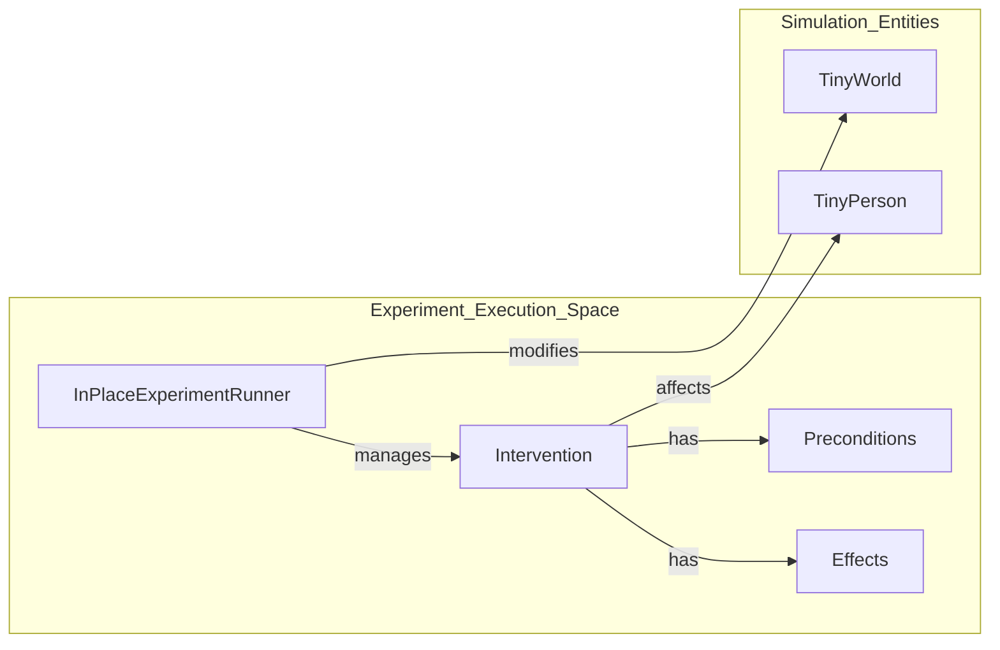

<!-- source: DeepWiki mcp.deepwiki.com · repo microsoft/TinyTroupe · page 7 Advanced Topics · fetched 2026-10-26 -->

# Advanced Topics

<details>
<summary>Relevant source files</summary>

The following files were used as context for generating this wiki page:

- [README.md](README.md)
- [data/extractions/appartment_rent_ad.extraction.json](data/extractions/appartment_rent_ad.extraction.json)
- [data/extractions/synthetic_data_generation.out.csv](data/extractions/synthetic_data_generation.out.csv)
- [examples/Vision for Product, Diagnosis and Appreciation Feedback (image modality).ipynb](examples/Vision for Product, Diagnosis and Appreciation Feedback (image modality).ipynb)

</details>


This page covers advanced features and techniques for TinyTroupe that enable more sophisticated agent behaviors, optimized performance, and complex simulation scenarios. For beginners, we recommend first familiarizing yourself with the core components in [Core Architecture](#2) and basic agent functionality in [TinyPerson](#3).

## Knowledge Grounding

Knowledge grounding allows `TinyPerson` agents to incorporate external knowledge from sources like local files and web pages. This significantly enhances their capabilities by providing access to specialized information beyond their base LLM training data.

### Grounding Architecture

```mermaid
flowchart TD
    subgraph "TinyPerson_Code_Space"
        direction TB
        TP["TinyPerson"]
        MF["MentalFaculty"]
        GF["FilesAndWebGroundingFaculty"]
        
        TP -- "has_faculty" --> GF
        GF -- "inherits_from" --> MF
    end
    
    subgraph "Grounding_Logic_Space"
        direction TB
        GC["GroundingConnector"]
        BSG["BaseSemanticGroundingConnector"]
        LFG["LocalFilesGroundingConnector"]
        WPG["WebPagesGroundingConnector"]
        
        GC <|-- BSG
        BSG <|-- LFG
        BSG <|-- WPG
    end
    
    subgraph "External_Data"
        LF["Local Files/Folders"]
        WP["Web URLs"]
    end
    
    GF -- "uses" --> GC
    LFG -- "accesses" --> LF
    WPG -- "accesses" --> WP
```

Sources: [tinytroupe/agent/grounding.py:13-273](), [tinytroupe/agent/grounding.py:112-153]()

### Grounding Connectors

Grounding is implemented through a hierarchical system of connectors in `tinytroupe/agent/grounding.py`:

1.  **`GroundingConnector`**: Abstract base class defining the interface: `retrieve_relevant`, `retrieve_by_name`, and `list_sources` [tinytroupe/agent/grounding.py:13-44]().
2.  **`BaseSemanticGroundingConnector`**: Implements semantic search using embeddings via `llama-index` integration [tinytroupe/agent/grounding.py:47-109]().
3.  **`LocalFilesGroundingConnector`**: Provides grounding in local files and folders by indexing them into a semantic vector store [tinytroupe/agent/grounding.py:156-223]().
4.  **`WebPagesGroundingConnector`**: Provides grounding in web content by crawling and indexing specified URLs [tinytroupe/agent/grounding.py:226-272]().

For details, see [Knowledge Grounding](#7.1).

## Interventions and Experimentation

TinyTroupe supports dynamic modifications to simulation behavior and controlled A/B testing through the `Intervention` and `InPlaceExperimentRunner` classes.

### Experimentation Framework



Sources: [tinytroupe/experimentation.py:1-150]()

*   **`Intervention`**: Defines a change to be applied to a `TinyWorld` or `TinyPerson`. It includes `preconditions` (when to apply) and `effects` (what to change) [tinytroupe/experimentation.py:19-102]().
*   **`InPlaceExperimentRunner`**: Orchestrates experiments by applying interventions and tracking variations. It supports randomized assignments and can be used for statistical validation [tinytroupe/experimentation.py:105-150]().

For details, see [Interventions and Experimentation](#7.2).

## Story Generation and Enrichment

TinyTroupe includes utilities to transform raw simulation logs into high-quality narratives and to enrich generated content.

*   **`TinyStory`**: Generates cohesive narratives from `TinyWorld` or `TinyPerson` interaction histories using LLMs [tinytroupe/storytelling.py:1-40]().
*   **`TinyEnricher`**: Enhances content by adding detail, clarity, or depth based on a set of requirements [tinytroupe/enrichment.py:1-35]().
*   **`TinyStyler`**: Applies specific writing styles (e.g., formal, creative, technical) to agent outputs or generated documents [tinytroupe/styling.py:1-30]().

For details, see [Story Generation and Enrichment](#7.3).

## Agent Validation

To ensure simulations are reliable and personas are consistent, TinyTroupe provides several validation mechanisms.

| Class | Purpose | Source |
|-------|---------|--------|
| `TinyPersonValidator` | Validates a `TinyPerson` against its specification using LLM-based checks. | [tinytroupe/validation.py:10-50]() |
| `SimulationExperimentEmpiricalValidator` | Compares simulation results against real-world empirical data (e.g., survey data) using statistical tests like t-tests or KS-tests. | [tinytroupe/validation.py:100-150]() |
| `proposition_holds` | A utility function used within tests to verify if a semantic proposition is true within the simulation context. | [tinytroupe/utils/validation.py:5-25]() |

For details, see [Agent Validation](#7.4).

## Vision Modality

Recent updates introduce support for vision, allowing agents to "see" and react to images. This exercises the *visual perception → cognition → action* loop [examples/Vision for Product, Diagnosis and Appreciation Feedback (image modality).ipynb:12-14]().

*   Agents can interpret photographs (e.g., supermarket shelves) without text descriptions [examples/Vision for Product, Diagnosis and Appreciation Feedback (image modality).ipynb:115-118]().
*   Configuration is managed via the `[OpenAI]` section using parameters like `vision_detail = auto` [examples/Vision for Product, Diagnosis and Appreciation Feedback (image modality).ipynb:48-48]().

Sources: [examples/Vision for Product, Diagnosis and Appreciation Feedback (image modality).ipynb:1-120]()

---

