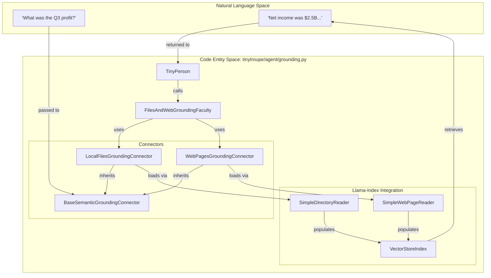
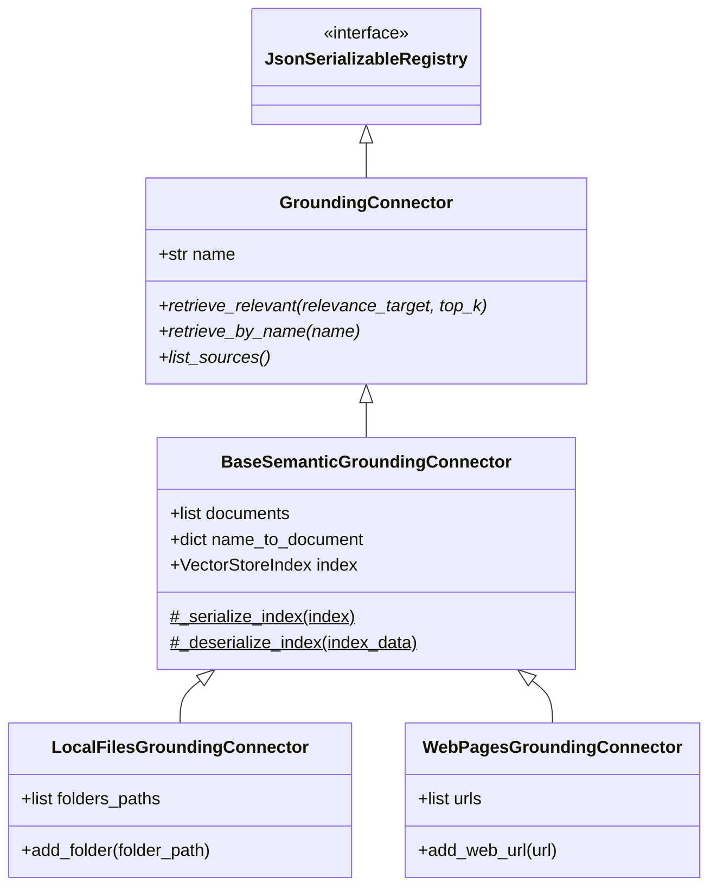
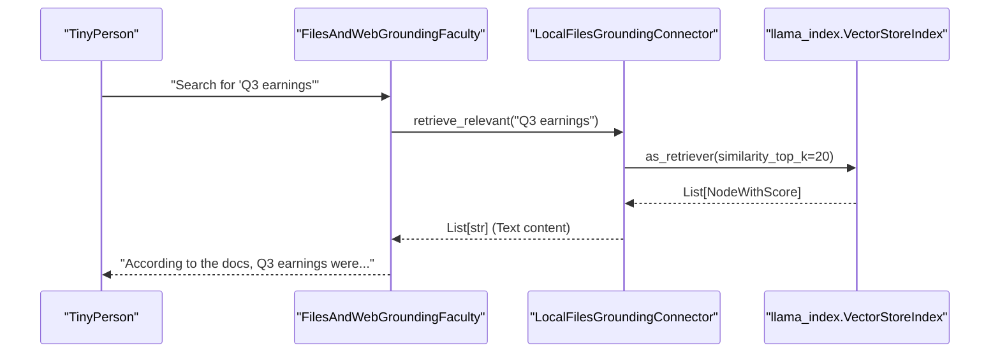

<!-- source: DeepWiki mcp.deepwiki.com · repo microsoft/TinyTroupe · page 7.1 Knowledge Grounding · fetched 2026-10-26 -->

# Knowledge Grounding

<details>
<summary>Relevant source files</summary>

The following files were used as context for generating this wiki page:

- [data/grounding_examples/finance/Nubank (NU) - 3Q24 Earnings Release.pdf](data/grounding_examples/finance/Nubank (NU) - 3Q24 Earnings Release.pdf)
- [data/grounding_examples/finance/Vale do Rio Doce (VALE 3) - Vale's Performance in 3Q24.pdf](data/grounding_examples/finance/Vale do Rio Doce (VALE 3) - Vale's Performance in 3Q24.pdf)
- [examples/Product Brainstorming.ipynb](examples/Product Brainstorming.ipynb)
- [test.bat](test.bat)
- [tests/conftest.py](tests/conftest.py)
- [tests/scenarios/test_jupyter_examples.py](tests/scenarios/test_jupyter_examples.py)
- [tests/unit/test_grounding.py](tests/unit/test_grounding.py)
- [tinytroupe/agent/grounding.py](tinytroupe/agent/grounding.py)

</details>


## Purpose and Scope

Knowledge Grounding in TinyTroupe allows agents to augment their internal parametric knowledge with external, authoritative data sources. By using grounding connectors, agents can perform semantic searches over local files and web content, ensuring their interactions are based on specific documents rather than just the training data of the underlying LLM. This is primarily managed through the `GroundingConnector` hierarchy and integrated into agents via the `FilesAndWebGroundingFaculty`.

## Architecture Overview

The grounding system bridges the "Natural Language Space" (queries and document content) with the "Code Entity Space" (classes and Llama-Index objects).

### Knowledge Grounding Data Flow

Sources: [tinytroupe/agent/grounding.py:16-55](), [tinytroupe/agent/grounding.py:156-170](), [tinytroupe/agent/grounding.py:226-240]()

## Grounding Connectors

The `GroundingConnector` is the base abstract class for all knowledge sources. It inherits from `JsonSerializableRegistry` [tinytroupe/agent/grounding.py:16-16]() to support persistence.

### Class Hierarchy and Key Methods

Sources: [tinytroupe/agent/grounding.py:16-35](), [tinytroupe/agent/grounding.py:38-60](), [tinytroupe/agent/grounding.py:156-165](), [tinytroupe/agent/grounding.py:226-235]()

### BaseSemanticGroundingConnector
This class handles the heavy lifting of semantic search using `llama-index` [tinytroupe/agent/grounding.py:5-7](). 
- **Indexing**: It maintains a `VectorStoreIndex` [tinytroupe/agent/grounding.py:60-60](). If an index is missing during initialization, it is rebuilt from the `documents` list [tinytroupe/agent/grounding.py:89-96]().
- **Serialization**: Since `VectorStoreIndex` is not natively serializable, the class uses `_serialize_index` [tinytroupe/agent/grounding.py:102-121]() to persist the index to a temporary directory and read it into a dictionary, and `_deserialize_index` [tinytroupe/agent/grounding.py:127-150]() to restore it.

### LocalFilesGroundingConnector
Specializes in local file system ingestion.
- It uses `SimpleDirectoryReader` [tinytroupe/agent/grounding.py:5-5]() to process folders [tinytroupe/agent/grounding.py:204-205]().
- Supported files include text, PDF (as seen in `data/grounding_examples/finance/`), and others supported by Llama-Index.

### WebPagesGroundingConnector
Specializes in web content.
- It uses `SimpleWebPageReader` [tinytroupe/agent/grounding.py:7-7]() to fetch content from provided URLs [tinytroupe/agent/grounding.py:255-256]().

## Implementation Details

### Retrieval Logic
Retrieval is performed via `retrieve_relevant(relevance_target, top_k)` [tinytroupe/agent/grounding.py:152-152](). It converts the index into a retriever and fetches the top `k` nodes based on semantic similarity [tinytroupe/agent/grounding.py:160-161]().

### Integration with TinyPerson
Grounding is typically exposed to agents via the `FilesAndWebGroundingFaculty`. In tests, this is demonstrated by adding the faculty to a `TinyPerson` instance [tests/unit/test_grounding.py:168-171]().

```python
from tinytroupe.agent.mental_faculty import FilesAndWebGroundingFaculty

# Initialize faculty with local documents
grounding_faculty = FilesAndWebGroundingFaculty(folders_paths=["/path/to/docs"])

# Attach to agent
agent.add_mental_faculties([grounding_faculty])
```
Sources: [tests/unit/test_grounding.py:168-171]()

## Knowledge Retrieval Data Flow
The following diagram shows the sequence of entities involved when an agent performs a grounded search.


Sources: [tinytroupe/agent/grounding.py:152-161](), [tests/unit/test_grounding.py:75-77]()

## Summary of Key Classes

| Class | Role | Source |
|-------|------|--------|
| `GroundingConnector` | Abstract base for all knowledge connectors. | [tinytroupe/agent/grounding.py:16]() |
| `BaseSemanticGroundingConnector` | Implements vector-based search logic. | [tinytroupe/agent/grounding.py:38]() |
| `LocalFilesGroundingConnector` | Ingests local files/folders. | [tinytroupe/agent/grounding.py:156]() |
| `WebPagesGroundingConnector` | Ingests web content via URLs. | [tinytroupe/agent/grounding.py:226]() |

Sources: [tinytroupe/agent/grounding.py:1-271]()

---

