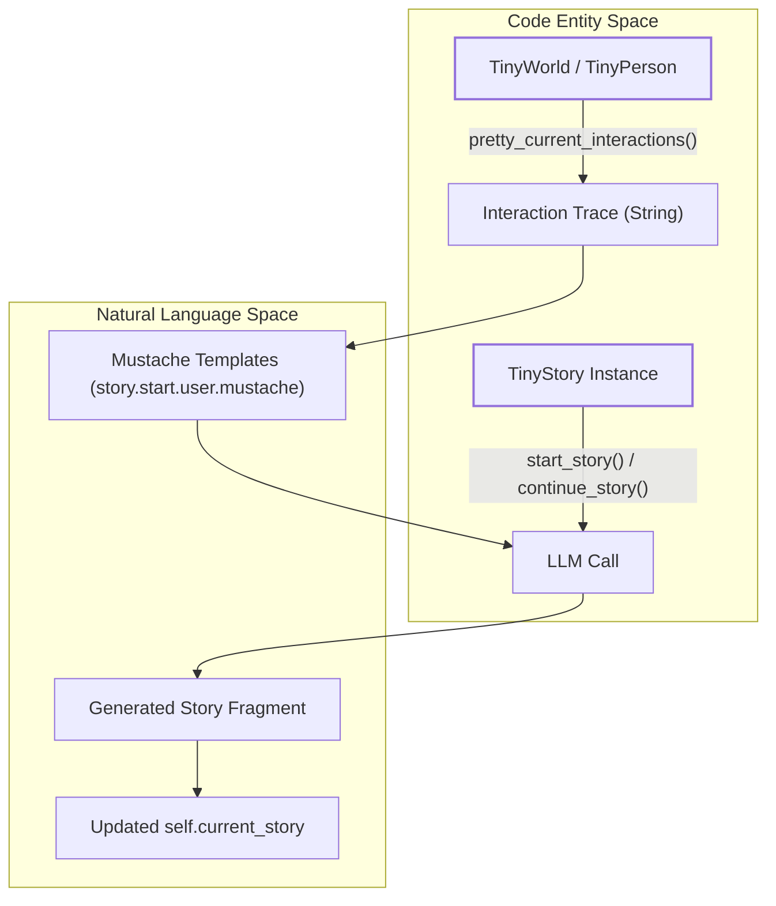
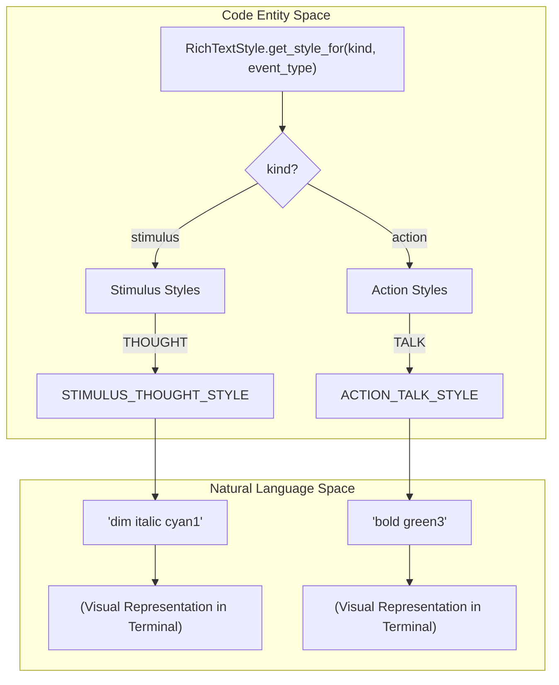

<!-- source: DeepWiki mcp.deepwiki.com · repo microsoft/TinyTroupe · page 7.3 Story Generation and Enrichment · fetched 2026-10-26 -->

# Story Generation and Enrichment

Relevant source files

The following files were used as context for generating this wiki page:

- [examples/Political Compass (customizing agents with fragments).ipynb](examples/Political Compass (customizing agents with fragments).ipynb)
- [examples/Story telling (long narratives).ipynb](examples/Story telling (long narratives).ipynb)
- [tinytroupe/steering/tiny_story.py](tinytroupe/steering/tiny_story.py)
- [tinytroupe/utils/rendering.py](tinytroupe/utils/rendering.py)
- [tinytroupe/utils/semantics.py](tinytroupe/utils/semantics.py)
- [tinytroupe/validation/prompts/check_person.mustache](tinytroupe/validation/prompts/check_person.mustache)

TinyTroupe provides a suite of tools for transforming raw simulation traces into polished narratives, enriching content with additional detail, and ensuring agent outputs adhere to specific stylistic guidelines. These capabilities are primarily handled by the `TinyStory`, `TinyEnricher`, and `TinyStyler` classes.

## TinyStory: Narrative Generation

The `TinyStory` class [tinytroupe/steering/tiny_story.py:10-13]() is designed to bridge the gap between technical simulation logs and human-readable stories. It uses the interaction history of either a `TinyWorld` environment or a specific `TinyPerson` agent to craft a cohesive narrative [tinytroupe/steering/tiny_story.py:15-38]().

### Key Features
- **Context Awareness**: Maintains a running context of the story generated so far [tinytroupe/steering/tiny_story.py:53]().
- **Trace Windowing**: Allows specifying `first_n` and `last_n` interactions to focus the LLM on the most relevant parts of a potentially long simulation [tinytroupe/steering/tiny_story.py:55-57]().
- **Guided Generation**: Uses "purposes" and "requirements" to steer the narrative (e.g., "include a plot twist") [tinytroupe/steering/tiny_story.py:61-63]().

### Implementation Details
`TinyStory` interacts with the simulation history through the `pretty_current_interactions` method found in both agents and environments [tinytroupe/steering/tiny_story.py:145-156](). It uses Mustache templates to format the prompt for the LLM.

**Narrative Data Flow**
The following diagram shows how `TinyStory` transforms code-level interaction traces into natural language stories.

Title: TinyStory Narrative Generation Flow

Sources: [tinytroupe/steering/tiny_story.py:59-97](), [tinytroupe/steering/tiny_story.py:139-169]()

## Content Enrichment with TinyEnricher

While simulations generate the "what," `TinyEnricher` is used to expand upon the "how" and "why," adding depth to generated artifacts or simulation events. It is frequently used in workflows involving the `ArtifactExporter` to polish synthetic data before final output [examples/Story telling (long narratives).ipynb:111-112]().

The enrichment process typically involves:
1. Taking a raw observation or generated text.
2. Applying a set of rules or expansion guidelines.
3. Using the `llm` decorator-based utilities to rephrase or expand the content.

### Semantic Utilities
The enrichment logic often relies on semantic helper functions defined in `tinytroupe/utils/semantics.py`:
- `correct_according_to_rule`: Rephrases observations to strictly follow specific style or content rules [tinytroupe/utils/semantics.py:6-29]().
- `formulate_corrective_rule`: Transforms feedback about a broken expectation into a reusable rule for future enrichment [tinytroupe/utils/semantics.py:130-134]().

Sources: [tinytroupe/enrichment.py:1-20](), [tinytroupe/utils/semantics.py:1-32]()

## TinyStyler: Output Formatting and Style

`TinyStyler` (and related rendering utilities) ensures that the output generated by agents or the simulation matches a desired visual or linguistic style. 

### Visual Styling
For terminal and rich-text output, the `RichTextStyle` class defines the "look and feel" of different event types [tinytroupe/utils/rendering.py:75-113]().

| Event Kind | Event Type | Style |
|---|---|---|
| Stimulus | CONVERSATION | `bold italic cyan1` |
| Stimulus | THOUGHT | `dim italic cyan1` |
| Action | TALK | `bold green3` |
| Action | THINK | `green` |

### Structural Styling
The `tinytroupe/utils/rendering.py` module provides functional tools to manipulate text structure:
- `break_text_at_length`: Truncates long outputs with an ellipsis `(...)` [tinytroupe/utils/rendering.py:23-34]().
- `inject_html_css_style_prefix`: Modifies HTML strings to include specific CSS attributes, useful for web-based reports [tinytroupe/utils/rendering.py:13-21]().

**Styling Logic Diagram**
This diagram maps the internal style selection logic to the resulting visual representation.

Title: Style Selection and Rendering Mapping

Sources: [tinytroupe/utils/rendering.py:75-113](), [tinytroupe/utils/rendering.py:13-21]()

## Practical Workflow: Long Narratives

In complex scenarios, such as the "Zog the alien meets Earth investors" example [examples/Story telling (long narratives).ipynb:7-11](), these components are used in tandem:

1. **Simulation**: Agents interact in a `TinyWorld`.
2. **Extraction**: `ResultsExtractor` gathers the core events.
3. **Enrichment**: `TinyEnricher` expands on the financial or technical details of the "investor" meetings.
4. **Storytelling**: `TinyStory` takes the enriched trace and writes a long-form narrative chapter by chapter [examples/Story telling (long narratives).ipynb:114]().

Sources: [examples/Story telling (long narratives).ipynb:98-117]()

---

