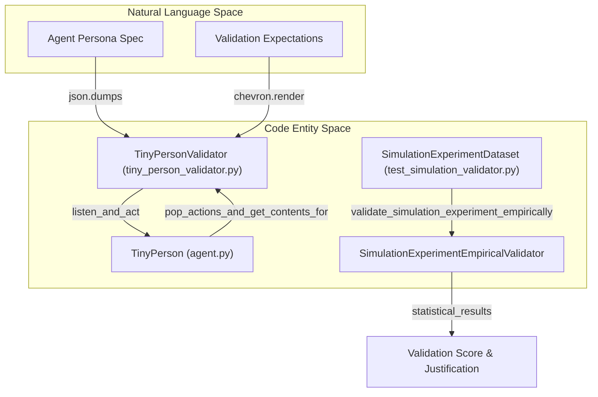
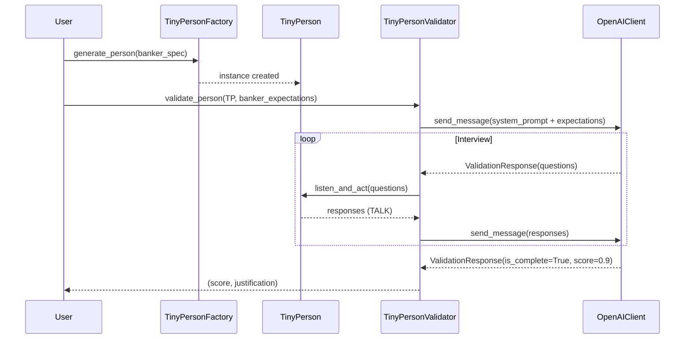

<!-- source: DeepWiki mcp.deepwiki.com · repo microsoft/TinyTroupe · page 7.4 Agent Validation · fetched 2026-10-26 -->

# Agent Validation

Relevant source files

The following files were used as context for generating this wiki page:

- [examples/Creating and Validating Agents.ipynb](examples/Creating and Validating Agents.ipynb)
- [tests/unit/test_simulation_validator.py](tests/unit/test_simulation_validator.py)
- [tests/unit/test_validation.py](tests/unit/test_validation.py)
- [tinytroupe/utils/json.py](tinytroupe/utils/json.py)
- [tinytroupe/utils/validation.py](tinytroupe/utils/validation.py)
- [tinytroupe/validation/propositions.py](tinytroupe/validation/propositions.py)
- [tinytroupe/validation/tiny_person_validator.py](tinytroupe/validation/tiny_person_validator.py)

Agent validation in TinyTroupe ensures that simulated `TinyPerson` instances behave according to their persona specifications and that simulation outcomes are empirically or semantically sound. The framework provides tools for automated interviewing of agents, proposition-based consistency checks, and empirical validation of experiment results.

## TinyPersonValidator

The `TinyPersonValidator` is a specialized class used to verify if a `TinyPerson` instance correctly embodies its defined persona. It uses an LLM-driven "interviewer" approach to probe the agent and assign a confidence score.

### Validation Process Flow
The validator follows an iterative loop where an LLM generates questions based on expectations, the agent responds, and the LLM evaluates the responses until it can reach a conclusion.

1.  **Initialization**: The validator loads a mustache template (`check_person.mustache`) and renders a system prompt using provided `expectations` [tinytroupe/validation/tiny_person_validator.py:51-55]().
2.  **Persona Injection**: The agent's full persona specification (`person._persona`) is typically included in the user prompt to give the LLM a ground-truth reference [tinytroupe/validation/tiny_person_validator.py:66-67]().
3.  **Interview Loop**:
    *   The LLM generates a set of questions [tinytroupe/validation/tiny_person_validator.py:90-97]().
    *   The agent receives these via `listen_and_act` and generates responses [tinytroupe/validation/tiny_person_validator.py:103-104]().
    *   The responses are fed back to the LLM [tinytroupe/validation/tiny_person_validator.py:108-109]().
4.  **Completion**: The process ends when the LLM sets `is_complete` to `True` in the `ValidationResponse` [tinytroupe/validation/tiny_person_validator.py:86]().

### Technical Components

| Class/Method | Description |
| :--- | :--- |
| `ValidationResponse` | A Pydantic model defining the LLM output: `questions`, `score` (0.0 to 1.0), `justification`, and `is_complete` [tinytroupe/validation/tiny_person_validator.py:17-23](). |
| `validate_person(...)` | The static entry point for validating an agent. It manages the conversation state and returns a `(score, justification)` tuple [tinytroupe/validation/tiny_person_validator.py:28-46](). |

**Sources:** [tinytroupe/validation/tiny_person_validator.py:1-120]()

## Proposition-based Checks

TinyTroupe uses `Proposition` objects to define formal properties that a simulation or agent should satisfy. These are often used for monitoring or post-hoc validation.

### Key Propositions for Validation
*   **Persona Adherence**: Checks if the behavior is consistent with traits, styles, and beliefs [tinytroupe/validation/propositions.py:58-77]().
*   **Self-Consistency**: Ensures the agent does not behave in contradictory ways [tinytroupe/validation/propositions.py:152-159]().
*   **Action Adherence**: A granular check specifically for the "next" actions (e.g., `TALK` or `THINK`) [tinytroupe/validation/propositions.py:79-109]().

### Implementation Logic
Propositions can include a `precondition_function` to filter which actions should be evaluated. For example, `_build_precondition_function_for_action_types` creates a check that only triggers the validation if the agent is performing specific actions like "TALK" [tinytroupe/validation/propositions.py:12-52]().

**Sources:** [tinytroupe/validation/propositions.py:1-165]()

## Empirical Validation of Experiments

For complex simulations involving control and treatment groups, TinyTroupe provides the `SimulationExperimentEmpiricalValidator`. This compares simulation datasets against real-world or expected data using statistical and semantic methods.

### Data Flow: Simulation to Validation
The diagram below shows how raw simulation data is transformed into a validated report.

**Simulation Validation Architecture**

### Validation Types
1.  **Statistical Validation**: Compares numerical results (e.g., purchase rates) across agent groups using statistical tests [tests/unit/test_simulation_validator.py:60-100]().
2.  **Semantic Validation**: Uses LLMs to compare the "justifications" provided by agents in different groups to see if the qualitative differences align with the experimental hypothesis [tests/unit/test_simulation_validator.py:103-141]().

**Sources:** [tests/unit/test_simulation_validator.py:9-181]()

## Utilities for Validation Data

Validation relies on clean data structures. TinyTroupe provides utilities to ensure LLM outputs match expected schemas.

*   **`to_pydantic_or_sanitized_dict`**: This function attempts to validate a raw dictionary against a Pydantic model. If validation fails, it falls back to a sanitized dictionary to prevent code crashes [tinytroupe/utils/validation.py:52-67]().
*   **`sanitize_raw_string`**: Normalizes strings to UTF-8 and prevents issues with excessively long strings [tinytroupe/utils/validation.py:19-35]().
*   **`JsonSerializableRegistry`**: A mixin that allows complex agent states to be serialized to/from JSON, facilitating the capture of simulation states for later validation [tinytroupe/utils/json.py:7-23]().

**Sources:** [tinytroupe/utils/validation.py:1-68](), [tinytroupe/utils/json.py:7-81]()

## Example: Validating a "Banker" Agent
In a typical workflow, a `TinyPersonFactory` generates an agent, which is then passed to the validator with specific expectations.

**Code Entity Interaction**

**Sources:** [tests/unit/test_validation.py:19-63](), [examples/Creating and Validating Agents.ipynb:164-193]()

---

