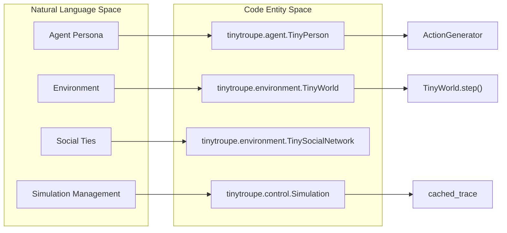
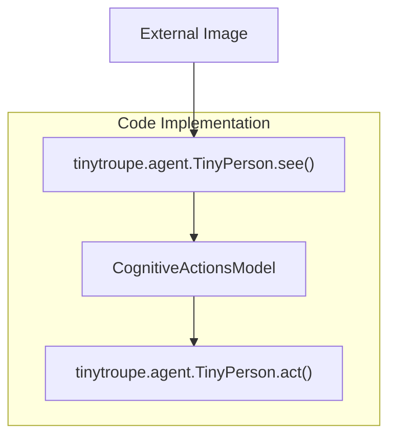

<!-- source: DeepWiki mcp.deepwiki.com · repo microsoft/TinyTroupe · page 8 Development Guide · fetched 2026-10-26 -->

# Development Guide

<details>
<summary>Relevant source files</summary>

The following files were used as context for generating this wiki page:

- [.github/copilot-instructions.md](.github/copilot-instructions.md)
- [.github/project-copilot-instructions.md](.github/project-copilot-instructions.md)
- [.github/prompts/improve.prompt.md](.github/prompts/improve.prompt.md)
- [README.md](README.md)
- [data/extractions/appartment_rent_ad.extraction.json](data/extractions/appartment_rent_ad.extraction.json)
- [data/extractions/synthetic_data_generation.out.csv](data/extractions/synthetic_data_generation.out.csv)
- [examples/Vision for Product, Diagnosis and Appreciation Feedback (image modality).ipynb](examples/Vision for Product, Diagnosis and Appreciation Feedback (image modality).ipynb)

</details>


This guide provides high-level information for developers who want to extend or contribute to the TinyTroupe framework. It covers the development environment, project structure, testing philosophy, and the interactive Jupyter widget UI.

For detailed technical specifications on testing and CI/CD, please refer to the child pages:
* [Testing](#8.1)
* [CI/CD and Security](#8.2)

## Development Environment Setup

### Prerequisites
* **Python 3.10**: The primary language for development [pyproject.toml:21-21]().
* **Conda/PowerShell**: Recommended environment management [ .github/copilot-instructions.md:31-35]().
* **API Keys**: Access to OpenAI, Azure OpenAI, or a local Ollama instance [README.md:65-71]().

### Setup Steps
1. **Clone and Install**:
   ```powershell
   git clone https://github.com/microsoft/TinyTroupe.git
   cd TinyTroupe
   pip install -e .
   ```
2. **Configuration**: Copy `examples/config.ini` to the root directory to customize model selection (e.g., `gpt-5-mini`) and caching behavior [README.md:67-68](), [examples/config.ini:1-61]().

## Project Structure and Code Entities

The following diagram bridges the natural language concepts of the simulation to the specific code entities found in the repository.

### Mapping Concepts to Code

Sources: [README.md:17-17](), [tinytroupe/agent.py:1-20](), [tinytroupe/environment.py:1-20](), [tinytroupe/control.py:1-30]()

## Testing and Validation

TinyTroupe uses `pytest` for its testing suite. Developers must ensure that any new functionality is accompanied by tests, particularly "core" tests for critical features.

* **Core vs. Slow**: Tests are categorized using markers. Core tests are intended for quick verification [ .github/copilot-instructions.md:40-41](), [ .github/copilot-instructions.md:51-51]().
* **Semantic Validation**: Beyond simple assertions, TinyTroupe uses `proposition_holds` to validate agent behavior using LLMs.
* **Empirical Validation**: The `SimulationExperimentEmpiricalValidator` allows comparing simulation results against real-world data using statistical tests like t-tests [README.md:68-68]().

For details on running and writing tests, see [Testing](#8.1).

## CI/CD and Security

The project employs GitHub Actions to maintain code quality and security.

* **Automated Testing**: Workflows run on every push to ensure core functionality remains intact [README.md:2-2]().
* **Security Scanning**: The repository uses `Bandit` for static security analysis and integrates results via SARIF [ .github/workflows/core-tests.yml:1-50]().
* **Cache Management**: CI workflows manage the OpenAI API cache to minimize costs while ensuring end-to-end correctness [ .github/copilot-instructions.md:42-43]().

For details on workflows and security reporting, see [CI/CD and Security](#8.2).

## Interactive UI: Jupyter Widget

For developers working in interactive environments, TinyTroupe provides a specialized widget for agent interaction.

| Component | File Path | Purpose |
|-----------|-----------|---------|
| `AgentChatJupyterWidget` | [tinytroupe/utils.py:1-100]() | Provides a chat interface within Jupyter notebooks [README.md:69-69](). |
| `Vision Modality` | [examples/Vision...ipynb:8-14]() | Allows agents to perceive and react to images [README.md:57-59](). |

### Vision Perception Loop

Sources: [examples/Vision for Product, Diagnosis and Appreciation Feedback (image modality).ipynb:12-14]()

## Contribution Guidelines

* **Elegance over Complexity**: Prefer readable solutions. If a complex architecture is required, it must be discussed first [ .github/copilot-instructions.md:14-19]().
* **Scientific Rigor**: Mechanisms must be based on sound principles of human behavior [ .github/copilot-instructions.md:22-23]().
* **LLM-First**: When adding new operations, prioritize LLM-driven versions unless a deterministic approach is strictly better [ .github/copilot-instructions.md:49-49]().

Sources: [ .github/copilot-instructions.md:1-74](), [README.md:1-100]()

---

