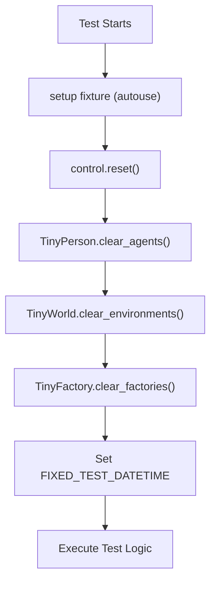
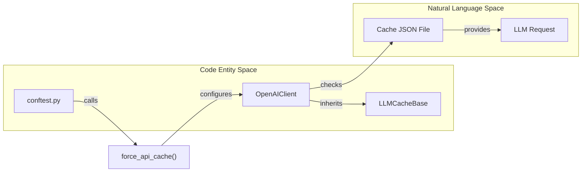

<!-- source: DeepWiki mcp.deepwiki.com · repo microsoft/TinyTroupe · page 8.1 Testing · fetched 2026-10-26 -->

# Testing

<details>
<summary>Relevant source files</summary>

The following files were used as context for generating this wiki page:

- [test.bat](test.bat)
- [tests/conftest.py](tests/conftest.py)
- [tests/scenarios/test_basic_scenarios.py](tests/scenarios/test_basic_scenarios.py)
- [tests/scenarios/test_brainstorming_scenarios.py](tests/scenarios/test_brainstorming_scenarios.py)
- [tests/scenarios/test_jupyter_examples.py](tests/scenarios/test_jupyter_examples.py)
- [tests/testing_utils.py](tests/testing_utils.py)
- [tests/unit/test_api_cache.py](tests/unit/test_api_cache.py)
- [tests/unit/test_api_cache_integration.py](tests/unit/test_api_cache_integration.py)
- [tests/unit/test_cost_tracking.py](tests/unit/test_cost_tracking.py)
- [tinytroupe/agent/grounding.py](tinytroupe/agent/grounding.py)

</details>


This document explains the testing framework and approach used in TinyTroupe, how to run tests, available configuration options, and technical details on semantic validation and API caching. It covers the organization and execution procedures for ensuring the reliability of the TinyTroupe framework.

## Test Organization and Markers

TinyTroupe uses `pytest` for testing, with tests categorized using markers and directory structures.

### Test Categories
- **Unit Tests**: Found in `tests/unit/`, these test individual components like API caching, cost tracking, and grounding connectors.
- **Scenario Tests**: Found in `tests/scenarios/`, these test complex interactions involving multiple agents and environments.
- **Example Tests**: These execute Jupyter notebooks in the `examples/` directory to ensure they remain functional.

### Pytest Markers
Tests are tagged with markers to allow selective execution:
- `@pytest.mark.core`: Essential tests that cover fundamental framework functionality. [tests/scenarios/test_basic_scenarios.py:32-32](), [tests/unit/test_api_cache.py:29-29]()
- `@pytest.mark.slow`: Tests that take a significant amount of time to run, such as notebook executions. [tests/scenarios/test_jupyter_examples.py:46-46]()
- `@pytest.mark.examples` / `@pytest.mark.notebooks`: Specific to Jupyter notebook integration tests. [tests/scenarios/test_jupyter_examples.py:47-48]()

Sources: [tests/scenarios/test_basic_scenarios.py:30-33](), [tests/scenarios/test_jupyter_examples.py:46-50](), [tests/unit/test_api_cache.py:29-30]()

## Running Tests

Tests can be executed via the `pytest` CLI or the provided `test.bat` script.

```bash
# Run only core tests
pytest -m core

# Run all tests with cache refresh
pytest -s --refresh_cache

# Run tests using the API cache to save costs
pytest --use_cache
```

The `test.bat` file is a convenience script for Windows users:
```batch
pytest -s --refresh_cache
```
Sources: [test.bat:1-1](), [tests/conftest.py:53-64]()

## The Setup Fixture

TinyTroupe employs a global `setup` fixture in `tests/testing_utils.py` that runs automatically before every test function (`autouse=True`). This ensures a clean slate by clearing internal registries and pinning time to keep LLM prompts stable.



### Technical Implementation
The fixture calls `clear_agents()`, `clear_environments()`, and `clear_factories()` to prevent cross-test contamination. It also sets a `FIXED_TEST_DATETIME` (2025-01-01) to ensure that system prompts containing the "current time" remain identical across runs, which is critical for API cache hits.

Sources: [tests/testing_utils.py:212-221](), [tests/testing_utils.py:33-33]()

## Semantic Validation with `proposition_holds`

Standard assertions (like string matching) often fail for LLM outputs due to non-determinism. TinyTroupe uses `proposition_holds` for semantic validation.

### Implementation Logic
The function `proposition_holds(proposition: str)` sends the proposition to an LLM, asking it to verify if the statement is "true" or "false" based on the context. [tests/testing_utils.py:114-143]()

```python
def proposition_holds(proposition: str) -> bool:
    system_prompt = "Check whether the following proposition is true or false..."
    user_prompt = f"Proposition: {proposition}"
    # ... calls LLM ...
    return True if response == "true" else False
```

### Usage Example
In brainstorming tests, it verifies if the extracted results actually contain product ideas:
```python
assert proposition_holds(f"The following contains some ideas for new product features: '{results}'")
```
Sources: [tests/testing_utils.py:114-143](), [tests/scenarios/test_brainstorming_scenarios.py:51-53]()

## API Caching in Tests

To minimize costs and increase test speed, TinyTroupe implements a disk-based API caching mechanism.

### Data Flow for Caching
The cache is managed by `LLMCacheBase` and specialized in `OpenAIClient`. It serializes API responses (including complex Pydantic models used in structured outputs) into a JSON file. [tests/unit/test_api_cache_integration.py:63-70](), [tests/unit/test_api_cache.py:30-41]()



### Cache Configuration (`conftest.py`)
The `pytest_configure` hook in `conftest.py` reads CLI arguments to enable or refresh the cache:
- If `--refresh_cache` is passed, the cache file is deleted before tests start. [tests/conftest.py:82-86]()
- If `--use_cache` is passed, `force_api_cache(True, ...)` is called to redirect all LLM calls to the local JSON store. [tests/conftest.py:88-90]()

Sources: [tests/conftest.py:67-94](), [tests/unit/test_api_cache.py:12-14](), [tests/unit/test_api_cache_integration.py:18-62]()

## Testing Utilities

The `tests/testing_utils.py` file provides several helper functions to inspect simulation state:

| Function | Purpose |
| :--- | :--- |
| `contains_action_type` | Checks if a list of actions contains a specific type (e.g., `TALK`). |
| `contains_stimulus_content` | Checks if a stimulus contains specific text, case-insensitive. |
| `agents_personas_are_equal` | Compares the `_persona` dictionaries of two agents. |
| `remove_file_if_exists` | Cleanup utility for temporary test artifacts. |

Sources: [tests/testing_utils.py:57-101](), [tests/testing_utils.py:163-179]()

---

