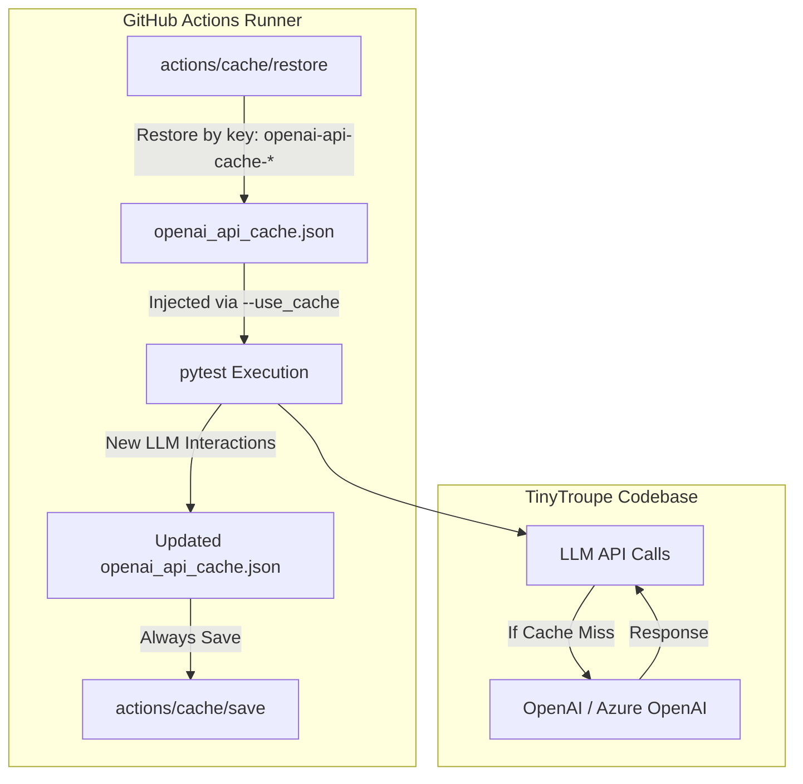
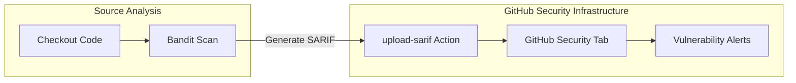

<!-- source: DeepWiki mcp.deepwiki.com · repo microsoft/TinyTroupe · page 8.2 CI/CD and Security · fetched 2026-10-26 -->

# CI/CD and Security

Relevant source files

The following files were used as context for generating this wiki page:

- [.github/prompts/open-ended_ideas.prompt.md](.github/prompts/open-ended_ideas.prompt.md)
- [.github/prompts/write_tests.prompt.md](.github/prompts/write_tests.prompt.md)
- [.github/workflows/all-tests.yml](.github/workflows/all-tests.yml)
- [.github/workflows/bandit.yml](.github/workflows/bandit.yml)
- [.github/workflows/core-tests.yml](.github/workflows/core-tests.yml)

This page details the Continuous Integration and Continuous Deployment (CI/CD) pipelines and security scanning infrastructure for TinyTroupe. The project utilizes GitHub Actions to automate testing, manage LLM API costs through intelligent caching, and perform static security analysis.

## Workflow Overview

TinyTroupe employs three primary GitHub Actions workflows to maintain code quality and security. These workflows are designed to balance thoroughness with execution cost, especially given the reliance on external LLM APIs.

| Workflow | Purpose | Trigger |
| :--- | :--- | :--- |
| **Core Tests** | Validates critical functionality (~1 hour). | Push/PR to `main` or `development`. |
| **All Tests** | Runs the full suite including slow tests. | Monthly schedule or manual trigger. |
| **Bandit** | Static security analysis for Python. | Push/PR to `main` or weekly schedule. |

Sources: [.github/workflows/core-tests.yml:1-16](), [.github/workflows/all-tests.yml:1-13](), [.github/workflows/bandit.yml:13-21]()

## Test Categorization and Execution

The CI environment distinguishes between "core" and "slow" tests to provide faster feedback loops for developers while ensuring long-running simulations are still verified periodically.

### Core Tests
The `core-tests.yml` workflow is the primary gatekeeper for contributions. It targets critical paths and excludes tests marked as `slow` using pytest markers.
- **Environment**: Ubuntu Latest, Python 3.10 [.github/workflows/core-tests.yml:20-30]().
- **Execution Command**: `pytest -s --use_cache -m "core and not slow"` [.github/workflows/core-tests.yml:49-49]().
- **Timeout**: 180 minutes to prevent runaway costs from LLM calls [.github/workflows/core-tests.yml:21-21]().

### All Tests
The `all-tests.yml` workflow runs the complete test suite. To optimize resources, it includes a check to skip execution if no commits have occurred in the last 30 days [.github/workflows/all-tests.yml:26-34]().
- **Execution Command**: `pytest -s --use_cache` [.github/workflows/all-tests.yml:58-58]().
- **Timeout**: 360 minutes [.github/workflows/all-tests.yml:18-18]().

Sources: [.github/workflows/core-tests.yml:19-66](), [.github/workflows/all-tests.yml:16-75]()

## OpenAI API Cache Lifecycle

Because TinyTroupe tests involve expensive LLM calls, the CI pipeline implements a persistent caching strategy for `openai_api_cache.json`. This minimizes API consumption by reusing responses from previous runs.

### Cache Data Flow
The following diagram illustrates how the API cache is managed across CI runs to bridge the gap between the GitHub Actions runner and the `OpenAIClient` caching mechanism.

**Diagram: CI API Cache Lifecycle**

Sources: [.github/workflows/core-tests.yml:38-57](), [.github/workflows/all-tests.yml:47-66]()

### Implementation Details
1. **Restore**: The workflow attempts to restore `openai_api_cache.json` using a key based on the `run_id` with a fallback to the most recent cache prefix `openai-api-cache-` [.github/workflows/core-tests.yml:38-44]().
2. **Persistence**: The cache is saved at the end of the run, even if tests fail (`if: always()`), to ensure that any successful LLM calls made during a partial run are captured for the next attempt [.github/workflows/core-tests.yml:51-56]().

## Security Scanning

Security is managed through **Bandit**, a tool designed to find common security issues in Python code.

### Bandit Configuration
The `bandit.yml` workflow performs static analysis and reports findings to the GitHub Security tab.
- **Permissions**: Requires `security-events: write` to upload results via SARIF (Static Analysis Results Interchange Format) [.github/workflows/bandit.yml:25-28]().
- **Thresholds**: Configured to report issues of `MEDIUM` severity and `MEDIUM` confidence or higher [.github/workflows/bandit.yml:43-45]().
- **Integration**: Uses `shun-dor/python-bandit-scan` to generate reports and `exit_zero: true` to ensure the workflow itself doesn't block CI unless explicitly desired, while still surfacing the vulnerabilities in the UI [.github/workflows/bandit.yml:33-37]().

**Diagram: Security Reporting Pipeline**

Sources: [.github/workflows/bandit.yml:1-52]()

## Artifacts and Reporting

Both test workflows produce artifacts for post-run analysis:
1. **Test Results**: Uploaded as `test-results.xml` and `test-report.html` [.github/workflows/core-tests.yml:58-65]().
2. **System Dependencies**: The CI environment installs `pandoc` to support document conversion tests (e.g., for `TinyWordProcessor`) [.github/workflows/core-tests.yml:32-33]().

Sources: [.github/workflows/core-tests.yml:33-33](), [.github/workflows/core-tests.yml:58-65]()

---

