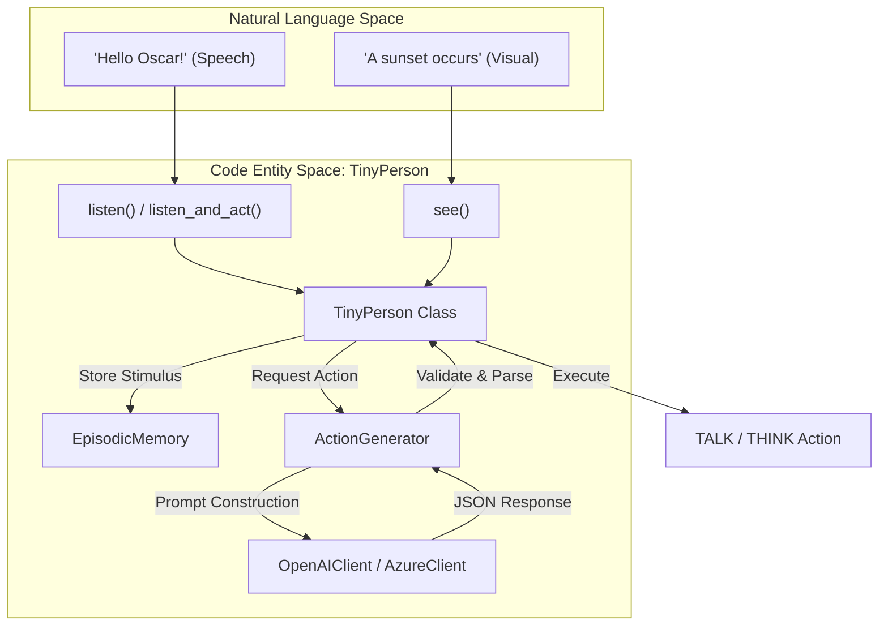
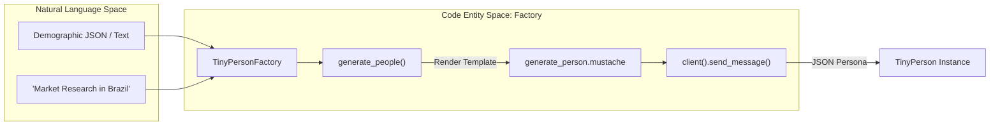

<!-- source: DeepWiki mcp.deepwiki.com · repo microsoft/TinyTroupe · page 9 Glossary · fetched 2026-10-26 -->

# Glossary

Relevant source files

The following files were used as context for generating this wiki page:

- [README.md](README.md)
- [data/extractions/appartment_rent_ad.extraction.json](data/extractions/appartment_rent_ad.extraction.json)
- [data/extractions/synthetic_data_generation.out.csv](data/extractions/synthetic_data_generation.out.csv)
- [examples/Travel Product Market Research.ipynb](examples/Travel Product Market Research.ipynb)
- [examples/Vision for Product, Diagnosis and Appreciation Feedback (image modality).ipynb](examples/Vision for Product, Diagnosis and Appreciation Feedback (image modality).ipynb)
- [pyproject.toml](pyproject.toml)
- [test.bat](test.bat)
- [tests/conftest.py](tests/conftest.py)
- [tests/non_functional/test_security.py](tests/non_functional/test_security.py)
- [tests/scenarios/test_jupyter_examples.py](tests/scenarios/test_jupyter_examples.py)
- [tests/unit/test_factory.py](tests/unit/test_factory.py)
- [tests/unit/test_tinyperson.py](tests/unit/test_tinyperson.py)
- [tinytroupe/agent/action_generator.py](tinytroupe/agent/action_generator.py)
- [tinytroupe/agent/grounding.py](tinytroupe/agent/grounding.py)
- [tinytroupe/agent/tiny_person.py](tinytroupe/agent/tiny_person.py)
- [tinytroupe/clients/__init__.py](tinytroupe/clients/__init__.py)
- [tinytroupe/clients/ollama_client.py](tinytroupe/clients/ollama_client.py)
- [tinytroupe/control.py](tinytroupe/control.py)
- [tinytroupe/environment/tiny_social_network.py](tinytroupe/environment/tiny_social_network.py)
- [tinytroupe/factory/prompts/generate_person.mustache](tinytroupe/factory/prompts/generate_person.mustache)
- [tinytroupe/factory/tiny_person_factory.py](tinytroupe/factory/tiny_person_factory.py)

This page provides definitions for codebase-specific terms, jargon, and domain concepts used throughout the TinyTroupe library. It serves as a technical reference for onboarding engineers to understand the mapping between conceptual simulation terms and their implementation in the code.

## Core Simulation Concepts

### TinyPerson
The fundamental agent unit in TinyTroupe. A `TinyPerson` is an LLM-powered entity with a specific persona, cognitive state, and memory systems [tinytroupe/agent/tiny_person.py:29-30](). It can perceive stimuli (listening, seeing) and perform actions (talking, thinking, using tools) [tinytroupe/agent/tiny_person.py:1005-1048]().
*   **Persona**: The static configuration of an agent, including name, age, occupation, and personality traits [tinytroupe/agent/tiny_person.py:57-68]().
*   **Mental State**: The dynamic internal state of the agent at a given time [tinytroupe/agent/tiny_person.py:58-69]().

### TinyWorld
The environment where `TinyPerson` agents exist and interact. It manages the simulation clock, handles the delivery of stimuli between agents, and ensures that agents only interact with those who are "accessible" to them.

### Stimulus
An external event perceived by a `TinyPerson`. Stimuli are categorized by types such as `CONVERSATION` (speech) or visual descriptions [tinytroupe/agent/tiny_person.py:444-445](). Stimuli are stored in episodic memory to provide context for future actions.

### Action
An output generated by a `TinyPerson`. Common types include `TALK` (to others), `THINK` (internal monologue), and `DONE` (signaling the end of a turn) [tinytroupe/agent/tiny_person.py:1040-1048](). Actions are generated via the `ActionGenerator`.

---

## Technical Implementation Terms

### ActionGenerator
The component responsible for the "Generate-Check-Correct" loop. It orchestrates the LLM calls to produce agent behaviors while performing quality checks for persona adherence, fluency, and self-consistency [tinytroupe/agent/action_generator.py:12-50]().
*   **Quality Threshold**: A numeric score (default 7) used to determine if a generated action is acceptable [tinytroupe/agent/action_generator.py:72]().
*   **Repetition Prevention**: A mechanism using Jaccard similarity to prevent agents from repeating the same action content indefinitely [tinytroupe/agent/tiny_person.py:38]().

### GroundingConnector
An abstraction layer that allows agents to access external knowledge sources [tinytroupe/agent/grounding.py:16-20]().
*   **Semantic Grounding**: Uses embeddings and vector search (via `llama-index`) to retrieve relevant information from documents or web pages [tinytroupe/agent/grounding.py:38-44]().

### LLM Client Registry
A pattern used to manage different LLM providers (OpenAI, Azure, Ollama). The system uses a global registry to resolve which client to use based on the `config.ini` settings [tinytroupe/clients/__init__.py:45-86]().

### Transactional Decorator
A Python decorator (`@transactional`) used to ensure that simulation state changes are tracked and can be checkpointed or rolled back by the `Simulation` controller [tinytroupe/control.py:17]().

---

## Data Flow & Architecture Diagrams

### From Perception to Action
The following diagram bridges the "Natural Language Space" (user input/environment events) to the "Code Entity Space" (classes and methods).

**Sources:** [tinytroupe/agent/tiny_person.py:81-125](), [tinytroupe/agent/tiny_person.py:1005-1048](), [tinytroupe/agent/action_generator.py:95-115]().

### Population Generation Pipeline
This diagram shows how demographic descriptions are transformed into executable agent entities.

**Sources:** [tinytroupe/factory/tiny_person_factory.py:24-64](), [tinytroupe/factory/tiny_person_factory.py:120-158](), [tinytroupe/factory/prompts/generate_person.mustache:1-10]().

---

## Glossary Table

| Term | Definition | Code Pointer |
| :--- | :--- | :--- |
| **Caching** | Mechanism to store LLM API responses to save costs and speed up tests. | [tinytroupe/clients/openai_client.py:8-15]() |
| **Episodic Memory** | Stores short-term interactions and stimuli in chronological order. | [tinytroupe/agent/memory.py:16]() |
| **Semantic Memory** | Stores long-term, structured knowledge about the agent's world. | [tinytroupe/agent/memory.py:16]() |
| **Factory** | A class (`TinyPersonFactory`) used to generate multiple agents from a broad description. | [tinytroupe/factory/tiny_person_factory.py:24]() |
| **Proposition** | A semantic check (LLM-based) to verify if a statement holds true in the simulation. | [tinytroupe/experimentation.py:7]() |
| **Done Action** | A special action type indicating the agent has finished its turn. | [tinytroupe/agent/tiny_person.py:34]() |
| **Exponential Backoff** | Strategy to retry API calls after failure with increasing wait times. | [tinytroupe/clients/ollama_client.py:73-80]() |
| **Minibio** | A short, generated string summarizing a `TinyPerson`'s persona. | [tests/unit/test_factory.py:35]() |

**Sources:** [tinytroupe/agent/tiny_person.py:29-100](), [tinytroupe/agent/action_generator.py:12-50](), [tinytroupe/factory/tiny_person_factory.py:24-64](), [tinytroupe/clients/ollama_client.py:73-80]().