# Page: Overview

# Overview

<details>
<summary>Relevant source files</summary>

The following files were used as context for generating this wiki page:

- [README.md](README.md)
- [data/extractions/appartment_rent_ad.extraction.json](data/extractions/appartment_rent_ad.extraction.json)
- [data/extractions/synthetic_data_generation.out.csv](data/extractions/synthetic_data_generation.out.csv)
- [docs/index.html](docs/index.html)
- [examples/Vision for Product, Diagnosis and Appreciation Feedback (image modality).ipynb](examples/Vision for Product, Diagnosis and Appreciation Feedback (image modality).ipynb)
- [tinytroupe/__init__.py](tinytroupe/__init__.py)

</details>


TinyTroupe is an experimental Python library for **LLM-powered multiagent persona simulation**. It enables the creation of artificial agents—`TinyPerson`s—with specific personalities, interests, and goals. These agents can interact within simulated environments—`TinyWorld`s—leveraging Large Language Models (LLMs) like GPT-4o and GPT-5-mini to generate realistic human-like behavior.

For detailed installation instructions, see [Installation and Setup](#1.1). For configuration options, see [Configuration Options](#1.2).

## Purpose and Key Concepts

TinyTroupe is designed for "imagination enhancement" in business and productivity contexts. Unlike AI assistants, which aim to help users directly, TinyTroupe simulates realistic human behavior to improve understanding of people, consumers, and social dynamics. Its key applications include:

- **Market Research**: Evaluating digital ads or product proposals with simulated audiences.
- **Software Testing**: Providing test input to systems (e.g., chatbots) and evaluating results.
- **Synthetic Data Generation**: Creating realistic datasets for training models or opportunity analysis.
- **Product Management**: Getting feedback from specific personas (e.g., physicians, lawyers).
- **Brainstorming**: Simulating focus groups for product feedback.

Sources: [README.md:17-25](), [README.md:57-71]()

## Core Architecture

TinyTroupe is structured around two primary abstractions: `TinyPerson` (the agent) and `TinyWorld` (the environment). These are supported by a `ConfigManager` for system settings and a `Simulation` controller for lifecycle management.

### System Architecture Diagram

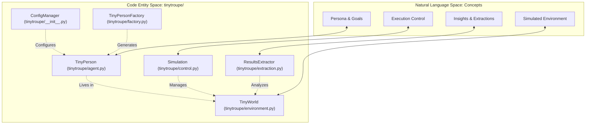

Sources: [tinytroupe/__init__.py:29-44](), [README.md:206-211]()

## TinyPerson: Agent Architecture

A `TinyPerson` consists of a detailed persona, mental state (emotions, goals, attention), and various mental faculties. It processes stimuli and generates actions using a "Generate-Check-Correct" loop to ensure persona adherence and fluency.

### Agent Component Mapping

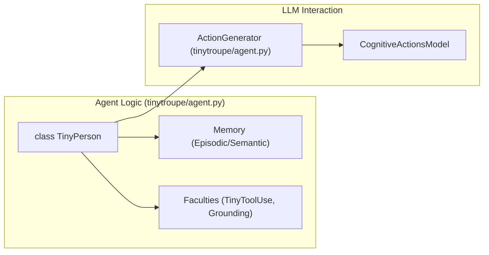

A `TinyPerson` can perform actions like `TALK`, `THINK`, and `REACH_OUT`. They now support **vision modality**, allowing them to "see" images and react based on visual perception rather than just text descriptions.

Sources: [README.md:57-62](), [README.md:91-93](), [tinytroupe/__init__.py:177-188]()

## TinyWorld: Environment Architecture

`TinyWorld` manages the interactions between agents. It handles the simulation step loop, agent accessibility (who can hear whom), and can be extended into specialized environments like `TinySocialNetwork`.

- **Time Management**: Controlled through simulation steps.
- **Accessibility**: Managed via `TinySocialNetwork` to constrain agent interactions.
- **Parallelism**: Agents can now run actions in parallel within the environment to improve performance.

Sources: [README.md:93-94](), [README.md:385-396]()

## Configuration and Integration

TinyTroupe uses a `ConfigManager` to load settings from `config.ini`. It supports OpenAI, Azure OpenAI, and experimental local models via Ollama.

| Category | Key Parameters |
|----------|----------------|
| **OpenAI** | `MODEL` (e.g., gpt-5-mini), `API_TYPE`, `CACHE_API_CALLS`, `MAX_CONCURRENT_MODEL_CALLS` |
| **Simulation** | `PARALLEL_AGENT_ACTIONS`, `RAI_HARMFUL_CONTENT_PREVENTION` |
| **Cognition** | `ENABLE_MEMORY_CONSOLIDATION`, `MAX_EPISODE_LENGTH` |
| **ActionGenerator** | `ENABLE_QUALITY_CHECKS`, `MAX_ATTEMPTS` |

Sources: [tinytroupe/__init__.py:82-188](), [README.md:65-71]()

## Results Extraction and Analysis

After a simulation, users utilize the `ResultsExtractor` and `ResultsReducer` to turn raw agent dialogues into structured data.

- **ResultsExtractor**: Parses interactions into JSON or CSV.
- **ResultsReporter**: Generates HTML reports.
- **SimulationExperimentEmpiricalValidator**: Compares simulation results against real-world data using statistical tests (t-test, KS-test) to validate agent behavior.

Sources: [README.md:68-69](), [data/extractions/appartment_rent_ad.extraction.json:1-8]()

## Project Structure

| Directory | Description |
|-----------|-------------|
| `/tinytroupe` | Core implementation (agents, environments, extraction, etc.). |
| `/examples` | Jupyter notebooks demonstrating vision, market research, and validation. |
| `/tests` | Pytest suite for core and slow tests. |
| `/data` | Input data for simulations and output examples (CSV, JSON). |

Sources: [README.md:194-201](), [data/extractions/synthetic_data_generation.out.csv:1-15]()

## Getting Started

1. **Install**: `pip install git+https://github.com/microsoft/TinyTroupe.git@main`
2. **Configure**: Set `OPENAI_API_KEY` and verify `config.ini` settings.
3. **Run**: Use provided example notebooks in `/examples` to explore vision modality or market research.

For more detailed information, see:
- [Installation and Setup](#1.1)
- [TinyPerson](#3) for agent details.
- [TinyWorld](#4) for environment details.
- [Market Research](#5.1) for specific use cases.

Sources: [README.md:118-139](), [examples/Vision for Product, Diagnosis and Appreciation Feedback (image modality).ipynb:8-14]()

---

# Page: Installation and Setup

# Installation and Setup

<details>
<summary>Relevant source files</summary>

The following files were used as context for generating this wiki page:

- [.env.example](.env.example)
- [MANIFEST.in](MANIFEST.in)
- [pyproject.toml](pyproject.toml)
- [tests/unit/test_tinyperson.py](tests/unit/test_tinyperson.py)
- [tinytroupe/agent/action_generator.py](tinytroupe/agent/action_generator.py)

</details>


## Purpose

This document provides step-by-step instructions for installing TinyTroupe and configuring it for successful operation. It covers installation methods, configuration file setup, API key configuration, and verification steps. For detailed information about all configuration options, see [Configuration Options](#1.2).

## Prerequisites

- Python ≥3.10 [pyproject.toml:17-17]()
- Access to OpenAI API, Azure OpenAI Service, or Ollama.
- The following key dependencies will be installed automatically:
  - `openai >= 1.65` [pyproject.toml:27-27]()
  - `pandas`, `matplotlib`, `seaborn`, `scipy` [pyproject.toml:25-39]()
  - `llama-index` and related integration packages [pyproject.toml:32-32]()
  - `tiktoken`, `msal`, `pydantic>=2.5.0` [pyproject.toml:29-37]()
  - `rich`, `requests`, `chevron`, `textdistance` [pyproject.toml:31-38]()
  - `pypandoc`, `python-docx`, `markdown` [pyproject.toml:33-33]()

Sources: [pyproject.toml:9-40]()

## Installation Methods

### Via PyPI (Recommended)

```bash
pip install tinytroupe
```

### From GitHub (Latest Version)

```bash
pip install git+https://github.com/microsoft/TinyTroupe.git
```

### Development Setup

```bash
git clone https://github.com/microsoft/TinyTroupe.git
cd TinyTroupe
pip install -e .
```

Sources: [pyproject.toml:1-46]()

## Configuration Setup

### Configuration File

TinyTroupe uses a `config.ini` file for configuration settings. The library looks for this file to initialize its internal state. The file is structured into several sections, including:

- `[OpenAI]`: Settings for OpenAI API, Azure OpenAI Service, or Ollama.
- `[Simulation]`: Settings for simulation behavior, including Responsible AI (RAI) toggles.
- `[Logging]`: Logging level configuration.

A default configuration file is included in the package. Users can provide a local `.env` file for sensitive keys as shown in `.env.example`.

Sources: [.env.example:1-8](), [tinytroupe/agent/action_generator.py:12-30]()

### Key Configuration Parameters

| Section | Parameter | Description | Default/Example |
|---------|-----------|-------------|--------------|
| OpenAI | API_TYPE | API provider (`openai`, `azure`, or `ollama`) | `openai` |
| OpenAI | MODEL | LLM model to use (e.g., `gpt-4o-mini`) | `gpt-4o-mini` |
| OpenAI | MAX_TOKENS | Maximum tokens per API call | `4000` |
| OpenAI | TEMPERATURE | Model temperature (randomness) | `1.2` |
| OpenAI | CACHE_API_CALLS | Enable API call caching to save costs | `True` |
| Simulation | RAI_HARMFUL_CONTENT_PREVENTION | Prevent harmful content generation | `True` |
| Simulation | RAI_COPYRIGHT_INFRINGEMENT_PREVENTION | Prevent copyright infringement | `True` |

Sources: [.env.example:1-8](), [tinytroupe/agent/action_generator.py:51-75]()

## API Key Setup

TinyTroupe requires API keys to communicate with LLM providers. These can be set as environment variables or within a `.env` file in the project root.

**For OpenAI:**
```bash
# In .env or shell
OPENAI_API_KEY="your-openai-api-key"
```

**For Azure OpenAI Service:**
```bash
# In .env or shell
AZURE_OPENAI_API_KEY="your-azure-openai-key"
AZURE_OPENAI_ENDPOINT="your-azure-endpoint"
```
*Note: To use Entra ID authentication with Azure, do not set the API key.*

Sources: [.env.example:1-8]()

## Package Initialization and Verification

When `tinytroupe` is imported, it initializes the configuration and logging systems. To verify the installation, you can run a basic script or use the provided test suite.

### Code Verification
```python
import tinytroupe
from tinytroupe.examples import create_oscar_the_architect

# Initialize an example agent
oscar = create_oscar_the_architect()

# Test a simple interaction
actions = oscar.listen_and_act("Tell me a bit about your life.", return_actions=True)

# Verify results
print(actions)
```
Sources: [tests/unit/test_tinyperson.py:11-25]()

### Running Tests
The project uses `pytest` with specific markers for validation:
- `pytest -m core`: Runs core validation tests.
- `pytest -m slow`: Runs comprehensive but slower tests.

Sources: [pyproject.toml:54-62]()

## Diagrams

### Installation and Environment Flow
This diagram maps the setup process to the configuration entities defined in the codebase.

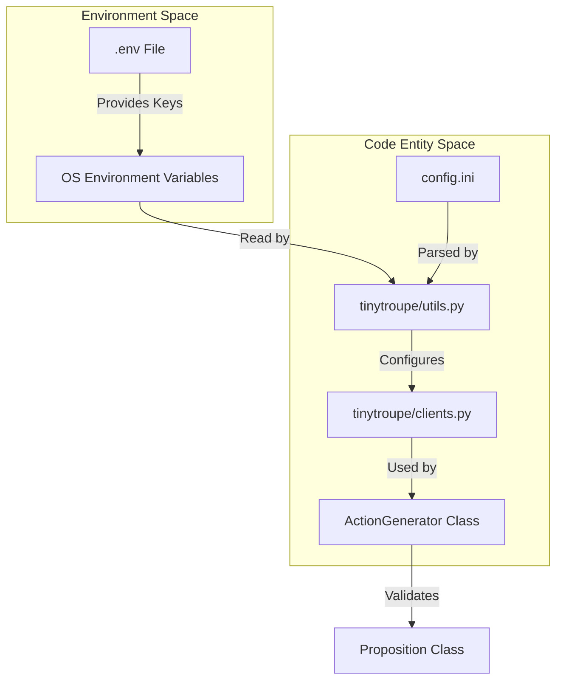
Sources: [.env.example:1-8](), [tinytroupe/agent/action_generator.py:4-12](), [pyproject.toml:45-52]()

### System Component Initialization
This diagram illustrates the data flow from installation requirements to the execution of a `TinyPerson` agent.

```mermaid
flowchart LR
    subgraph "Natural Language Space"
        personaDef["Persona Description"]
        userPrompt["User Stimulus"]
    end

    subgraph "Code Entity Space"
        tpFactory["TinyPersonFactory"]
        tpInstance["TinyPerson Instance"]
        memory["EpisodicMemory"]
        actGen["ActionGenerator"]
    end

    personaDef -->|Input to| tpFactory
    tpFactory -->|Creates| tpInstance
    userPrompt -->|listen()| tpInstance
    tpInstance -->|Stores in| memory
    tpInstance -->|Calls act()| actGen
    actGen -->|Returns| actions["List of Actions"]
```
Sources: [tests/unit/test_tinyperson.py:37-45](), [tinytroupe/agent/action_generator.py:95-115]()

### Installation Process

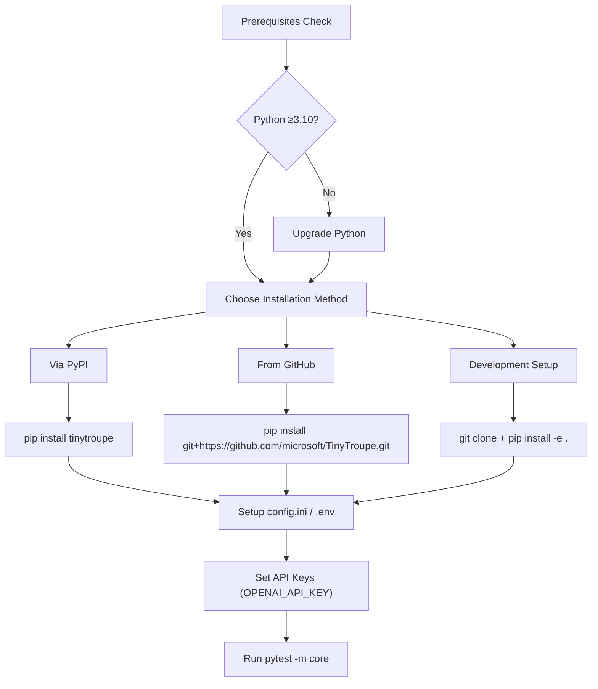
Sources: [pyproject.toml:1-62](), [.env.example:1-8]()

---

# Page: Configuration Options

# Configuration Options

<details>
<summary>Relevant source files</summary>

The following files were used as context for generating this wiki page:

- [config.ini](config.ini)
- [examples/config.ini](examples/config.ini)
- [tinytroupe/config.ini](tinytroupe/config.ini)
- [tinytroupe/extraction/results_extractor.py](tinytroupe/extraction/results_extractor.py)
- [tinytroupe/utils/config.py](tinytroupe/utils/config.py)

</details>


This page details the configuration parameters that control TinyTroupe's behavior, including OpenAI API integration, simulation settings, and logging options. Configuration is managed through an INI file format, allowing you to adjust various aspects of the system to suit your specific requirements.

## Configuration File Structure

TinyTroupe uses INI-format configuration files organized into logical sections. The system provides a default configuration in the package, but you can override settings using a custom configuration file in the current working directory.

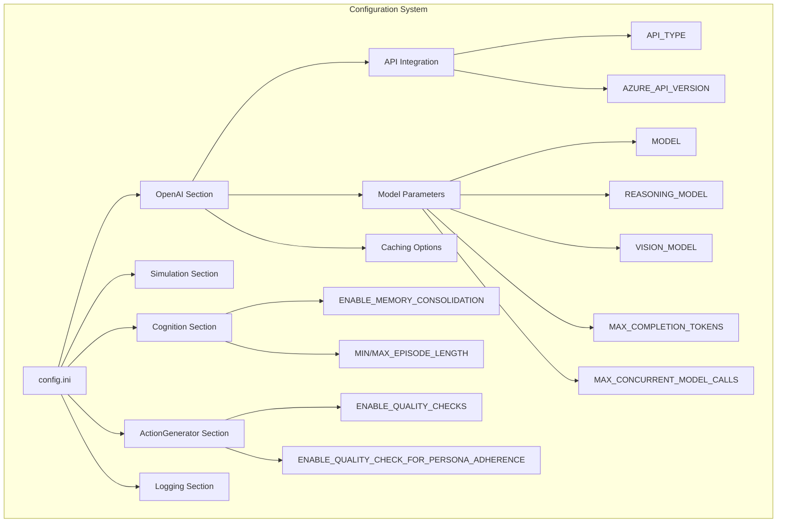

Sources: [tinytroupe/config.ini:1-126](), [examples/config.ini:1-49]()

## Configuration Location and Loading

The configuration is managed by `tinytroupe/utils/config.py`. TinyTroupe looks for configuration in the following order:

1. **Default configuration**: Bundled with the package at `tinytroupe/config.ini` [tinytroupe/utils/config.py:118-122]().
2. **Custom configuration**: A file named `config.ini` in the current working directory (`Path.cwd()`) [tinytroupe/utils/config.py:128-135]().

The `read_config_file` function handles this hierarchy, where values in the custom file override the defaults [tinytroupe/utils/config.py:108-151]().

## OpenAI Configuration Section

This section controls the interaction with OpenAI, Azure OpenAI Service, or local providers like Ollama.

### API Integration Settings

| Parameter | Description | Values | Default |
|-----------|-------------|--------|---------|
| `API_TYPE` | Specifies the API service provider | `openai`, `azure` | `openai` |
| `AZURE_API_VERSION` | API version for Azure OpenAI Service | String (e.g., "2024-12-01-preview") | `2024-12-01-preview` |
| `AZURE_EMBEDDING_MODEL_API_VERSION` | API version for Azure embedding models | String | `2023-05-15` |

Sources: [tinytroupe/config.ini:7-12](), [tinytroupe/config.ini:34-35]()

### Model Selection

TinyTroupe supports different models for different cognitive tasks:

| Parameter | Description | Default |
|-----------|-------------|---------|
| `MODEL` | Main text generation model for agent responses | `gpt-5-mini` |
| `REASONING_MODEL` | Used for precise reasoning and detailed analysis | `o3-mini` |
| `VISION_MODEL` | Used for image understanding (defaults to `MODEL` if unset) | Unset |
| `EMBEDDING_MODEL` | Model used for text similarity and memory retrieval | `text-embedding-3-small` |

Sources: [tinytroupe/config.ini:19-33]()

### Model Execution Parameters

| Parameter | Description | Default |
|-----------|-------------|---------|
| `MAX_COMPLETION_TOKENS` | Maximum tokens per API response | `128000` |
| `TIMEOUT` | API call timeout in seconds | `480` |
| `MAX_ATTEMPTS` | Max retry attempts for failed API calls | `5` |
| `WAITING_TIME` | Initial waiting time between retries (seconds) | `1` |
| `EXPONENTIAL_BACKOFF_FACTOR` | Factor for backoff between retries | `5` |
| `MAX_CONCURRENT_MODEL_CALLS` | Limits concurrent API invocations (0/NONE to disable) | `4` |
| `REASONING_EFFORT` | Effort level for reasoning models | `high` |
| `VISION_DETAIL` | Detail level for image tokens (`auto`, `low`, `high`) | `auto` |

Sources: [tinytroupe/config.ini:40-49](), [tinytroupe/config.ini:30]()

### Caching Settings

Caching prevents redundant API calls and reduces costs during development.

| Parameter | Description | Values | Default |
|-----------|-------------|--------|---------|
| `CACHE_API_CALLS` | Enable/disable API response caching | `True`, `False` | `False` |
| `CACHE_FILE_NAME` | File name for the JSON cache | String | `openai_api_cache.json` |

Sources: [tinytroupe/config.ini:55-56]()

## Simulation Configuration Section

Controls simulation-wide behaviors and safety filters.

| Parameter | Description | Default |
|-----------|-------------|---------|
| `PARALLEL_AGENT_GENERATION` | Whether to generate agents in parallel | `True` |
| `PARALLEL_AGENT_ACTIONS` | Whether to process agent actions in parallel | `True` |
| `RAI_HARMFUL_CONTENT_PREVENTION` | Enable/disable harmful content filters | `True` |
| `RAI_COPYRIGHT_INFRINGEMENT_PREVENTION` | Enable/disable copyright filters | `True` |

Sources: [tinytroupe/config.ini:66-70]()

## Cognition and Memory Settings

These parameters define how `TinyPerson` agents manage their internal state and memory.

| Parameter | Description | Default |
|-----------|-------------|---------|
| `ENABLE_MEMORY_CONSOLIDATION` | Enables the transition of episodic to semantic memory | `True` |
| `ENABLE_CONTINUOUS_CONTEXTUAL_SEMANTIC_MEMORY_RETRIEVAL` | Enables RAG-style retrieval for memory | `True` |
| `MIN_EPISODE_LENGTH` | Minimum interaction steps before consolidation | `10` |
| `MAX_EPISODE_LENGTH` | Maximum interaction steps before consolidation | `15` |
| `EPISODIC_MEMORY_FIXED_PREFIX_LENGTH` | Number of early interactions kept in fixed context | `10` |
| `EPISODIC_MEMORY_LOOKBACK_LENGTH` | Number of recent interactions kept in sliding window | `20` |

Sources: [tinytroupe/config.ini:74-81]()

## ActionGenerator Quality Checks

TinyTroupe can perform self-correction on agent actions to ensure high-quality outputs.

| Parameter | Description | Default |
|-----------|-------------|---------|
| `ENABLE_QUALITY_CHECKS` | Master switch for all quality verifications | `False` |
| `MAX_ATTEMPTS` | Retries for the Generate-Check-Correct loop | `2` |
| `QUALITY_THRESHOLD` | Threshold (0-9) for accepting an action | `5` |
| `ENABLE_REGENERATION` | Allow the model to try again on failure | `True` |
| `ENABLE_QUALITY_CHECK_FOR_PERSONA_ADHERENCE` | Verify action matches persona | `True` |
| `ENABLE_QUALITY_CHECK_FOR_SELFCONSISTENCY` | Verify action is logically consistent | `False` |
| `CONTINUE_ON_FAILURE` | Proceed even if quality checks fail after max retries | `True` |

Sources: [tinytroupe/config.ini:84-101]()

## Logging Configuration Section

Managed by `start_logger` in `tinytroupe/utils/config.py` [tinytroupe/utils/config.py:212-258]().

| Parameter | Description | Default |
|-----------|-------------|---------|
| `LOGLEVEL` | Default log level for root and `tinytroupe` loggers | `ERROR` |
| `LOGLEVEL_CONSOLE` | Log level for stdout (set `NONE` to disable) | `INFO` |
| `LOGLEVEL_FILE` | Log level for the generated `.log` file | `DEBUG` |
| `LOG_INCLUDE_THREAD_ID` | Include thread names and IDs in log format | `True` |

Sources: [tinytroupe/config.ini:107-121]()

## Configuration Flow and Usage

The following diagram associates configuration parameters with the specific code entities they influence.

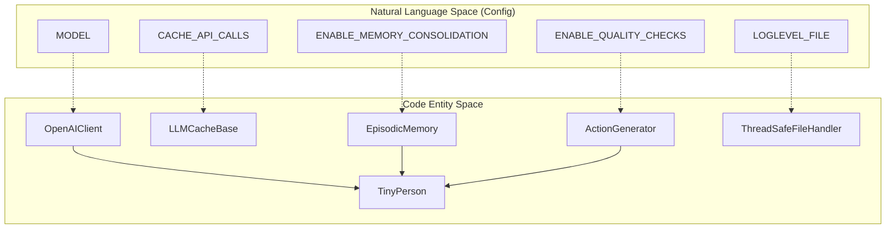

Sources: [tinytroupe/utils/config.py:83-86](), [tinytroupe/config.ini:1-126](), [tinytroupe/extraction/results_extractor.py:159-161]()

## Implementation Details: Data Flow

When TinyTroupe starts, the `read_config_file` function is called to populate a global `_config` object [tinytroupe/utils/config.py:11-108](). This object is then accessed throughout the codebase using the `config` object returned by the utility.

### Logging Initialization
The `start_logger` function [tinytroupe/utils/config.py:212-258]() reads the `[Logging]` section and:
1. Determines the `_effective_root_level` by taking the minimum of console, file, and root levels [tinytroupe/utils/config.py:66-72]().
2. Creates a `ThreadSafeFileHandler` if `LOGLEVEL_FILE` is not `NONE` [tinytroupe/utils/config.py:83-86]().
3. Applies formatters that include thread IDs if `LOG_INCLUDE_THREAD_ID` is `True` [tinytroupe/utils/config.py:21-29]().

### API Client Configuration
The `OpenAIClient` (and related classes in `tinytroupe/clients.py`) uses parameters like `TIMEOUT`, `MAX_ATTEMPTS`, and `EXPONENTIAL_BACKOFF_FACTOR` to configure its request loop. It also checks `CACHE_API_CALLS` to decide whether to wrap calls in the caching layer.

Sources: [tinytroupe/utils/config.py:1-258](), [tinytroupe/config.ini:1-126]()

---

# Page: Core Architecture

# Core Architecture

<details>
<summary>Relevant source files</summary>

The following files were used as context for generating this wiki page:

- [README.md](README.md)
- [data/extractions/appartment_rent_ad.extraction.json](data/extractions/appartment_rent_ad.extraction.json)
- [data/extractions/synthetic_data_generation.out.csv](data/extractions/synthetic_data_generation.out.csv)
- [examples/Vision for Product, Diagnosis and Appreciation Feedback (image modality).ipynb](examples/Vision for Product, Diagnosis and Appreciation Feedback (image modality).ipynb)
- [tinytroupe/__init__.py](tinytroupe/__init__.py)

</details>


This document describes the fundamental architecture and components of the TinyTroupe system. It focuses on the core design elements, data flow, and relationships between primary system components. For details on specific subsystems like mental faculties or memory systems, see the corresponding pages: [TinyPerson](#3), [Mental Faculties](#3.2), [Memory Systems](#3.3), and [Simulation Control](#2.1).

## Overview

TinyTroupe is built as a framework for LLM-powered multiagent simulations. Its architecture follows a modular design that separates agent behavior from environment dynamics, enabling flexible simulation configurations while maintaining a consistent execution model.

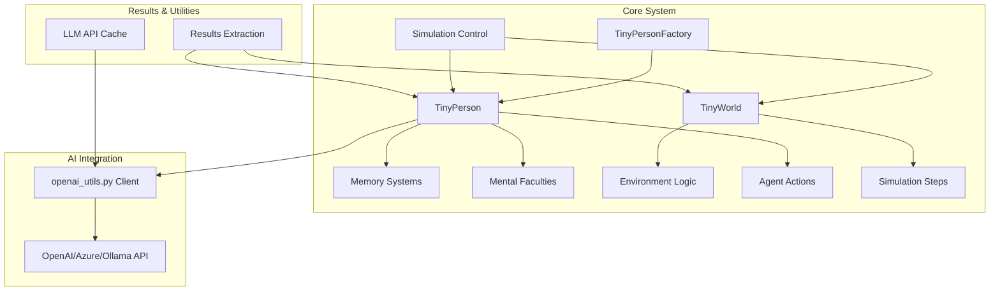

Sources: [README.md:1-50](), [tinytroupe/agent/__init__.py:1-20]()

## Primary Components

The TinyTroupe system consists of three primary components that form the foundation of the architecture:

1. **TinyPerson**: Agent class representing simulated individuals with personas, mental states, and cognitive abilities [tinytroupe/agent/__init__.py:32-48]().
2. **TinyWorld**: Environment where agents interact, providing the context and rules for simulation [tinytroupe/environment/__init__.py:10-25]().
3. **Control System**: Orchestrates simulations, manages state via the `Simulation` class, and provides caching mechanisms [tinytroupe/control.py:14-136]().

These components interact through a well-defined lifecycle and transaction model, which ensures deterministic simulation behavior and efficient resource usage.

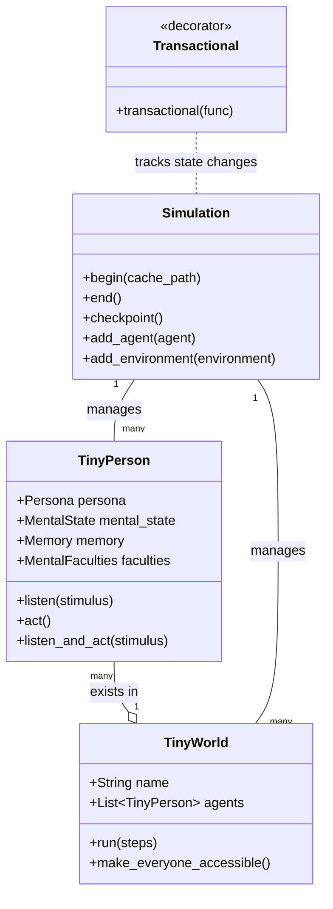

Sources: [tinytroupe/control.py:14-136](), [README.md:204-220](), [tinytroupe/agent/__init__.py:32-48]()

### TinyPerson (Agent)

The `TinyPerson` class represents individual agents. Each agent has a persona (static attributes), mental state (dynamic attributes), memory systems, and mental faculties. Recent updates include action correction mechanisms to improve persona adherence [README.md:91-91]().

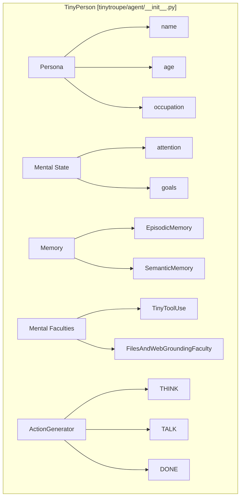

Sources: [tinytroupe/agent/__init__.py:32-48](), [README.md:214-216](), [tinytroupe/__init__.py:177-185]()

### TinyWorld (Environment)

`TinyWorld` serves as the base environment class. It manages the simulation timeline and agent accessibility. In version 0.5.1+, `TinyWorld` supports running agents in parallel within each step to improve performance [README.md:93-93]().

Key features:
- **Parallel Actions**: Controlled by `PARALLEL_AGENT_ACTIONS` in `config.ini` [tinytroupe/__init__.py:151-153]().
- **Accessibility**: Managed via `make_everyone_accessible()` to allow all agents to talk to each other [tinytroupe/environment/__init__.py:100-110]().

Sources: [README.md:384-397](), [tinytroupe/__init__.py:151-153]()

### Control System

The control system, residing in `tinytroupe/control.py`, manages simulation state through the `Simulation` class. It uses a `transactional` decorator to wrap methods that modify agent or environment state, allowing for state capture and rollback/caching [tinytroupe/control.py:159-200]().

For details, see [Simulation Control](#2.1).

Sources: [tinytroupe/control.py:384-572]()

## Simulation Lifecycle

A TinyTroupe simulation follows a defined lifecycle managed by the `control` module.

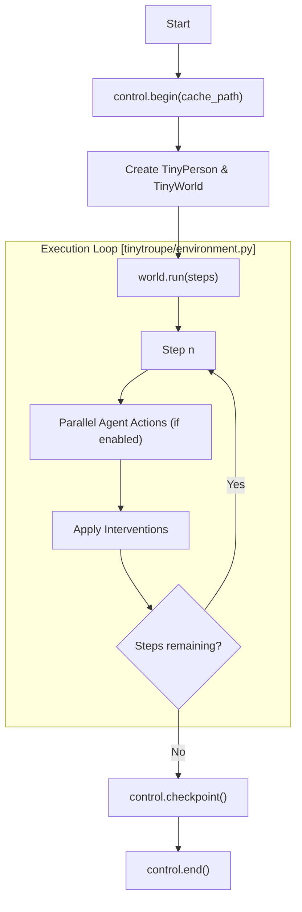

Sources: [tinytroupe/control.py:66-116](), [README.md:462-469](), [tinytroupe/__init__.py:151-153]()

## LLM Integration and Caching

TinyTroupe abstracts LLM interactions through a configuration-driven client. It supports OpenAI, Azure OpenAI, and experimental Ollama support [README.md:71-71]().

### Caching Tiers
1. **Simulation Cache**: Managed by `control.py`, stores the high-level state of the simulation (agent memories, world state) [tinytroupe/control.py:159-170]().
2. **API Cache**: Managed by the LLM client, stores raw request/response pairs in a JSON file (default: `openai_api_cache.json`) to save costs and speed up repeated runs [tinytroupe/__init__.py:143-145]().

### Configuration Management
The `ConfigManager` class in `tinytroupe/__init__.py` handles settings from `config.ini`, including model selection (defaulting to `gpt-4o` or `gpt-5-mini`), temperature, and concurrency limits [tinytroupe/__init__.py:82-138]().

For details, see [OpenAI Integration](#2.2).

Sources: [tinytroupe/__init__.py:29-150](), [README.md:467-471]()

---

# Page: Simulation Control

# Simulation Control

<details>
<summary>Relevant source files</summary>

The following files were used as context for generating this wiki page:

- [examples/Travel Product Market Research.ipynb](examples/Travel Product Market Research.ipynb)
- [tests/scenarios/test_basic_scenarios.py](tests/scenarios/test_basic_scenarios.py)
- [tests/scenarios/test_brainstorming_scenarios.py](tests/scenarios/test_brainstorming_scenarios.py)
- [tests/testing_utils.py](tests/testing_utils.py)
- [tests/unit/test_control.py](tests/unit/test_control.py)
- [tinytroupe/control.py](tinytroupe/control.py)
- [tinytroupe/examples/loaders.py](tinytroupe/examples/loaders.py)
- [tinytroupe/factory/prompts/generate_person.mustache](tinytroupe/factory/prompts/generate_person.mustache)

</details>


This page explains how simulations are managed in TinyTroupe, including starting, running, checkpointing, and ending simulations via the `control` module. The simulation control system is responsible for tracking the state of the simulation, managing transactions, and providing caching mechanisms for efficient execution.

## Overview

The simulation control module provides the infrastructure for managing the lifecycle of a simulation. It allows you to:

- Begin and end simulations.
- Track agents, environments, and factories.
- Save simulation state to disk (checkpointing).
- Optimize performance through caching of execution traces.
- Apply a transactional approach to ensure state consistency and reproducibility.

Sources: [tinytroupe/control.py:1-9](), [tests/scenarios/test_basic_scenarios.py:33-58]()

## Simulation Lifecycle

The simulation lifecycle in TinyTroupe follows a specific pattern of initialization, execution, and termination.

### Lifecycle Diagram

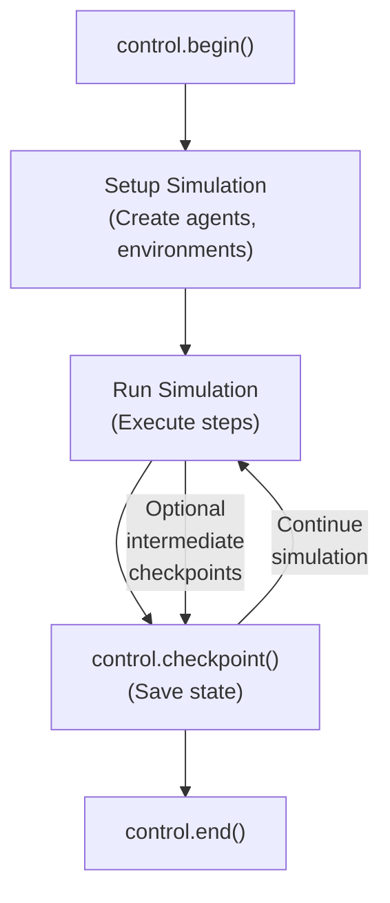

Sources: [tinytroupe/control.py:78-130](), [tests/scenarios/test_basic_scenarios.py:33-58]()

A typical simulation follows these steps:

1.  **Begin**: Initialize the simulation with `control.begin()`. This resets internal counters and prepares the cache file [tinytroupe/control.py:78-119]().
2.  **Setup**: Create agents, environments, and establish relationships. Entities are automatically registered with the current simulation [tinytroupe/control.py:142-171]().
3.  **Run**: Execute simulation steps (e.g., `agent.listen_and_act()` or `world.run()`).
4.  **Checkpoint**: Save the simulation state with `control.checkpoint()`, which writes unsaved changes to the cache file [tinytroupe/control.py:131-140]().
5.  **End**: Terminate the simulation with `control.end()`, which performs a final checkpoint and stops the simulation [tinytroupe/control.py:120-130]().

## The Simulation Class

The `Simulation` class is the core of the simulation control system. It maintains the state of all entities and handles the execution chain.

### Key Attributes

| Attribute | Purpose |
|-----------|---------|
| `agents` | List of `TinyPerson` instances in the simulation [tinytroupe/control.py:30](). |
| `environments` | List of `TinyWorld` instances in the simulation [tinytroupe/control.py:33](). |
| `factories` | List of `TinyFactory` instances (e.g., `TinyPersonFactory`) [tinytroupe/control.py:35](). |
| `cached_trace` | A list of historical simulation states loaded from a cache file [tinytroupe/control.py:63-66](). |
| `execution_trace` | The actual current execution path being built [tinytroupe/control.py:76](). |
| `status` | Current status: `STATUS_STARTED` or `STATUS_STOPPED` [tinytroupe/control.py:39](). |
| `cache_path` | File path for simulation state persistence [tinytroupe/control.py:41](). |
| `auto_checkpoint` | If `True`, saves to disk after every transaction [tinytroupe/control.py:44](). |

### Simulation Class Structure

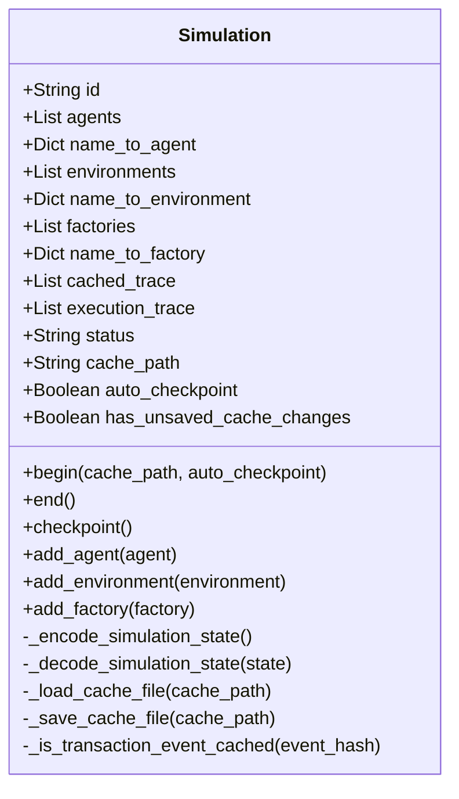

Sources: [tinytroupe/control.py:22-77](), [tinytroupe/control.py:142-171](), [tinytroupe/control.py:274-382]()

## Global Control Functions

The `control` module provides a functional interface to the `default` simulation instance, facilitating easy management in scripts and notebooks.

| Function | Purpose |
|----------|---------|
| `begin(cache_path, id, auto_checkpoint)` | Starts a simulation and clears existing entity registries [tinytroupe/control.py:577-601](). |
| `end(id)` | Stops the simulation and saves the final state [tinytroupe/control.py:603-611](). |
| `checkpoint(id)` | Explicitly saves the simulation trace to the cache file [tinytroupe/control.py:613-621](). |
| `reset()` | Clears the `_current_simulations` dictionary and resets global state [tinytroupe/control.py:633-642](). |
| `current_simulation()` | Returns the simulation object currently in scope [tinytroupe/control.py:623-631](). |

Sources: [tinytroupe/control.py:577-642]()

## Transactional Processing

The simulation uses a transactional approach to ensure consistency. This is implemented through the `Transaction` class and the `@transactional` decorator. When a method is marked as `@transactional`, the system checks if that specific event (function name + arguments) has already occurred in the `cached_trace`.

### Transaction Flow

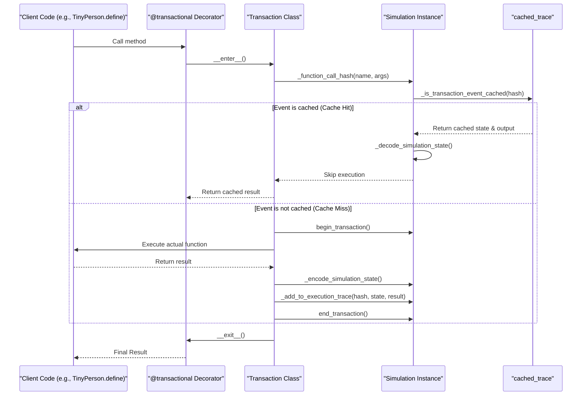

Sources: [tinytroupe/control.py:384-539](), [tinytroupe/control.py:541-574]()

## Caching Mechanism

The caching system avoids redundant LLM calls and computations. It relies on:
1.  **State Encoding**: Converting the entire simulation state (agents, environments, etc.) into a JSON-serializable dictionary [tinytroupe/control.py:274-308]().
2.  **Event Hashing**: Hashing function names and arguments to identify unique "events" [tinytroupe/control.py:182-224]().
3.  **Trace Matching**: Comparing the current execution against the `cached_trace`. If a mismatch occurs, the cache suffix is dropped to maintain consistency [tinytroupe/control.py:226-245]().

### Caching System Diagram

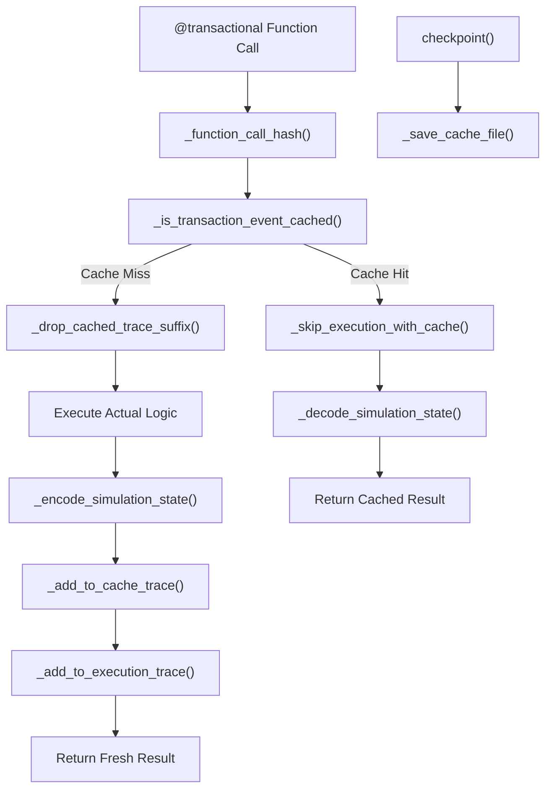

Sources: [tinytroupe/control.py:176-272]()

## Example Usage

In scenarios like market research, `control.begin()` is used to load existing results and avoid re-generating the same population or survey responses.

```python
import tinytroupe.control as control
from tinytroupe.examples import create_oscar_the_architect

# Start with a specific cache file
control.begin("my_simulation.cache.json")

# This creation is transactional and will be cached
agent = create_oscar_the_architect()

# Define properties (transactional)
agent.define("age", 19)

# Save the trace to the JSON file
control.checkpoint()

# Finalize
control.end()
```

Sources: [tests/scenarios/test_basic_scenarios.py:33-58](), [examples/Travel Product Market Research.ipynb:137]()

## Integration with Other Components

The simulation control system acts as a central registry. When `Simulation.begin()` is called, it clears the global registries of other classes to ensure a fresh state.

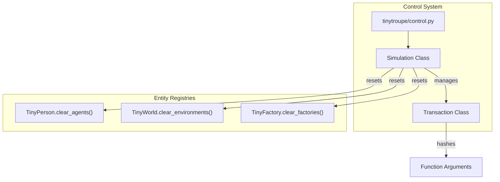

Sources: [tinytroupe/control.py:108-111](), [tests/testing_utils.py:213-218]()

---

# Page: OpenAI Integration

# OpenAI Integration

<details>
<summary>Relevant source files</summary>

The following files were used as context for generating this wiki page:

- [tests/non_functional/test_security.py](tests/non_functional/test_security.py)
- [tests/unit/test_api_cache.py](tests/unit/test_api_cache.py)
- [tests/unit/test_api_cache_integration.py](tests/unit/test_api_cache_integration.py)
- [tinytroupe/clients/__init__.py](tinytroupe/clients/__init__.py)
- [tinytroupe/clients/azure_client.py](tinytroupe/clients/azure_client.py)
- [tinytroupe/clients/ollama_client.py](tinytroupe/clients/ollama_client.py)
- [tinytroupe/clients/openai_client.py](tinytroupe/clients/openai_client.py)

</details>


TinyTroupe integrates with Large Language Models (LLMs) through a flexible client architecture that supports **OpenAI**, **Azure OpenAI Service**, and **Ollama**. This integration handles the complexities of API communication, including caching, exponential backoff, token counting, and structured output parsing.

## Client Architecture

The integration is built on a provider-agnostic registry pattern. All clients inherit from `LLMCacheBase` to provide consistent JSON-based caching functionality.

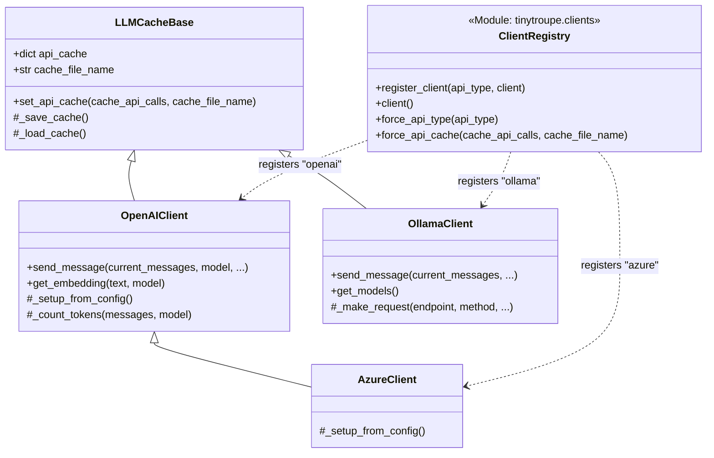

Sources: [tinytroupe/clients/openai_client.py:28-32](), [tinytroupe/clients/openai_client.py:82-85](), [tinytroupe/clients/azure_client.py:15-15](), [tinytroupe/clients/ollama_client.py:13-13](), [tinytroupe/clients/__init__.py:45-121]()

## Request Flow and Caching

When a message is sent via `send_message`, the client follows a specific execution path that prioritizes the local JSON cache to save costs and improve performance.

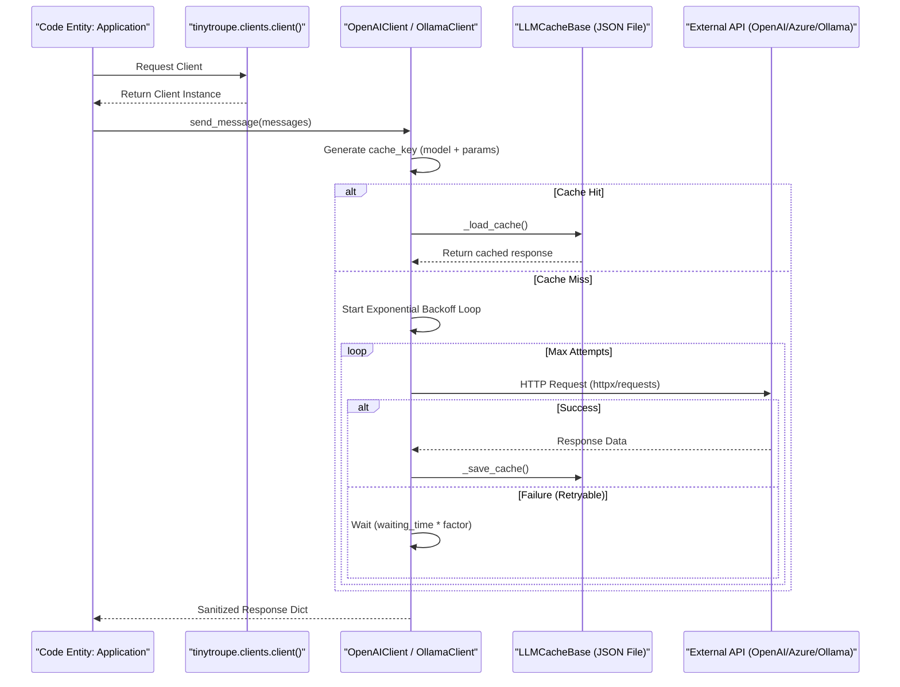

### Exponential Backoff
TinyTroupe implements its own retry logic rather than relying on library defaults. It uses an `exponential_backoff_factor` and a `waiting_time` defined in the configuration [tinytroupe/clients/openai_client.py:183-185](). For OpenAI, `max_retries` is set to 0 in the underlying `OpenAI` object to allow TinyTroupe's custom loop to manage retries [tinytroupe/clients/openai_client.py:171-174]().

### Token Counting
The `OpenAIClient` uses `tiktoken` to estimate token usage [tinytroupe/clients/openai_client.py:12](). It tracks statistics including `_input_tokens`, `_output_tokens`, and `_total_tokens` [tinytroupe/clients/openai_client.py:143-145]().

Sources: [tinytroupe/clients/openai_client.py:213-250](), [tinytroupe/clients/openai_client.py:171-174](), [tinytroupe/clients/ollama_client.py:105-154](), [tinytroupe/clients/openai_client.py:138-148]()

## Client Registry and Overrides

The `tinytroupe.clients` module maintains a registry of available API clients. By default, it registers `OpenAIClient`, `AzureClient`, and `OllamaClient` [tinytroupe/clients/__init__.py:118-120]().

### Key Functions
- `client()`: Returns the client instance corresponding to the `api_type` defined in `config.ini` [tinytroupe/clients/__init__.py:75-86]().
- `force_api_type(api_type)`: Globally overrides the configured API type, useful for switching between local Ollama and cloud OpenAI during execution [tinytroupe/clients/__init__.py:92-100]().
- `force_api_cache(cache_api_calls, cache_file_name)`: Updates the caching settings for all registered clients simultaneously [tinytroupe/clients/__init__.py:103-115]().

Sources: [tinytroupe/clients/__init__.py:45-121]()

## Implementation Details

### LLMCacheBase
The `LLMCacheBase` class provides `_save_cache()` and `_load_cache()` methods that handle reading and writing the API cache as a JSON file [tinytroupe/clients/openai_client.py:34-52](). This allows for human-readable inspection of cached LLM interactions.

### OpenAI vs. Azure Configuration
- **OpenAIClient**: Uses the `OPENAI_API_KEY` environment variable [tinytroupe/clients/openai_client.py:173]().
- **AzureClient**: Can use either an API key (`AZURE_OPENAI_KEY`) or **Entra ID Authentication** via `DefaultAzureCredential` [tinytroupe/clients/azure_client.py:42-65](). It requires an `AZURE_OPENAI_ENDPOINT` and `AZURE_API_VERSION` [tinytroupe/clients/azure_client.py:44-47]().

### Ollama Integration
The `OllamaClient` interacts with local LLMs via direct HTTP requests to the Ollama server (default: `http://localhost:11434/v1`) [tinytroupe/clients/ollama_client.py:23](). It supports a specific `num_ctx` parameter for controlling the input context size [tinytroupe/clients/ollama_client.py:91]().

Sources: [tinytroupe/clients/openai_client.py:28-76](), [tinytroupe/clients/azure_client.py:25-66](), [tinytroupe/clients/ollama_client.py:13-41]()

## Configuration Parameters

The clients are initialized using values from the `config.ini` file, processed via the `@config_manager.config_defaults` decorator.

| Parameter | Description | Client Usage |
|-----------|-------------|--------------|
| `api_type` | `openai`, `azure`, or `ollama` | Registry selection |
| `model` | The LLM model name (e.g., `gpt-4o`) | All clients |
| `cache_api_calls` | Boolean to enable/disable JSON caching | All clients |
| `max_attempts` | Number of retries for failed requests | All clients |
| `timeout` | Request timeout in seconds | OpenAI/Azure (via httpx) |
| `max_concurrent_model_calls` | Limits parallel API requests | OpenAIClient |

Sources: [tinytroupe/clients/openai_client.py:87-97](), [tinytroupe/clients/openai_client.py:176-188](), [tinytroupe/clients/ollama_client.py:29-42](), [tinytroupe/clients/__init__.py:79-83]()

---

# Page: TinyPerson

# TinyPerson

<details>
<summary>Relevant source files</summary>

The following files were used as context for generating this wiki page:

- [pyproject.toml](pyproject.toml)
- [tests/unit/test_tinyperson.py](tests/unit/test_tinyperson.py)
- [tinytroupe/agent/action_generator.py](tinytroupe/agent/action_generator.py)
- [tinytroupe/agent/tiny_person.py](tinytroupe/agent/tiny_person.py)
- [tinytroupe/environment/tiny_social_network.py](tinytroupe/environment/tiny_social_network.py)

</details>


TinyPerson is the core agent class in the TinyTroupe framework, representing a simulated person with cognitive capabilities, memory, goals, emotions, and the ability to interact with other agents and environments. This page provides a high-level guide to the TinyPerson architecture and its primary components.

For detailed guides on specific subsystems, see the following child pages:
*   [Creating Agents](#3.1) — Methods for defining personas, loading JSON specs, and using `TinyPersonFactory`.
*   [Mental Faculties](#3.2) — Specialized capabilities like `TinyToolUse` and `FilesAndWebGroundingFaculty`.
*   [Memory Systems](#3.3) — Details on `EpisodicMemory`, `SemanticMemory`, and consolidation.
*   [Action Generation](#3.4) — The internal pipeline for generating and validating agent actions.

## Overview of TinyPerson

A `TinyPerson` represents a simulated human-like agent with a persistent personality, mental state, memory systems, and interaction capabilities. Unlike traditional AI assistants, TinyTroupe agents are designed to exhibit human-like behaviors, including idiosyncrasies and emotions.

Each `TinyPerson` includes:
*   A **persona** with attributes like name, age, and occupation.
*   A **mental state** with dynamic attributes like goals and emotions.
*   **Memory systems** for storing experiences (`EpisodicMemory`) and knowledge (`SemanticMemory`).
*   **Mental faculties** that provide specialized capabilities like tool use.

Sources: [tinytroupe/agent/tiny_person.py:29-88](), [tinytroupe/agent/tiny_person.py:127-196]()

## TinyPerson Architecture

The following diagram illustrates the relationship between the `TinyPerson` class and its core components in the codebase.

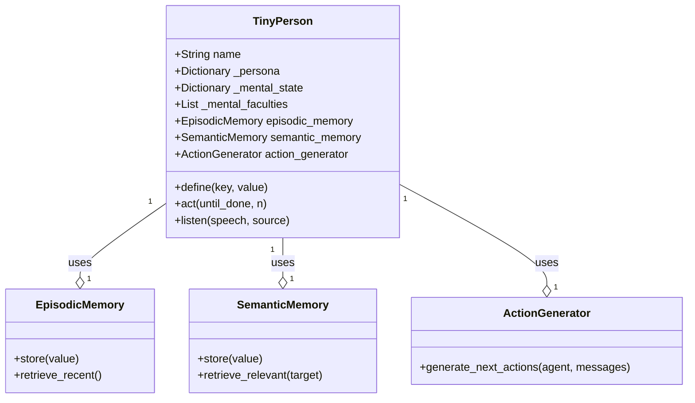

*TinyPerson Code Entity Diagram*

Sources: [tinytroupe/agent/tiny_person.py:29-123](), [tinytroupe/agent/tiny_person.py:161-180]()

## Core Components

### Persona and Mental State
The persona defines static attributes (e.g., age, nationality, occupation), while the mental state tracks dynamic variables like current location, goals, and emotions. These are managed via the `_persona` and `_mental_state` dictionaries and can be modified using the `define()` method.

For details on configuring these, see [Creating Agents](#3.1).

Sources: [tinytroupe/agent/tiny_person.py:56-71](), [tinytroupe/agent/tiny_person.py:292-325]()

### Memory Systems
TinyPerson utilizes two primary memory types:
1.  **Episodic Memory**: A chronological log of stimuli and actions.
2.  **Semantic Memory**: A vector-based store for factual knowledge and document grounding.

For details on how these systems function and consolidate information, see [Memory Systems](#3.3).

Sources: [tinytroupe/agent/tiny_person.py:107-112](), [tinytroupe/agent/memory.py:17-156]()

### Mental Faculties
Faculties are modular components that extend an agent's abilities. Common faculties include `RecallFaculty` for memory access and `TinyToolUse` for executing external code or API calls.

For details on available faculties and how to create new ones, see [Mental Faculties](#3.2).

Sources: [tinytroupe/agent/tiny_person.py:386-405](), [tinytroupe/agent/mental_faculties.py:1-20]()

## Interaction and Action Flow

Agents interact with the world through a cycle of receiving stimuli and generating actions. The `ActionGenerator` handles the complex logic of producing valid, persona-consistent behaviors.

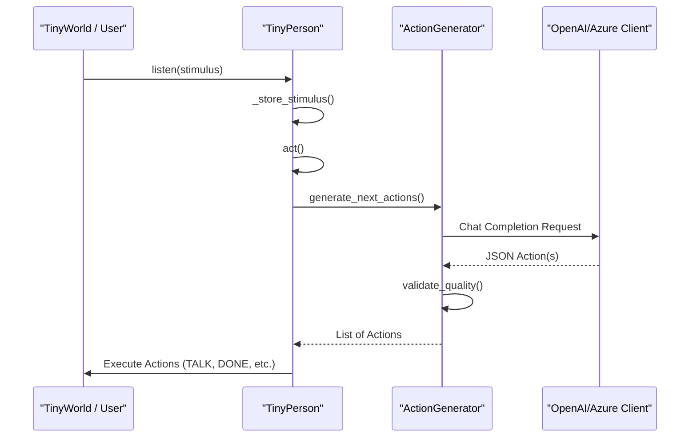

*From Stimulus to Action: Code Flow*

For a deep dive into the generation pipeline, quality checks, and repetition prevention, see [Action Generation](#3.4).

Sources: [tinytroupe/agent/tiny_person.py:407-510](), [tinytroupe/agent/action_generator.py:95-115]()

## Agent Interaction Methods

### Receiving Stimuli
Agents perceive their environment through several methods that update their internal state and memory:
*   `listen(speech, source)`: Processes conversational input.
*   `see(visual_description, source)`: Processes visual descriptions.
*   `think(thought)`: Adds internal monologue to the agent's context.

Sources: [tinytroupe/agent/tiny_person.py:511-606]()

### Producing Actions
The `act()` method is the primary entry point for agent behavior. It can be configured to run until the agent decides it is finished (`until_done=True`) or for a fixed number of steps.
*   `act(until_done, n, return_actions)`: Triggers the action generation loop.
*   `listen_and_act(speech)`: A convenience wrapper for immediate response.

Sources: [tinytroupe/agent/tiny_person.py:407-440](), [tinytroupe/agent/tiny_person.py:634-645]()

## Environment and Social Context
Agents can be placed in a `TinyWorld` or `TinySocialNetwork`. Their behavior is influenced by their `_accessible_agents` list and the `environment` they are currently in.
*   `make_agent_accessible(other_agent)`: Allows the agent to target others with actions like `TALK`.
*   `move_to(location)`: Updates the agent's spatial context.

Sources: [tinytroupe/agent/tiny_person.py:712-770](), [tinytroupe/environment/tiny_social_network.py:59-74]()

## State Management
`TinyPerson` supports full serialization for saving and loading simulation states.
*   `save_specification(path)`: Exports the agent's persona and state to JSON.
*   `load_specification(path)`: Reconstitutes an agent from a file.

Sources: [tinytroupe/agent/tiny_person.py:1214-1268]()

---

# Page: Creating Agents

# Creating Agents

<details>
<summary>Relevant source files</summary>

The following files were used as context for generating this wiki page:

- [examples/agents/Friedrich_Wolf.agent.json](examples/agents/Friedrich_Wolf.agent.json)
- [examples/agents/Lila.agent.json](examples/agents/Lila.agent.json)
- [examples/agents/Lisa.agent.json](examples/agents/Lisa.agent.json)
- [examples/fragments/genuine.agent.fragment.json](examples/fragments/genuine.agent.fragment.json)
- [examples/fragments/loving_parent.agent.fragment.json](examples/fragments/loving_parent.agent.fragment.json)
- [examples/information/populations/brazil.json](examples/information/populations/brazil.json)
- [examples/information/populations/usa.json](examples/information/populations/usa.json)
- [tests/unit/test_control.py](tests/unit/test_control.py)
- [tests/unit/test_factory.py](tests/unit/test_factory.py)
- [tinytroupe/examples/loaders.py](tinytroupe/examples/loaders.py)
- [tinytroupe/factory/tiny_person_factory.py](tinytroupe/factory/tiny_person_factory.py)

</details>


This page explains the methods and patterns for creating and configuring `TinyPerson` agents within the TinyTroupe framework. You'll learn how to instantiate agents directly, use the `TinyPersonFactory` for automated generation, and leverage pre-defined examples and fragments.

## Overview

TinyTroupe agents are instances of the `TinyPerson` class, which represents simulated individuals with specific personalities, backgrounds, and capabilities. Creating agents involves instantiating this class and configuring its persona via natural language or structured data.

### Agent Creation Pathways

The following diagram maps the Natural Language descriptions to the Code Entities responsible for agent creation.

```mermaid
flowchart TD
    subgraph "Natural Language Space"
        NLS1["'A software engineer from Brazil'"]
        NLS2["'A diverse urban community'"]
        NLS3["'A loving parent'"]
    end

    subgraph "Code Entity Space"
        TP["TinyPerson Class"]
        TPF["TinyPersonFactory"]
        LOAD["loaders.py"]
        SPEC["JSON Specification"]
    end

    NLS1 -->|Direct Definition| TP
    NLS2 -->|Contextual Generation| TPF
    NLS3 -->|Fragment Loading| LOAD
    
    TPF -->|Calls| TP
    LOAD -->|Parses| SPEC
    SPEC -->|Instantiates| TP
```

Sources: [tinytroupe/agent/tiny_person.py:22-45](), [tinytroupe/factory/tiny_person_factory.py:24-36](), [tinytroupe/examples/loaders.py:4-14]()

## Basic Agent Creation Methods

### Direct Instantiation
The most fundamental way to create an agent is by instantiating `TinyPerson` [tinytroupe/agent/tiny_person.py:47-76](). Once created, you use the `define` method to build the persona.

```python
from tinytroupe.agent import TinyPerson

# 1. Instantiate
alice = TinyPerson(name="Alice")

# 2. Configure via define()
alice.define("age", 30)
alice.define("occupation", "Data Scientist")
alice.define("personality", ["curious", "analytical"])
```
The `define` method [tinytroupe/agent/tiny_person.py:290-325]() is versatile; it can take strings, numbers, or complex dictionaries and lists, merging them into the agent's internal `_persona` dictionary.

Sources: [tinytroupe/agent/tiny_person.py:47-76](), [tinytroupe/agent/tiny_person.py:290-325]()

### Loading from Specifications
Agents can be entirely defined in JSON files and loaded using `TinyPerson.load_specification` [tinytroupe/agent/tiny_person.py:1232-1259]().

| Feature | Description |
| :--- | :--- |
| **JSON Schema** | Includes `name`, `age`, `gender`, `occupation`, `personality`, `beliefs`, etc. |
| **Example Files** | `Lila.agent.json`, `Lisa.agent.json`, `Friedrich_Wolf.agent.json`. |
| **Flexibility** | Allows overriding the agent name during load to avoid global name collisions. |

Sources: [tinytroupe/agent/tiny_person.py:1232-1259](), [examples/agents/Lila.agent.json:1-17](), [examples/agents/Friedrich_Wolf.agent.json:1-20]()

## Automated Generation with TinyPersonFactory

The `TinyPersonFactory` [tinytroupe/factory/tiny_person_factory.py:24-225]() uses LLMs to automate the creation of agents based on high-level contexts.

### Factory Initialization and Context
A factory is initialized with a `context` (the environment description) and optionally a `sampling_space_description` [tinytroupe/factory/tiny_person_factory.py:29-54]().

```python
from tinytroupe.factory import TinyPersonFactory

bank_context = "A large Brazilian bank facing competition from fintechs."
factory = TinyPersonFactory(context=bank_context)

# Generate a specific person
banker = factory.generate_person("A vice-president with an MBA in finance.")
```

### Batch Generation and Demographics
TinyTroupe supports generating entire populations using demographic data [tinytroupe/factory/tiny_person_factory.py:120-153](). You can provide a file path to demographic distributions (e.g., `brazil.json` or `usa.json`) to the `create_factory_from_demography` method.

| Parameter | Role |
| :--- | :--- |
| `total_population_size` | The theoretical size of the group being sampled from. |
| `agent_particularities` | Specific constraints for the generated batch (e.g., "All must be students"). |
| `temperature` | Controls the diversity of the generated personas [tests/unit/test_factory.py:42-71](). |

Sources: [tinytroupe/factory/tiny_person_factory.py:24-64](), [tinytroupe/factory/tiny_person_factory.py:120-153](), [tests/unit/test_factory.py:92-126](), [examples/information/populations/usa.json:1-15]()

## Using Example Agents and Fragments

TinyTroupe provides a set of pre-configured agents and "persona fragments" to speed up development.

### Example Loaders
The `tinytroupe.examples.loaders` module provides utility functions to access bundled assets [tinytroupe/examples/loaders.py:4-44]():
- `load_example_agent_specification(name)`: Loads a full agent JSON.
- `load_example_fragment_specification(name)`: Loads a partial persona (e.g., "loving parent" or "genuine").

### Persona Fragments
Fragments allow you to "mix-in" traits to an existing agent. For example, the `loving_parent.agent.fragment.json` defines specific interests (Children, Education) and behaviors (priority on safety) [examples/fragments/loving_parent.agent.fragment.json:1-37]().

```mermaid
flowchart LR
    subgraph "Code Components"
        LA["loaders.py"]
        F1["genuine.fragment.json"]
        F2["loving_parent.fragment.json"]
    end

    subgraph "Agent Assembly"
        TP["TinyPerson Instance"]
        TP -- "define()" --> TP
    end

    LA -->|extracts| F1
    LA -->|extracts| F2
    F1 -->|merged into| TP
    F2 -->|merged into| TP
```

Sources: [tinytroupe/examples/loaders.py:16-26](), [examples/fragments/loving_parent.agent.fragment.json:1-37](), [examples/fragments/genuine.agent.fragment.json:1-18]()

## Configuration and Persistence

### Post-Processing
When using factories, you can pass a `post_processing_func` to `generate_person` to programmatically modify agents immediately after they are created by the LLM [tests/unit/test_factory.py:74-90](). This is useful for adding specific technical metadata or mandatory traits.

### Unique Names
The `TinyPersonFactory` maintains an `all_unique_names` list to ensure that every generated agent has a globally unique name within the simulation [tinytroupe/factory/tiny_person_factory.py:27-27]().

### Caching and Simulations
Agent creation is integrated with the `tinytroupe.control` module. When a simulation is active via `control.begin()`, agent generation results are cached in the simulation's execution trace [tests/unit/test_control.py:105-135](). Subsequent runs with the same parameters will load agents from the cache rather than calling the LLM again.

Sources: [tests/unit/test_factory.py:74-90](), [tinytroupe/factory/tiny_person_factory.py:27-27](), [tests/unit/test_control.py:105-135]()

---

# Page: Mental Faculties

# Mental Faculties

<details>
<summary>Relevant source files</summary>

The following files were used as context for generating this wiki page:

- [tinytroupe/agent/__init__.py](tinytroupe/agent/__init__.py)
- [tinytroupe/agent/memory.py](tinytroupe/agent/memory.py)
- [tinytroupe/agent/mental_faculty.py](tinytroupe/agent/mental_faculty.py)
- [tinytroupe/enrichment/tiny_enricher.py](tinytroupe/enrichment/tiny_enricher.py)
- [tinytroupe/environment/__init__.py](tinytroupe/environment/__init__.py)
- [tinytroupe/tools/tiny_tool.py](tinytroupe/tools/tiny_tool.py)
- [tinytroupe/tools/tiny_word_processor.py](tinytroupe/tools/tiny_word_processor.py)
- [tinytroupe/utils/llm.py](tinytroupe/utils/llm.py)

</details>


Mental Faculties are specialized cognitive capabilities that can be added to `TinyPerson` agents in the TinyTroupe framework. They extend an agent's abilities beyond basic thinking and communication, enabling them to interact with external tools, access grounded knowledge, and recall information in specific ways. This page details the available mental faculties, how they work, and how to use them in your agent simulations.

For information about general agent architecture, see [3. TinyPerson](). For details about memory systems that work alongside mental faculties, see [3.3. Memory Systems]().

## Overview of Mental Faculties

Mental faculties in TinyTroupe are modular components inheriting from the `TinyMentalFaculty` base class [tinytroupe/agent/mental_faculty.py:19-22](). Each faculty provides specific action definitions and constraints that are incorporated into the agent's system prompt. When an agent performs an action, each of its mental faculties has an opportunity to process that action via the `process_action` method [tinytroupe/agent/mental_faculty.py:47-57]().

### Mental Faculties Architecture

```mermaid
graph TD
    subgraph "Mental Faculties Architecture"
        MF["TinyMentalFaculty"] --> TU["TinyToolUse"]
        MF --> RF["RecallFaculty"]
        MF --> GF["FilesAndWebGroundingFaculty"]
        MF --> CMF["CustomMentalFaculty"]
        
        TU -- "implements" --> AT["actions_definitions_prompt()"]
        TU -- "implements" --> AC["actions_constraints_prompt()"]
        TU -- "implements" --> AP["process_action()"]
        
        RF -- "implements" --> RAT["Recall actions definitions"]
        RF -- "implements" --> RAP["process_action()"]
        
        GF -- "implements" --> GAT["Grounding actions definitions"]
        GF -- "implements" --> GAP["process_action()"]
    end
```

Sources: [tinytroupe/agent/mental_faculty.py:19-194](), [tinytroupe/agent/mental_faculty.py:228-232]()

## Integration with Agent Architecture

Mental faculties are integrated into the `TinyPerson` class. When an agent generates its system prompt, it iterates through its `_mental_faculties` list to collect action definitions and constraints [tinytroupe/agent/tiny_person.py:214-216](). During the `act()` loop, the agent passes every generated action to each faculty's `process_action()` method to trigger logic execution [tinytroupe/agent/tiny_person.py:474-475]().

### Agent Interaction Flow

```mermaid
flowchart TD
    subgraph "Agent Integration"
        TP["TinyPerson"]
        MS["CognitiveState"]
        MEM["TinyMemory"]
        MF["TinyMentalFaculty"]
        
        TP --> MS
        TP --> MEM
        TP --> MF
        
        MF --> |"actions_definitions_prompt()"| SP["System Prompt"]
        SP --> |"Influences"| AG["Action Generation"]
        
        AG --> |"Generates"| ACT["Action"]
        ACT --> |"process_action(agent, action)"| MF
        MF --> |"Execution"| SE["Side Effects"]
        SE --> |"e.g., agent.think()"| MS
        SE --> |"e.g., agent.store_memory()"| MEM
    end
```

Sources: [tinytroupe/agent/tiny_person.py:32-33](), [tinytroupe/agent/tiny_person.py:118-119](), [tinytroupe/agent/tiny_person.py:386-405](), [tinytroupe/agent/mental_faculty.py:47-57]()

## Available Mental Faculties

### TinyToolUse Faculty

The `TinyToolUse` faculty enables agents to interact with `TinyTool` instances [tinytroupe/agent/mental_faculty.py:228-232](). It acts as a bridge, translating agent actions into tool method calls. For example, the `TinyWordProcessor` tool allows agents to write documents that can be enriched and exported [tinytroupe/tools/tiny_word_processor.py:7-10]().

```mermaid
graph TD
    subgraph "TinyToolUse Faculty"
        TTU["TinyToolUse"]
        TTU --> |"manages"| TOOLS["tools: list[TinyTool]"]
        
        TOOLS --> TWP["TinyWordProcessor"]
        
        TWP --> |"write_document()"| AE["ArtifactExporter"]
        TWP --> |"enrich_content()"| TE["TinyEnricher"]
        
        TTU --> |"process_action()"| EXEC["tool.process_action()"]
    end
```

Sources: [tinytroupe/agent/mental_faculty.py:228-275](), [tinytroupe/tools/tiny_word_processor.py:7-38]()

#### TinyTool and TinyWordProcessor
`TinyTool` is the base class for all tools [tinytroupe/tools/tiny_tool.py:6](). It includes a retry mechanism `repeat_on_error` that attempts to re-run tool logic up to 3 times if an exception occurs [tinytroupe/tools/tiny_tool.py:65-69]().
`TinyWordProcessor` specifically handles the `WRITE_DOCUMENT` action [tinytroupe/tools/tiny_word_processor.py:39-40](). It uses a `TinyEnricher` to expand drafts [tinytroupe/tools/tiny_word_processor.py:15-26]() and an `ArtifactExporter` to save files in `md`, `docx`, and `json` formats [tinytroupe/tools/tiny_word_processor.py:28-37]().

### Files and Web Grounding Faculty

The `FilesAndWebGroundingFaculty` enables agents to ground their knowledge in external sources via `GroundingConnector` instances [tinytroupe/agent/mental_faculty.py:278-281]().

#### Grounding Connectors

The grounding system uses `llama-index` to create a `VectorStoreIndex` for semantic retrieval [tinytroupe/agent/grounding.py:51-54]().

1. **BaseSemanticGroundingConnector**: Core functionality for document retrieval [tinytroupe/agent/grounding.py:41]().
2. **LocalFilesGroundingConnector**: Indexes local folders and files [tinytroupe/agent/grounding.py:161]().
3. **WebPagesGroundingConnector**: Scrapes and indexes content from web URLs [tinytroupe/agent/grounding.py:228]().

```mermaid
classDiagram
    class GroundingConnector {
        <<interface>>
        +retrieve_relevant(relevance_target)
    }
    
    class BaseSemanticGroundingConnector {
        +index: VectorStoreIndex
        +add_documents(documents)
    }
    
    class LocalFilesGroundingConnector {
        +add_folder(folder_path)
    }
    
    class WebPagesGroundingConnector {
        +add_web_url(web_url)
    }
    
    GroundingConnector <|-- BaseSemanticGroundingConnector
    BaseSemanticGroundingConnector <|-- LocalFilesGroundingConnector
    BaseSemanticGroundingConnector <|-- WebPagesGroundingConnector
```

Sources: [tinytroupe/agent/grounding.py:13-272]()

### Recall Faculty

The `RecallFaculty` implements the `RECALL` action [tinytroupe/agent/mental_faculty.py:173](). When an agent performs a recall, the faculty calls `agent.retrieve_relevant_memories()` [tinytroupe/agent/mental_faculty.py:176-178](). If information is found, the agent "thinks" the result, bringing it into the current context [tinytroupe/agent/mental_faculty.py:186-189]().

## Working with Mental Faculties

### Custom Mental Faculty Development

Users can define custom faculties using `CustomMentalFaculty` by providing a dictionary of action configurations [tinytroupe/agent/mental_faculty.py:72-86]().

```python
def my_custom_logic(agent, action):
    print(f"{agent.name} is performing {action['type']}")

custom_faculty = CustomMentalFaculty("MyFaculty")
custom_faculty.add_action(
    action_name="SPECIAL_ACTION",
    description="Allows the agent to do something unique.",
    function=my_custom_logic
)
agent.add_mental_faculty(custom_faculty)
```

Sources: [tinytroupe/agent/mental_faculty.py:114-119]()

### Action Processing and Prompting

The `TinyPerson` class manages faculties through these key lifecycle points:

1. **Initialization**: Faculties are stored in `self._mental_faculties` [tinytroupe/agent/tiny_person.py:118-119]().
2. **Prompting**: `actions_definitions_prompt()` and `actions_constraints_prompt()` are called to build the LLM system message [tinytroupe/agent/tiny_person.py:214-216]().
3. **Execution**: Every action in `self.act()` is passed to `faculty.process_action(self, action)` [tinytroupe/agent/tiny_person.py:474-475]().

### Summary Table of Faculty Methods

| Method | Purpose | Implementation Detail |
| :--- | :--- | :--- |
| `actions_definitions_prompt()` | Returns the prompt for defining actions. | [tinytroupe/agent/mental_faculty.py:59-63]() |
| `actions_constraints_prompt()` | Returns the constraints for actions. | [tinytroupe/agent/mental_faculty.py:65-69]() |
| `process_action(agent, action)` | Executes logic when an action is triggered. | [tinytroupe/agent/mental_faculty.py:47-57]() |

Sources: [tinytroupe/agent/mental_faculty.py:47-69]()

---

# Page: Memory Systems

# Memory Systems

<details>
<summary>Relevant source files</summary>

The following files were used as context for generating this wiki page:

- [tests/unit/test_memory.py](tests/unit/test_memory.py)
- [tinytroupe/agent/__init__.py](tinytroupe/agent/__init__.py)
- [tinytroupe/agent/memory.py](tinytroupe/agent/memory.py)
- [tinytroupe/agent/mental_faculty.py](tinytroupe/agent/mental_faculty.py)
- [tinytroupe/agent/tiny_person.py](tinytroupe/agent/tiny_person.py)
- [tinytroupe/environment/__init__.py](tinytroupe/environment/__init__.py)
- [tinytroupe/environment/tiny_social_network.py](tinytroupe/environment/tiny_social_network.py)

</details>


## Purpose and Scope

This document explains the memory systems used by TinyPerson agents in the TinyTroupe framework. It covers the architecture of both episodic and semantic memory, how they're integrated into agent behavior, and the mechanisms for memory consolidation. TinyTroupe agents utilize a cognitive psychology-inspired model where memory is not a monolithic storage but a set of specialized systems.

Sources: [tinytroupe/agent/__init__.py:1-14](), [tinytroupe/agent/memory.py:12-17]()

## Memory Architecture

TinyTroupe implements a cognitive psychology-inspired memory model that divides agent memory into two distinct systems, both inheriting from the `TinyMemory` base class (which is a `TinyMentalFaculty`).

```mermaid
flowchart TD
    subgraph "Code Entity Space: Memory Classes"
        TMF["TinyMentalFaculty [tinytroupe/agent/mental_faculty.py]"]
        TM["TinyMemory [tinytroupe/agent/memory.py]"]
        EM["EpisodicMemory [tinytroupe/agent/memory.py]"]
        SM["SemanticMemory [tinytroupe/agent/memory.py]"]
        EC["EpisodicConsolidator [tinytroupe/agent/memory.py]"]
        
        TMF <|-- TM
        TM <|-- EM
        TM <|-- SM
        EC -- "processes" --> EM
        EC -- "extracts to" --> SM
    end

    subgraph "Natural Language Space: Cognitive Concepts"
        EP["Episodic Memory\n(Experiences)"]
        SEM["Semantic Memory\n(Facts/Knowledge)"]
        CON["Consolidation\n(Learning)"]
    end

    EM -.-> EP
    SM -.-> SEM
    EC -.-> CON
```

Sources: [tinytroupe/agent/memory.py:17-20](), [tinytroupe/agent/memory.py:172-175](), [tinytroupe/agent/memory.py:372-375](), [tinytroupe/agent/memory.py:591-594]()

## Episodic Memory

`EpisodicMemory` stores the agent's personal experiences in a temporally organized buffer. It tracks stimuli received and actions performed.

### Structure and Storage
Episodic memories are stored in two parts:
1. `episodic_buffer`: A temporary storage for the current ongoing episode.
2. `memory`: A list of committed episodes (past experiences).

The agent uses `store(value)` to add a new event (stimulus or action) to the buffer. When an episode concludes, `commit_episode()` moves the buffer content into permanent memory.

Sources: [tinytroupe/agent/memory.py:172-192](), [tinytroupe/agent/memory.py:223-233]()

### Retrieval and Context
Retrieval from episodic memory is primarily used to construct the LLM prompt. The `retrieve` method allows fetching `first_n` and `last_n` memories, often used to maintain a "fixed prefix" of important early context and a "lookback" of recent events.

Sources: [tinytroupe/agent/memory.py:251-270](), [tinytroupe/agent/tiny_person.py:40-45]()

## Semantic Memory

`SemanticMemory` stores general knowledge, facts, and concepts. Unlike episodic memory, it is designed for similarity-based retrieval and is often grounded in external data sources.

### Knowledge Grounding
Semantic memory can be populated using `BaseSemanticGroundingConnector` implementations. It supports:
- `Document` objects from `llama_index`.
- Text-based facts.
- Information extracted from web pages or local files via the `FilesAndWebGroundingFaculty`.

Sources: [tinytroupe/agent/memory.py:372-385](), [tinytroupe/agent/mental_faculty.py:196-210]()

### Retrieval Mechanism
Retrieval is performed via `retrieve_relevant(relevance_target, top_k)`, which typically uses embeddings to find the most pertinent information for the agent's current situation. It also supports a `summarize_relevant_via_full_scan` method, which uses an LLM to process batches of memories and accumulate information relevant to a specific query.

Sources: [tinytroupe/agent/memory.py:441-450](), [tinytroupe/agent/memory.py:96-115]()

## Memory Consolidation

Memory consolidation is the process of moving information from short-term episodic experiences into long-term semantic knowledge. This is handled by the `EpisodicConsolidator`.

```mermaid
sequenceDiagram
    participant Agent as "TinyPerson"
    participant EC as "EpisodicConsolidator"
    participant EM as "EpisodicMemory"
    participant SM as "SemanticMemory"
    participant LLM as "LLM API"

    Agent->>EC: consolidate_episodic_into_semantic()
    EC->>EM: retrieve_all()
    EM-->>EC: List of experiences
    EC->>LLM: Request summary of key facts/insights
    LLM-->>EC: Extracted semantic knowledge
    EC->>SM: store_all(new_knowledge)
    Note over EC,SM: Experiences are now "learned" facts
```

Sources: [tinytroupe/agent/memory.py:591-610](), [tinytroupe/agent/memory.py:615-635]()

### Consolidator Types
1. **EpisodicConsolidator**: Focuses on extracting factual information and experiences from episodic memory to semantic memory.
2. **ReflectionConsolidator**: A specialized consolidator that encourages the agent to "reflect" on its experiences to derive higher-level insights or self-knowledge.

Sources: [tinytroupe/agent/memory.py:591-594](), [tinytroupe/agent/memory.py:657-660]()

## Memory Integration with Agent Behavior

Memory is integrated into the `TinyPerson` through the `RecallFaculty` and the main action loop.

| Method | Role | File Reference |
| :--- | :--- | :--- |
| `TinyPerson.think()` | Internal cognitive action stored in episodic memory. | [tinytroupe/agent/tiny_person.py:452-465]() |
| `TinyPerson.act()` | Generates actions; retrieves recent episodic context. | [tinytroupe/agent/tiny_person.py:734-750]() |
| `RecallFaculty.process_action()` | Handles "RECALL" actions by querying semantic memory. | [tinytroupe/agent/mental_faculty.py:170-185]() |
| `TinyPerson.retrieve_relevant_memories()` | Contextual retrieval from semantic memory. | [tinytroupe/agent/tiny_person.py:865-885]() |

Sources: [tinytroupe/agent/tiny_person.py:452-465](), [tinytroupe/agent/mental_faculty.py:170-185]()

## Persistence and Serialization

Both memory systems are fully serializable, allowing agents to be saved and restored with their "minds" intact.

- **Episodic Memory Serialization**: Saves the list of committed memories and the current buffer.
- **Semantic Memory Serialization**: Saves the indexed knowledge base.
- **TinyPerson Integration**: The `serializable_attributes` list in `TinyPerson` includes `episodic_memory` and `semantic_memory`.

Sources: [tinytroupe/agent/tiny_person.py:56-65](), [tinytroupe/agent/memory.py:349-360](), [tinytroupe/agent/memory.py:565-575]()

---

# Page: Action Generation

# Action Generation

<details>
<summary>Relevant source files</summary>

The following files were used as context for generating this wiki page:

- [pyproject.toml](pyproject.toml)
- [tests/unit/test_action_generator.py](tests/unit/test_action_generator.py)
- [tests/unit/test_tinyperson.py](tests/unit/test_tinyperson.py)
- [tinytroupe/agent/action_generator.py](tinytroupe/agent/action_generator.py)
- [tinytroupe/agent/prompts/tiny_person.mustache](tinytroupe/agent/prompts/tiny_person.mustache)
- [tinytroupe/agent/prompts/tiny_person.v2.mustache](tinytroupe/agent/prompts/tiny_person.v2.mustache)
- [tinytroupe/profiling.py](tinytroupe/profiling.py)

</details>


The **Action Generation** system is the core engine responsible for transforming a `TinyPerson`'s mental state and external stimuli into concrete behaviors. It operates through the `ActionGenerator` class, which implements a sophisticated **Generate-Check-Correct** loop to ensure that agent outputs are high-quality, persona-consistent, and non-repetitive.

## Overview of the Action Pipeline

When an agent needs to act (typically via `TinyPerson.act()`), the request is delegated to the `ActionGenerator`. The pipeline follows these primary stages:

1.  **Stimuli Processing**: Recent messages and stimuli are prepared, including resolving multimodal content (images) if present.
2.  **Tentative Generation**: An initial sequence of actions is generated using the underlying LLM.
3.  **Quality Assessment**: The tentative actions are evaluated against a set of "Propositions" (quality checks).
4.  **Iterative Correction**: If checks fail, the system attempts to regenerate or correct the actions until they pass or the maximum number of attempts is reached.
5.  **Normalization**: The output is formatted into a consistent sequence of actions, ensuring a `DONE` action terminates the turn.

### Action Generation Data Flow

The following diagram illustrates the flow from stimuli to the final validated action sequence.

**Diagram: Action Generation Data Flow**
```mermaid
graph TD
    subgraph "Natural Language Space"
        A["Stimuli (CONVERSATION, VISUAL, etc.)"] --> B["TinyPerson.current_messages"]
    end

    subgraph "Code Entity Space: ActionGenerator"
        B --> C["_inject_multimodal_images()"]
        C --> D["_generate_tentative_action()"]
        D --> E{"Quality Checks Enabled?"}
        
        E -- "Yes" --> F["_perform_quality_checks()"]
        F --> G{"Passes Threshold?"}
        
        G -- "No" --> H["_generate_feedback()"]
        H --> I["Regeneration / Correction Loop"]
        I --> D
        
        G -- "Yes" --> J["generate_next_actions()"]
        E -- "No" --> J
        
        J --> K["Final Action List (JSON)"]
    end

    subgraph "Environment Execution"
        K --> L["TinyPerson.environment.step()"]
    end
```
Sources: [tinytroupe/agent/action_generator.py:95-115](), [tinytroupe/agent/action_generator.py:117-151](), [tinytroupe/agent/prompts/tiny_person.mustache:41-62]()

---

## The Generate-Check-Correct Loop

The `ActionGenerator` does not simply accept the first output from an LLM. It uses an internal loop to refine results based on semantic validation.

### Implementation Details
*   **Max Attempts**: Defined by `self.max_attempts` (default is 2) [tinytroupe/agent/action_generator.py:16-16]().
*   **Quality Threshold**: A score (default 7/10) that an action must meet across enabled dimensions to be accepted [tinytroupe/agent/action_generator.py:26-26]().
*   **Feedback Mechanism**: If an action fails, the system generates "negative feedback" describing why it failed (e.g., "The action is not consistent with the persona's age"). This feedback is fed back into the next LLM prompt [tinytroupe/agent/action_generator.py:134-136]().

### Quality Propositions
The system evaluates actions using the `Proposition` class, which uses an LLM to "judge" the content against specific criteria:

| Dimension | Code Reference | Description |
| :--- | :--- | :--- |
| **Persona Adherence** | `action_persona_adherence` | Ensures the action matches the agent's defined style, age, and knowledge [tinytroupe/agent/action_generator.py:79-81](). |
| **Self-Consistency** | `action_self_consistency` | Checks if the action contradicts previous statements or the agent's current goals [tinytroupe/agent/action_generator.py:82-82](). |
| **Fluency** | `action_fluency` | Ensures the text is natural, well-structured, and lacks robotic repetition [tinytroupe/agent/action_generator.py:83-83](). |
| **Similarity** | `max_action_similarity` | Uses Jaccard similarity to prevent the agent from repeating the exact same content in consecutive turns [tinytroupe/agent/action_generator.py:27-27](). |

Sources: [tinytroupe/agent/action_generator.py:51-93](), [tinytroupe/experimentation.py:7-7]()

---

## Cognitive Actions Model

TinyTroupe agents follow a "Cognitive State" pattern. Every action generation request expects the LLM to output not just the `action`, but also an updated `cognitive_state`.

### Structure of the Output
The LLM is prompted (via `tiny_person.mustache`) to return a JSON object containing:
1.  **Goals**: Short-term, medium-term, and long-term objectives [tinytroupe/agent/prompts/tiny_person.mustache:66-73]().
2.  **Attention**: What the agent is currently focused on [tinytroupe/agent/prompts/tiny_person.mustache:74-74]().
3.  **Emotions**: The agent's current feelings [tinytroupe/agent/prompts/tiny_person.mustache:75-75]().
4.  **Actions**: A list of actions (e.g., `TALK`, `THINK`, `REACH_OUT`) [tinytroupe/agent/prompts/tiny_person.mustache:51-62]().

**Diagram: Cognitive State Update Loop**
```mermaid
graph LR
    subgraph "Input State"
        M["Memory"]
        P["Persona"]
    end

    subgraph "ActionGenerator Model"
        LLM["LLM (CognitiveActionsModel)"]
    end

    subgraph "Output State"
        G["Goals"]
        E["Emotions"]
        A["Actions"]
    end

    M & P --> LLM
    LLM --> G & E & A
    G & E --> M
```
Sources: [tinytroupe/agent/prompts/tiny_person.mustache:65-82](), [tinytroupe/agent/action_generator.py:107-115]()

---

## Repetition Prevention: Jaccard Similarity Check

To prevent agents from getting stuck in "loops" (repeating the same phrase or thought), the `ActionGenerator` implements a similarity check.

### Implementation
1.  **Similarity Metric**: The system uses Jaccard similarity to compare the `content` of a newly generated action with the `content` of the previous action [tinytroupe/agent/action_generator.py:27-27]().
2.  **Threshold**: If the similarity exceeds `max_action_similarity` (default 0.6), the action is flagged as a failure [tinytroupe/agent/action_generator.py:73-73]().
3.  **Correction**: The agent is then prompted to "rephrase or provide a different action" to maintain simulation variety.

Sources: [tinytroupe/agent/action_generator.py:24-27](), [tinytroupe/agent/prompts/tiny_person.v2.mustache:87-88]()

---

## Multimodal Action Generation

The `ActionGenerator` supports vision-capable models. If an agent "sees" an image (a stimulus with an image ID), the `_inject_multimodal_images` function resolves these IDs into the actual image data before calling the LLM.

*   **Function**: `_inject_multimodal_images(agent, current_messages)` [tinytroupe/agent/action_generator.py:132-132]().
*   **Action Type**: Agents can use the `SHOW` action to share image IDs with other agents [tinytroupe/agent/prompts/tiny_person.v2.mustache:52-52]().

Sources: [tinytroupe/agent/action_generator.py:129-132](), [tinytroupe/agent/prompts/tiny_person.v2.mustache:39-39]()

---

# Page: TinyWorld

# TinyWorld

<details>
<summary>Relevant source files</summary>

The following files were used as context for generating this wiki page:

- [tests/scenarios/test_basic_scenarios.py](tests/scenarios/test_basic_scenarios.py)
- [tests/scenarios/test_brainstorming_scenarios.py](tests/scenarios/test_brainstorming_scenarios.py)
- [tests/testing_utils.py](tests/testing_utils.py)
- [tinytroupe/environment/tiny_world.py](tinytroupe/environment/tiny_world.py)

</details>


TinyWorld serves as the environment component in the TinyTroupe framework, providing a controlled simulation space where `TinyPerson` agents interact, communicate, and perform actions. It manages simulation time progression, handles agent interactions, and orchestrates the overall simulation flow through a step-based loop.

For information about agent implementation details, see [TinyPerson](#3). For social relationships between agents, see [TinySocialNetwork](#4.1).

## Core Architecture

TinyWorld functions as a container and coordinator for agent interactions, implementing the environment where simulated participants exist and operate. It maintains the list of active agents, controls simulation time, and processes agent actions either sequentially or in parallel.

```mermaid
classDiagram
    class TinyWorld {
        +String name
        +DateTime current_datetime
        +List agents
        +Dict name_to_agent
        +List _interventions
        +Bool broadcast_if_no_target
        +add_agent(agent)
        +remove_agent(agent)
        +run(steps, timedelta_per_step)
        +broadcast(speech, source)
        +_handle_actions(source, actions)
        +_step(timedelta_per_step)
        +_step_sequentially()
        +_step_in_parallel()
    }
    
    TinyWorld --> "0..*" TinyPerson : contains
    TinyWorld --> "0..*" Intervention : applies
    TinyPerson --> TinyWorld : exists in
```

Sources: [tinytroupe/environment/tiny_world.py:20-109](), [tinytroupe/environment/tiny_world.py:147-184]()

### Key Attributes

TinyWorld maintains several important attributes for simulation state and configuration:

| Attribute | Type | Description |
|-----------|------|-------------|
| `name` | string | Identifier for the environment. [tinytroupe/environment/tiny_world.py:61-63]() |
| `current_datetime` | datetime | Current simulation time, defaults to `default_initial_datetime` or `now()`. [tinytroupe/environment/tiny_world.py:65-70]() |
| `agents` | list | List of `TinyPerson` agents in the environment. [tinytroupe/environment/tiny_world.py:74-74]() |
| `name_to_agent` | dict | Maps agent names to agent objects for quick lookup. [tinytroupe/environment/tiny_world.py:75-75]() |
| `_interventions` | list | List of interventions applied at each simulation step. [tinytroupe/environment/tiny_world.py:77-77]() |
| `broadcast_if_no_target` | bool | If True, broadcast actions if the target is not found. [tinytroupe/environment/tiny_world.py:71-71]() |

Sources: [tinytroupe/environment/tiny_world.py:60-90]()

### Static Registry

TinyWorld maintains a static registry of all environments, allowing for global retrieval and cleanup during testing.

```mermaid
graph TD
    subgraph "TinyWorld Static Registry [tinytroupe/environment/tiny_world.py:26]"
        TR["TinyWorld.all_environments"]
        TW1["TinyWorld Instance 1"]
        TW2["TinyWorld Instance 2"]
        
        TR --> TW1
        TR --> TW2
    end
    
    subgraph "Registry Methods"
        ADD["add_environment(env)"]
        GET["get_environment_by_name(name)"]
        CLR["clear_environments()"]
    end
```

Sources: [tinytroupe/environment/tiny_world.py:26-26](), [tinytroupe/environment/tiny_world.py:754-797]()

## Simulation Control

TinyWorld provides methods to run and manage simulations through a step-based model. Each step represents a discrete unit of time where agents can observe and act.

### The Simulation Loop

The core simulation process occurs in the `_step()` method, which is decorated with `@transactional()` to support simulation state management.

1. **Advance Time**: Increments `current_datetime` by the specified `timedelta_per_step`. [tinytroupe/environment/tiny_world.py:114-114]()
2. **Apply Interventions**: Checks `intervention.check_precondition()` and applies effects. Interventions are never parallelized to avoid race conditions. [tinytroupe/environment/tiny_world.py:123-132]()
3. **Agent Actions**: Agents act either sequentially (`_step_sequentially`) or in parallel (`_step_in_parallel`) using a `ThreadPoolExecutor`. [tinytroupe/environment/tiny_world.py:135-143]()

Sources: [tinytroupe/environment/tiny_world.py:100-145](), [tinytroupe/environment/tiny_world.py:174-178]()

### Time Management

The environment supports various time-unit shortcuts for running simulations:

| Method | Time Unit | Step Logic |
|--------|-----------|------------|
| `run_minutes(minutes)` | Minutes | 1-minute steps. [tinytroupe/environment/tiny_world.py:218-220]() |
| `run_hours(hours)` | Hours | 1-hour steps. [tinytroupe/environment/tiny_world.py:226-228]() |
| `run_days(days)` | Days | 1-day steps. [tinytroupe/environment/tiny_world.py:234-236]() |

Sources: [tinytroupe/environment/tiny_world.py:218-268]()

## Agent Management

TinyWorld manages the lifecycle and accessibility of agents within its scope.

### Adding and Removing Agents

When an agent is added via `add_agent(agent)`, the environment ensures the agent's name is unique within that world and sets the agent's `environment` reference to itself.

Sources: [tinytroupe/environment/tiny_world.py:273-305]()

### Agent Accessibility

By default, agents in a world may not be aware of each other. The `make_everyone_accessible()` method establishes mutual accessibility between all agents currently in the environment, allowing them to interact without a prior "reach out" action.

Sources: [tinytroupe/environment/tiny_world.py:497-505]()

## Communication and Interaction

TinyWorld mediates agent communications, translating agent actions into environmental stimuli.

### Action Handling

```mermaid
graph TD
    subgraph "TinyWorld._handle_actions() [tinytroupe/environment/tiny_world.py:371]"
        ACT["Action from Agent"] --> TYPE{Action Type?}
        TYPE -->|"REACH_OUT"| REACH["_handle_reach_out()"]
        TYPE -->|"TALK"| TALK["_handle_talk()"]
        
        REACH --> SOCIAL["Update TinySocialNetwork relations"]
        TALK --> TARGET{Target found?}
        TARGET -->|"Yes"| DELIVER["target_agent.listen()"]
        TARGET -->|"No"| BCAST["broadcast() if enabled"]
    end
```

For details on how relationships and reaching out are handled, see [TinySocialNetwork](#4.1).

Sources: [tinytroupe/environment/tiny_world.py:371-438]()

### Broadcasting

TinyWorld can send stimuli to all agents simultaneously. This is useful for environmental changes or moderator instructions.
- `broadcast(speech)`: Every agent receives a `listen` stimulus. [tinytroupe/environment/tiny_world.py:442-453]()
- `broadcast_thought(thought)`: Every agent receives a `think` stimulus. [tinytroupe/environment/tiny_world.py:455-466]()

Sources: [tinytroupe/environment/tiny_world.py:442-496]()

## State Management

TinyWorld supports full state serialization, which is essential for the `control` module's checkpointing features.

- `encode_complete_state()`: Captures the environment's metadata and calls `encode_complete_state()` on all contained agents. [tinytroupe/environment/tiny_world.py:687-711]()
- `decode_complete_state(state)`: Reconstructs the environment and its agents from a dictionary. [tinytroupe/environment/tiny_world.py:713-751]()

Sources: [tinytroupe/environment/tiny_world.py:687-751]()

---

# Page: TinySocialNetwork

# TinySocialNetwork

<details>
<summary>Relevant source files</summary>

The following files were used as context for generating this wiki page:

- [tinytroupe/agent/tiny_person.py](tinytroupe/agent/tiny_person.py)
- [tinytroupe/environment/tiny_social_network.py](tinytroupe/environment/tiny_social_network.py)
- [tinytroupe/environment/tiny_world.py](tinytroupe/environment/tiny_world.py)

</details>


## Purpose and Scope

This document describes the `TinySocialNetwork` class, a specialized environment that extends the base `TinyWorld` environment to model and manage social relationships between agents. It enables the creation of relationship structures between agents and controls how they can interact based on those relationships. For information about the base environment system, see [TinyWorld](4.0).

Sources: [tinytroupe/environment/tiny_social_network.py:16-17](), [tinytroupe/environment/tiny_world.py:20-21]()

## Class Architecture

`TinySocialNetwork` inherits from `TinyWorld` and adds functionality for managing agent relationships. It implements mechanisms for defining, querying, and enforcing relationships that determine which agents can interact with each other.

### TinySocialNetwork Class Hierarchy

```mermaid
classDiagram
    class TinyWorld {
        +String name
        +List agents
        +bool broadcast_if_no_target
        +add_agent()
        +make_everyone_accessible()
        +run()
        +_step()
        +_handle_reach_out()
        +_handle_talk()
    }
    
    class TinySocialNetwork {
        +Dict relations
        +add_relation(agent_1, agent_2, name)
        +_update_agents_contexts()
        +_step()
        +_handle_reach_out(source_agent, content, target)
        +is_in_relation_with(agent_1, agent_2, relation_name)
    }
    
    TinyWorld <|-- TinySocialNetwork
```

Sources: [tinytroupe/environment/tiny_social_network.py:16-30](), [tinytroupe/environment/tiny_world.py:20-45]()

## Core Concepts

### Relationships

The core concept in `TinySocialNetwork` is the **relation** between agents. Relations:
- Are undirected: if agent A has a relation with agent B, then agent B also has the same relation with agent A [tinytroupe/environment/tiny_social_network.py:108-112]().
- Can be named (e.g., "friends", "colleagues", "family") [tinytroupe/environment/tiny_social_network.py:33-41]().
- Control which agents can interact with each other [tinytroupe/environment/tiny_social_network.py:68-73]().

Relationships are stored in the `self.relations` dictionary, where:
- Keys are relation names (strings).
- Values are lists of agent pairs (tuples of two `TinyPerson` objects).

```mermaid
flowchart TD
    SN["TinySocialNetwork"]
    RD["relations (dict)"]
    R1["'friends' (list)"]
    R2["'colleagues' (list)"]
    P1["(Agent1, Agent2)"]
    P2["(Agent1, Agent3)"]
    P3["(Agent2, Agent4)"]
    
    SN --> RD
    RD --> R1
    RD --> R2
    R1 --> P1
    R1 --> P2
    R2 --> P3
```

Sources: [tinytroupe/environment/tiny_social_network.py:30-54]()

### Agent Accessibility

The `TinySocialNetwork` controls which agents can perceive and interact with each other based on their relationships. This is enforced via the `_update_agents_contexts` method:

1. **Reset**: All agent accessibility is cleared using `agent.make_all_agents_inaccessible()` [tinytroupe/environment/tiny_social_network.py:65-66]().
2. **Establish**: Accessibility is restored only for agents sharing a relation using `agent.make_agent_accessible(other_agent)` [tinytroupe/environment/tiny_social_network.py:68-73]().
3. **Enforcement**: This process occurs during every simulation `_step` before agents are allowed to act [tinytroupe/environment/tiny_social_network.py:76-80]().

```mermaid
sequenceDiagram
    participant TSN as "TinySocialNetwork"
    participant A1 as "TinyPerson: Agent1"
    participant A2 as "TinyPerson: Agent2"
    
    Note over TSN: _step() called
    TSN->>TSN: _update_agents_contexts()
    TSN->>A1: make_all_agents_inaccessible()
    TSN->>A2: make_all_agents_inaccessible()
    
    alt is_in_relation_with(A1, A2)
        TSN->>A1: make_agent_accessible(A2)
        TSN->>A2: make_agent_accessible(A1)
    end
    
    Note over TSN: super()._step() proceeds
```

Sources: [tinytroupe/environment/tiny_social_network.py:59-80](), [tinytroupe/agent/tiny_person.py:152-153]()

## Creating and Managing Relationships

### Creating the Social Network

To create a social network environment:

```python
network = TinySocialNetwork("My Social Network")
```

The constructor `__init__` takes a `name` and an optional `broadcast_if_no_target` boolean [tinytroupe/environment/tiny_social_network.py:18-28](). If `True`, the environment will attempt to broadcast actions through available relations if a specific target is missing [tinytroupe/environment/tiny_social_network.py:24-25]().

Sources: [tinytroupe/environment/tiny_social_network.py:18-31]()

### Adding Relations

Relations are added using `add_relation(agent_1, agent_2, name="default")` [tinytroupe/environment/tiny_social_network.py:33]().

This method:
1. Automatically adds agents to the environment's `self.agents` list if they are not already present [tinytroupe/environment/tiny_social_network.py:46-49]().
2. Appends the agent pair to the specified relation list in `self.relations` [tinytroupe/environment/tiny_social_network.py:51-54]().
3. Returns `self` to allow for method chaining [tinytroupe/environment/tiny_social_network.py:56]().

Sources: [tinytroupe/environment/tiny_social_network.py:33-56]()

## Social Interactions

### Handling Social Actions

The `TinySocialNetwork` overrides interaction handlers to enforce relationship constraints:

**REACH_OUT Action**:
An agent can only reach out to another agent if they share a relation.
- The system checks `is_in_relation_with(source_agent, target_agent)` [tinytroupe/environment/tiny_social_network.py:95]().
- If successful, it calls the parent `TinyWorld._handle_reach_out` [tinytroupe/environment/tiny_social_network.py:96]().
- If unsuccessful, it sends a private stimulus to the source agent via `source_agent.socialize()` explaining that the target is not reachable [tinytroupe/environment/tiny_social_network.py:99]().

```mermaid
flowchart TD
    Action["Action: REACH_OUT"]
    Handler["TinySocialNetwork._handle_reach_out()"]
    Check{"is_in_relation_with?"}
    Success["TinyWorld._handle_reach_out()"]
    Failure["TinyPerson.socialize('Not in same relation')"]
    
    Action --> Handler
    Handler --> Check
    Check -->|Yes| Success
    Check -->|No| Failure
```

Sources: [tinytroupe/environment/tiny_social_network.py:83-100]()

### Checking Relationships

The `is_in_relation_with` method provides a utility to query the network state:
- If `relation_name` is `None`, it iterates through all relations to find any match [tinytroupe/environment/tiny_social_network.py:122-126]().
- If a `relation_name` is provided, it checks only that specific key in `self.relations` [tinytroupe/environment/tiny_social_network.py:128-131]().
- It checks both directions `(agent_1, agent_2)` and `(agent_2, agent_1)` to ensure undirected symmetry [tinytroupe/environment/tiny_social_network.py:130]().

Sources: [tinytroupe/environment/tiny_social_network.py:108-132]()

## Implementation Details

### Transactional Operations

All state-modifying methods in `TinySocialNetwork` use the `@transactional()` decorator [tinytroupe/environment/tiny_social_network.py:32, 58, 75, 82](). This ensures that if the simulation is running within a `tinytroupe.control.Simulation` context, changes to the social structure are recorded in the execution trace and can be checkpointed.

Sources: [tinytroupe/environment/tiny_social_network.py:8, 32, 58, 75, 82]()

### Relationship to Core Architecture

`TinySocialNetwork` acts as a filter for the `_accessible_agents` list maintained by every `TinyPerson` [tinytroupe/agent/tiny_person.py:152]().

```mermaid
flowchart LR
    subgraph "Code Entity Space"
        TSN["class TinySocialNetwork"]
        TP["class TinyPerson"]
        REL["self.relations"]
        ACC["self._accessible_agents"]
    end

    subgraph "Natural Language Space"
        S1["'Social Circle'"]
        S2["'Acquaintances'"]
    end

    TSN -- "manages" --> REL
    REL -- "defines" --> S1
    TSN -- "populates" --> ACC
    ACC -- "determines" --> S2
    TP -- "looks at" --> ACC
```

Sources: [tinytroupe/environment/tiny_social_network.py:16-17](), [tinytroupe/environment/tiny_social_network.py:59-73](), [tinytroupe/agent/tiny_person.py:150-153]()

---

# Page: Using TinyTroupe

# Using TinyTroupe

<details>
<summary>Relevant source files</summary>

The following files were used as context for generating this wiki page:

- [README.md](README.md)
- [data/extractions/appartment_rent_ad.extraction.json](data/extractions/appartment_rent_ad.extraction.json)
- [data/extractions/synthetic_data_generation.out.csv](data/extractions/synthetic_data_generation.out.csv)
- [examples/Advertisement for TV.ipynb](examples/Advertisement for TV.ipynb)
- [examples/Simple Chat.ipynb](examples/Simple Chat.ipynb)
- [examples/Vision for Product, Diagnosis and Appreciation Feedback (image modality).ipynb](examples/Vision for Product, Diagnosis and Appreciation Feedback (image modality).ipynb)
- [tests/scenarios/test_extended_scenarios.py](tests/scenarios/test_extended_scenarios.py)
- [tests/unit/test_profiling.py](tests/unit/test_profiling.py)

</details>


This page provides an overview of common patterns and workflows when using the TinyTroupe framework for LLM-based people simulation. It covers the basic workflow of setting up, running, and analyzing simulations, as well as the typical use cases and best practices.

For specific use cases like market research, advertisement evaluation, or brainstorming sessions, see the respective dedicated pages ([Market Research](#5.1), [Advertisement Evaluation](#5.2), [Brainstorming Sessions](#5.3), and [Synthetic Data Generation](#5.4)).

## Basic Simulation Workflow

Using TinyTroupe involves a series of steps that typically follow this pattern:

```mermaid
flowchart TD
    A["1. Setup Environment<br>(Import libraries, configure)"] --> B["2. Create Agents<br>(TinyPerson)"]
    B --> C["3. Create World<br>(TinyWorld)"]
    C --> D["4. Define Interactions<br>(listen/see)"]
    D --> E["5. Run Simulation<br>(world.run)"]
    E --> F["6. Extract Results<br>(ResultsExtractor)"]
    
    subgraph "Simulation Control"
        G["Cache Simulation<br>(control.begin/checkpoint/end)"]
    end
    
    subgraph "Validation"
        H["Validate Agents<br>(TinyPersonValidator)"]
    end
    
    A -.-> G
    B -.-> H
```

### 1. Setup Environment

Start by importing the necessary modules and setting up any configuration. TinyTroupe uses a `config.ini` file to manage LLM parameters and simulation behavior [README.md:34-36]().

```python
import tinytroupe
from tinytroupe.agent import TinyPerson
from tinytroupe.environment import TinyWorld
from tinytroupe.factory import TinyPersonFactory
from tinytroupe.extraction import ResultsExtractor
from tinytroupe import control
```

If you want to cache simulation results to avoid recalculating expensive steps, use the `control` module [tinytroupe/control.py:46-60]().

```python
control.begin("my_simulation.cache.json")
```

Sources: [README.md:92-101](), [tinytroupe/control.py:46-60]()

### 2. Create Agents

There are several ways to create `TinyPerson` agents [tinytroupe/agent.py:23-45]():

1.  **Using pre-defined examples**:
    ```python
    from tinytroupe.examples import create_lisa_the_data_scientist
    lisa = create_lisa_the_data_scientist()
    ```
2.  **Loading from JSON specification**:
    ```python
    lisa = TinyPerson.load_specification("./agents/Lisa.agent.json")
    ```
3.  **Defining programmatically**:
    ```python
    lisa = TinyPerson("Lisa")
    lisa.define("age", 28)
    lisa.define("occupation", {"title": "Data Scientist"})
    ```
4.  **Using TinyPersonFactory**:
    This uses a plan-based approach to generate diverse populations [README.md:91-92]().

Sources: [tinytroupe/agent.py:23-45](), [examples/Simple Chat.ipynb:118-120](), [README.md:91-92]()

### 3. Create World

Create a `TinyWorld` to serve as the environment. You can manage agent accessibility to simulate specific social structures [tinytroupe/environment.py:24-35]().

```python
world = TinyWorld("Chat Room", [lisa, oscar])
world.make_everyone_accessible() 
```

Sources: [tinytroupe/environment.py:24-35](), [examples/Simple Chat.ipynb:135-136]()

### 4. Define Interactions and Run

Provide initial stimuli via `listen` or `see` (for vision-capable models) and execute the simulation loop [tinytroupe/agent.py:468-482]().

```python
world.broadcast("Welcome to the brainstorming session.")
world.run(3) # Run for 3 simulation steps
```

Sources: [tinytroupe/agent.py:468-482](), [tests/scenarios/test_extended_scenarios.py:62-66]()

### 5. Extract Results

Use `ResultsExtractor` to get structured data from the agents' episodic memories or the world state [tinytroupe/extraction.py:28-45]().

```python
extractor = ResultsExtractor()
results = extractor.extract_results_from_world(
    world, 
    extraction_objective="Identify the top 3 product ideas"
)
```

Sources: [tinytroupe/extraction.py:28-45](), [tests/scenarios/test_extended_scenarios.py:69-75]()

## Common Use Patterns

The following diagram bridges natural language objectives to the specific code entities used to achieve them.

```mermaid
graph LR
    subgraph "Natural Language Space"
        OBJ1["'Generate a diverse group of users'"]
        OBJ2["'Have them discuss a new TV ad'"]
        OBJ3["'Summarize their preferences'"]
        OBJ4["'Show them a product image'"]
    end

    subgraph "Code Entity Space"
        CE1["TinyPersonFactory.generate_person()"]
        CE2["TinyWorld.run()"]
        CE3["ResultsExtractor.extract_results_from_world()"]
        CE4["TinyPerson.see()"]
    end

    OBJ1 --> CE1
    OBJ2 --> CE2
    OBJ3 --> CE3
    OBJ4 --> CE4
```

### Vision-Based Evaluation
TinyTroupe supports a **vision modality**, allowing agents to "see" and react to images without text descriptions [examples/Vision for Product, Diagnosis and Appreciation Feedback (image modality).ipynb:10-14](). This is useful for product design and diagnostic feedback.

### Synthetic Data Generation
Agents can collaborate to produce artifacts like documents or datasets. The `ArtifactExporter` and `TinyWordProcessor` tool are used to save these outputs in formats like CSV or DOCX [README.md:21-23]().

## Advanced Features

### Simulation Control and Caching
The `tinytroupe.control` module manages the simulation lifecycle.
*   `control.begin(file_path)`: Starts a transaction and loads from cache if it exists [tinytroupe/control.py:46-60]().
*   `control.checkpoint()`: Saves the current state of all registered agents and worlds [tinytroupe/control.py:112-125]().

### Mental Faculties
Agents can be equipped with `MentalFaculty` objects to extend their capabilities [tinytroupe/agent.py:155-165]():
*   `TinyToolUse`: Enables agents to use external tools [README.md:94]().
*   `FilesAndWebGroundingFaculty`: Allows agents to query documents or web pages.

### Empirical Validation
The `SimulationExperimentEmpiricalValidator` allows users to compare simulation results against real-world data using statistical tests like t-tests [README.md:68-69]().

## Best Practices

1.  **Model Selection**: The default is `gpt-5-mini`. Note that different model series (GPT-4 vs GPT-5) may require configuration adjustments [README.md:67-68]().
2.  **Parallelism**: Enable `parallel_agent_actions` in `config.ini` to speed up simulations involving many agents [examples/Simple Chat.ipynb:64-64]().
3.  **Cost Tracking**: Use the built-in cost tracking utilities at the client and agent levels to monitor API expenses [README.md:70-71]().
4.  **Interactive Debugging**: Use the `AgentChatJupyterWidget` for real-time interaction with agents during development [README.md:69-70]().

Sources: [README.md:67-71](), [tinytroupe/control.py:46-125](), [tinytroupe/agent.py:155-165]()

---

### Child Pages
*   [Market Research](#5.1) — Detailed population generation and demographic analysis.
*   [Advertisement Evaluation](#5.2) — Focus groups and ad copy testing.
*   [Brainstorming Sessions](#5.3) — Multi-agent ideation workflows.
*   [Synthetic Data Generation](#5.4) — Exporting agent interactions to structured files.

---

# Page: Market Research

# Market Research

<details>
<summary>Relevant source files</summary>

The following files were used as context for generating this wiki page:

- [examples/AI-enabled Children Story Telling Market Research.ipynb](examples/AI-enabled Children Story Telling Market Research.ipynb)
- [examples/Bottled Gazpacho Market Research 5 (with behavior correction).ipynb](examples/Bottled Gazpacho Market Research 5 (with behavior correction).ipynb)
- [examples/Bottled Gazpacho Market Research 5.ipynb](examples/Bottled Gazpacho Market Research 5.ipynb)
- [examples/Travel Product Market Research.ipynb](examples/Travel Product Market Research.ipynb)
- [examples/information/populations/colombia.json](examples/information/populations/colombia.json)
- [examples/information/populations/colombia_extra_info.txt](examples/information/populations/colombia_extra_info.txt)
- [tests/unit/test_factory.py](tests/unit/test_factory.py)
- [tinytroupe/control.py](tinytroupe/control.py)
- [tinytroupe/factory/prompts/generate_person.mustache](tinytroupe/factory/prompts/generate_person.mustache)
- [tinytroupe/factory/tiny_person_factory.py](tinytroupe/factory/tiny_person_factory.py)

</details>


Market Research in TinyTroupe enables simulating customer research through AI-generated personas that respond to product concepts, surveys, and interviews. This page documents the technical implementation of the population generation pipeline, the use of demographic data files, and the workflow for extracting customer insights.

## Overview of Market Research in TinyTroupe

TinyTroupe's market research capabilities allow for the creation of a simulated population with diverse demographics and preferences. This population is then presented with product concepts or surveys to gauge interest, understand objections, and identify market segments.

### Market Research Simulation Flow
The following diagram maps the high-level research process to specific code entities and data structures.

```mermaid
flowchart TD
    Start["control.begin()"] --> Setup["Define Sampling Space"]
    Setup --> Factory["TinyPersonFactory"]
    Factory -->|generate_people| Population["List[TinyPerson]"]
    Population -->|person.chat| Survey["Raw Conversation"]
    Survey --> Extractor["ResultsExtractor"]
    Extractor -->|extract_from_person| Data["Structured JSON"]
    Data --> Analysis["Pandas DataFrame / Profiler"]
```
Sources: [tinytroupe/factory/tiny_person_factory.py:24-36](), [tinytroupe/control.py:78-119](), [examples/Travel Product Market Research.ipynb:137-138]()

## Population Generation Pipeline

The core of market research is the `TinyPersonFactory`, which automates the creation of diverse agents.

### TinyPersonFactory Implementation
The `TinyPersonFactory` [tinytroupe/factory/tiny_person_factory.py:24-211]() uses LLM-based sampling to ensure that the generated agents are not repetitive and cover the requested demographic dimensions.

- **`generate_person(agent_particularities, temperature)`**: Generates a single `TinyPerson`. It uses a Mustache template [tinytroupe/factory/prompts/generate_person.mustache:1-80]() to provide the LLM with context and rules for generating authentic, non-cliché personas.
- **`generate_people(number_of_people, agent_particularities)`**: Generates a list of agents. It can run in parallel if `parallel_agent_generation` is enabled in `config.ini` [tinytroupe/factory/tiny_person_factory.py:261-300]().
- **`all_unique_names`**: A class-level list used to ensure that every agent generated across different factory instances has a globally unique name [tinytroupe/factory/tiny_person_factory.py:27-27]().

### Demographic Data Integration
TinyTroupe supports generating populations based on real-world statistical data. The method `create_factory_from_demography` [tinytroupe/factory/tiny_person_factory.py:120-153]() allows users to pass a path to a JSON file containing demographic distributions.

Example demographic files include:
- `examples/information/populations/colombia.json`: Contains fine-grained data on age distribution, ethnic composition, and household income [examples/information/populations/colombia.json:6-41]().
- `examples/information/populations/colombia_extra_info.txt`: Provides qualitative dimensions like "General Attitude" (ranging from "Extremely Optimistic" to "Cynical Skeptic") and "Shopping Habits" [examples/information/populations/colombia_extra_info.txt:13-65]().

Sources: [tinytroupe/factory/tiny_person_factory.py:120-170](), [examples/information/populations/colombia.json:1-100]()

## Structured Data Extraction

To turn agent conversations into actionable insights, TinyTroupe uses the `ResultsExtractor`.

### Extraction Workflow
1. **Define Objective**: Specify what needs to be extracted (e.g., "Find whether the person would buy the product").
2. **Define Fields**: List the specific JSON fields required (e.g., `["response", "justification"]`).
3. **Field Hints**: Provide constraints to the LLM (e.g., "Response must be exactly 'Yes' or 'No'").

```python
results_extractor = ResultsExtractor(
    extraction_objective="Find interest in Gazpacho",
    fields=["response", "justification"],
    fields_hints={"response": "Must be 'Yes', 'No', or 'Maybe'"}
)
```
Sources: [examples/Travel Product Market Research.ipynb:201-205](), [examples/AI-enabled Children Story Telling Market Research.ipynb:119-120]()

## Advanced Simulation Control

For reproducible and efficient research, the `control` module manages the simulation lifecycle.

- **Caching**: `control.begin("file.cache.json")` [tinytroupe/control.py:78-119]() ensures that expensive LLM calls for agent generation and survey responses are cached. If the simulation is re-run with the same parameters, results are pulled from the cache.
- **Transactional Execution**: The `@transactional` decorator [tinytroupe/factory/tiny_person_factory.py:246-246]() is used during agent generation to ensure that the simulation state is consistent and can be checkpointed.

### Natural Language to Code Mapping

The following diagram shows how research concepts in natural language are mapped to specific classes and methods in the codebase.

```mermaid
classDiagram
    class MarketResearchGoal {
        <<Natural Language>>
        "I want to test a new travel app"
    }
    class TinyPersonFactory {
        <<Code Entity>>
        context: str
        generate_people(n)
    }
    class TinyPerson {
        <<Code Entity>>
        chat(message)
        define(trait, value)
    }
    class ResultsExtractor {
        <<Code Entity>>
        extract_from_person(person)
    }

    MarketResearchGoal --> TinyPersonFactory : "Defined as 'context'"
    TinyPersonFactory --> TinyPerson : "Creates via LLM"
    TinyPerson --> ResultsExtractor : "Conversation history processed by"
```
Sources: [tinytroupe/factory/tiny_person_factory.py:24-36](), [tinytroupe/agent.py:1-50](), [tinytroupe/control.py:22-76]()

## Example Notebooks

TinyTroupe provides several reference implementations for market research:

1.  **Travel Product Market Research**: Demonstrates generating a population of 50-70 Americans to test travel product ideas [examples/Travel Product Market Research.ipynb:167-171]().
2.  **Bottled Gazpacho**: A classic example testing a Spanish food product in the American market, including behavior correction and 0-4 scale rating systems [examples/Bottled Gazpacho Market Research 5.ipynb:7-14]().
3.  **AI Children Story Telling**: Focuses on a niche tech product, utilizing `SimulationExperimentEmpiricalValidator` to compare simulation results against expected market data [examples/AI-enabled Children Story Telling Market Research.ipynb:119-123]().

## Best Practices for Market Research

- **Fine-Grained Context**: When initializing the `TinyPersonFactory`, provide a "Sampling Space Description" that mandates diversity (e.g., "from the simplest professions to those of the highest ranks") [examples/Travel Product Market Research.ipynb:196-205]().
- **Temperature Variance**: Use different temperatures in `generate_person` to increase the variance of the generated population [tests/unit/test_factory.py:42-71]().
- **Validation**: Use `TinyPersonValidator` or `SimulationExperimentEmpiricalValidator` to ensure the generated population is realistic and adheres to the intended demographics [examples/AI-enabled Children Story Telling Market Research.ipynb:116-122]().

Sources: [tinytroupe/factory/tiny_person_factory.py:24-55](), [tests/unit/test_factory.py:92-125](), [examples/Travel Product Market Research.ipynb:196-205]()

---

# Page: Advertisement Evaluation

# Advertisement Evaluation

<details>
<summary>Relevant source files</summary>

The following files were used as context for generating this wiki page:

- [examples/Advertisement for TV.ipynb](examples/Advertisement for TV.ipynb)
- [examples/Create Ad for Apartment.ipynb](examples/Create Ad for Apartment.ipynb)
- [examples/Online Advertisement for Travel.ipynb](examples/Online Advertisement for Travel.ipynb)
- [examples/Simple Chat.ipynb](examples/Simple Chat.ipynb)
- [tests/scenarios/test_advertisement_scenarios.py](tests/scenarios/test_advertisement_scenarios.py)
- [tests/scenarios/test_extended_scenarios.py](tests/scenarios/test_extended_scenarios.py)
- [tests/unit/test_profiling.py](tests/unit/test_profiling.py)
- [tinytroupe/extraction/normalizer.py](tinytroupe/extraction/normalizer.py)
- [tinytroupe/extraction/prompts/normalizer.system.mustache](tinytroupe/extraction/prompts/normalizer.system.mustache)
- [tinytroupe/extraction/prompts/normalizer.user.mustache](tinytroupe/extraction/prompts/normalizer.user.mustache)

</details>


## Purpose and Scope

This documentation describes how to use TinyTroupe for evaluating advertisements with simulated agents. The advertisement evaluation system allows users to test different ad options with a diverse set of synthetic personas to determine which advertisements are most effective for different audience segments. This capability is particularly useful for market research, A/B testing of ad variants, and understanding consumer preferences before launching advertising campaigns.

Sources: [examples/Advertisement for TV.ipynb:7-10](), [examples/Online Advertisement for Travel.ipynb:7-9]()

## Overview

The advertisement evaluation system creates a group of simulated agents, each with distinct personalities, preferences, and backgrounds. These agents are presented with multiple advertisement variants and asked to choose the most convincing one based on their specific characteristics. The system then extracts structured data from their responses, allowing for an analysis of which ads appeal to which demographic segments.

### Workflow Diagram

```mermaid
flowchart TD
    subgraph "Advertisement Evaluation Process"
        A["Define Advertisements"] --> B["Create Agents"]
        B --> C["Set Situation Context via change_context()"]
        C --> D["Present Ads via listen_and_act()"]
        D --> E["Agents Evaluate Ads"]
        E --> F["Extract Results via ResultsExtractor"]
        F --> G["Analyze Preferences"]
    end
    
    subgraph "Inputs"
        AD1["Ad Variant 1"] --> A
        AD2["Ad Variant 2"] --> A
        AD3["Ad Variant 3"] --> A
        PERS["Agent Personas (TinyPerson)"] --> B
        SIT["Contextual Situation"] --> C
    end
    
    subgraph "Outputs"
        F --> RES1["Preferred Ad Choices"]
        F --> RES2["Choice Justifications"]
        F --> RES3["Demographic Insights"]
    end
```

Sources: [examples/Advertisement for TV.ipynb:137-181](), [examples/Advertisement for TV.ipynb:232-232](), [tests/scenarios/test_advertisement_scenarios.py:103-126]()

## Implementation Components

The advertisement evaluation system utilizes several key TinyTroupe components that work together:

### System Entity Mapping

The following diagram maps the logical evaluation steps to the specific classes and methods in the codebase.

```mermaid
classDiagram
    class TinyPerson {
        +listen_and_act(message)
        +change_context(situation)
        +episodic_memory
    }
    
    class TinyPersonFactory {
        +generate_person(context_text)
        +generate_people(count)
    }
    
    class ResultsExtractor {
        +extract_results_from_agent(agent, extraction_objective, fields)
        +extract_results_from_world(world, extraction_objective)
    }
    
    class TinyWorld {
        +broadcast(message)
        +run(steps)
    }
    
    TinyPerson --|> ResultsExtractor : processed by
    TinyPersonFactory ..> TinyPerson : creates
    TinyWorld o-- TinyPerson : contains
```

Sources: [tinytroupe/agent.py:27-27](), [tinytroupe/factory.py:12-12](), [tinytroupe/extraction/results_extractor.py:13-13](), [tinytroupe/environment.py:10-10]()

## Setting Up Advertisement Evaluation

### 1. Define Advertisements

Advertisements are typically defined as multi-line strings containing the title, URL, and ad copy.

```python
# Ad targeting tech enthusiasts
tv_ad_1 = """
The Ultimate Gaming Experience - LG 4K Ultra HD TV
https://www.lg.com/tv/oled
AdExperience Next-Level Gaming with LG's 4K OLED TV. Unmatched Picture Quality.
"""
```

Sources: [examples/Advertisement for TV.ipynb:140-152](), [tests/scenarios/test_advertisement_scenarios.py:32-58]()

### 2. Create Evaluation Request

Construct a prompt that instructs agents to evaluate the ads. This prompt often includes specific instructions to select only one ad and explain the reasoning.

```python
eval_request_msg = f"""
Can you please evaluate these Bing ads for me? Which one convinces you more to buy their particular offering? 
Select **ONLY** one. Please explain your reasoning, based on your background and personality.

# AD 1
{tv_ad_1}
...
"""
```

Sources: [tests/scenarios/test_advertisement_scenarios.py:103-126](), [examples/Advertisement for TV.ipynb:191-216]()

### 3. Define Situation Context

The `situation` string provides the behavioral framing for the agent, ensuring they act as a consumer in a specific state of mind.

```python
situation = "You decided you want to visit Europe and you are planning your next vacations."
```

Sources: [tests/scenarios/test_advertisement_scenarios.py:130-130](), [examples/Advertisement for TV.ipynb:232-232]()

### 4. Create and Configure Agents

Agents can be created manually, loaded from JSON, or generated via `TinyPersonFactory`. Before the evaluation, their context is updated using `change_context`.

```python
from tinytroupe.examples import create_oscar_the_architect
from tinytroupe.factory import TinyPersonFactory

# Option A: Predefined
oscar = create_oscar_the_architect()

# Option B: Factory generated
factory = TinyPersonFactory("Diverse consumers from different demographics.")
consumer = factory.generate_person("A budget-conscious shopper.")

# Apply context
oscar.change_context(situation)
```

Sources: [tests/scenarios/test_advertisement_scenarios.py:134-138](), [tests/scenarios/test_advertisement_scenarios.py:156-160]()

### 5. Execution and Extraction

Agents process the ads via `listen_and_act`. The `ResultsExtractor` then parses the resulting agent interactions into structured formats (JSON/Dict).

```python
from tinytroupe.extraction import ResultsExtractor

# Agent acts
oscar.listen_and_act(eval_request_msg)

# Extract structured choice
extractor = ResultsExtractor()
res = extractor.extract_results_from_agent(
    oscar,
    extraction_objective="Find the ad the agent chose. Extract the Ad number, title and justification.",
    fields=["ad_id", "ad_title", "justification"]
)
```

Sources: [tests/scenarios/test_advertisement_scenarios.py:138-149](), [examples/Advertisement for TV.ipynb:460-466]()

## Advanced Evaluation: Focus Groups

Beyond individual evaluation, ads can be discussed in a `TinyWorld` focus group. This allows agents to influence each other and provides insights into how an ad might be perceived in social discussions.

### Focus Group Workflow

```mermaid
sequenceDiagram
    participant User
    participant World as TinyWorld (Focus Group)
    participant Agents as TinyPerson Agents
    participant Extractor as ResultsExtractor

    User->>World: broadcast(apartment_description)
    User->>World: broadcast(task_instruction)
    Note over World, Agents: Agents interact and discuss
    World->>Agents: run(steps)
    User->>Extractor: extract_results_from_world(world)
    Extractor-->>User: Structured Discussion Summary
```

Sources: [tests/scenarios/test_advertisement_scenarios.py:166-194](), [examples/Create Ad for Apartment.ipynb:121-169]()

## Result Normalization

When evaluating ads across a large population, agents might use different terms for the same concept. The `Normalizer` class can be used to cluster these responses into canonical categories.

- **Class**: `Normalizer` [tinytroupe/extraction/normalizer.py:12-12]()
- **Functionality**: Uses LLM-based clustering to map diverse strings to a fixed number `n` of normalized elements [tinytroupe/extraction/normalizer.py:29-30]().
- **Constraints**: Enforces a hard upper bound on categories and maximum character lengths for labels [tinytroupe/extraction/normalizer.py:101-103]().

Sources: [tinytroupe/extraction/normalizer.py:59-68](), [tinytroupe/extraction/prompts/normalizer.system.mustache:9-13]()

## Best Practices

1.  **Shuffle Ads**: To avoid primacy/recency bias, instruct agents to consider the content regardless of the order [examples/Online Advertisement for Travel.ipynb:187-187]().
2.  **Specific Extraction Fields**: Always define clear `fields` in `ResultsExtractor` (e.g., `["ad_id", "justification"]`) to ensure the LLM returns consistent keys [tests/scenarios/test_advertisement_scenarios.py:148-148]().
3.  **Diverse Population**: Use `TinyPersonFactory` to generate a "long tail" of personas, ensuring the ad is tested against niche demographics [examples/Online Advertisement for Travel.ipynb:746-759]().
4.  **Verification**: Use `proposition_holds` or assertions to verify that the extracted `ad_id` matches the provided options [tests/scenarios/test_advertisement_scenarios.py:153-157]().

Sources: [tests/scenarios/test_advertisement_scenarios.py:144-157](), [tinytroupe/factory.py:44-51]()

---

# Page: Brainstorming Sessions

# Brainstorming Sessions

<details>
<summary>Relevant source files</summary>

The following files were used as context for generating this wiki page:

- [examples/Product Brainstorming (with behavior correction).ipynb](examples/Product Brainstorming (with behavior correction).ipynb)
- [examples/Product Brainstorming.ipynb](examples/Product Brainstorming.ipynb)
- [tests/scenarios/test_basic_scenarios.py](tests/scenarios/test_basic_scenarios.py)
- [tests/scenarios/test_brainstorming_scenarios.py](tests/scenarios/test_brainstorming_scenarios.py)
- [tests/testing_utils.py](tests/testing_utils.py)
- [tests/unit/test_grounding.py](tests/unit/test_grounding.py)

</details>


This document explains how to conduct brainstorming and ideation sessions using the TinyTroupe framework. Brainstorming sessions enable you to create a group of `TinyPerson` agents with different expertise and backgrounds, place them in a shared environment, and have them collaboratively generate and develop ideas around a specific topic or problem.

## Overview

Brainstorming sessions in TinyTroupe leverage the multi-agent capabilities of the framework to simulate realistic ideation processes. Multiple agents with distinct personalities and expertise engage in conversations, analyze problems, and generate creative solutions collaboratively.

The process typically involves:
1. Creating specialized agents with relevant expertise via `TinyPerson.load_specification` or `TinyPersonFactory`.
2. Setting up a shared environment using `TinyWorld`.
3. Distributing prompts to all agents using `TinyWorld.broadcast`.
4. Running the simulation loop with `TinyWorld.run`.
5. Extracting and validating generated ideas using `ResultsExtractor` and `proposition_holds`.

### Brainstorming Workflow Logic

The following diagram maps the conceptual workflow to the specific code entities involved in a brainstorming session.

```mermaid
flowchart TD
    subgraph "Natural Language Space"
        PROB["Define Problem Statement"]
        IDEAS["Brainstormed Ideas"]
    end

    subgraph "Code Entity Space"
        TP["TinyPerson"]
        TW["TinyWorld"]
        RE["ResultsExtractor"]
        PH["proposition_holds()"]
        
        LOAD["TinyPerson.load_specification()"]
        RUN["TinyWorld.run()"]
        BC["TinyWorld.broadcast()"]
    end

    PROB --> BC
    LOAD --> TP
    TP --> TW
    BC --> TW
    TW --> RUN
    RUN --> RE
    RE --> IDEAS
    IDEAS --> PH
```

Sources: [examples/Product Brainstorming.ipynb:123-125](), [examples/Product Brainstorming.ipynb:141-141](), [tests/scenarios/test_brainstorming_scenarios.py:23-47](), [tests/testing_utils.py:114-119]()

## Setting Up a Brainstorming Session

### Creating Expert Agents
For effective brainstorming, you need to create agents with diverse expertise. This is typically done by loading pre-defined JSON specifications or using factories.

```python
# Loading agents with distinct personas
lisa = TinyPerson.load_specification("./agents/Lisa.agent.json") # Data Scientist
oscar = TinyPerson.load_specification("./agents/Oscar.agent.json") # Architect
marcos = TinyPerson.load_specification("./agents/Marcos.agent.json") # Physician
```

Sources: [examples/Product Brainstorming.ipynb:123-125]()

### Setting Up the Environment
A brainstorming session takes place in a `TinyWorld` instance. This environment manages the communication bus between agents.

```python
world = TinyWorld("Focus group", [lisa, oscar, marcos])
```

Sources: [examples/Product Brainstorming.ipynb:141-141]()

## Running the Brainstorming Process

### Broadcasting Prompts
The `TinyWorld.broadcast` method is the primary tool for delivering instructions to all participants simultaneously. In a brainstorming context, it is used to present the problem statement.

```python
world.broadcast(
    """
    Folks, we need to brainstorm ideas for a new product. Your mission is to discuss potential AI feature ideas
    to add to Microsoft Word. In general, we want features that make you or your industry more productive.
    """
)
```

Sources: [tests/scenarios/test_brainstorming_scenarios.py:23-31]()

### Simulation Execution
The `run(n)` method executes the simulation for `n` steps. During each step, agents process the stimuli (the broadcasted message) and generate actions (talking, thinking).

```python
world.run(1)
```

Sources: [tests/scenarios/test_brainstorming_scenarios.py:33-33]()

## Extracting and Validating Results

### Using ResultsExtractor
Once the simulation has run, you can use the `ResultsExtractor` to parse the interaction history and summarize the ideas generated.

```python
from tinytroupe.extraction import ResultsExtractor

extractor = ResultsExtractor()
results = extractor.extract_results_from_agent(
    agent,
    extraction_objective="Summarize the ideas that the group came up with as a list.",
    situation="A focus group to brainstorm AI features for Word."
)
```

Sources: [tests/scenarios/test_brainstorming_scenarios.py:39-47]()

### Semantic Validation
To programmatically verify if the brainstorming session was successful (e.g., in a CI/CD pipeline or automated experiment), TinyTroupe provides `proposition_holds`. This function uses an LLM to check if a natural language statement is true regarding the results.

```python
assert proposition_holds(
    f"The following contains some ideas for new product features: '{results}'"
)
```

Sources: [tests/testing_utils.py:114-119](), [tests/scenarios/test_brainstorming_scenarios.py:51-53]()

## Advanced Interaction Patterns

### Behavior Correction
For more rigorous brainstorming, you can enable quality checks and reasoning steps within the `ActionGenerator` of the agents. This forces agents to self-correct and adhere more strictly to their personas.

```python
for person in people:
    person.action_generator.enable_quality_checks = True
    person.action_generator.max_attempts = 5
    person.action_generator.quality_threshold = 5
```

Sources: [examples/Product Brainstorming (with behavior correction).ipynb:136-142]()

### Component Interaction Diagram

This diagram shows how data flows through the system during a brainstorming session, from the initial broadcast to the final extraction.

```mermaid
sequenceDiagram
    participant User as "Developer/User"
    participant TW as "TinyWorld"
    participant TP as "TinyPerson"
    participant RE as "ResultsExtractor"
    participant LLM as "LLM (OpenAI/Azure)"

    User->>TW: broadcast("Brainstorm AI features")
    User->>TW: run(1)
    TW->>TP: receive_stimuli()
    TP->>LLM: generate_actions()
    LLM-->>TP: TALK: "I suggest Feature X"
    TP->>TW: emit_action()
    TW->>User: Display interaction
    User->>RE: extract_results_from_agent(agent)
    RE->>LLM: summarize_history(agent.episodic_memory)
    LLM-->>RE: "Summary of ideas: ..."
    RE-->>User: Final Ideation List
```

Sources: [tests/scenarios/test_brainstorming_scenarios.py:23-49](), [tests/testing_utils.py:134-134]()

## Summary of Key Functions

| Class/Function | Role in Brainstorming | Source |
| :--- | :--- | :--- |
| `TinyWorld.broadcast()` | Sends the brainstorming prompt to all agents simultaneously. | [tests/scenarios/test_brainstorming_scenarios.py:23-31]() |
| `TinyWorld.run()` | Advances the simulation, allowing agents to discuss ideas. | [tests/scenarios/test_brainstorming_scenarios.py:33-33]() |
| `ResultsExtractor.extract_results_from_agent()` | Distills the conversation into a structured list of ideas. | [tests/scenarios/test_brainstorming_scenarios.py:43-47]() |
| `proposition_holds()` | Validates that the output contains relevant brainstorming content. | [tests/testing_utils.py:114-119]() |
| `ActionGenerator.enable_quality_checks` | Ensures agents provide high-quality, relevant ideas. | [examples/Product Brainstorming (with behavior correction).ipynb:138-138]() |

Sources: [tests/scenarios/test_brainstorming_scenarios.py:23-53](), [tests/testing_utils.py:114-119](), [examples/Product Brainstorming (with behavior correction).ipynb:136-142]()

---

# Page: Synthetic Data Generation

# Synthetic Data Generation

<details>
<summary>Relevant source files</summary>

The following files were used as context for generating this wiki page:

- [examples/Synthetic Data Generation.ipynb](examples/Synthetic Data Generation.ipynb)
- [examples/Word Processor Tool Usage.ipynb](examples/Word Processor Tool Usage.ipynb)
- [tinytroupe/enrichment/tiny_enricher.py](tinytroupe/enrichment/tiny_enricher.py)
- [tinytroupe/extraction/artifact_exporter.py](tinytroupe/extraction/artifact_exporter.py)
- [tinytroupe/tools/tiny_tool.py](tinytroupe/tools/tiny_tool.py)
- [tinytroupe/tools/tiny_word_processor.py](tinytroupe/tools/tiny_word_processor.py)
- [tinytroupe/utils/llm.py](tinytroupe/utils/llm.py)

</details>


Synthetic data generation in TinyTroupe involves using simulated agents to produce structured or unstructured datasets that mimic real-world human output. This is achieved through the interaction of agents within a `TinyWorld`, the use of specialized tools like the `TinyWordProcessor`, and the final export of data via the `ArtifactExporter`.

## Overview of the Data Generation Pipeline

The generation of synthetic data typically follows a pipeline where agents are initialized, interact to produce content, and then that content is captured and formatted into external files.

### Data Flow and System Entities
The following diagram illustrates how natural language simulation goals are transformed into concrete code entities and finally into synthetic data artifacts.

**Synthetic Data Generation Flow**
```mermaid
graph TD
    subgraph "Natural Language Space"
        A["Simulation Goal (e.g., 'Generate Marketing Reports')"]
        B["Agent Personas (e.g., 'Knowledge Worker')"]
    end

    subgraph "Code Entity Space"
        C["tinytroupe.factory.TinyPersonFactory"]
        D["tinytroupe.agent.TinyPerson"]
        E["tinytroupe.tools.TinyWordProcessor"]
        F["tinytroupe.extraction.ArtifactExporter"]
        G["tinytroupe.enrichment.TinyEnricher"]
    end

    subgraph "Artifact Space"
        H[".docx Document"]
        I[".json Data"]
        J[".md Report"]
    end

    A --> C
    B --> C
    C -->|"generate_person()"| D
    D -->|"WRITE_DOCUMENT"| E
    E --> G
    G -->|"enrich_content()"| E
    E --> F
    F -->|"export()"| H
    F -->|"export()"| I
    F -->|"export()"| J
```
**Sources:** [tinytroupe/tools/tiny_word_processor.py:7-10](), [tinytroupe/extraction/artifact_exporter.py:13-22](), [examples/Synthetic Data Generation.ipynb:129-174]()

---

## Core Components for Generation

### 1. ArtifactExporter
The `ArtifactExporter` is the primary class responsible for writing simulation results to the file system. It handles various formats and ensures filenames are sanitized.

*   **Initialization:** Requires a `base_output_folder` [tinytroupe/extraction/artifact_exporter.py:19-20]().
*   **Export Formats:** Supports `json`, `txt`, `md`, and `docx` [tinytroupe/extraction/artifact_exporter.py:56-63]().
*   **Sanitization:** Automatically replaces invalid characters (e.g., `:`, `*`, `?`) in artifact names with hyphens to ensure cross-platform file compatibility [tinytroupe/extraction/artifact_exporter.py:45-51]().

### 2. TinyWordProcessor
The `TinyWordProcessor` is a `TinyTool` that allows agents to perform the `WRITE_DOCUMENT` action. When an agent uses this tool, it triggers the creation of artifacts.

*   **Action Handling:** Processes the `WRITE_DOCUMENT` action which expects a JSON object containing `title`, `content`, and optionally `author` [tinytroupe/tools/tiny_word_processor.py:39-52]().
*   **Automatic Multi-Format Export:** By default, it calls the exporter to produce Markdown, DOCX, and JSON versions of the same document [tinytroupe/tools/tiny_word_processor.py:33-37]().

### 3. TinyEnricher
To ensure synthetic data is "long and detailed," the `TinyEnricher` can be attached to the word processor. It uses an LLM to expand a draft or outline into a full-length document [tinytroupe/enrichment/tiny_enricher.py:15-25]().

**Sources:** [tinytroupe/extraction/artifact_exporter.py:13-63](), [tinytroupe/tools/tiny_word_processor.py:7-52](), [tinytroupe/enrichment/tiny_enricher.py:8-39]()

---

## Implementation Detail: Word Processor Interaction

The interaction between the agent's mental faculty and the file system is managed through the `TinyToolUse` faculty.

**Tool and Exporter Integration**
```mermaid
sequenceDiagram
    participant Agent as "tinytroupe.agent.TinyPerson"
    participant Tool as "tinytroupe.tools.TinyWordProcessor"
    participant Enricher as "tinytroupe.enrichment.TinyEnricher"
    participant Exporter as "tinytroupe.extraction.ArtifactExporter"

    Agent->>Tool: _process_action("WRITE_DOCUMENT", content)
    Note over Tool: content contains {title, content, author}
    
    rect rgb(240, 240, 240)
        Note right of Tool: Optional Enrichment
        Tool->>Enricher: enrich_content(content)
        Enricher-->>Tool: Detailed Markdown Content
    end

    Tool->>Exporter: export(artifact_name, content, target_format="md")
    Tool->>Exporter: export(artifact_name, content, target_format="docx")
    Tool->>Exporter: export(artifact_name, json_doc, target_format="json")
    
    Exporter->>Exporter: _compose_filepath()
    Exporter->>File System: Write Files
```
**Sources:** [tinytroupe/tools/tiny_word_processor.py:12-38](), [tinytroupe/tools/tiny_tool.py:52-69](), [tinytroupe/extraction/artifact_exporter.py:22-53]()

---

## Example Usage: Generating a Dataset

To generate a synthetic dataset, you typically define a factory to produce agents, provide them with the word processor tool, and run a simulation.

### Configuration Snippet
```python
# Setup Exporter and Tool
exporter = ArtifactExporter(base_output_folder="./synthetic_data")
enricher = TinyEnricher()
word_proc = TinyWordProcessor(exporter=exporter, enricher=enricher)

# Assign to Agent
agent = TinyPerson("Data Scientist")
agent.add_mental_faculties([TinyToolUse(tools=[word_proc])])

# Agent Action (triggered via simulation or direct prompt)
# The agent will now use WRITE_DOCUMENT which invokes the exporter.
```
**Sources:** [examples/Word Processor Tool Usage.ipynb:146-192](), [tinytroupe/tools/tiny_word_processor.py:59-67]()

### Supported Output Formats
| Format | Method | Description |
| :--- | :--- | :--- |
| **JSON** | `_export_as_json` | Saves a dictionary as a formatted JSON file. [tinytroupe/extraction/artifact_exporter.py:79-88]() |
| **DOCX** | `_export_as_docx` | Converts Markdown to HTML, then to DOCX using `pypandoc`. [tinytroupe/extraction/artifact_exporter.py:90-119]() |
| **Markdown**| `_export_as_txt` | Saves raw string content with a `.md` extension. [tinytroupe/extraction/artifact_exporter.py:66-77]() |
| **CSV** | (via ResultsReducer) | While not directly in `ArtifactExporter`, notebooks show CSV generation via `pandas` on extracted results. [examples/Synthetic Data Generation.ipynb:97-106]() |

**Sources:** [tinytroupe/extraction/artifact_exporter.py:56-119](), [examples/Synthetic Data Generation.ipynb:97-106]()

---

# Page: Results Extraction

# Results Extraction

<details>
<summary>Relevant source files</summary>

The following files were used as context for generating this wiki page:

- [tests/scenarios/test_advertisement_scenarios.py](tests/scenarios/test_advertisement_scenarios.py)
- [tests/unit/test_normalizer.py](tests/unit/test_normalizer.py)
- [tinytroupe/agent/prompts/tiny_person.mustache](tinytroupe/agent/prompts/tiny_person.mustache)
- [tinytroupe/extraction/normalizer.py](tinytroupe/extraction/normalizer.py)
- [tinytroupe/extraction/prompts/normalizer.system.mustache](tinytroupe/extraction/prompts/normalizer.system.mustache)
- [tinytroupe/extraction/prompts/normalizer.user.mustache](tinytroupe/extraction/prompts/normalizer.user.mustache)
- [tinytroupe/extraction/results_extractor.py](tinytroupe/extraction/results_extractor.py)
- [tinytroupe/extraction/results_reporter.py](tinytroupe/extraction/results_reporter.py)
- [tinytroupe/profiling.py](tinytroupe/profiling.py)
- [tinytroupe/utils/config.py](tinytroupe/utils/config.py)

</details>


## Purpose and Scope

This document describes the Results Extraction system in TinyTroupe, which provides mechanisms for extracting structured data from agent interactions and simulation states. The system moves beyond raw logs to provide structured insights through a suite of specialized classes: `ResultsExtractor`, `ResultsReducer`, `ResultsReporter`, `Normalizer`, and `Profiler`.

The Results Extraction system is primarily used to convert natural language responses from agents into structured formats like JSON, DataFrames, or Markdown reports, enabling quantitative analysis and population-level profiling.

## ResultsExtractor Overview

The `ResultsExtractor` class in [tinytroupe/extraction/results_extractor.py:15-176]() is the primary component for converting unstructured interaction history into structured data. It uses LLM-based parsing to extract specific fields defined by the user.

```mermaid
flowchart TD
    subgraph "Natural Language Space"
        TP["TinyPerson Memory/Interactions"]
        TW["TinyWorld History"]
        MUST["Mustache Templates"]
    end

    subgraph "Code Entity Space"
        RE["ResultsExtractor Class"]
        LLM["LLM Client"]
        UTIL["utils.extract_json()"]
    end

    subgraph "Structured Data Space"
        JSON["JSON Object"]
        DF["Pandas DataFrame"]
    end

    TP -->|"pretty_current_interactions()"| RE
    TW -->|"pretty_interactions()"| RE
    MUST -->|"chevron.render()"| RE
    RE -->|"send_message()"| LLM
    LLM -->|"raw content"| UTIL
    UTIL -->|"parsed dict"| JSON
    JSON -->|"to_dataframe()"| DF
```

**Diagram: ResultsExtractor Data Flow (Natural Language to Code Entities)**

Sources: [tinytroupe/extraction/results_extractor.py:113-176](), [tinytroupe/extraction/results_extractor.py:15-176]()

### Core Extraction Logic
The `ResultsExtractor` utilizes the following parameters to guide the LLM:
*   **`extraction_objective`**: A string describing the goal (e.g., "Extract the user's preference for travel ads"). [tinytroupe/extraction/results_extractor.py:23-23]()
*   **`fields`**: A list of keys to be present in the output JSON. [tinytroupe/extraction/results_extractor.py:25-25]()
*   **`fields_hints`**: Specific instructions for each field. [tinytroupe/extraction/results_extractor.py:26-26]()

The extraction is performed via `extract_results_from_agent` [tinytroupe/extraction/results_extractor.py:85-176]() or `extract_results_from_world` [tinytroupe/extraction/results_extractor.py:178-233](). Results are cached in `self.agent_extraction` and `self.world_extraction`. [tinytroupe/extraction/results_extractor.py:50-51]()

## Results Reporting and Reduction

### ResultsReporter
The `ResultsReporter` [tinytroupe/extraction/results_reporter.py:15-212]() generates human-readable Markdown reports. It offers three primary strategies:
1.  **`report_from_agents`**: Interviews agents directly using a `reporting_task`. [tinytroupe/extraction/results_reporter.py:36-85]()
2.  **`report_from_interactions`**: Analyzes historical logs via `pretty_current_interactions`. [tinytroupe/extraction/results_reporter.py:87-135]()
3.  **`report_from_data`**: Formats existing structured data into a narrative. [tinytroupe/extraction/results_reporter.py:137-161]()

### Normalizer
When dealing with diverse text inputs (e.g., varying job titles), the `Normalizer` [tinytroupe/extraction/normalizer.py:12-182]() clusters similar elements into canonical categories.
*   It enforces a hard upper bound `n` on categories. [tinytroupe/extraction/normalizer.py:101-104]()
*   It uses `LLMChat` with `normalizer.system.mustache` to perform semantic clustering. [tinytroupe/extraction/normalizer.py:59-70]()
*   It maintains a `normalizing_map` to ensure consistency across multiple calls. [tinytroupe/extraction/normalizer.py:49-49]()

Sources: [tinytroupe/extraction/results_reporter.py:15-212](), [tinytroupe/extraction/normalizer.py:12-182]()

## Population Analysis with Profiler

The `Profiler` class [tinytroupe/profiling.py:29-335]() provides high-level statistical analysis of agent populations. It bridges the gap between individual agent states and population-wide distributions.

```mermaid
flowchart LR
    subgraph "Population Space"
        AGENTS["List[TinyPerson]"]
    end

    subgraph "Profiling Logic"
        PROF["Profiler.profile()"]
        NORM["Normalizer"]
        ATTR["_get_nested_attribute()"]
    end

    subgraph "Visualization & Data"
        DIST["Attributes Distributions (DF)"]
        DEMO["Demographics Analysis"]
        CORR["Correlation Matrix"]
        PLOT["Matplotlib/Seaborn Charts"]
    end

    AGENTS --> PROF
    PROF --> ATTR
    ATTR --> NORM
    NORM --> DIST
    DIST --> DEMO
    DIST --> CORR
    DEMO --> PLOT
    CORR --> PLOT
```

**Diagram: Profiling Pipeline (Population to Visualization)**

Sources: [tinytroupe/profiling.py:76-129](), [tinytroupe/profiling.py:133-172]()

### Key Profiling Functions
*   **`_analyze_demographics`**: Computes mean, median, and diversity indices for age, occupation, and nationality. [tinytroupe/profiling.py:133-172]()
*   **`_analyze_persona_composition`**: Uses the `Normalizer` to categorize complex persona facets like "interests" or "beliefs". [tinytroupe/profiling.py:210-238]()
*   **`_analyze_correlations`**: Calculates a correlation matrix between numeric or normalized categorical attributes. [tinytroupe/profiling.py:240-272]()
*   **`render`**: Generates visual charts (histograms, pie charts, heatmaps) and stores the underlying data in `self.plot_data`. [tinytroupe/profiling.py:274-335]()

## Common Usage Patterns

### Market Research Scenario
In market research, the workflow typically involves extracting choice data and then profiling the segments.

```python
# Extract choices from a focus group
extractor = ResultsExtractor()
choices = extractor.extract_results_from_agents(
    people,
    extraction_objective="Identify the chosen ad and justification",
    fields=["ad_id", "justification"]
)

# Profile the population that made those choices
profiler = Profiler()
profiler.profile(people, plot=True)
```

Sources: [tests/scenarios/test_advertisement_scenarios.py:140-159](), [tinytroupe/profiling.py:76-129]()

### Technical Integration Details
*   **Data Structure**: Extractions are often saved as JSON files containing `agent_extractions` and `world_extraction` keys. [tinytroupe/extraction/results_extractor.py:50-51]()
*   **LLM Configuration**: Extraction and normalization use the `LLMChat` utility which respects settings in `config.ini`. [tinytroupe/extraction/normalizer.py:59-70](), [tinytroupe/utils/config.py:108-151]()
*   **Nested Attributes**: The Profiler supports dot notation (e.g., `occupation.title`) to access deep persona fields via `_get_nested_attribute`. [tinytroupe/profiling.py:53-55]()

## Summary

The Results Extraction system provides a robust pipeline for turning agent simulations into actionable data. By combining the precision of the `ResultsExtractor` with the statistical breadth of the `Profiler` and the semantic clustering of the `Normalizer`, TinyTroupe allows researchers to perform both qualitative and quantitative analysis of synthetic populations.

Sources: [tinytroupe/extraction/results_extractor.py:1-233](), [tinytroupe/profiling.py:1-335](), [tinytroupe/extraction/results_reporter.py:1-212](), [tinytroupe/extraction/normalizer.py:1-182]()

---

# Page: Advanced Topics

# Advanced Topics

<details>
<summary>Relevant source files</summary>

The following files were used as context for generating this wiki page:

- [README.md](README.md)
- [data/extractions/appartment_rent_ad.extraction.json](data/extractions/appartment_rent_ad.extraction.json)
- [data/extractions/synthetic_data_generation.out.csv](data/extractions/synthetic_data_generation.out.csv)
- [examples/Vision for Product, Diagnosis and Appreciation Feedback (image modality).ipynb](examples/Vision for Product, Diagnosis and Appreciation Feedback (image modality).ipynb)

</details>


This page covers advanced features and techniques for TinyTroupe that enable more sophisticated agent behaviors, optimized performance, and complex simulation scenarios. For beginners, we recommend first familiarizing yourself with the core components in [Core Architecture](#2) and basic agent functionality in [TinyPerson](#3).

## Knowledge Grounding

Knowledge grounding allows `TinyPerson` agents to incorporate external knowledge from sources like local files and web pages. This significantly enhances their capabilities by providing access to specialized information beyond their base LLM training data.

### Grounding Architecture

```mermaid
flowchart TD
    subgraph "TinyPerson_Code_Space"
        direction TB
        TP["TinyPerson"]
        MF["MentalFaculty"]
        GF["FilesAndWebGroundingFaculty"]
        
        TP -- "has_faculty" --> GF
        GF -- "inherits_from" --> MF
    end
    
    subgraph "Grounding_Logic_Space"
        direction TB
        GC["GroundingConnector"]
        BSG["BaseSemanticGroundingConnector"]
        LFG["LocalFilesGroundingConnector"]
        WPG["WebPagesGroundingConnector"]
        
        GC <|-- BSG
        BSG <|-- LFG
        BSG <|-- WPG
    end
    
    subgraph "External_Data"
        LF["Local Files/Folders"]
        WP["Web URLs"]
    end
    
    GF -- "uses" --> GC
    LFG -- "accesses" --> LF
    WPG -- "accesses" --> WP
```

Sources: [tinytroupe/agent/grounding.py:13-273](), [tinytroupe/agent/grounding.py:112-153]()

### Grounding Connectors

Grounding is implemented through a hierarchical system of connectors in `tinytroupe/agent/grounding.py`:

1.  **`GroundingConnector`**: Abstract base class defining the interface: `retrieve_relevant`, `retrieve_by_name`, and `list_sources` [tinytroupe/agent/grounding.py:13-44]().
2.  **`BaseSemanticGroundingConnector`**: Implements semantic search using embeddings via `llama-index` integration [tinytroupe/agent/grounding.py:47-109]().
3.  **`LocalFilesGroundingConnector`**: Provides grounding in local files and folders by indexing them into a semantic vector store [tinytroupe/agent/grounding.py:156-223]().
4.  **`WebPagesGroundingConnector`**: Provides grounding in web content by crawling and indexing specified URLs [tinytroupe/agent/grounding.py:226-272]().

For details, see [Knowledge Grounding](#7.1).

## Interventions and Experimentation

TinyTroupe supports dynamic modifications to simulation behavior and controlled A/B testing through the `Intervention` and `InPlaceExperimentRunner` classes.

### Experimentation Framework

```mermaid
flowchart LR
    subgraph "Experiment_Execution_Space"
        direction TB
        ER["InPlaceExperimentRunner"]
        IV["Intervention"]
        
        ER -- "manages" --> IV
        IV -- "has" --> PC["Preconditions"]
        IV -- "has" --> EF["Effects"]
    end

    subgraph "Simulation_Entities"
        direction TB
        TW["TinyWorld"]
        TP["TinyPerson"]
    end

    ER -- "modifies" --> TW
    IV -- "affects" --> TP
```

Sources: [tinytroupe/experimentation.py:1-150]()

*   **`Intervention`**: Defines a change to be applied to a `TinyWorld` or `TinyPerson`. It includes `preconditions` (when to apply) and `effects` (what to change) [tinytroupe/experimentation.py:19-102]().
*   **`InPlaceExperimentRunner`**: Orchestrates experiments by applying interventions and tracking variations. It supports randomized assignments and can be used for statistical validation [tinytroupe/experimentation.py:105-150]().

For details, see [Interventions and Experimentation](#7.2).

## Story Generation and Enrichment

TinyTroupe includes utilities to transform raw simulation logs into high-quality narratives and to enrich generated content.

*   **`TinyStory`**: Generates cohesive narratives from `TinyWorld` or `TinyPerson` interaction histories using LLMs [tinytroupe/storytelling.py:1-40]().
*   **`TinyEnricher`**: Enhances content by adding detail, clarity, or depth based on a set of requirements [tinytroupe/enrichment.py:1-35]().
*   **`TinyStyler`**: Applies specific writing styles (e.g., formal, creative, technical) to agent outputs or generated documents [tinytroupe/styling.py:1-30]().

For details, see [Story Generation and Enrichment](#7.3).

## Agent Validation

To ensure simulations are reliable and personas are consistent, TinyTroupe provides several validation mechanisms.

| Class | Purpose | Source |
|-------|---------|--------|
| `TinyPersonValidator` | Validates a `TinyPerson` against its specification using LLM-based checks. | [tinytroupe/validation.py:10-50]() |
| `SimulationExperimentEmpiricalValidator` | Compares simulation results against real-world empirical data (e.g., survey data) using statistical tests like t-tests or KS-tests. | [tinytroupe/validation.py:100-150]() |
| `proposition_holds` | A utility function used within tests to verify if a semantic proposition is true within the simulation context. | [tinytroupe/utils/validation.py:5-25]() |

For details, see [Agent Validation](#7.4).

## Vision Modality

Recent updates introduce support for vision, allowing agents to "see" and react to images. This exercises the *visual perception → cognition → action* loop [examples/Vision for Product, Diagnosis and Appreciation Feedback (image modality).ipynb:12-14]().

*   Agents can interpret photographs (e.g., supermarket shelves) without text descriptions [examples/Vision for Product, Diagnosis and Appreciation Feedback (image modality).ipynb:115-118]().
*   Configuration is managed via the `[OpenAI]` section using parameters like `vision_detail = auto` [examples/Vision for Product, Diagnosis and Appreciation Feedback (image modality).ipynb:48-48]().

Sources: [examples/Vision for Product, Diagnosis and Appreciation Feedback (image modality).ipynb:1-120]()

---

# Page: Knowledge Grounding

# Knowledge Grounding

<details>
<summary>Relevant source files</summary>

The following files were used as context for generating this wiki page:

- [data/grounding_examples/finance/Nubank (NU) - 3Q24 Earnings Release.pdf](data/grounding_examples/finance/Nubank (NU) - 3Q24 Earnings Release.pdf)
- [data/grounding_examples/finance/Vale do Rio Doce (VALE 3) - Vale's Performance in 3Q24.pdf](data/grounding_examples/finance/Vale do Rio Doce (VALE 3) - Vale's Performance in 3Q24.pdf)
- [examples/Product Brainstorming.ipynb](examples/Product Brainstorming.ipynb)
- [test.bat](test.bat)
- [tests/conftest.py](tests/conftest.py)
- [tests/scenarios/test_jupyter_examples.py](tests/scenarios/test_jupyter_examples.py)
- [tests/unit/test_grounding.py](tests/unit/test_grounding.py)
- [tinytroupe/agent/grounding.py](tinytroupe/agent/grounding.py)

</details>


## Purpose and Scope

Knowledge Grounding in TinyTroupe allows agents to augment their internal parametric knowledge with external, authoritative data sources. By using grounding connectors, agents can perform semantic searches over local files and web content, ensuring their interactions are based on specific documents rather than just the training data of the underlying LLM. This is primarily managed through the `GroundingConnector` hierarchy and integrated into agents via the `FilesAndWebGroundingFaculty`.

## Architecture Overview

The grounding system bridges the "Natural Language Space" (queries and document content) with the "Code Entity Space" (classes and Llama-Index objects).

### Knowledge Grounding Data Flow
```mermaid
flowchart TD
    subgraph "Natural Language Space"
        UserQuery["'What was the Q3 profit?'"]
        DocContent["'Net income was $2.5B...'"]
    end

    subgraph "Code Entity Space: tinytroupe/agent/grounding.py"
        TP["TinyPerson"]
        GF["FilesAndWebGroundingFaculty"]
        
        subgraph "Connectors"
            LFGC["LocalFilesGroundingConnector"]
            WPGC["WebPagesGroundingConnector"]
            BSGC["BaseSemanticGroundingConnector"]
        end

        subgraph "Llama-Index Integration"
            VSI["VectorStoreIndex"]
            SDR["SimpleDirectoryReader"]
            SWR["SimpleWebPageReader"]
        end
    end

    TP -- "calls" --> GF
    GF -- "uses" --> LFGC
    GF -- "uses" --> WPGC
    
    LFGC -- "inherits" --> BSGC
    WPGC -- "inherits" --> BSGC
    
    LFGC -- "loads via" --> SDR
    WPGC -- "loads via" --> SWR
    
    SDR -- "populates" --> VSI
    SWR -- "populates" --> VSI
    
    UserQuery -- "passed to" --> BSGC
    VSI -- "retrieves" --> DocContent
    DocContent -- "returned to" --> TP
```
Sources: [tinytroupe/agent/grounding.py:16-55](), [tinytroupe/agent/grounding.py:156-170](), [tinytroupe/agent/grounding.py:226-240]()

## Grounding Connectors

The `GroundingConnector` is the base abstract class for all knowledge sources. It inherits from `JsonSerializableRegistry` [tinytroupe/agent/grounding.py:16-16]() to support persistence.

### Class Hierarchy and Key Methods
```mermaid
classDiagram
    class JsonSerializableRegistry {
        <<interface>>
    }
    class GroundingConnector {
        +str name
        +retrieve_relevant(relevance_target, top_k)*
        +retrieve_by_name(name)*
        +list_sources()*
    }
    class BaseSemanticGroundingConnector {
        +list documents
        +dict name_to_document
        +VectorStoreIndex index
        #_serialize_index(index)$
        #_deserialize_index(index_data)$
    }
    class LocalFilesGroundingConnector {
        +list folders_paths
        +add_folder(folder_path)
    }
    class WebPagesGroundingConnector {
        +list urls
        +add_web_url(url)
    }

    JsonSerializableRegistry <|-- GroundingConnector
    GroundingConnector <|-- BaseSemanticGroundingConnector
    BaseSemanticGroundingConnector <|-- LocalFilesGroundingConnector
    BaseSemanticGroundingConnector <|-- WebPagesGroundingConnector
```
Sources: [tinytroupe/agent/grounding.py:16-35](), [tinytroupe/agent/grounding.py:38-60](), [tinytroupe/agent/grounding.py:156-165](), [tinytroupe/agent/grounding.py:226-235]()

### BaseSemanticGroundingConnector
This class handles the heavy lifting of semantic search using `llama-index` [tinytroupe/agent/grounding.py:5-7](). 
- **Indexing**: It maintains a `VectorStoreIndex` [tinytroupe/agent/grounding.py:60-60](). If an index is missing during initialization, it is rebuilt from the `documents` list [tinytroupe/agent/grounding.py:89-96]().
- **Serialization**: Since `VectorStoreIndex` is not natively serializable, the class uses `_serialize_index` [tinytroupe/agent/grounding.py:102-121]() to persist the index to a temporary directory and read it into a dictionary, and `_deserialize_index` [tinytroupe/agent/grounding.py:127-150]() to restore it.

### LocalFilesGroundingConnector
Specializes in local file system ingestion.
- It uses `SimpleDirectoryReader` [tinytroupe/agent/grounding.py:5-5]() to process folders [tinytroupe/agent/grounding.py:204-205]().
- Supported files include text, PDF (as seen in `data/grounding_examples/finance/`), and others supported by Llama-Index.

### WebPagesGroundingConnector
Specializes in web content.
- It uses `SimpleWebPageReader` [tinytroupe/agent/grounding.py:7-7]() to fetch content from provided URLs [tinytroupe/agent/grounding.py:255-256]().

## Implementation Details

### Retrieval Logic
Retrieval is performed via `retrieve_relevant(relevance_target, top_k)` [tinytroupe/agent/grounding.py:152-152](). It converts the index into a retriever and fetches the top `k` nodes based on semantic similarity [tinytroupe/agent/grounding.py:160-161]().

### Integration with TinyPerson
Grounding is typically exposed to agents via the `FilesAndWebGroundingFaculty`. In tests, this is demonstrated by adding the faculty to a `TinyPerson` instance [tests/unit/test_grounding.py:168-171]().

```python
from tinytroupe.agent.mental_faculty import FilesAndWebGroundingFaculty

# Initialize faculty with local documents
grounding_faculty = FilesAndWebGroundingFaculty(folders_paths=["/path/to/docs"])

# Attach to agent
agent.add_mental_faculties([grounding_faculty])
```
Sources: [tests/unit/test_grounding.py:168-171]()

## Knowledge Retrieval Data Flow
The following diagram shows the sequence of entities involved when an agent performs a grounded search.

```mermaid
sequenceDiagram
    participant A as "TinyPerson"
    participant F as "FilesAndWebGroundingFaculty"
    participant C as "LocalFilesGroundingConnector"
    participant L as "llama_index.VectorStoreIndex"

    A->>F: "Search for 'Q3 earnings'"
    F->>C: retrieve_relevant("Q3 earnings")
    C->>L: as_retriever(similarity_top_k=20)
    L-->>C: List[NodeWithScore]
    C-->>F: List[str] (Text content)
    F-->>A: "According to the docs, Q3 earnings were..."
```
Sources: [tinytroupe/agent/grounding.py:152-161](), [tests/unit/test_grounding.py:75-77]()

## Summary of Key Classes

| Class | Role | Source |
|-------|------|--------|
| `GroundingConnector` | Abstract base for all knowledge connectors. | [tinytroupe/agent/grounding.py:16]() |
| `BaseSemanticGroundingConnector` | Implements vector-based search logic. | [tinytroupe/agent/grounding.py:38]() |
| `LocalFilesGroundingConnector` | Ingests local files/folders. | [tinytroupe/agent/grounding.py:156]() |
| `WebPagesGroundingConnector` | Ingests web content via URLs. | [tinytroupe/agent/grounding.py:226]() |

Sources: [tinytroupe/agent/grounding.py:1-271]()

---

# Page: Interventions and Experimentation

# Interventions and Experimentation

<details>
<summary>Relevant source files</summary>

The following files were used as context for generating this wiki page:

- [tests/unit/test_experimentation.py](tests/unit/test_experimentation.py)
- [tests/unit/test_intervention.py](tests/unit/test_intervention.py)
- [tinytroupe/experimentation/__init__.py](tinytroupe/experimentation/__init__.py)
- [tinytroupe/experimentation/in_place_experiment_runner.py](tinytroupe/experimentation/in_place_experiment_runner.py)
- [tinytroupe/experimentation/statistical_tests.py](tinytroupe/experimentation/statistical_tests.py)
- [tinytroupe/steering/intervention.py](tinytroupe/steering/intervention.py)

</details>


This page details the mechanisms for steering simulations through **Interventions** and conducting controlled studies using the **InPlaceExperimentRunner**. These tools allow researchers to modify agent behavior mid-simulation based on specific triggers and validate hypotheses through statistical testing.

## Interventions

An `Intervention` is a steering mechanism that monitors a simulation and applies a specific effect when a precondition is met. This allows for "if-then" logic within a `TinyWorld` or on individual `TinyPerson` agents.

### Core Components
*   **Targets**: The `TinyPerson` or `TinyWorld` instances being monitored and affected [tinytroupe/steering/intervention.py:51-64]().
*   **Preconditions**: Logic that determines if the intervention should trigger.
    *   **Textual**: A natural language claim checked by an LLM via the `Proposition` class [tinytroupe/steering/intervention.py:150-155]().
    *   **Functional**: A Python callable that takes the target and returns a boolean [tinytroupe/steering/intervention.py:159-163]().
    *   **Propositional**: A specific `Proposition` instance with an optional score threshold [tinytroupe/steering/intervention.py:168-175]().
*   **Effects**: A functional callback (e.g., a lambda) that executes if the precondition is true. Effects often involve forcing an agent to `think` or `act` in a specific way [tinytroupe/steering/intervention.py:71, 180-183]().

### Batch Interventions
The `InterventionBatch` and the `create_for_each` factory method allow applying the same steering logic to multiple agents simultaneously [tinytroupe/steering/intervention.py:12-15, 96-115]().

### Intervention Flow Diagram
The following diagram shows how an intervention is evaluated during a simulation step.

```mermaid
graph TD
    subgraph "Natural Language Space"
        NL_Pre["Textual Precondition: 'Agent is angry'"]
    end

    subgraph "Code Entity Space"
        STEP["TinyWorld.step()"] --> INT_CALL["Intervention.__call__()"]
        INT_CALL --> CHECK["Intervention.check_precondition()"]
        
        CHECK --> PROP["Proposition.check()"]
        NL_Pre -.-> PROP
        
        PROP -- "True" --> EFFECT["Intervention.apply_effect()"]
        EFFECT --> TARGET["TinyPerson.think() / act()"]
    end
    
    Sources: [tinytroupe/steering/intervention.py:117-141](), [tinytroupe/environment.py:1-20]()
```

Sources: [tinytroupe/steering/intervention.py:49-183](), [tinytroupe/steering/intervention.py:12-46]()

---

## Experimentation and A/B Testing

TinyTroupe provides a framework for running systematic experiments, such as comparing a "control" group against one or more "treatment" groups.

### InPlaceExperimentRunner
The `InPlaceExperimentRunner` manages the lifecycle of an experiment across multiple runs. It uses an external configuration file (default: `experiment_config.json`) to track state, active treatments, and results [tinytroupe/experimentation/in_place_experiment_runner.py:8-18]().

**Key Workflow:**
1.  **Add Experiments**: Define the names of the experimental arms [tinytroupe/experimentation/in_place_experiment_runner.py:20-31]().
2.  **Activate Next**: Cycle through treatments in a loop [tinytroupe/experimentation/in_place_experiment_runner.py:33-82]().
3.  **Collect Results**: Store metrics for each arm [tinytroupe/experimentation/in_place_experiment_runner.py:127-151]().

### Randomization and Propositions
*   **ABRandomizer**: Randomizes the order of options (e.g., "Option A" vs "Option B") to prevent position bias, with built-in derandomization to map choices back to "control" or "treatment" [tinytroupe/experimentation/randomization.py:1-10](), [tests/unit/test_experimentation.py:16-58]().
*   **Proposition**: A class used to verify if a specific semantic claim holds true for an agent or world. It uses an LLM to provide a boolean check, a confidence score, and a justification [tinytroupe/experimentation/proposition.py:1-20](), [tests/unit/test_experimentation.py:81-90]().

### Statistical Validation
The `StatisticalTester` class performs rigorous analysis on collected metrics [tinytroupe/experimentation/statistical_tests.py:8-14]().

| Test Type | Purpose | Code Reference |
| :--- | :--- | :--- |
| **Welch's T-Test** | Compare means of two groups with unequal variance. | `_run_welch_t_test` [tinytroupe/experimentation/statistical_tests.py:121]() |
| **Mann-Whitney U** | Non-parametric test for comparing distributions. | `_run_mann_whitney` [tinytroupe/experimentation/statistical_tests.py:122]() |
| **ANOVA** | Compare means across three or more groups. | `_run_anova` [tinytroupe/experimentation/statistical_tests.py:123]() |
| **Chi-Square** | Test relationships between categorical variables. | `_run_chi_square` [tinytroupe/experimentation/statistical_tests.py:124]() |

### Experiment Data Flow
This diagram illustrates the relationship between experiment configuration and statistical output.

```mermaid
graph LR
    subgraph "Storage"
        JSON["experiment_config.json"]
    end

    subgraph "Execution"
        RUNNER["InPlaceExperimentRunner"]
        RAND["ABRandomizer"]
        SIM["Simulation Run"]
    end

    subgraph "Analysis"
        TESTER["StatisticalTester"]
        STATS["p-values / Confidence Intervals"]
    end

    JSON <--> RUNNER
    RUNNER --> RAND
    RAND --> SIM
    SIM -- "Metrics" --> RUNNER
    RUNNER -- "Aggregated Data" --> TESTER
    TESTER --> STATS

    Sources: [tinytroupe/experimentation/in_place_experiment_runner.py:8-151](), [tinytroupe/experimentation/statistical_tests.py:8-130]()
```

Sources: [tinytroupe/experimentation/in_place_experiment_runner.py:8-151](), [tinytroupe/experimentation/statistical_tests.py:8-130](), [tinytroupe/experimentation/randomization.py:1-10]()

---

# Page: Story Generation and Enrichment

# Story Generation and Enrichment

<details>
<summary>Relevant source files</summary>

The following files were used as context for generating this wiki page:

- [examples/Political Compass (customizing agents with fragments).ipynb](examples/Political Compass (customizing agents with fragments).ipynb)
- [examples/Story telling (long narratives).ipynb](examples/Story telling (long narratives).ipynb)
- [tinytroupe/steering/tiny_story.py](tinytroupe/steering/tiny_story.py)
- [tinytroupe/utils/rendering.py](tinytroupe/utils/rendering.py)
- [tinytroupe/utils/semantics.py](tinytroupe/utils/semantics.py)
- [tinytroupe/validation/prompts/check_person.mustache](tinytroupe/validation/prompts/check_person.mustache)

</details>


TinyTroupe provides a suite of tools for transforming raw simulation traces into polished narratives, enriching content with additional detail, and ensuring agent outputs adhere to specific stylistic guidelines. These capabilities are primarily handled by the `TinyStory`, `TinyEnricher`, and `TinyStyler` classes.

## TinyStory: Narrative Generation

The `TinyStory` class [tinytroupe/steering/tiny_story.py:10-13]() is designed to bridge the gap between technical simulation logs and human-readable stories. It uses the interaction history of either a `TinyWorld` environment or a specific `TinyPerson` agent to craft a cohesive narrative [tinytroupe/steering/tiny_story.py:15-38]().

### Key Features
- **Context Awareness**: Maintains a running context of the story generated so far [tinytroupe/steering/tiny_story.py:53]().
- **Trace Windowing**: Allows specifying `first_n` and `last_n` interactions to focus the LLM on the most relevant parts of a potentially long simulation [tinytroupe/steering/tiny_story.py:55-57]().
- **Guided Generation**: Uses "purposes" and "requirements" to steer the narrative (e.g., "include a plot twist") [tinytroupe/steering/tiny_story.py:61-63]().

### Implementation Details
`TinyStory` interacts with the simulation history through the `pretty_current_interactions` method found in both agents and environments [tinytroupe/steering/tiny_story.py:145-156](). It uses Mustache templates to format the prompt for the LLM.

**Narrative Data Flow**
The following diagram shows how `TinyStory` transforms code-level interaction traces into natural language stories.

Title: TinyStory Narrative Generation Flow
```mermaid
graph TD
    subgraph "Code Entity Space"
        A["TinyWorld / TinyPerson"] -- "pretty_current_interactions()" --> B["Interaction Trace (String)"]
        C["TinyStory Instance"] -- "start_story() / continue_story()" --> D["LLM Call"]
    end

    subgraph "Natural Language Space"
        B --> E["Mustache Templates (story.start.user.mustache)"]
        E --> D
        D --> F["Generated Story Fragment"]
        F --> G["Updated self.current_story"]
    end

    style A stroke-width:2px
    style C stroke-width:2px
```
Sources: [tinytroupe/steering/tiny_story.py:59-97](), [tinytroupe/steering/tiny_story.py:139-169]()

## Content Enrichment with TinyEnricher

While simulations generate the "what," `TinyEnricher` is used to expand upon the "how" and "why," adding depth to generated artifacts or simulation events. It is frequently used in workflows involving the `ArtifactExporter` to polish synthetic data before final output [examples/Story telling (long narratives).ipynb:111-112]().

The enrichment process typically involves:
1. Taking a raw observation or generated text.
2. Applying a set of rules or expansion guidelines.
3. Using the `llm` decorator-based utilities to rephrase or expand the content.

### Semantic Utilities
The enrichment logic often relies on semantic helper functions defined in `tinytroupe/utils/semantics.py`:
- `correct_according_to_rule`: Rephrases observations to strictly follow specific style or content rules [tinytroupe/utils/semantics.py:6-29]().
- `formulate_corrective_rule`: Transforms feedback about a broken expectation into a reusable rule for future enrichment [tinytroupe/utils/semantics.py:130-134]().

Sources: [tinytroupe/enrichment.py:1-20](), [tinytroupe/utils/semantics.py:1-32]()

## TinyStyler: Output Formatting and Style

`TinyStyler` (and related rendering utilities) ensures that the output generated by agents or the simulation matches a desired visual or linguistic style. 

### Visual Styling
For terminal and rich-text output, the `RichTextStyle` class defines the "look and feel" of different event types [tinytroupe/utils/rendering.py:75-113]().

| Event Kind | Event Type | Style |
|---|---|---|
| Stimulus | CONVERSATION | `bold italic cyan1` |
| Stimulus | THOUGHT | `dim italic cyan1` |
| Action | TALK | `bold green3` |
| Action | THINK | `green` |

### Structural Styling
The `tinytroupe/utils/rendering.py` module provides functional tools to manipulate text structure:
- `break_text_at_length`: Truncates long outputs with an ellipsis `(...)` [tinytroupe/utils/rendering.py:23-34]().
- `inject_html_css_style_prefix`: Modifies HTML strings to include specific CSS attributes, useful for web-based reports [tinytroupe/utils/rendering.py:13-21]().

**Styling Logic Diagram**
This diagram maps the internal style selection logic to the resulting visual representation.

Title: Style Selection and Rendering Mapping
```mermaid
graph TD
    subgraph "Code Entity Space"
        A["RichTextStyle.get_style_for(kind, event_type)"] --> B{kind?}
        B -- "stimulus" --> C["Stimulus Styles"]
        B -- "action" --> D["Action Styles"]
        
        C -- "THOUGHT" --> E["STIMULUS_THOUGHT_STYLE"]
        D -- "TALK" --> F["ACTION_TALK_STYLE"]
    end

    subgraph "Natural Language Space"
        E --> G["'dim italic cyan1'"]
        F --> H["'bold green3'"]
        G --> I["(Visual Representation in Terminal)"]
        H --> J["(Visual Representation in Terminal)"]
    end
```
Sources: [tinytroupe/utils/rendering.py:75-113](), [tinytroupe/utils/rendering.py:13-21]()

## Practical Workflow: Long Narratives

In complex scenarios, such as the "Zog the alien meets Earth investors" example [examples/Story telling (long narratives).ipynb:7-11](), these components are used in tandem:

1. **Simulation**: Agents interact in a `TinyWorld`.
2. **Extraction**: `ResultsExtractor` gathers the core events.
3. **Enrichment**: `TinyEnricher` expands on the financial or technical details of the "investor" meetings.
4. **Storytelling**: `TinyStory` takes the enriched trace and writes a long-form narrative chapter by chapter [examples/Story telling (long narratives).ipynb:114]().

Sources: [examples/Story telling (long narratives).ipynb:98-117]()

---

# Page: Agent Validation

# Agent Validation

<details>
<summary>Relevant source files</summary>

The following files were used as context for generating this wiki page:

- [examples/Creating and Validating Agents.ipynb](examples/Creating and Validating Agents.ipynb)
- [tests/unit/test_simulation_validator.py](tests/unit/test_simulation_validator.py)
- [tests/unit/test_validation.py](tests/unit/test_validation.py)
- [tinytroupe/utils/json.py](tinytroupe/utils/json.py)
- [tinytroupe/utils/validation.py](tinytroupe/utils/validation.py)
- [tinytroupe/validation/propositions.py](tinytroupe/validation/propositions.py)
- [tinytroupe/validation/tiny_person_validator.py](tinytroupe/validation/tiny_person_validator.py)

</details>


Agent validation in TinyTroupe ensures that simulated `TinyPerson` instances behave according to their persona specifications and that simulation outcomes are empirically or semantically sound. The framework provides tools for automated interviewing of agents, proposition-based consistency checks, and empirical validation of experiment results.

## TinyPersonValidator

The `TinyPersonValidator` is a specialized class used to verify if a `TinyPerson` instance correctly embodies its defined persona. It uses an LLM-driven "interviewer" approach to probe the agent and assign a confidence score.

### Validation Process Flow
The validator follows an iterative loop where an LLM generates questions based on expectations, the agent responds, and the LLM evaluates the responses until it can reach a conclusion.

1.  **Initialization**: The validator loads a mustache template (`check_person.mustache`) and renders a system prompt using provided `expectations` [tinytroupe/validation/tiny_person_validator.py:51-55]().
2.  **Persona Injection**: The agent's full persona specification (`person._persona`) is typically included in the user prompt to give the LLM a ground-truth reference [tinytroupe/validation/tiny_person_validator.py:66-67]().
3.  **Interview Loop**:
    *   The LLM generates a set of questions [tinytroupe/validation/tiny_person_validator.py:90-97]().
    *   The agent receives these via `listen_and_act` and generates responses [tinytroupe/validation/tiny_person_validator.py:103-104]().
    *   The responses are fed back to the LLM [tinytroupe/validation/tiny_person_validator.py:108-109]().
4.  **Completion**: The process ends when the LLM sets `is_complete` to `True` in the `ValidationResponse` [tinytroupe/validation/tiny_person_validator.py:86]().

### Technical Components

| Class/Method | Description |
| :--- | :--- |
| `ValidationResponse` | A Pydantic model defining the LLM output: `questions`, `score` (0.0 to 1.0), `justification`, and `is_complete` [tinytroupe/validation/tiny_person_validator.py:17-23](). |
| `validate_person(...)` | The static entry point for validating an agent. It manages the conversation state and returns a `(score, justification)` tuple [tinytroupe/validation/tiny_person_validator.py:28-46](). |

**Sources:** [tinytroupe/validation/tiny_person_validator.py:1-120]()

## Proposition-based Checks

TinyTroupe uses `Proposition` objects to define formal properties that a simulation or agent should satisfy. These are often used for monitoring or post-hoc validation.

### Key Propositions for Validation
*   **Persona Adherence**: Checks if the behavior is consistent with traits, styles, and beliefs [tinytroupe/validation/propositions.py:58-77]().
*   **Self-Consistency**: Ensures the agent does not behave in contradictory ways [tinytroupe/validation/propositions.py:152-159]().
*   **Action Adherence**: A granular check specifically for the "next" actions (e.g., `TALK` or `THINK`) [tinytroupe/validation/propositions.py:79-109]().

### Implementation Logic
Propositions can include a `precondition_function` to filter which actions should be evaluated. For example, `_build_precondition_function_for_action_types` creates a check that only triggers the validation if the agent is performing specific actions like "TALK" [tinytroupe/validation/propositions.py:12-52]().

**Sources:** [tinytroupe/validation/propositions.py:1-165]()

## Empirical Validation of Experiments

For complex simulations involving control and treatment groups, TinyTroupe provides the `SimulationExperimentEmpiricalValidator`. This compares simulation datasets against real-world or expected data using statistical and semantic methods.

### Data Flow: Simulation to Validation
The diagram below shows how raw simulation data is transformed into a validated report.

**Simulation Validation Architecture**
```mermaid
graph TD
    subgraph "Natural Language Space"
        Persona["Agent Persona Spec"]
        Expectations["Validation Expectations"]
    end

    subgraph "Code Entity Space"
        TPV["TinyPersonValidator (tiny_person_validator.py)"]
        TP["TinyPerson (agent.py)"]
        SED["SimulationExperimentDataset (test_simulation_validator.py)"]
        SEEV["SimulationExperimentEmpiricalValidator"]
    end

    Persona -->|json.dumps| TPV
    Expectations -->|chevron.render| TPV
    TPV -->|listen_and_act| TP
    TP -->|pop_actions_and_get_contents_for| TPV
    
    SED -->|validate_simulation_experiment_empirically| SEEV
    SEEV -->|statistical_results| Output["Validation Score & Justification"]
```

### Validation Types
1.  **Statistical Validation**: Compares numerical results (e.g., purchase rates) across agent groups using statistical tests [tests/unit/test_simulation_validator.py:60-100]().
2.  **Semantic Validation**: Uses LLMs to compare the "justifications" provided by agents in different groups to see if the qualitative differences align with the experimental hypothesis [tests/unit/test_simulation_validator.py:103-141]().

**Sources:** [tests/unit/test_simulation_validator.py:9-181]()

## Utilities for Validation Data

Validation relies on clean data structures. TinyTroupe provides utilities to ensure LLM outputs match expected schemas.

*   **`to_pydantic_or_sanitized_dict`**: This function attempts to validate a raw dictionary against a Pydantic model. If validation fails, it falls back to a sanitized dictionary to prevent code crashes [tinytroupe/utils/validation.py:52-67]().
*   **`sanitize_raw_string`**: Normalizes strings to UTF-8 and prevents issues with excessively long strings [tinytroupe/utils/validation.py:19-35]().
*   **`JsonSerializableRegistry`**: A mixin that allows complex agent states to be serialized to/from JSON, facilitating the capture of simulation states for later validation [tinytroupe/utils/json.py:7-23]().

**Sources:** [tinytroupe/utils/validation.py:1-68](), [tinytroupe/utils/json.py:7-81]()

## Example: Validating a "Banker" Agent
In a typical workflow, a `TinyPersonFactory` generates an agent, which is then passed to the validator with specific expectations.

**Code Entity Interaction**
```mermaid
sequenceDiagram
    participant User
    participant TPF as TinyPersonFactory
    participant TP as TinyPerson
    participant TPV as TinyPersonValidator
    participant LLM as OpenAIClient

    User->>TPF: generate_person(banker_spec)
    TPF-->>TP: instance created
    User->>TPV: validate_person(TP, banker_expectations)
    TPV->>LLM: send_message(system_prompt + expectations)
    loop Interview
        LLM-->>TPV: ValidationResponse(questions)
        TPV->>TP: listen_and_act(questions)
        TP-->>TPV: responses (TALK)
        TPV->>LLM: send_message(responses)
    end
    LLM-->>TPV: ValidationResponse(is_complete=True, score=0.9)
    TPV-->>User: (score, justification)
```

**Sources:** [tests/unit/test_validation.py:19-63](), [examples/Creating and Validating Agents.ipynb:164-193]()

---

# Page: Development Guide

# Development Guide

<details>
<summary>Relevant source files</summary>

The following files were used as context for generating this wiki page:

- [.github/copilot-instructions.md](.github/copilot-instructions.md)
- [.github/project-copilot-instructions.md](.github/project-copilot-instructions.md)
- [.github/prompts/improve.prompt.md](.github/prompts/improve.prompt.md)
- [README.md](README.md)
- [data/extractions/appartment_rent_ad.extraction.json](data/extractions/appartment_rent_ad.extraction.json)
- [data/extractions/synthetic_data_generation.out.csv](data/extractions/synthetic_data_generation.out.csv)
- [examples/Vision for Product, Diagnosis and Appreciation Feedback (image modality).ipynb](examples/Vision for Product, Diagnosis and Appreciation Feedback (image modality).ipynb)

</details>


This guide provides high-level information for developers who want to extend or contribute to the TinyTroupe framework. It covers the development environment, project structure, testing philosophy, and the interactive Jupyter widget UI.

For detailed technical specifications on testing and CI/CD, please refer to the child pages:
* [Testing](#8.1)
* [CI/CD and Security](#8.2)

## Development Environment Setup

### Prerequisites
* **Python 3.10**: The primary language for development [pyproject.toml:21-21]().
* **Conda/PowerShell**: Recommended environment management [ .github/copilot-instructions.md:31-35]().
* **API Keys**: Access to OpenAI, Azure OpenAI, or a local Ollama instance [README.md:65-71]().

### Setup Steps
1. **Clone and Install**:
   ```powershell
   git clone https://github.com/microsoft/TinyTroupe.git
   cd TinyTroupe
   pip install -e .
   ```
2. **Configuration**: Copy `examples/config.ini` to the root directory to customize model selection (e.g., `gpt-5-mini`) and caching behavior [README.md:67-68](), [examples/config.ini:1-61]().

## Project Structure and Code Entities

The following diagram bridges the natural language concepts of the simulation to the specific code entities found in the repository.

### Mapping Concepts to Code
```mermaid
graph LR
    subgraph "Natural Language Space"
        A["Agent Persona"]
        B["Environment"]
        C["Social Ties"]
        D["Simulation Management"]
    end

    subgraph "Code Entity Space"
        A --> TP["tinytroupe.agent.TinyPerson"]
        B --> TW["tinytroupe.environment.TinyWorld"]
        C --> TSN["tinytroupe.environment.TinySocialNetwork"]
        D --> CTRL["tinytroupe.control.Simulation"]
    end

    TP --> ActionGen["ActionGenerator"]
    TW --> Step["TinyWorld.step()"]
    CTRL --> Cache["cached_trace"]
```
Sources: [README.md:17-17](), [tinytroupe/agent.py:1-20](), [tinytroupe/environment.py:1-20](), [tinytroupe/control.py:1-30]()

## Testing and Validation

TinyTroupe uses `pytest` for its testing suite. Developers must ensure that any new functionality is accompanied by tests, particularly "core" tests for critical features.

* **Core vs. Slow**: Tests are categorized using markers. Core tests are intended for quick verification [ .github/copilot-instructions.md:40-41](), [ .github/copilot-instructions.md:51-51]().
* **Semantic Validation**: Beyond simple assertions, TinyTroupe uses `proposition_holds` to validate agent behavior using LLMs.
* **Empirical Validation**: The `SimulationExperimentEmpiricalValidator` allows comparing simulation results against real-world data using statistical tests like t-tests [README.md:68-68]().

For details on running and writing tests, see [Testing](#8.1).

## CI/CD and Security

The project employs GitHub Actions to maintain code quality and security.

* **Automated Testing**: Workflows run on every push to ensure core functionality remains intact [README.md:2-2]().
* **Security Scanning**: The repository uses `Bandit` for static security analysis and integrates results via SARIF [ .github/workflows/core-tests.yml:1-50]().
* **Cache Management**: CI workflows manage the OpenAI API cache to minimize costs while ensuring end-to-end correctness [ .github/copilot-instructions.md:42-43]().

For details on workflows and security reporting, see [CI/CD and Security](#8.2).

## Interactive UI: Jupyter Widget

For developers working in interactive environments, TinyTroupe provides a specialized widget for agent interaction.

| Component | File Path | Purpose |
|-----------|-----------|---------|
| `AgentChatJupyterWidget` | [tinytroupe/utils.py:1-100]() | Provides a chat interface within Jupyter notebooks [README.md:69-69](). |
| `Vision Modality` | [examples/Vision...ipynb:8-14]() | Allows agents to perceive and react to images [README.md:57-59](). |

### Vision Perception Loop
```mermaid
graph TD
    Stimulus["External Image"] --> Perception["tinytroupe.agent.TinyPerson.see()"]
    Perception --> Cognition["CognitiveActionsModel"]
    Cognition --> Action["tinytroupe.agent.TinyPerson.act()"]
    
    subgraph "Code Implementation"
        Perception
        Cognition
        Action
    end
```
Sources: [examples/Vision for Product, Diagnosis and Appreciation Feedback (image modality).ipynb:12-14]()

## Contribution Guidelines

* **Elegance over Complexity**: Prefer readable solutions. If a complex architecture is required, it must be discussed first [ .github/copilot-instructions.md:14-19]().
* **Scientific Rigor**: Mechanisms must be based on sound principles of human behavior [ .github/copilot-instructions.md:22-23]().
* **LLM-First**: When adding new operations, prioritize LLM-driven versions unless a deterministic approach is strictly better [ .github/copilot-instructions.md:49-49]().

Sources: [ .github/copilot-instructions.md:1-74](), [README.md:1-100]()

---

# Page: Testing

# Testing

<details>
<summary>Relevant source files</summary>

The following files were used as context for generating this wiki page:

- [test.bat](test.bat)
- [tests/conftest.py](tests/conftest.py)
- [tests/scenarios/test_basic_scenarios.py](tests/scenarios/test_basic_scenarios.py)
- [tests/scenarios/test_brainstorming_scenarios.py](tests/scenarios/test_brainstorming_scenarios.py)
- [tests/scenarios/test_jupyter_examples.py](tests/scenarios/test_jupyter_examples.py)
- [tests/testing_utils.py](tests/testing_utils.py)
- [tests/unit/test_api_cache.py](tests/unit/test_api_cache.py)
- [tests/unit/test_api_cache_integration.py](tests/unit/test_api_cache_integration.py)
- [tests/unit/test_cost_tracking.py](tests/unit/test_cost_tracking.py)
- [tinytroupe/agent/grounding.py](tinytroupe/agent/grounding.py)

</details>


This document explains the testing framework and approach used in TinyTroupe, how to run tests, available configuration options, and technical details on semantic validation and API caching. It covers the organization and execution procedures for ensuring the reliability of the TinyTroupe framework.

## Test Organization and Markers

TinyTroupe uses `pytest` for testing, with tests categorized using markers and directory structures.

### Test Categories
- **Unit Tests**: Found in `tests/unit/`, these test individual components like API caching, cost tracking, and grounding connectors.
- **Scenario Tests**: Found in `tests/scenarios/`, these test complex interactions involving multiple agents and environments.
- **Example Tests**: These execute Jupyter notebooks in the `examples/` directory to ensure they remain functional.

### Pytest Markers
Tests are tagged with markers to allow selective execution:
- `@pytest.mark.core`: Essential tests that cover fundamental framework functionality. [tests/scenarios/test_basic_scenarios.py:32-32](), [tests/unit/test_api_cache.py:29-29]()
- `@pytest.mark.slow`: Tests that take a significant amount of time to run, such as notebook executions. [tests/scenarios/test_jupyter_examples.py:46-46]()
- `@pytest.mark.examples` / `@pytest.mark.notebooks`: Specific to Jupyter notebook integration tests. [tests/scenarios/test_jupyter_examples.py:47-48]()

Sources: [tests/scenarios/test_basic_scenarios.py:30-33](), [tests/scenarios/test_jupyter_examples.py:46-50](), [tests/unit/test_api_cache.py:29-30]()

## Running Tests

Tests can be executed via the `pytest` CLI or the provided `test.bat` script.

```bash
# Run only core tests
pytest -m core

# Run all tests with cache refresh
pytest -s --refresh_cache

# Run tests using the API cache to save costs
pytest --use_cache
```

The `test.bat` file is a convenience script for Windows users:
```batch
pytest -s --refresh_cache
```
Sources: [test.bat:1-1](), [tests/conftest.py:53-64]()

## The Setup Fixture

TinyTroupe employs a global `setup` fixture in `tests/testing_utils.py` that runs automatically before every test function (`autouse=True`). This ensures a clean slate by clearing internal registries and pinning time to keep LLM prompts stable.

```mermaid
flowchart TD
    START["Test Starts"] --> FIXTURE["setup fixture (autouse)"]
    FIXTURE --> RESET_SIM["control.reset()"]
    RESET_SIM --> CLEAR_AGENTS["TinyPerson.clear_agents()"]
    CLEAR_AGENTS --> CLEAR_WORLDS["TinyWorld.clear_environments()"]
    CLEAR_WORLDS --> CLEAR_FACTS["TinyFactory.clear_factories()"]
    CLEAR_FACTS --> PIN_TIME["Set FIXED_TEST_DATETIME"]
    PIN_TIME --> EXEC["Execute Test Logic"]
```

### Technical Implementation
The fixture calls `clear_agents()`, `clear_environments()`, and `clear_factories()` to prevent cross-test contamination. It also sets a `FIXED_TEST_DATETIME` (2025-01-01) to ensure that system prompts containing the "current time" remain identical across runs, which is critical for API cache hits.

Sources: [tests/testing_utils.py:212-221](), [tests/testing_utils.py:33-33]()

## Semantic Validation with `proposition_holds`

Standard assertions (like string matching) often fail for LLM outputs due to non-determinism. TinyTroupe uses `proposition_holds` for semantic validation.

### Implementation Logic
The function `proposition_holds(proposition: str)` sends the proposition to an LLM, asking it to verify if the statement is "true" or "false" based on the context. [tests/testing_utils.py:114-143]()

```python
def proposition_holds(proposition: str) -> bool:
    system_prompt = "Check whether the following proposition is true or false..."
    user_prompt = f"Proposition: {proposition}"
    # ... calls LLM ...
    return True if response == "true" else False
```

### Usage Example
In brainstorming tests, it verifies if the extracted results actually contain product ideas:
```python
assert proposition_holds(f"The following contains some ideas for new product features: '{results}'")
```
Sources: [tests/testing_utils.py:114-143](), [tests/scenarios/test_brainstorming_scenarios.py:51-53]()

## API Caching in Tests

To minimize costs and increase test speed, TinyTroupe implements a disk-based API caching mechanism.

### Data Flow for Caching
The cache is managed by `LLMCacheBase` and specialized in `OpenAIClient`. It serializes API responses (including complex Pydantic models used in structured outputs) into a JSON file. [tests/unit/test_api_cache_integration.py:63-70](), [tests/unit/test_api_cache.py:30-41]()

```mermaid
graph LR
    subgraph "Code Entity Space"
        CLIENT["OpenAIClient"]
        CACHE_BASE["LLMCacheBase"]
        CONF["conftest.py"]
    end

    subgraph "Natural Language Space"
        REQ["LLM Request"]
        FILE["Cache JSON File"]
    end

    CONF -- "calls" --> FORCE["force_api_cache()"]
    FORCE -- "configures" --> CLIENT
    CLIENT -- "inherits" --> CACHE_BASE
    CLIENT -- "checks" --> FILE
    FILE -- "provides" --> REQ
```

### Cache Configuration (`conftest.py`)
The `pytest_configure` hook in `conftest.py` reads CLI arguments to enable or refresh the cache:
- If `--refresh_cache` is passed, the cache file is deleted before tests start. [tests/conftest.py:82-86]()
- If `--use_cache` is passed, `force_api_cache(True, ...)` is called to redirect all LLM calls to the local JSON store. [tests/conftest.py:88-90]()

Sources: [tests/conftest.py:67-94](), [tests/unit/test_api_cache.py:12-14](), [tests/unit/test_api_cache_integration.py:18-62]()

## Testing Utilities

The `tests/testing_utils.py` file provides several helper functions to inspect simulation state:

| Function | Purpose |
| :--- | :--- |
| `contains_action_type` | Checks if a list of actions contains a specific type (e.g., `TALK`). |
| `contains_stimulus_content` | Checks if a stimulus contains specific text, case-insensitive. |
| `agents_personas_are_equal` | Compares the `_persona` dictionaries of two agents. |
| `remove_file_if_exists` | Cleanup utility for temporary test artifacts. |

Sources: [tests/testing_utils.py:57-101](), [tests/testing_utils.py:163-179]()

---

# Page: CI/CD and Security

# CI/CD and Security

<details>
<summary>Relevant source files</summary>

The following files were used as context for generating this wiki page:

- [.github/prompts/open-ended_ideas.prompt.md](.github/prompts/open-ended_ideas.prompt.md)
- [.github/prompts/write_tests.prompt.md](.github/prompts/write_tests.prompt.md)
- [.github/workflows/all-tests.yml](.github/workflows/all-tests.yml)
- [.github/workflows/bandit.yml](.github/workflows/bandit.yml)
- [.github/workflows/core-tests.yml](.github/workflows/core-tests.yml)

</details>


This page details the Continuous Integration and Continuous Deployment (CI/CD) pipelines and security scanning infrastructure for TinyTroupe. The project utilizes GitHub Actions to automate testing, manage LLM API costs through intelligent caching, and perform static security analysis.

## Workflow Overview

TinyTroupe employs three primary GitHub Actions workflows to maintain code quality and security. These workflows are designed to balance thoroughness with execution cost, especially given the reliance on external LLM APIs.

| Workflow | Purpose | Trigger |
| :--- | :--- | :--- |
| **Core Tests** | Validates critical functionality (~1 hour). | Push/PR to `main` or `development`. |
| **All Tests** | Runs the full suite including slow tests. | Monthly schedule or manual trigger. |
| **Bandit** | Static security analysis for Python. | Push/PR to `main` or weekly schedule. |

Sources: [.github/workflows/core-tests.yml:1-16](), [.github/workflows/all-tests.yml:1-13](), [.github/workflows/bandit.yml:13-21]()

## Test Categorization and Execution

The CI environment distinguishes between "core" and "slow" tests to provide faster feedback loops for developers while ensuring long-running simulations are still verified periodically.

### Core Tests
The `core-tests.yml` workflow is the primary gatekeeper for contributions. It targets critical paths and excludes tests marked as `slow` using pytest markers.
- **Environment**: Ubuntu Latest, Python 3.10 [.github/workflows/core-tests.yml:20-30]().
- **Execution Command**: `pytest -s --use_cache -m "core and not slow"` [.github/workflows/core-tests.yml:49-49]().
- **Timeout**: 180 minutes to prevent runaway costs from LLM calls [.github/workflows/core-tests.yml:21-21]().

### All Tests
The `all-tests.yml` workflow runs the complete test suite. To optimize resources, it includes a check to skip execution if no commits have occurred in the last 30 days [.github/workflows/all-tests.yml:26-34]().
- **Execution Command**: `pytest -s --use_cache` [.github/workflows/all-tests.yml:58-58]().
- **Timeout**: 360 minutes [.github/workflows/all-tests.yml:18-18]().

Sources: [.github/workflows/core-tests.yml:19-66](), [.github/workflows/all-tests.yml:16-75]()

## OpenAI API Cache Lifecycle

Because TinyTroupe tests involve expensive LLM calls, the CI pipeline implements a persistent caching strategy for `openai_api_cache.json`. This minimizes API consumption by reusing responses from previous runs.

### Cache Data Flow
The following diagram illustrates how the API cache is managed across CI runs to bridge the gap between the GitHub Actions runner and the `OpenAIClient` caching mechanism.

**Diagram: CI API Cache Lifecycle**
```mermaid
graph TD
    subgraph "GitHub Actions Runner"
        A["actions/cache/restore"] -- "Restore by key: openai-api-cache-*" --> B["openai_api_cache.json"]
        B -- "Injected via --use_cache" --> C["pytest Execution"]
        C -- "New LLM Interactions" --> D["Updated openai_api_cache.json"]
        D -- "Always Save" --> E["actions/cache/save"]
    end

    subgraph "TinyTroupe Codebase"
        C --> F["LLM API Calls"]
        F -- "If Cache Miss" --> G["OpenAI / Azure OpenAI"]
        G -- "Response" --> F
    end
```
Sources: [.github/workflows/core-tests.yml:38-57](), [.github/workflows/all-tests.yml:47-66]()

### Implementation Details
1. **Restore**: The workflow attempts to restore `openai_api_cache.json` using a key based on the `run_id` with a fallback to the most recent cache prefix `openai-api-cache-` [.github/workflows/core-tests.yml:38-44]().
2. **Persistence**: The cache is saved at the end of the run, even if tests fail (`if: always()`), to ensure that any successful LLM calls made during a partial run are captured for the next attempt [.github/workflows/core-tests.yml:51-56]().

## Security Scanning

Security is managed through **Bandit**, a tool designed to find common security issues in Python code.

### Bandit Configuration
The `bandit.yml` workflow performs static analysis and reports findings to the GitHub Security tab.
- **Permissions**: Requires `security-events: write` to upload results via SARIF (Static Analysis Results Interchange Format) [.github/workflows/bandit.yml:25-28]().
- **Thresholds**: Configured to report issues of `MEDIUM` severity and `MEDIUM` confidence or higher [.github/workflows/bandit.yml:43-45]().
- **Integration**: Uses `shun-dor/python-bandit-scan` to generate reports and `exit_zero: true` to ensure the workflow itself doesn't block CI unless explicitly desired, while still surfacing the vulnerabilities in the UI [.github/workflows/bandit.yml:33-37]().

**Diagram: Security Reporting Pipeline**
```mermaid
graph LR
    subgraph "Source Analysis"
        A["Checkout Code"] --> B["Bandit Scan"]
    end

    subgraph "GitHub Security Infrastructure"
        B -- "Generate SARIF" --> C["upload-sarif Action"]
        C --> D["GitHub Security Tab"]
        D --> E["Vulnerability Alerts"]
    end
```
Sources: [.github/workflows/bandit.yml:1-52]()

## Artifacts and Reporting

Both test workflows produce artifacts for post-run analysis:
1. **Test Results**: Uploaded as `test-results.xml` and `test-report.html` [.github/workflows/core-tests.yml:58-65]().
2. **System Dependencies**: The CI environment installs `pandoc` to support document conversion tests (e.g., for `TinyWordProcessor`) [.github/workflows/core-tests.yml:32-33]().

Sources: [.github/workflows/core-tests.yml:33-33](), [.github/workflows/core-tests.yml:58-65]()

---

# Page: Glossary

# Glossary

<details>
<summary>Relevant source files</summary>

The following files were used as context for generating this wiki page:

- [README.md](README.md)
- [data/extractions/appartment_rent_ad.extraction.json](data/extractions/appartment_rent_ad.extraction.json)
- [data/extractions/synthetic_data_generation.out.csv](data/extractions/synthetic_data_generation.out.csv)
- [examples/Travel Product Market Research.ipynb](examples/Travel Product Market Research.ipynb)
- [examples/Vision for Product, Diagnosis and Appreciation Feedback (image modality).ipynb](examples/Vision for Product, Diagnosis and Appreciation Feedback (image modality).ipynb)
- [pyproject.toml](pyproject.toml)
- [test.bat](test.bat)
- [tests/conftest.py](tests/conftest.py)
- [tests/non_functional/test_security.py](tests/non_functional/test_security.py)
- [tests/scenarios/test_jupyter_examples.py](tests/scenarios/test_jupyter_examples.py)
- [tests/unit/test_factory.py](tests/unit/test_factory.py)
- [tests/unit/test_tinyperson.py](tests/unit/test_tinyperson.py)
- [tinytroupe/agent/action_generator.py](tinytroupe/agent/action_generator.py)
- [tinytroupe/agent/grounding.py](tinytroupe/agent/grounding.py)
- [tinytroupe/agent/tiny_person.py](tinytroupe/agent/tiny_person.py)
- [tinytroupe/clients/__init__.py](tinytroupe/clients/__init__.py)
- [tinytroupe/clients/ollama_client.py](tinytroupe/clients/ollama_client.py)
- [tinytroupe/control.py](tinytroupe/control.py)
- [tinytroupe/environment/tiny_social_network.py](tinytroupe/environment/tiny_social_network.py)
- [tinytroupe/factory/prompts/generate_person.mustache](tinytroupe/factory/prompts/generate_person.mustache)
- [tinytroupe/factory/tiny_person_factory.py](tinytroupe/factory/tiny_person_factory.py)

</details>


This page provides definitions for codebase-specific terms, jargon, and domain concepts used throughout the TinyTroupe library. It serves as a technical reference for onboarding engineers to understand the mapping between conceptual simulation terms and their implementation in the code.

## Core Simulation Concepts

### TinyPerson
The fundamental agent unit in TinyTroupe. A `TinyPerson` is an LLM-powered entity with a specific persona, cognitive state, and memory systems [tinytroupe/agent/tiny_person.py:29-30](). It can perceive stimuli (listening, seeing) and perform actions (talking, thinking, using tools) [tinytroupe/agent/tiny_person.py:1005-1048]().
*   **Persona**: The static configuration of an agent, including name, age, occupation, and personality traits [tinytroupe/agent/tiny_person.py:57-68]().
*   **Mental State**: The dynamic internal state of the agent at a given time [tinytroupe/agent/tiny_person.py:58-69]().

### TinyWorld
The environment where `TinyPerson` agents exist and interact. It manages the simulation clock, handles the delivery of stimuli between agents, and ensures that agents only interact with those who are "accessible" to them.

### Stimulus
An external event perceived by a `TinyPerson`. Stimuli are categorized by types such as `CONVERSATION` (speech) or visual descriptions [tinytroupe/agent/tiny_person.py:444-445](). Stimuli are stored in episodic memory to provide context for future actions.

### Action
An output generated by a `TinyPerson`. Common types include `TALK` (to others), `THINK` (internal monologue), and `DONE` (signaling the end of a turn) [tinytroupe/agent/tiny_person.py:1040-1048](). Actions are generated via the `ActionGenerator`.

---

## Technical Implementation Terms

### ActionGenerator
The component responsible for the "Generate-Check-Correct" loop. It orchestrates the LLM calls to produce agent behaviors while performing quality checks for persona adherence, fluency, and self-consistency [tinytroupe/agent/action_generator.py:12-50]().
*   **Quality Threshold**: A numeric score (default 7) used to determine if a generated action is acceptable [tinytroupe/agent/action_generator.py:72]().
*   **Repetition Prevention**: A mechanism using Jaccard similarity to prevent agents from repeating the same action content indefinitely [tinytroupe/agent/tiny_person.py:38]().

### GroundingConnector
An abstraction layer that allows agents to access external knowledge sources [tinytroupe/agent/grounding.py:16-20]().
*   **Semantic Grounding**: Uses embeddings and vector search (via `llama-index`) to retrieve relevant information from documents or web pages [tinytroupe/agent/grounding.py:38-44]().

### LLM Client Registry
A pattern used to manage different LLM providers (OpenAI, Azure, Ollama). The system uses a global registry to resolve which client to use based on the `config.ini` settings [tinytroupe/clients/__init__.py:45-86]().

### Transactional Decorator
A Python decorator (`@transactional`) used to ensure that simulation state changes are tracked and can be checkpointed or rolled back by the `Simulation` controller [tinytroupe/control.py:17]().

---

## Data Flow & Architecture Diagrams

### From Perception to Action
The following diagram bridges the "Natural Language Space" (user input/environment events) to the "Code Entity Space" (classes and methods).

```mermaid
graph TD
    subgraph "Natural Language Space"
        Input["'Hello Oscar!' (Speech)"]
        WorldEvent["'A sunset occurs' (Visual)"]
    end

    subgraph "Code Entity Space: TinyPerson"
        TP["TinyPerson Class"]
        Listen["listen() / listen_and_act()"]
        See["see()"]
        Mem["EpisodicMemory"]
        AG["ActionGenerator"]
        LLM["OpenAIClient / AzureClient"]
    end

    Input --> Listen
    WorldEvent --> See
    Listen --> TP
    See --> TP
    TP -->|Store Stimulus| Mem
    TP -->|Request Action| AG
    AG -->|Prompt Construction| LLM
    LLM -->|JSON Response| AG
    AG -->|Validate & Parse| TP
    TP -->|Execute| OutputAction["TALK / THINK Action"]
```
**Sources:** [tinytroupe/agent/tiny_person.py:81-125](), [tinytroupe/agent/tiny_person.py:1005-1048](), [tinytroupe/agent/action_generator.py:95-115]().

### Population Generation Pipeline
This diagram shows how demographic descriptions are transformed into executable agent entities.

```mermaid
graph LR
    subgraph "Natural Language Space"
        Demo["Demographic JSON / Text"]
        Context["'Market Research in Brazil'"]
    end

    subgraph "Code Entity Space: Factory"
        TPF["TinyPersonFactory"]
        TPF_Gen["generate_people()"]
        Mustache["generate_person.mustache"]
        LLM_F["client().send_message()"]
    end

    Demo --> TPF
    Context --> TPF
    TPF --> TPF_Gen
    TPF_Gen -->|Render Template| Mustache
    Mustache --> LLM_F
    LLM_F -->|JSON Persona| Agent["TinyPerson Instance"]
```
**Sources:** [tinytroupe/factory/tiny_person_factory.py:24-64](), [tinytroupe/factory/tiny_person_factory.py:120-158](), [tinytroupe/factory/prompts/generate_person.mustache:1-10]().

---

## Glossary Table

| Term | Definition | Code Pointer |
| :--- | :--- | :--- |
| **Caching** | Mechanism to store LLM API responses to save costs and speed up tests. | [tinytroupe/clients/openai_client.py:8-15]() |
| **Episodic Memory** | Stores short-term interactions and stimuli in chronological order. | [tinytroupe/agent/memory.py:16]() |
| **Semantic Memory** | Stores long-term, structured knowledge about the agent's world. | [tinytroupe/agent/memory.py:16]() |
| **Factory** | A class (`TinyPersonFactory`) used to generate multiple agents from a broad description. | [tinytroupe/factory/tiny_person_factory.py:24]() |
| **Proposition** | A semantic check (LLM-based) to verify if a statement holds true in the simulation. | [tinytroupe/experimentation.py:7]() |
| **Done Action** | A special action type indicating the agent has finished its turn. | [tinytroupe/agent/tiny_person.py:34]() |
| **Exponential Backoff** | Strategy to retry API calls after failure with increasing wait times. | [tinytroupe/clients/ollama_client.py:73-80]() |
| **Minibio** | A short, generated string summarizing a `TinyPerson`'s persona. | [tests/unit/test_factory.py:35]() |

**Sources:** [tinytroupe/agent/tiny_person.py:29-100](), [tinytroupe/agent/action_generator.py:12-50](), [tinytroupe/factory/tiny_person_factory.py:24-64](), [tinytroupe/clients/ollama_client.py:73-80]().