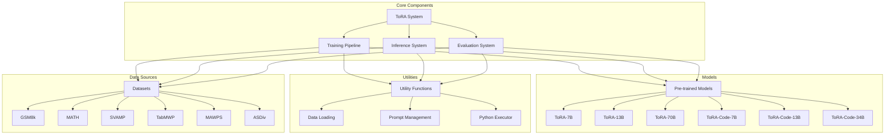
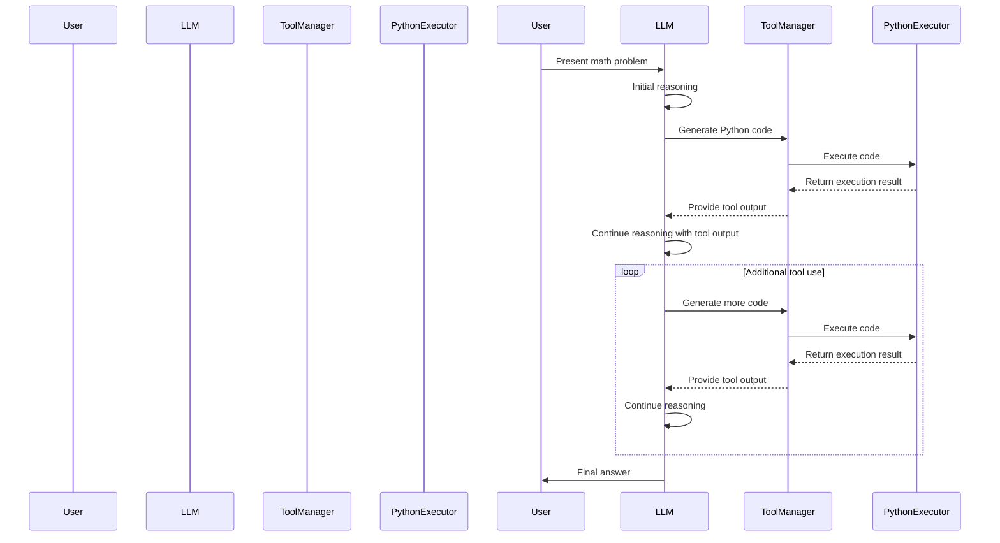
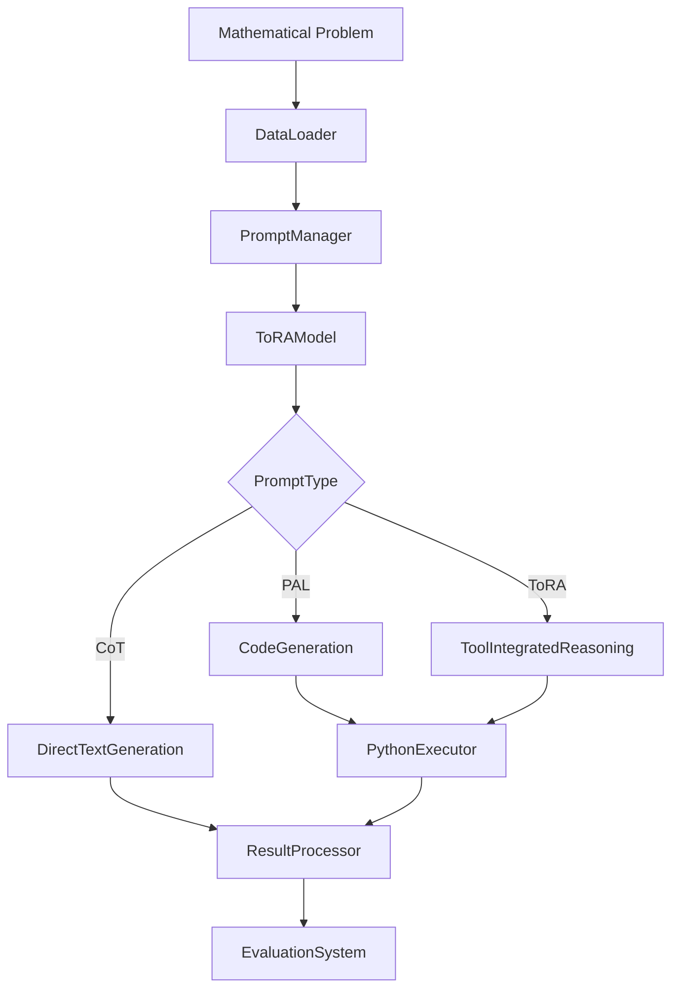
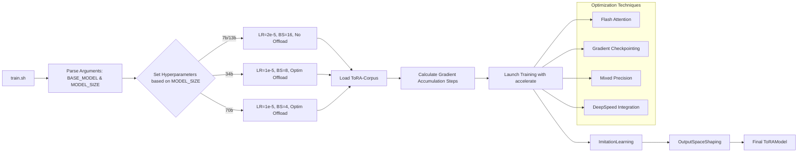

<!-- source: DeepWiki mcp.deepwiki.com · repo microsoft/ToRA · page 1 Overview · fetched 2026-10-26 -->

# Overview

<details>
<summary>Relevant source files</summary>

The following files were used as context for generating this wiki page:

- [README.md](README.md)
- [docs/index.html](docs/index.html)
- [src/requirements.txt](src/requirements.txt)
- [src/train/llama2_flash_attn_monkey_patch.py](src/train/llama2_flash_attn_monkey_patch.py)

</details>


ToRA is a Tool-integrated Reasoning Agent designed to solve challenging mathematical reasoning problems by seamlessly integrating natural language reasoning with programmatic tool usage. This repository provides the complete implementation for training, inferencing, and evaluating ToRA models, which achieve state-of-the-art performance on mathematical reasoning benchmarks.

This document introduces the purpose, architecture, and key components of the ToRA system. For detailed instructions on getting started, see [Installation and Requirements](#1.1) and [Quick Start Guide](#1.2).

## System Architecture

The ToRA system consists of three primary components that work together to train models, generate solutions, and evaluate performance:



Sources: [README.md:49-67]()

The system architecture is implemented across multiple directories and files:
- Training Pipeline: `src/train/` directory with training scripts and model implementation
- Inference System: `src/inference.py` and `src/inference_api.py` for model inference
- Evaluation System: `src/eval/evaluate.py` and `src/eval/grader.py` for assessing model outputs
- Utilities: `src/utils/` directory containing shared utility functions

## Tool-Integrated Reasoning

The key innovation of ToRA is the tool-integrated reasoning approach, which interleaves natural language reasoning with program-based tool use:



Sources: [README.md:72-78](), [docs/index.html:256-262]()

This process enables ToRA to:
1. Parse and understand problems using natural language reasoning
2. Generate Python code for precise calculations
3. Execute the code in a controlled environment
4. Incorporate the execution results into continued reasoning
5. Produce accurate final solutions

An example of this tool-integrated reasoning is shown in the README, where the model solves a problem by alternating between natural language reasoning and Python code execution.

## Inference System Architecture

The inference system bridges natural language problems to executable code through a multi-stage pipeline:



Sources: [README.md:105-111]()

The inference system components include:
- `DataLoader`: Loads and preprocesses mathematical problems
- `PromptManager`: Constructs appropriate prompts based on the selected method
- `ToRAModel`: The pre-trained language model
- `PythonExecutor`: Executes generated Python code in a safe environment
- `ResultProcessor`: Processes model outputs and execution results
- `EvaluationSystem`: Assesses the accuracy of solutions

## Training Pipeline

The training pipeline configures and optimizes models based on their size:



Sources: [README.md:79-86](), [src/train/llama2_flash_attn_monkey_patch.py:135-144]()

The training pipeline uses several optimization techniques, including flash attention, which is implemented in `train/llama2_flash_attn_monkey_patch.py`:

```python
def replace_llama_attn_with_flash_attn():
    cuda_major, cuda_minor = torch.cuda.get_device_capability()
    if cuda_major < 8:
        warnings.warn(
            "Flash attention is only supported on A100 or H100 GPU during training due to head dim > 64 backward."
        )

    LlamaModel._prepare_decoder_attention_mask = _prepare_decoder_attention_mask
    LlamaAttention.forward = forward
```

Training consists of two main phases:
1. **Imitation Learning**: Fine-tuning on tool-integrated reasoning trajectories in the ToRA-Corpus
2. **Output Space Shaping**: Enhancing model performance through self-sampling and trajectory correction

## Model Family and Performance

ToRA is available in several variations, all accessible via Hugging Face:

| Model | Base Model | Size | GSM8k | MATH | AVG@10 tasks |
|-------|------------|------|-------|------|-------------|
| ToRA-7B | LLaMA-2 | 7B | 68.8% | 40.1% | 62.4% |
| ToRA-13B | LLaMA-2 | 13B | 72.7% | 43.0% | 65.9% |
| ToRA-70B | LLaMA-2 | 70B | 84.3% | 49.7% | 76.9% |
| ToRA-Code-7B | CodeLLaMA | 7B | 72.6% | 44.6% | 66.5% |
| ToRA-Code-13B | CodeLLaMA | 13B | 75.8% | 48.1% | 71.3% |
| ToRA-Code-34B | CodeLLaMA | 34B | 80.7% | 51.0% | 74.8% |

Sources: [README.md:53-67]()

Notably, ToRA-Code-34B is the first open-source model to achieve over 50% accuracy on the competition-level MATH dataset, significantly outperforming GPT-4's Chain-of-Thought performance (51.0% vs. 42.5%).

## Installation Requirements

ToRA requires the following key dependencies:

```
transformers==4.31.0
deepspeed==0.11.0
accelerate==0.21.0
flash_attn==2.3.6
vllm==0.1.4
sympy==1.12
```

Sources: [src/requirements.txt:1-35]()

For complete installation instructions, see [Installation and Requirements](#1.1).

## Getting Started

To run inference with a pre-trained ToRA model:

```bash
# Clone the repository
git clone https://github.com/microsoft/ToRA.git && cd ToRA/src

# Set up environment
conda create -n tora python=3.10
conda activate tora
pip install -r requirements.txt

# Run inference
bash scripts/infer.sh
```

Sources: [README.md:88-109]()

The inference script loads a pre-trained model, processes input data, and generates solutions using the tool-integrated reasoning approach.

## Evaluation System

The evaluation system assesses model performance on benchmark datasets:


Sources: [README.md:113-135]()

To evaluate predictions:

```bash
python -m eval.evaluate \
    --data_name "math" \
    --prompt_type "tora" \
    --file_path "outputs/llm-agents/tora-code-34b-v1.0/math/test_tora_-1_seed0_t0.0_s0_e5000.jsonl" \
    --execute
```

This evaluates model performance on the MATH dataset, using the grading system in `eval/grader.py` that has been carefully designed to assess mathematical answers accurately.

## Related Components

For more detailed information on specific components of the ToRA system, refer to:
- [Training Pipeline](#2.1): Details on model training and optimization
- [Inference System](#2.2): Information on generating solutions
- [Evaluation System](#2.3): Explanation of performance metrics and evaluation
- [Tool-Integrated Reasoning](#2.4): Deep dive into the core reasoning methodology

---

