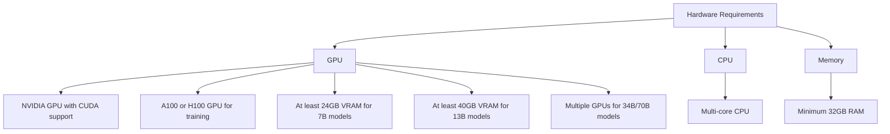
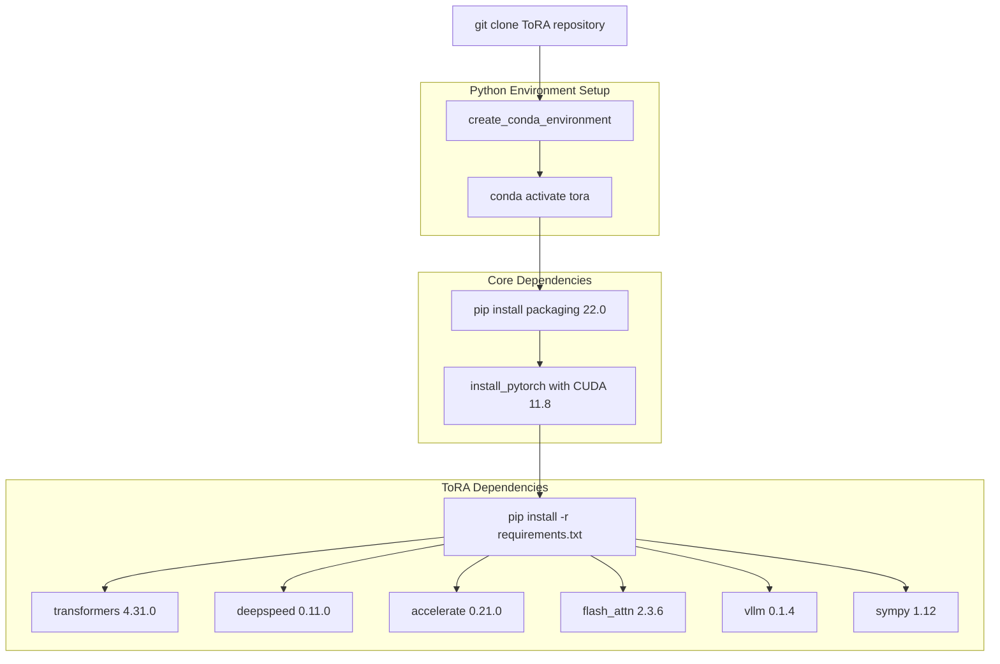
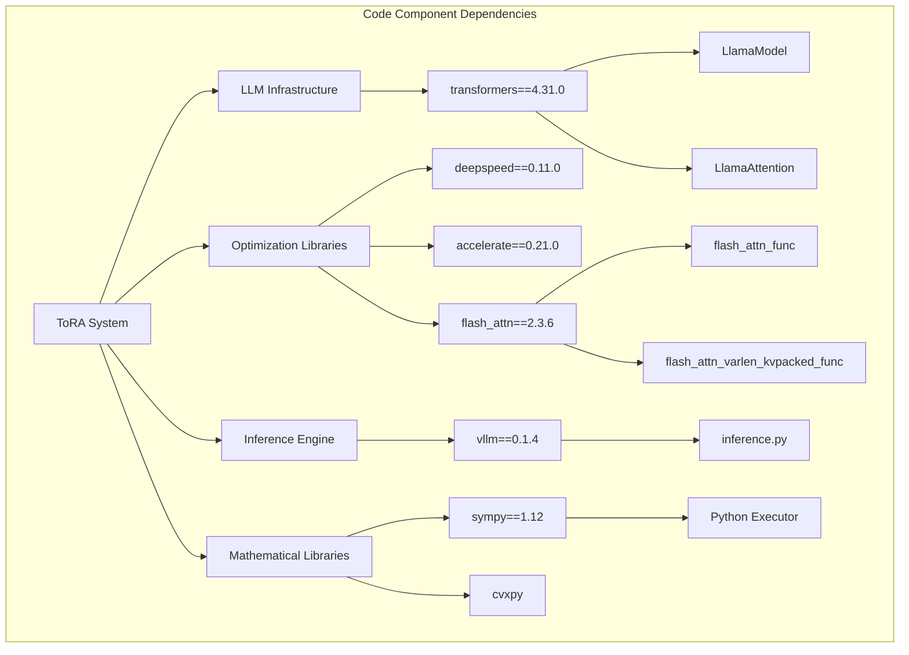
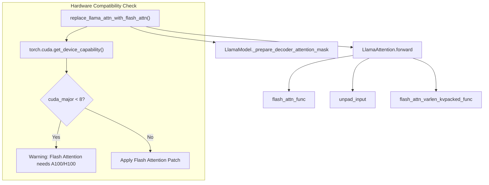

<!-- source: DeepWiki mcp.deepwiki.com · repo microsoft/ToRA · page 1.1 Installation and Requirements · fetched 2026-10-26 -->

# Installation and Requirements

<details>
<summary>Relevant source files</summary>

The following files were used as context for generating this wiki page:

- [README.md](README.md)
- [src/requirements.txt](src/requirements.txt)
- [src/train/llama2_flash_attn_monkey_patch.py](src/train/llama2_flash_attn_monkey_patch.py)

</details>


This page provides detailed instructions for installing ToRA (Tool-Integrated Reasoning Agent) and setting up the required dependencies. For information on using ToRA after installation, see the [Quick Start Guide](#1.2).

## Hardware Requirements

ToRA models require significant GPU resources, especially for the larger model variants. The hardware requirements vary depending on the model size you intend to use:

| Model Size | Minimum VRAM | Recommended Setup |
|------------|--------------|-------------------|
| 7B         | 24GB         | Single A10/3090/4090 GPU |
| 13B        | 40GB         | Single A100 (40GB) or multiple GPUs |
| 34B        | 80GB         | Multiple A100 GPUs |
| 70B        | 140GB        | Multiple A100 GPUs |

**Important Note**: Flash Attention, which is used for optimizing the models during training, is only fully supported on A100 or H100 GPUs due to head dimension compatibility issues with backward passes.

### Hardware Components Diagram



Sources: [README.md:90-101](), [train/llama2_flash_attn_monkey_patch.py:136-141]()

## Software Requirements

ToRA has the following software requirements:

- **Operating System**: Linux (recommended)
- **Python Version**: 3.10
- **CUDA Toolkit**: 11.8 (compatible with PyTorch 2.0.1)
- **Environment Management**: Conda (recommended)

## Installation Process

### Installation Workflow



Sources: [README.md:90-101]()

### Step-by-Step Installation

1. **Clone the Repository**:
   ```bash
   git clone https://github.com/microsoft/ToRA.git && cd ToRA/src
   ```

2. **Create and Activate Conda Environment**:
   ```bash
   conda create -n tora python=3.10
   conda activate tora
   ```

3. **Install Prerequisites and PyTorch**:
   ```bash
   pip install packaging==22.0
   pip install torch==2.0.1 --index-url https://download.pytorch.org/whl/cu118
   ```
   Note: This installs PyTorch with CUDA 11.8 support. Adjust for your specific CUDA version if needed.

4. **Install Dependencies**:
   ```bash
   pip install -r requirements.txt
   ```

Sources: [README.md:90-101]()

## Key Dependencies

ToRA relies on several core libraries and packages that enable its functionality. The complete list is specified in the requirements.txt file, but here are the most critical dependencies:



Sources: [src/requirements.txt:1-35](), [train/llama2_flash_attn_monkey_patch.py:10-13]()

### Critical Dependencies

| Dependency | Version | Purpose |
|------------|---------|---------|
| transformers | 4.31.0 | Provides model architecture and tokenization |
| deepspeed | 0.11.0 | Enables efficient distributed training |
| accelerate | 0.21.0 | Facilitates multi-GPU training |
| flash_attn | 2.3.6 | Optimizes attention computation |
| vllm | 0.1.4 | Powers efficient inference (note: must be ≤ 0.1.4) |
| sympy | 1.12 | Symbolic mathematics for code execution |
| antlr4-python3-runtime | 4.11 | Required for sympy compatibility |

Sources: [src/requirements.txt:1-35]()

## Flash Attention Integration

ToRA optimizes performance through Flash Attention, which is integrated via a monkey-patching mechanism for LLaMA models:



Sources: [train/llama2_flash_attn_monkey_patch.py:21-145]()

## Verification

After installation, you can verify that ToRA is properly installed by running:

```bash
bash scripts/infer.sh
```

Make sure to configure the `MODEL_NAME_OR_PATH` and `DATA` variables in the script before running it.

Sources: [README.md:102-109]()

## Common Issues and Troubleshooting

### CUDA Out of Memory Errors
- Reduce batch size in your configuration
- Enable gradient checkpointing
- Use model parallelism for larger models

### Flash Attention Issues
- Ensure you have a compatible GPU (A100/H100 recommended for optimal performance)
- Verify you're using flash_attn version 2.3.6

### vLLM Version Compatibility
- Make sure to use vLLM version 0.1.4 as specified in requirements.txt
- Later versions may have unresolved compatibility issues with ToRA

### Dependency Conflicts
- Use a fresh conda environment to avoid conflicts
- Follow the exact version specifications in requirements.txt

Sources: [src/requirements.txt:28](), [train/llama2_flash_attn_monkey_patch.py:136-141]()

---

