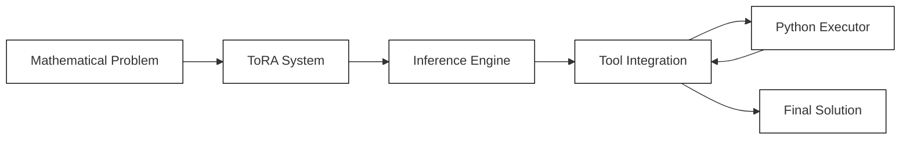
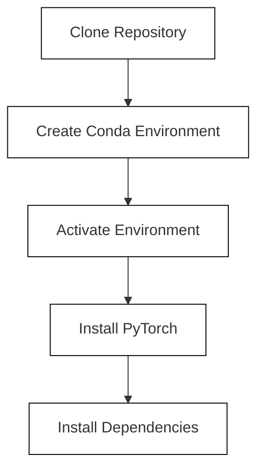
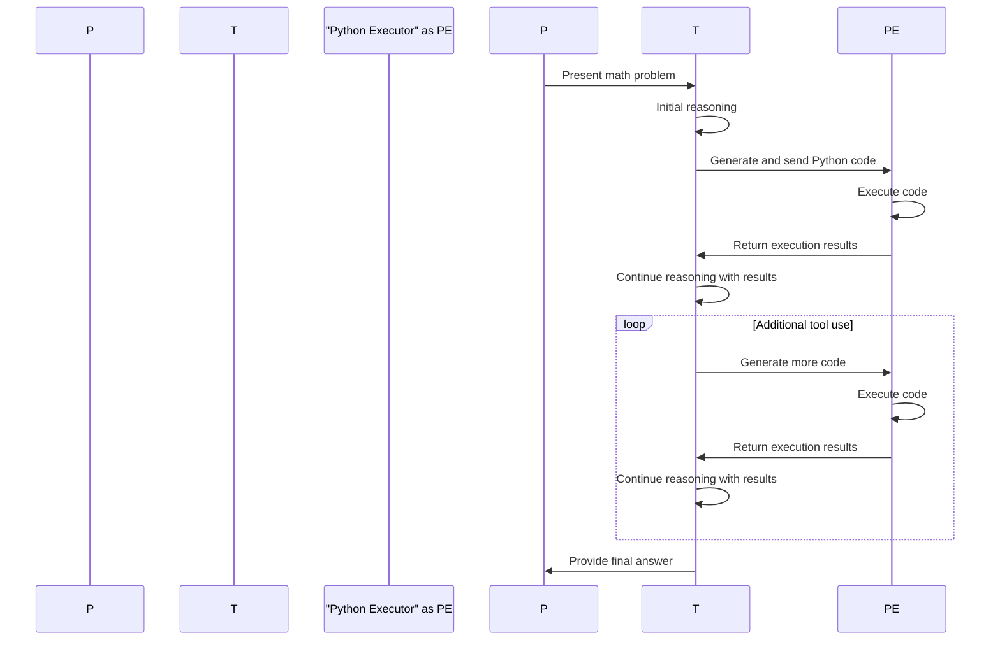
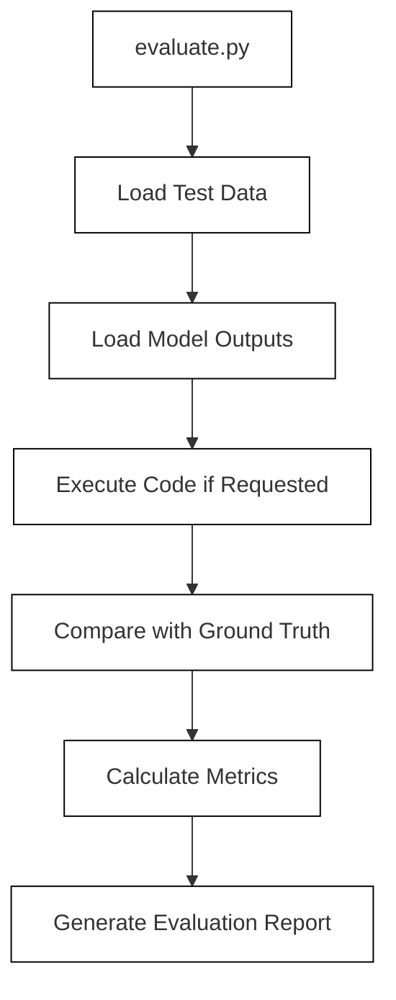
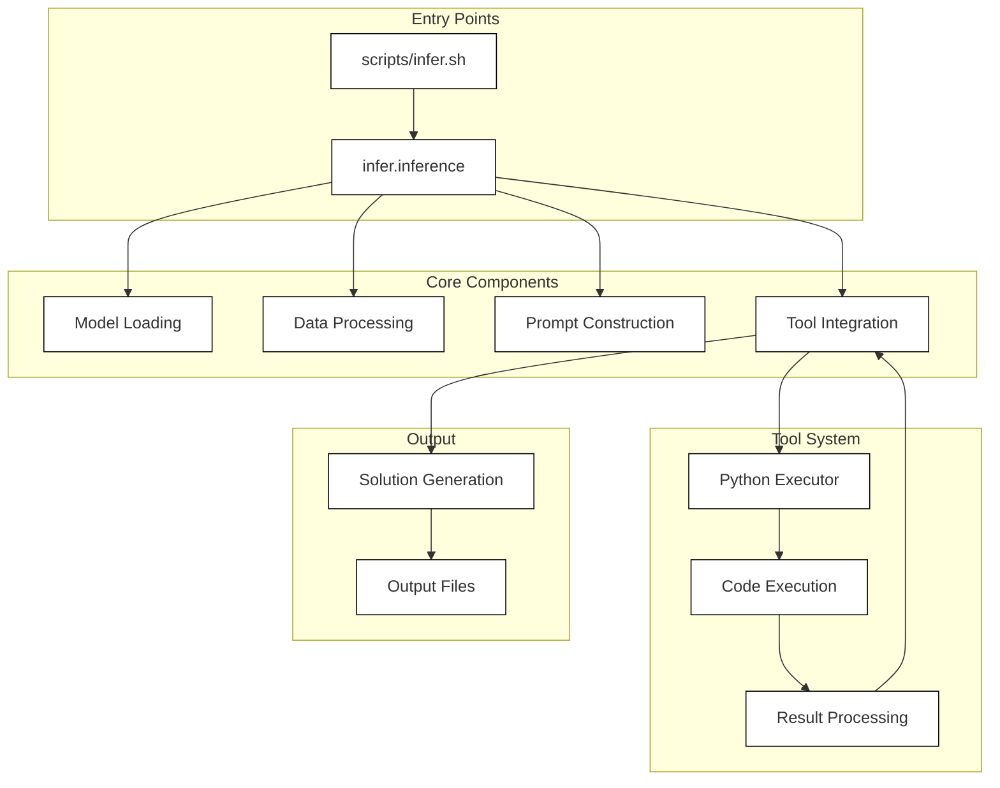

<!-- source: DeepWiki mcp.deepwiki.com · repo microsoft/ToRA · page 1.2 Quick Start Guide · fetched 2026-10-26 -->

# Quick Start Guide

<details>
<summary>Relevant source files</summary>

The following files were used as context for generating this wiki page:

- [README.md](README.md)
- [src/requirements.txt](src/requirements.txt)
- [src/scripts/infer.sh](src/scripts/infer.sh)
- [src/train/llama2_flash_attn_monkey_patch.py](src/train/llama2_flash_attn_monkey_patch.py)

</details>


This guide provides a straightforward introduction to using ToRA (Tool-integrated Reasoning Agent) for mathematical problem solving. You'll learn how to set up the environment, run inference using pre-trained models, and evaluate results. For detailed information about the training process, see [Training Pipeline](#2.1), and for more on the evaluation system, see [Evaluation System](#2.3).

## System Overview

ToRA is a series of Tool-integrated Reasoning Agents designed to solve challenging mathematical reasoning problems by interacting with tools such as computation libraries and symbolic solvers. The system seamlessly integrates natural language reasoning with external tools, combining analytical language capabilities with computational efficiency.



Sources: [README.md:50-51]()

## Available Models

ToRA offers several pre-trained models with varying parameter sizes and capabilities:

| Model | Size | GSM8k | MATH | Link |
|-------|------|-------|------|------|
| ToRA-7B | 7B | 68.8 | 40.1 | [HuggingFace](https://huggingface.co/llm-agents/tora-7b-v1.0) |
| ToRA-Code-7B | 7B | 72.6 | 44.6 | [HuggingFace](https://huggingface.co/llm-agents/tora-code-7b-v1.0) |
| ToRA-13B | 13B | 72.7 | 43.0 | [HuggingFace](https://huggingface.co/llm-agents/tora-13b-v1.0) |
| ToRA-Code-13B | 13B | 75.8 | 48.1 | [HuggingFace](https://huggingface.co/llm-agents/tora-code-13b-v1.0) |
| ToRA-Code-34B | 34B | 80.7 | 51.0 | [HuggingFace](https://huggingface.co/llm-agents/tora-code-34b-v1.0) |
| ToRA-70B | 70B | 84.3 | 49.7 | [HuggingFace](https://huggingface.co/llm-agents/tora-70b-v1.0) |

Sources: [README.md:53-66]()

## Environment Setup

Follow these steps to set up your environment for ToRA:



1. Clone the repository and navigate to the source directory:
   ```bash
   git clone https://github.com/microsoft/ToRA.git && cd ToRA/src
   ```

2. Create and activate a conda environment:
   ```bash
   conda create -n tora python=3.10
   conda activate tora
   ```

3. Install PyTorch and other dependencies:
   ```bash
   pip install packaging==22.0
   pip install torch==2.0.1 --index-url https://download.pytorch.org/whl/cu118 # For CUDA 11.8
   pip install -r requirements.txt
   ```

Sources: [README.md:92-101](), [src/requirements.txt:1-35]()

## Running Inference

The inference system in ToRA allows you to use pre-trained models to solve mathematical problems.


### Configuration Parameters

Edit the `src/scripts/infer.sh` script to configure your inference run:

| Parameter | Description | Example Value |
|-----------|-------------|---------------|
| MODEL_NAME_OR_PATH | Path or name of the pre-trained model | "llm-agents/tora-code-34b-v1.0" |
| DATA_NAME | Dataset to use for inference | "math" or "gsm8k" |
| SPLIT | Data split to use | "test" |
| PROMPT_TYPE | Type of prompt to use | "tora" |
| NUM_TEST_SAMPLE | Number of samples to test (-1 for all) | -1 |

### Running the Inference Script

To run inference, execute:

```bash
bash scripts/infer.sh
```

This will:
1. Load the specified model
2. Process the selected dataset
3. Generate solutions to the mathematical problems
4. Save the results to output files

Sources: [src/scripts/infer.sh:1-30](), [README.md:103-111]()

## Tool-Integrated Reasoning Process

One of ToRA's key features is its ability to combine natural language reasoning with tool usage. Here's how this process works:



The diagram above shows how ToRA solves problems by alternating between reasoning in natural language and using Python code as a tool for computation. This allows the model to handle complex mathematical problems effectively by leveraging both symbolic reasoning and computational capabilities.

Sources: [README.md:71-77]()

## Evaluating Results

After running inference, you can evaluate the model's performance using the evaluation system.



### Running Evaluation

To evaluate your model's outputs, run:

```bash
python -m eval.evaluate \
    --data_name "math" \
    --prompt_type "tora" \
    --file_path "outputs/llm-agents/tora-code-34b-v1.0/math/test_tora_-1_seed0_t0.0_s0_e5000.jsonl" \
    --execute
```

### Understanding Evaluation Results

The evaluation script will output:
- Overall accuracy score
- Type-specific scores (by mathematical domain)
- Information about timeout or empty samples

Sample output:
```
Num samples: 5000
Num scores: 5000
Timeout samples: 0
Empty samples: 2
Mean score: [51.0]
Type scores: {'Algebra': 67.3, 'Counting & Probability': 42.2, 'Geometry': 26.1, 'Intermediate Algebra': 40.0, 'Number Theory': 59.3, 'Prealgebra': 63.8, 'Precalculus': 34.2}
```

Sources: [README.md:113-136]()

## Code Components Overview

The following diagram illustrates the key code components involved in the ToRA inference system:



Sources: [README.md:87-136](), [src/scripts/infer.sh:1-30]()

## Next Steps

After getting started with ToRA, you may want to explore:

1. Using different models for comparison
2. Trying various mathematical datasets
3. Testing different prompt configurations
4. Analyzing the generated code and solutions

For more detailed information about specific components of the ToRA system, refer to the following pages:
- [Training Pipeline](#2.1) - For details on how to train your own ToRA models
- [Inference System](#2.2) - For deeper information about the inference system
- [Evaluation System](#2.3) - For comprehensive details on evaluation metrics and methodologies
- [Tool-Integrated Reasoning](#2.4) - For an in-depth explanation of ToRA's tool integration approach

---

